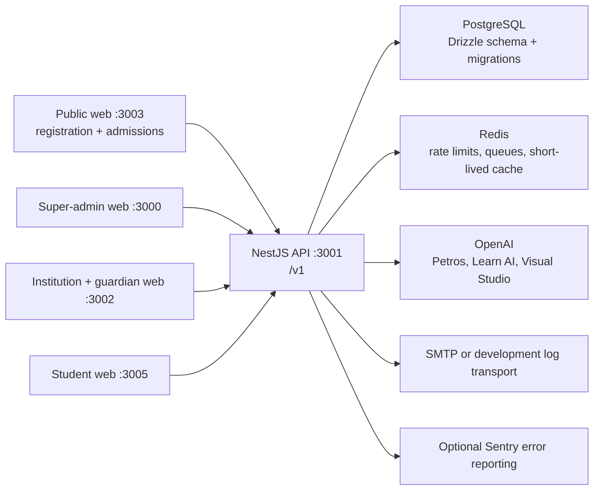
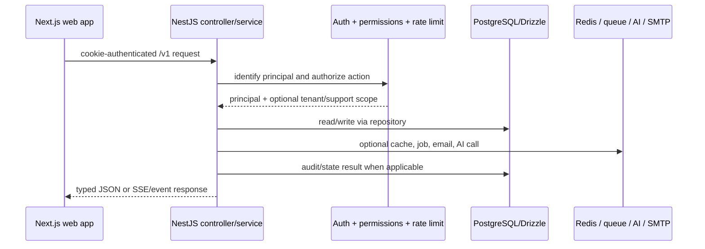

# Edrion codebase audit

**Audit date:** 18 July 2026  
**Scope:** current working tree at `/Users/macbook/Documents/Edrion Labs`  
**Method:** source-code, manifests, migrations, tests, scripts, and configuration were inspected. Existing prose documentation was not treated as evidence for the findings below. No live production environment, database, or deployment account was available.

## Executive summary

Edrion is a large, modular education-platform monorepo. It combines four web experiences—platform administration, institution operations, student learning, and public registration/admissions—with a single NestJS API, a shared PostgreSQL database, Redis-backed operational services, and a substantial AI feature set. It is best described as a **modular monolith**: one deployable API and one database, divided internally into clearly named feature modules rather than independently deployable microservices.

The strongest foundations are shared TypeScript contracts, a broad relational data model, layered access controls, audit logging, feature flags, and a meaningful unit-test suite. The product scope is already unusually broad: institutional administration, academics, people, admissions, finance, student learning, guardian workflows, support access, documents, reporting, and AI-assisted tools.

The principal planning constraint is delivery maturity, not lack of feature ambition. The current tree contains widespread uncommitted changes, the institution web app currently fails type-checking, there is no checked-in CI/CD or container/deployment definition, and some customer-visible capabilities intentionally use stubs or local-disk storage. The code has good seams for future growth, but new work should be gated behind a stabilization pass and a deployment/operability decision.

## Audit limits and confidence

Findings labelled **verified** come directly from code. Findings labelled **verify with the team** need deployment, product, or operational context that source code cannot establish.

- The repository includes 5 web-app directories, but `apps/parent-web` is deleted in the current working tree; the guardian experience has been moved into `apps/institution-web/src/app/(guardian)`.
- There are 108 API controller files and 896 route decorators under the `/v1` API prefix (326 GET, 366 POST, 99 PATCH, 16 PUT, 89 DELETE). This is a source inventory, not a promise that every route is production-ready.
- The database source defines 238 tables across 63 schema files, with 85 SQL migrations present and a final row-level-security migration.
- The tree has significant local work in progress: many modified files, deletions, and untracked source files. This audit describes that current state, not solely the last commit.

## 1. Architecture and infrastructure

### Technology stack (verified)

| Area | Technology | Evidence / role |
| --- | --- | --- |
| Language/runtime | TypeScript 5.6; Node.js 20+; pnpm 11.1.2 | Root `package.json`, `.nvmrc` |
| Repository build | pnpm workspaces and Turborepo 2.x | `pnpm-workspace.yaml`, `turbo.json` |
| API | NestJS 10, Express, Swagger/OpenAPI | `apps/api` |
| Web | Next.js 14.2 App Router, React 18.3, Tailwind CSS 3.4 | all active web apps |
| Client state | TanStack React Query 5; React Hook Form + Zod where forms need it | web app manifests and hooks |
| Data access | PostgreSQL 15+ via Drizzle ORM 0.36 and `postgres` | `packages/database` |
| Cache/jobs | Redis via ioredis; BullMQ workers | `apps/api/src/common/redis`, `queue` |
| Authentication | HTTP-only signed sessions; optional Supabase JWT verification | authentication and portal modules |
| AI | OpenAI Responses API; configured GPT models and embeddings | Petros, Learn AI, Visual Studio |
| Documents/attachments | Handlebars, Mammoth, PDF.js, Playwright Core, Nodemailer | API manifest and document modules |
| Observability | structured logging abstraction; optional Sentry error reporting | `packages/observability` |

### System shape (verified)



The API is the sole intended database writer. Its internal design uses feature modules, typically split into controller (HTTP), service (business rules), repository (queries), Zod schema (input contract), and Drizzle table definitions. Shared packages prevent each frontend from inventing its own data shapes.

This is not a microservice system: API modules share process memory, a deployment lifecycle, a database connection pool, and package dependencies. This is a sensible early-to-mid-stage trade-off—simpler transactions and development, but a large blast radius for releases and scaling.

### Applications and intended audiences (verified)

| Application | Port | Audience and purpose |
| --- | ---: | --- |
| `super-admin-web` | 3000 | Internal control plane: institutions, employees, plans, subscriptions, support, governance, audit, integrations |
| `api` | 3001 | Shared backend API and Swagger docs at `/docs` |
| `institution-web` | 3002 | School staff and administration; also currently houses guardian/parent routes |
| `public-web` | 3003 | Institution registration funnel and student admission application funnel |
| `student-web` | 3005 | Student portal: classes, work, learning, library, labs, progress |

### Environment and deployment (verified / gap)

Environment parsing is centralized in `packages/config` with Zod validation. The template separates browser-safe `NEXT_PUBLIC_*` values from API secrets and documents PostgreSQL, Redis, Supabase, SMTP, Sentry, OpenAI, billing, and upload settings. This is a good configuration boundary.

No Dockerfile, Compose file, Kubernetes/Helm files, Terraform, Vercel configuration, GitHub Actions, GitLab CI, CircleCI configuration, or other checked-in deployment pipeline was found. Therefore hosting topology, secret storage, database backup/restore, migration rollout process, horizontal scaling policy, and release approvals are **verify-with-the-team items**.

`turbo.json` coordinates local build, lint, type-check, test and e2e task names, but task naming alone is not a deployment pipeline. The only live lifecycle check found is `scripts/e2e-lifecycle.sh`; it expects a manually running API, seeded PostgreSQL database, development header authentication, `curl`, and `psql`, and it mutates data.

## 2. Database design and tenancy

### Data model (verified)

The data store is a PostgreSQL relational model with UUID primary keys, timestamps, typed enums, foreign-key references, optimistic-locking `version` fields on key mutable records, JSONB only where flexible data is useful, and schema-level indexes. The source contains roughly 613 explicit foreign-key references, 495 named indexes, and 13 direct unique declarations. The exact deployed database must still be confirmed by comparing migration history with the production database.

The central relationship is:

```text
Institution
  ├─ Campuses, subscriptions, institution users, roles/settings, audit/support access
  ├─ Academic years/terms → departments/grades → subjects/classes → staff assignments
  ├─ Students ↔ parents/guardians; student enrollments
  ├─ Admissions, attendance, timetable, examinations, gradebook, assignments/homework
  ├─ Finance, payroll, expenses, library, transport, inventory, hostel
  ├─ Messaging, announcements, reports, documents, security/facilities/health/counseling
  └─ Student/guardian-specific learning, notification, payment, and safety records
```

Schema domains and their main tables are as follows. This is a compact complete inventory by bounded context; table names remain the source of truth.

| Domain | Tables / responsibility |
| --- | --- |
| Platform identity and commercial | `platform_employees`, platform roles/permissions/assignments/overrides, `auth_sessions`, `institutions`, `campuses`, plans/versions, subscriptions/addons, invoices/payments/refunds/credits/discounts/usage, idempotency keys |
| Institution access and operations | institution users/roles/campus access/dashboard preferences, portal sessions/invitations, settings, feature definitions/assignments/rollouts, support cases/messages/access sessions, audit/security/activity events, jobs, integrations/webhooks |
| Academic structure and people | academic years/terms, departments, grade levels, programme slots/subjects, classes/teachers, students/staff/parents/guardians, student enrollments and staff assignments |
| Teaching and assessment | assignments/submissions/questions/attempts/answers, homework equivalents, exams/schedules/papers/assignees/attempts/answers, grade entries, report cards/entries, attendance sessions/records, timetable slots, bell schedules/periods, calendar types/events |
| Administration services | fees and invoices/payments, payroll, expenses, library books/loans, transport routes/vehicles/assignments, inventory/movements, hostel rooms/allocations, facilities/work orders/assets, front-desk visitors/appointments, IT devices/access requests, labs, security/access logs |
| Communications and guardian life-cycle | announcements/notifications/targets, conversations/messages/attachments, recipient groups, notices/receipts, consent/PTM/absence records, notification preferences/digests, health/recognition/counseling disclosures, pickup/leave/gate/transport/outing, parent payment intents, documents and profile-change requests |
| Student learning and AI | student sessions/preferences/storage/content, learning ledger and paths/sessions/attempts/revision/evidence, personal library collections/items/pages/artifacts/decks/cards/reviews, mock exams/question bank/debates/badges, Visual Studio canvases/revisions, Petros conversations/messages/artifacts, AI policy/run/tool/confirmation/approval records |
| Registration and admission | institution registration requests/OTPs/reviews/attachments/onboarding tasks; admission applications/drafts/OTPs/information requests |

### Tenant isolation and data access (verified)

Institution-facing requests run in a transaction that sets PostgreSQL session variables such as `app.institution_id`, and `AsyncLocalStorage` routes injected Drizzle access to that transaction. The final SQL migration enables row-level security (RLS) for a long list of tenant tables; student-private Visual Studio and exam data use additional student/independent-user policies. This is good defense in depth: the service layer still decides permissions, while RLS reduces the chance that a wrongly scoped query returns another institution’s data.

Example (abridged from `packages/database/src/client.ts`):

```ts
return db.transaction(async (tx) => {
  await tx.execute(sql`select set_config('app.institution_id', ${institutionId}, true)`);
  return tenantStore.run({ db: tx as Database }, fn);
});
```

Important constraint: the RLS design intentionally allows all rows when the tenant variable is unset for platform-wide work. Its real protection therefore depends on the application using a non-superuser, non-`BYPASSRLS` `edrion_app` role and correctly entering tenant transactions. **Verify with the team** that production uses that role, the `zzz_rls.sql` migration has run, all newer tenant tables are included, and no background job bypasses its intended scope.

### Database performance observations

The schema deliberately indexes common tenant, status, relationship, and date/filter columns. Repositories also generally offer page/filter-oriented endpoints. This is a sound baseline.

Planning risks:

- The number of tables and joins makes query-plan review necessary for dashboards, search, exports, audit trails, guardian summaries, and reports. No `EXPLAIN ANALYZE` evidence or production slow-query telemetry is in the tree.
- JSONB bags exist for flexible fields such as institution addresses, contacts, risk flags, and usage stats. Promote fields to indexed columns before filtering/reporting on them at scale.
- RLS, large lists, and multi-domain dashboards add joins and predicates. Establish performance budgets and representative tenant-size load tests before adding more aggregate screens.
- The pool default is ten PostgreSQL connections per API process. This is reasonable locally, but total connections need coordination if API/worker replicas scale.

## 3. Features, workflows, and business logic

### Platform administration (verified)

The super-admin surface and matching API modules provide:

- Institution and campus lifecycle: create, edit, activate, restrict, suspend, archive, and extend trial.
- Employee and institution-user administration, roles, campus access, permission overrides, invitations, forced reset, MFA requirement, session revocation, and account status changes.
- Commercial control: plan drafts/versions/publishing, subscriptions, addons, plan/cycle changes, price overrides, discounts, credits, overage and grace/pause/cancel workflows.
- Feature definitions, per-scope assignments/rollouts, and kill switches.
- Support cases and time-bounded support-access sessions, with portal-entry and audit correlation.
- Platform audit/activity browsing and CSV-style export, analytics dashboard, pending actions, system health, integration/webhook administration, AI governance and internal Copilot run approval.
- Institution-registration request triage and approval. Approval creates an institution and onboarding tasks.

### Institution operations portal (verified)

The staff portal has routes and services for onboarding/dashboard, academics/programme structure, classes and courses, people directory, staff/student/parent records, admissions and applicant conversion, attendance, timetable/bell schedules/calendar, assignments/homework, exams/gradebook/report cards, fees/expenses/payroll, library, transport, inventory, hostel, conduct, health/counseling, labs, facilities, front desk, IT, security, announcements/notifications, messages, documents, reporting, settings, roles/users, audit, billing, and Petros AI assistance.

This is genuine breadth, not merely a navigation shell: controllers map to services and repositories, and schema tables exist for these modules. Maturity varies by feature. In particular, the current work tree is actively extending programme structures, academic scope, bell schedules, unified calendars, guardian access, assignments, and exam authoring.

### Student experience (verified)

The student web/API implements login/activation/reset, profile/preferences, home and analytics, institutional classes/courses/materials, assignments/quizzes/homework, student examinations and report cards, calendar/planner, fees/transport/hostel, learning sessions/question answering/quick answers/learning paths/revision/streaks/history/notes, a document library, flashcards and artifacts, mock-exam and debate labs, achievement badges, and Visual Studio diagram/canvas creation with AI-assisted operations.

Several AI-heavy flows use server-sent events or job/event polling so the browser can display incremental results rather than wait for a single long response. The student app stores some client-side preferences/state with Zustand and IndexedDB.

### Guardian and public journeys (verified)

- Public web supports an institution-registration multi-step funnel and public admission applications, including drafts, OTP verification, submission, status, information requests, and file intake.
- Guardian routes are embedded in the institution web app and connect to the `parent` API. They cover a family dashboard, children, attendance, results, health, behavior, fees, documents, pickup/early leave, transport/hostel/library, notices/consents/PTM/absence notes, inbox, settings, and profile/document requests.
- Parent/staff API endpoints manage absence approval, pickup verification, early-leave decisions, medical incidents, notices, recognitions, documents, and emergency broadcasts.

### Business-rule patterns (verified)

The codebase uses several recurring implementation patterns:

| Rule type | Implementation |
| --- | --- |
| Access | Global platform guard, portal/student guards, permission catalogue, role evaluation, route metadata, and RLS tenant boundary |
| Sensitive actions | Optional recent-auth window; set `RECENT_AUTH_ENABLED=true` to enforce it |
| Concurrent edits | `version` fields and versioned mutation schemas on many mutable resources |
| Financial retry safety | durable idempotency table plus short-lived Redis replay cache |
| AI safeguards | policy/action rules, kill switch, run/confirmation/approval records, rate limits and quota controls |
| Auditability | append-only audit events, request correlation IDs, support-session attribution |
| Input safety | Zod schemas and a custom body validation pipe for many controllers |
| State transitions | lifecycle/action endpoints rather than unrestricted record updates for institutions, subscriptions, accounts, plans, and support sessions |

### Known non-final behaviors (verified)

The audit found intentionally incomplete/placeholder implementations that matter for roadmap conversations:

- The generic internal Copilot planner records `stub-planner`; it is a deterministic stub, not a live LLM planner.
- SMS and WhatsApp parent notification channels are typed/logging stubs; no Twilio/MSG91/WhatsApp provider implementation is present.
- Student learning budgets contain a v1 stub pending Redis counters.
- Some library summarization, flashcard and quiz fallbacks produce deterministic placeholder content when AI is unavailable; exam generation has last-resort placeholder questions.
- Attachment and student storage default to local process disk. The configuration explicitly says to replace it with object storage; this is unsuitable for multi-instance deployment without shared persistent storage.
- Billing provider secrets are configured, but no Stripe/Razorpay provider SDK implementation was found. Parent payment schemas support mock/manual/webhook-shaped flows.
- A dark theme token object exists, but the code treats it as a future-ready placeholder rather than a fully shipped theme switch.

These are not necessarily defects; they are product decisions that must be explicit before the associated features are marketed or scaled.

## 4. API and data flow

### API conventions (verified)

All API routes are prefixed with `/v1`; interactive Swagger documentation is generated at `/docs`. HTTP uses JSON by default and a standard error envelope:

```json
{
  "statusCode": 403,
  "code": "FORBIDDEN",
  "message": "Missing required permission(s): …",
  "correlationId": "…"
}
```

Browsers use cookie credentials. Platform calls use the shared `ApiClient`; institution/student calls use app-specific clients that pass the active scope. Most list endpoints accept pagination/filter query parameters and return typed DTOs. Mutations are normally POST/PATCH/PUT action endpoints, with Zod validation on many bodies. The API client maps failure responses into a typed `ApiClientError` so UI code can present consistent messages.

API groups are too numerous to list 896 individual paths usefully here; the source is the authoritative full inventory. The practical route map is:

| Route family | Main purpose |
| --- | --- |
| `/auth`, `/health`, `/system` | platform session, password/re-auth, health checks |
| `/institutions`, `/campuses`, `/employees`, `/institution-users`, `/plans`, `/subscriptions`, `/billing`, `/features` | platform control plane |
| `/audit`, `/analytics`, `/support-*`, `/integrations`, `/observability`, `/ai-governance`, `/copilot` | internal governance and operations |
| `/registration*`, `/admissions/apply` | public institution and student application funnels |
| `/portal/*` | institution staff operations and Petros/document generation |
| `/parent`, `/parent-staff`, `/parent/payments/webhook` | guardian and staff-facing parent workflows |
| `/student/*` | student auth, dashboard, learning, schoolwork, library, lab, storage, analytics |

For implementation planning, do not hand-maintain a parallel endpoint list. Run the API and use its generated OpenAPI document as the canonical contract; then add contract tests that compare client calls with it.

### Typical request lifecycle (verified)



The most important special case is a tenant request: portal/student interceptors create an institution- or student-scoped database transaction, set the PostgreSQL scope variable, and use `AsyncLocalStorage` so repositories are automatically confined to it.

## 5. Frontend, UI/UX, and accessibility

### Component and design-system architecture (verified)

`packages/design-tokens` supplies semantic colours, spacing, radius, sizing, shadows, typography, and motion. `packages/ui` offers reusable inputs, buttons, cards, badges, tables, drawers, dialogs, toasts, calendars, selectors, empty/error/skeleton states, focus handling, and location/contact widgets. The web apps generate CSS token files before development/build and consume a shared Tailwind preset.

The visual direction is coherent: warm ivory surfaces, dark-green navigation, green primary actions, consistent 38px input/button heights, rounded cards, and centralized status colors. Tailwind content scanning includes the UI package so shared classes are retained. Individual apps still add raw color extensions and custom styles, so token discipline is strong but not absolute.

### Interaction and responsive patterns (verified)

- Next.js App Router route groups segregate shell/auth/guardian experiences.
- React Query provides 30-second default staleness in main apps, disabled refetch-on-window-focus, one retry, targeted longer caches for stable data, optimistic dashboard preference updates, and polling for conversations/long-running work.
- Tables, drawers, dialogs, searchable selectors, skeletons, error states, confirmation dialogs, pagination, dashboard widgets, and multi-step public forms are recurring patterns.
- Responsive Tailwind utility classes are used across the apps. The source offers no visual regression suite, so actual behavior at mobile/tablet/large desktop breakpoints remains **verify with design/QA**.
- Motion is brief and a global `prefers-reduced-motion` override disables animations/transitions.

### Accessibility (verified and gap)

There is deliberate accessibility work: labels and field errors, `aria-live` status, progress bars, dialog modal semantics, focus-trap utilities, accessible combobox/listbox patterns, table sort and pagination announcements, visible status/error states, decorative icons marked hidden, keyboard-capable shared controls, and a palette comment documenting a contrast correction for muted text.

However, no axe, Lighthouse, keyboard-journey, screen-reader, or accessibility integration test configuration was found. Accessibility therefore cannot be certified from source inspection. A priority accessibility audit should exercise all public registration/admission flows, guardian privacy flows, tables/drawers/dialogs, complex assignment/exam builders, diagrams, and keyboard-only mobile navigation.

## 6. Code quality, tests, and documentation

### Organization and standards (verified)

The workspace layout is coherent:

```text
apps/       deployable API and web experiences
packages/   database, schemas, shared types, permissions, UI, config, audit, AI/flags/observability
tooling/    shared ESLint, TypeScript, Tailwind, Vitest configuration
scripts/    live lifecycle test
plans/, docs/  project prose (not relied upon by this audit)
```

Naming is consistently domain-oriented and TypeScript conventions are clear (`*.controller.ts`, `*.service.ts`, `*.repository.ts`, `*.spec.ts`, `*.schema.ts`/package schema files). The module structure makes it relatively easy for a new developer to trace a feature from page → hook/client → controller → service → repository → table.

### Tests and verification executed

`pnpm test` was run during this audit and **passed**. It ran 67 spec files / **572 tests** across API and shared packages. Coverage is strongest for business rules: permission evaluation, schemas, authentication/session behavior, subscription/billing logic, registration, AI policy/planning, tenant scope, guards, error handling, Visual Studio, and selected student learning features.

`pnpm typecheck` was also run and **failed** in `@edrion/institution-web` with 10 errors. The visible issues include implicit `any` callback parameters, mismatched programme-structure shape, possibly undefined permission state, a missing staff property, invalid `{}` access in people filters, and an unused import. This is a release blocker for a strict TypeScript build even though test suites pass.

There are no browser E2E tests, API integration test harness, test database container, visual regression tests, test coverage threshold, or generated coverage artifact in the inspected configuration. The manual `e2e-lifecycle.sh` is valuable but cannot replace CI-run non-destructive E2E coverage.

### Duplication and refactoring opportunities

1. The API has 896 endpoints and several very large modules/controllers (for example academics, parent, student library). Continue decomposing by subdomain and publish route ownership to avoid merge conflicts and hidden coupling.
2. Institution, student, guardian, and platform clients share concepts but use a mixture of shared and app-specific fetch/hooks. Consolidate common error/query/auth behavior while preserving distinct session scopes.
3. Some student controllers accept raw `unknown` request bodies and validate deeper in services, while many platform routes use `zodBody` at the controller boundary. Standardize boundary validation and document exceptions such as streams/uploads.
4. `parent-web` deletions and guardian additions in `institution-web` are a migration in flight. Complete the move atomically: remove workspace references, redirects, service-worker artifacts, and deployment assumptions, then document the new ownership.
5. Local storage, external Google Fonts import, and raw Tailwind color values should be centralized before multi-region/multi-instance operation or branding expansion.

### Error handling, logging, and auditability (verified)

The global exception filter creates stable, non-stack-trace JSON errors and attaches a correlation ID. It logs 4xx conditions as warnings, reports 5xx errors through the optional error reporter, and includes actor/request context. The API config applies Helmet, explicit CORS origins, a 512KB JSON body cap, raw-body preservation for signed webhooks, rate limiting, and a structured logging abstraction.

The audit writer, support-session attribution, AI run records, security events, and activity events are notable strengths for a system handling education records and administrative actions.

## 7. Performance, reliability, and scalability

### Existing measures (verified)

- React Query caching, placeholder data, scoped cache invalidation, and selected polling reduce unnecessary page reloads.
- PostgreSQL indexes and pagination exist broadly across the schema/API.
- Redis backs fixed-window rate limits, idempotency replay cache, job status/events, Visual Studio reference cache, and AI quota counters.
- BullMQ handles background work; workers run with concurrency 5 per configured queue.
- AI operations include model selection, output limits, usage/cost records, daily quotas, topicality checks, policy controls, and a limited OpenAI retry path.
- Upload/body limits exist; long AI and rendering work can use queues/SSE/polling.

### Constraints and likely bottlenecks

| Risk | Why it matters | Planning response |
| --- | --- | --- |
| Single API/database deployment unit | one busy module or bad release affects every portal | establish module ownership, canary/release gates, and capacity targets before adding heavy features |
| Local-disk attachment/student storage | files do not naturally follow a request across replicas; backups/retention are unclear | adopt object storage, signed URLs, malware scanning, retention and lifecycle policy |
| Redis fail-open behavior | API stays available, but rate limit and some quota/caching protections disappear during Redis outage | define which controls may fail open versus fail closed; monitor Redis health |
| Polling and large client apps | chat/long jobs can generate frequent requests; pages carry large interactive bundles | measure bundle size, Core Web Vitals, API rate, and replace hot polling with event-driven updates where justified |
| Large relational reports | dashboards and exports can combine many tenant tables | profile real tenant data, add read models/materialized aggregates only after measured need |
| AI latency/cost | several product experiences depend on external models | show clear degraded states, budgets, cancellation, queues, and product-level cost ownership |
| Single process workers | in-process API workers mix web traffic with background load | split API and worker process roles when job volume/reliability requires it |

No Lighthouse report, bundle-analysis output, load test, database query plan, cache hit ratio, queue backlog SLO, uptime dashboard, or production telemetry was found. Those measures must be obtained through operational review, not inferred from code.

## 8. Security and operational posture

### Strengths (verified)

- Server-side authorization is explicitly authoritative; hiding UI controls is not relied upon.
- Cookie sessions, session database records, optional Supabase verification, login lockout, password helpers, MFA/recent-auth concepts, and separate platform/portal/student session names exist.
- RLS provides a second tenant-isolation boundary when deployed correctly.
- Input validation, CORS allowlists, Helmet, body limits, raw webhook body capture, idempotency, rate limits, audit trails, and structured error redaction are all present.
- Secrets are kept out of browser-prefixed variables in the environment template.

### Decisions requiring verification

- Confirm production has `AUTH_DEV_HEADER`, `AUTH_DEV_LOGIN`, portal dev login/header flags, and any development default identity disabled. The template enables the first two for local development.
- Confirm cookie attributes (secure, same-site, domain), CSRF strategy for cookie-authenticated state-changing endpoints, key rotation process, and Supabase token issuer/audience settings. These are not established by the inspected excerpts alone.
- Confirm RLS migration/grants, least-privilege production roles, encrypted backups, PII retention/deletion process, parent/student consent policy, and incident response ownership.
- Confirm malware scanning/content-type validation for uploads and policy/compliance review for student/guardian sensitive health/counseling data.
- Confirm provider contracts and webhook signature handling before enabling real payment/SMS/WhatsApp integrations.

## 9. Strengths, weaknesses, and technical debt

### What the codebase does especially well

1. **Clear domain modeling.** The schema and modules capture the breadth of an education operation rather than treating it as a collection of generic CRUD screens.
2. **Shared contracts.** Schemas, shared types, permissions, design tokens, and UI components are correctly elevated into workspace packages.
3. **Governance-ready architecture.** Auditing, support access, roles, feature flags, AI policies, usage controls, and RLS were considered early.
4. **A coherent multi-portal product.** Platform, institution, student, guardian, and public journeys use one backend while retaining audience-specific experiences.
5. **Good validation and test fundamentals.** Business-rule tests are meaningful and currently all pass.

### Critical gaps/liabilities

1. **Current compile failure:** `pnpm typecheck` fails in the institution frontend. Stabilize this before new feature work or release.
2. **No visible CI/CD/deployment-as-code:** reproducibility, migration safety, rollback, backup, monitoring, and alerting cannot be assured from this repository.
3. **Worktree is highly dirty:** broad uncommitted changes increase regression/merge/review risk and make release provenance unclear.
4. **Uneven feature maturity:** several AI, notifications, billing, storage, and analytics features have explicit stubs/fallbacks/placeholders.
5. **Testing gap at system boundary:** unit tests are strong, but browser journeys, real database/RLS behavior, webhooks, files, accessibility, and production-like integration scenarios are under-verified.

### Feature-planning opportunities and constraints

| Opportunity | Existing foundation | Constraint to resolve first |
| --- | --- | --- |
| More institution workflows | rich portal modules, permissions, schema, shared UI | reduce large-module coupling; establish E2E and performance tests |
| Student AI experiences | streaming/jobs, policy/quota records, visual/lab infrastructure | clarify model availability, budget, safety, fallback quality |
| Guardian engagement | broad API and embedded guardian routes | finish parent-web migration; test privacy/access boundaries and mobile UX |
| Real payments/notifications | typed seams, webhook/raw-body design, event records | choose providers; build signatures, retries, reconciliation, consent and observability |
| Analytics/reporting | extensive records and report tables | define canonical metrics, data retention, query scaling and export limits |
| Multi-tenant scale | RLS, scoped transactions, indexed schema | verify database role/RLS deployment; move files to object storage; define worker topology |

## 10. Recommended sequencing

### First: stabilization (release gate)

1. Fix the 10 institution-web TypeScript errors and make `pnpm typecheck`, `pnpm test`, lint, and production builds mandatory CI checks.
2. Split and commit the current working-tree changes into reviewable domain slices; complete or revert the parent-web-to-guardian-route migration deliberately.
3. Add a non-destructive disposable-database integration suite for auth, tenant RLS, permissions, support access, public admission, and a representative student flow.
4. Publish the generated OpenAPI contract in CI and add contract checks for shared clients.

### Next: operational foundation

1. Decide hosting, process topology (web/API/worker), managed PostgreSQL/Redis, object storage, secret manager, migration runner, backups, rollback, and alerting.
2. Instrument request latency/error rate, DB slow queries, Redis health, queue depth/failures, file-processing failures, and AI cost/latency. Set owners and thresholds.
3. Replace local file storage with object storage and establish file security/retention rules.
4. Run accessibility and responsive QA on the public, guardian, and complex institutional authoring flows.

### Then: product expansion

Prioritize a small number of end-to-end slices with explicit maturity definitions. For example, a real parent payment integration needs provider choice, idempotent webhook verification, UI receipts/refunds, reconciliation, operational runbooks, monitoring, tests, and support workflows—not only a payment button. Apply the same definition to SMS/WhatsApp, AI automation, advanced reporting, and any new portal.

## Team discussion checklist

The following answers cannot be derived reliably from source code and should be captured before roadmap commitments:

- Which environments exist, who deploys, and what is the authoritative production architecture?
- Has every migration—especially RLS/grants—been applied in each environment, and what is the backup/restore test cadence?
- Which features are pilot-only, demo-only, stubbed, or contractually supported?
- What are the data-residency, safeguarding, consent, retention, deletion, and audit requirements for minors’ data?
- Which external providers are approved for identity, payments, email, SMS/WhatsApp, storage, and AI, and who owns their cost/incident response?
- What tenant sizes, response-time targets, uptime objective, and peak-period workloads must the system support?
- Who owns each large API/module and the shared cross-cutting packages?

## Evidence summary

- Root scripts and workspaces: `package.json`, `pnpm-workspace.yaml`, `turbo.json`, `.nvmrc`.
- Runtime/bootstrap: `apps/api/src/main.ts`, `apps/api/src/app.module.ts`, `packages/config/src/index.ts`.
- Data and tenant scope: `packages/database/src/schema/*`, `packages/database/src/client.ts`, `packages/database/migrations/sql/zzz_rls.sql`.
- API behavior: 108 `*.controller.ts` files in `apps/api/src`; generated Swagger is configured at runtime.
- UI system: `packages/design-tokens`, `packages/ui`, each Next app’s Tailwind/global styles.
- Verification run during audit: `pnpm test` passed; `pnpm typecheck` failed in `@edrion/institution-web` as detailed above.
