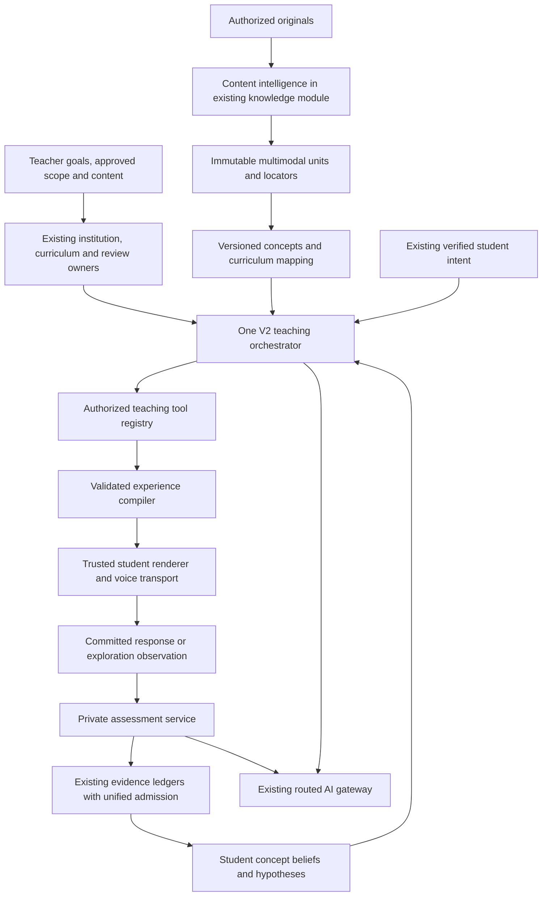

# Petros 2.0: production implementation blueprint

**Date:** 8 October 2026  
**Status:** architecture proposal; no application implementation, configuration changes, migrations, or provider experiments performed.  
**Repository root:** `/Volumes/Chris/Edrion Labs`.

**Navigation:** [Decision](#1-architectural-decision-and-success-definition) · [Existing integration](#2-evidence-base-and-current-architecture) · [Teacher control](#3-service-boundaries-ownership-and-teacher-control) · [Orchestrator](#4-ai-teaching-orchestrator) · [Content](#5-universal-content-intelligence) · [Concept graph](#6-concept-and-curriculum-graph) · [Experiences](#7-interactive-experience-engine) · [Student intelligence](#8-student-intelligence) · [Assessment](#9-assessment-engine) · [Realtime](#10-real-time-ai-tutor) · [Schemas/APIs/files](#11-data-model-apis-and-exact-implementation-targets) · [Prototype](#12-first-working-prototype-adaptive-cloud-computing-session) · [Phases](#13-phased-development-and-gradual-migration) · [Acceptance](#14-testing-measurable-acceptance-and-production-operations) · [Risks](#15-risks-unresolved-decisions-and-release-checklist).

## 1. Architectural decision and success definition

Build one evidence-driven teaching orchestrator inside the existing NestJS modular monolith. It chooses a small, revisable instructional plan, invokes authorized tools, observes student responses, and changes its next action when the evidence changes. PostgreSQL remains the authority for sessions, sources, commands, approvals, and evidence. Redis/BullMQ provides dispatch and transient delivery. Existing Next.js applications render validated experience specifications through trusted components.

The unit of instruction is an **objective-directed teaching action with an expected observable consequence**, not a document summary, generated lesson, page, or chat turn. An action may explain, ask a discriminating question, contrast cases, demonstrate a process, run a bounded experiment, fade a worked example, assess transfer, revisit a prerequisite, or ask a teacher for help. An explanation is useful without being assessed; completing it cannot establish learning. An assessment requires a server-owned task and evaluator contract.

The system must be able to answer: **What do we currently know about this student's understanding? Which evidence supports it? Why is this the next teaching action? What response would change that decision?** Store concise decision factors and evidence references, not hidden model reasoning.

Use one orchestrator and ordinary deterministic services. Content interpretation, evaluation, and voice may make separate model calls with narrow contracts; they are not autonomous agents. A separately routed evaluator is justified by separation of grading inputs from instructional generation, not by a multi-agent design. Do not introduce a graph database, vector database, workflow platform, or microservice mesh for the prototype. Add a deployment boundary only where isolation or demonstrated load requires it: untrusted file parsing and, later, a persistent voice connection worker.

### 1.1 Non-negotiable outcomes

- Teacher-approved objectives, content authority, and assistance restrictions bound instruction. Student curiosity can initiate a detour inside that scope; exceeding it requires an explicit scope choice allowed by institutional policy.
- Stable concept and objective identities survive wording, source, question, and session changes.
- Engagement, self-report, assisted performance, unassisted performance, transfer, and delayed retention remain different evidence classes throughout ingestion, projection, and UI.
- Wrong answers produce hypotheses, not permanent labels. Probe competing explanations before declaring a misconception.
- Public activities never contain hidden answer contracts, and teaching models cannot grant approval or write mastery directly.
- Generated experiences use validated data and trusted kernels; no generated JavaScript, JSX, HTML, SVG markup, imports, arbitrary formulas, or frontend execution.
- Time and move limits close a session honestly as incomplete when necessary. They do not convert coverage into mastery.
- New sessions migrate gradually. Saved legacy sessions remain readable with their original contracts.

Spaced retrieval, explanatory questioning, worked-example/problem alternation, and verbal/visual connections motivate the available strategies. The [IES practice guide](https://ies.ed.gov/ncee/wwc/PracticeGuide/1) supports those choices; it does not establish that Petros improves learning. Petros-specific effectiveness requires the evaluation programme in §14.

## 2. Evidence base and current architecture

The requested `AI_SYSTEM_AUDIT.md` was located under the user-confirmed alternative name. The entire 1,011-line [Edrion / Petros AI architecture audit](</Users/macbook/.codex/visualizations/2026/10/08/01a11b97-5c16-7b01-999a-a541b23dfc58/edrion-ai-architecture-audit.md>) was read, including its API, database, function catalogue, and verification appendices. This blueprint also inspected the current checkout's source, ownership helpers, assessment admission, teacher attachments, document parsing/retrieval, adaptive policy, visual registry, provider adapters, queues, and migration runner.

**Evidence rule:** the audit's database counts, missing tables, feature settings, and provider latencies are its 8 October snapshot, not fresh runtime measurements in this design task. Documentation describing earlier successful OCR or semantic concept extraction conflicts with current executable wiring. The current PDF subprocess flattens `getTextContent()` output and performs no OCR; the active outline is deterministic. Capability claims below follow code and the audit rather than older handoff prose. No production or local database was mutated or re-certified here.

### 2.1 Findings that determine the design

| Current finding | Consequence for 2.0 |
|---|---|
| The audited cloud session has an explanation, a prose quick check with its answer, and zero executable questions/evaluations. Eight characters of paraphrase permit continuation. | Question-like prose must not be presented as assessed work. A teach-back or check must have a persisted response protocol, private criteria, and an evaluator. Explanation continuation remains a navigation action. |
| Generic PLAN may run before a mandatory policy replaces its result; serial PLAN/RENDER attempts took about 30.6 seconds in the audited example. | Resolve deterministic constraints first. Reuse reviewed material and compile a selected action without a second model call where possible. Measure complete turn latency. |
| Generic, document, pack, teach-back, companion, and demo paths have different evidence semantics. | One admission service and canonical mapping interface; adapters preserve each entry route during migration. |
| Concept keys derive from question targets, titles, tags, or scenes. | Canonical UUID identity plus versioned explicit mappings; never merge by slug normalization. |
| PDF teaching has usable immutable text locators; teacher PPT context can be reduced to 600 characters. | Extend the source owner to format-specific units and retrieval. Route teacher attachments through the same ingestion path. |
| The newer reviewed pack, objective ledger, and workspace are substantive but gated. | Reuse their authority and private-contract mechanisms. A configured function name is not a usable tool. |
| Heuristic mastery can admit assisted/repeated/self-rated events through legacy producers. | V2 reads only a rebuilt projection from classified evidence; old numeric projections are compatibility data. |
| Turn-based recording/TTS and approximate weighted word highlighting exist. | Retain these as fallback; add streaming voice as a transport over the same teaching state. |
| Four document-learning tables were absent in the audited database. | Migration inventory and operational capability checks are phase-zero release gates. |
| Session time is wall-clock active time; the audited example exceeded 17 hours. | Separate active UI heartbeat time, elapsed session duration, and response latency. None determines knowledge. |

### 2.2 Retain, refactor, deprecate, replace

All paths in this document are exact repository-relative paths under the root given above. **Existing** means inspected or indexed in this checkout; **new** paths are implementation targets, not files created by this proposal.

| Disposition | Existing paths / owners | Implementation decision |
|---|---|---|
| Retain | `apps/api/src/modules/student/core/student-auth.guard.ts`, `student-session.service.ts`, `student-permissions.guard.ts`, `student-portal.guard.ts`, `student-tenant.interceptor.ts`; `packages/database/src/client.ts`; `packages/auth`, `packages/permissions` | Keep principal resolution, institution/campus/enrolment boundaries, session cookies, server permissions and RLS. New jobs re-resolve current authority. No new identity system. |
| Retain | `apps/api/src/modules/student/core/owner-scope.ts`, `student-owned-transactions.ts`; `apps/api/src/modules/student/student.types.ts` | Preserve institutional/independent account separation. Initial V2 production pilot is institutional. Independent support is a separate gated ownership migration, not implied by the existing home branch. |
| Retain and extend | `apps/api/src/modules/student/knowledge/knowledge-document.service.ts`, `knowledge-preparation.repository.ts`; `apps/api/src/modules/portal/course-content/portal-material-preparation.jobs.ts`, `portal-course-content.service.ts` | These remain source/publication/preparation owners. Add typed units and locators; do not create a second knowledge collection or bypass source revocation. |
| Retain and strengthen | `apps/api/src/modules/student/knowledge/knowledge-pdf-process.ts`, `pdf-extract.cjs` | Keep OS process isolation, credentials exclusion and resource caps. Add a versioned structured output and selective rendering/OCR in isolated workers. |
| Retain for preview; refactor teaching intake | `apps/api/src/modules/student/materials/material-document-preview.service.ts`, `presentation-converter.ts`; `apps/api/src/modules/portal/teaching/petros-teacher-guidance-files.service.ts`; `apps/api/src/modules/student/assignments/petros-guidance-files.ts` | Preview is not authoritative full interpretation. Replace the 600-character teaching handoff with source revision/unit references while preserving file visibility and existing previews. |
| Retain authority | `apps/api/src/modules/student/knowledge/petros-teaching-pack.service.ts`, `petros-teaching-pack.repository.ts`; `apps/api/src/modules/portal/courses/course-curriculum.repository.ts`; `apps/api/src/modules/petros-institutional/petros-institutional.service.ts` | Extend candidate contracts to V2 graph/objective/task references. Keep reviewer qualifications, immutable approvals, revocations, course/syllabus versions, homework and knowledge restrictions. |
| Retain | `apps/api/src/modules/portal/teaching/petros-teacher-guidance.service.ts`; `apps/api/src/modules/portal/petros-assignment-learning.service.ts`; `apps/api/src/modules/student/assignments/student-assignments.service.ts` | Goals, recipients, due dates, participation reporting and learning releases stay with these owners. Reporting complete does not become a grade or mastery claim. |
| Refactor | `apps/api/src/modules/student/petros-session-intent/petros-session-intent.service.ts`, `petros-session-intent.repository.ts`, `petros-document-source.ts` | Verified intent and start remain entry authority. Add engine selection and format-capability admission without relaxing PDF-specific legacy rules. |
| Replace for V2; retain legacy adapter | `apps/api/src/modules/student/petros-loop/petros-loop.service.ts` (`plan`, `renderDecision`, `buildQuestionSpecs`, `evaluateAnswer`); `petros-loop.policy.ts`; `petros-document-teaching.policy.ts` | V2 controller dispatches to the new orchestration and assessment services. Old algorithms continue only for pinned V1 sessions. No nested second teaching engine inside the orchestrator. |
| Refactor into reusable policy/content adapters | `apps/api/src/modules/student/petros-loop/petros-adaptive.service.ts`, `petros-adaptive.renderer.ts`; `packages/schemas/src/petros-adaptive-policy.ts` | Preserve approved task selection, exposure checks and useful deterministic interventions. Remove the requirement that instruction remain a fixed pack sequence. |
| Deprecate as mandatory V2 curriculum | `apps/api/src/modules/student/petros-session-intent/petros-document-preparation.service.ts`, `petros-document-teaching.ts`, `petros-document-outline.ts` | Reuse jobs and source slices. Fixed scenes become optional cached instructional fragments, not a complete obligatory lesson. New semantic mapping is a real invoked, validated operation. |
| Retain ledger; replace V2 inference | `apps/api/src/modules/petros-learner-model/petros-learner-model.service.ts`, `petros-learner-model.engine.ts`, `petros-learning-source-ingestion.service.ts`, `petros-learning-source-normalizers.ts`, `petros-objective-evidence.service.ts`, `petros-objective-evidence.repository.ts` | Keep event lineage, correction, quarantine, replay and outbox. Add one admission path and conservative concept beliefs. Do not treat the old basis-point estimate as calibrated knowledge. |
| Refactor producers | `apps/api/src/modules/student/petros-teach-back/petros-teach-back.service.ts`, `petros-artifacts/petros-artifacts.service.ts`, `petros-artifacts/petros-learning-artifacts.service.ts` | Keep teach-back, saved work, and scheduling. Stop V2 from converting audience fit or flashcard self-rating into verified mastery. Genuine assessed responses use the new assessment boundary. |
| Retain trusted rendering | `packages/schemas/src/petros-engine-compiler.ts`, `packages/schemas/src/petros-engine-interpreter.ts`, `packages/schemas/src/petros-engine-registry.ts`, `packages/schemas/src/petros-engine-models.ts`, `packages/schemas/src/petros-engine-units.ts`, `packages/schemas/src/petros-visual-program.ts`; `apps/api/src/modules/student/petros-loop/petros-workspace.service.ts`; `apps/student-web/src/components/petros/petros-program-workspace.tsx`, `petros-document-activity.tsx`; `packages/ui/src/petros-teaching-block-preview.tsx` | Adapt registered experiences; add a small number of reviewed capabilities. Keep executable extensions disabled. Preserve accessible alternatives and observation-only workspace events. |
| Refactor shell | `apps/student-web/src/components/petros/petros-repair-session.tsx`, `petros-home.tsx`, `petros-document-teaching.tsx`; `apps/student-web/src/app/(app)/petros/session/page.tsx` | Split transport/session logic, experience rendering, assessment and voice. Use server-returned engine version for routing, preserving old URLs. Remove V2 XP/length-gate learning claims. |
| Retain and extend | `apps/api/src/modules/petros-ai-routing/petros-ai-gateway.service.ts`, `petros-provider-adapters.ts`, `petros-routing-engine.ts`, `petros-ai-routing.repository.ts`, `petros-ai-credentials.service.ts`; `apps/api/src/common/queue/jobs.service.ts`, `apps/api/src/common/queue/queue.worker.ts` | Keep routing, release gates, credentials, metering, budgets and queues. Add actual tool-call/streaming capabilities and current-authority checks, not new direct provider clients in teaching features. |
| Retain | `apps/api/src/modules/student/petros-companion/petros-companion.service.ts`, `petros-action-registry.service.ts`, `petros-student-context.service.ts`; `petros-continuity/petros-continuity.service.ts`; `petros-reflection/petros-reflection.service.ts` | Companion opens or assists the authoritative session. Memories and recommendations use V2 evidence fences. It cannot conduct an independent hidden lesson or grade an active assessment. |
| Retain fallback; add transport | `apps/student-web/src/components/petros/use-petros-voice.ts`; `apps/api/src/modules/student/petros-input-modes/petros-input-modes.service.ts`, `petros-media-safety.ts`; `apps/student-web/src/features/learning-studio/target-registry.tsx`, `apps/student-web/src/features/learning-studio/use-teaching-playback.ts`, `apps/student-web/src/features/learning-studio/petros-rig.tsx` | Preserve explicit mic use, media scanning/retention, recognition correction, text fallback and target anchoring. Current timing estimates must be labelled approximate. |
| Keep separate | `apps/api/src/modules/portal/petros/petros-agent.service.ts`, `openai-client.service.ts`, `tools/registry.ts` | Staff administrative tools must never enter the student registry. Reuse design patterns for bounded calls and authorization, not staff credentials or domain permissions. |
| Demote to examples | `apps/student-web/src/features/learning-studio/integrals-teaching-studio.tsx`; `apps/api/src/modules/student/petros-loop/petros-pilot.policy.ts` | Retain clearly labelled demos/fixtures. Do not count their local answer checks as production evidence. |
| Deprecate as V2 substrates | `packages/database/src/schema/learn.ts`, historical `knowledge_chunks` declarations | No resurrection of the disconnected Learn engine or empty vector tables as a shortcut. Preserve historical consumers; delete only after separate usage inventory. |
| Retain and extend | `packages/learn-evals`; `apps/api/src/modules/petros-quality`; `packages/audit`, `packages/observability`, `packages/feature-flags` | Add real learner-response, accuracy and retention evaluation. Synthetic transcripts remain engineering tests. |

## 3. Service boundaries, ownership, and teacher control

### 3.1 Logical services

| Service | Owns | Explicit boundary |
|---|---|---|
| `PetrosTeachingOrchestratorService` | Next-action planning, bounded tool loop, interruption/detour integration | Proposes instruction; does not authorize sources, grade responses, or write beliefs directly. |
| `PetrosTeachingSessionService` / repository | Lifecycle, command receipts, revisions, atomic publication | Sole V2 session writer through existing tables. |
| `PetrosContentIntelligenceService` | Adapter selection, structured extraction, quality manifest | Source access still comes from existing knowledge/material owners. |
| `PetrosConceptGraphService` | Stable identity, reviewed mappings, prerequisites and objectives | Suggested relationships are provisional until approved. |
| `PetrosExperienceCompilerService` | Component and kernel validation, public payload assembly | Rejects unsupported capability or unsafe input; shape validation does not prove subject truth. |
| `PetrosAssessmentService` | Task issue, private evaluator, feedback and results | Teaching model cannot set correctness or eligibility. |
| `PetrosEvidenceAdmissionService` / `PetrosStudentIntelligenceService` | Classification, deduplication, canonical evidence views, rebuildable beliefs | No engagement-to-mastery conversion; no official grade mutation. |
| `PetrosRealtimeTutorService` | Voice connection/control, transcript and playback normalization | Transport for the same session and tools, never a second pedagogical authority. |

Start these as providers in one new teaching module plus extensions to existing knowledge and learner modules. Parsing runs in isolated processes. Queue handlers can run in the existing worker deployment. Long-lived voice can later run in a separate process of the same codebase if connection density requires it.

### 3.2 Teacher policy contract

Resolve an immutable `TeachingScopeSnapshot` at admission: course/class/subject, recipient/assignment version, curriculum revision, objective versions, canonical graph release, approved source revisions and permitted units, required versus optional objectives, depth, language/accessibility accommodations, allowed strategies/capabilities, knowledge mode, assistance policy, assessment/review rules, time/cost limits, and authority hash.

- `source_bound`: factual instruction requires approved source support; no ungrounded general claims. A necessary prerequisite absent from content becomes a teacher-content gap.
- `source_primary`: approved sources lead; permitted analogies/general explanations are labelled separately and cannot override source claims. Contradictions stop factual resolution and offer qualified review.
- `general_learning`: only when institutional policy permits; teacher-defined scope still applies. General-model claims have weaker provenance and cannot create verified assessment authority.

Teacher UI can approve an objective/resource envelope, prerequisite edges, misconception probes, reusable task families, rubric versions, and allowed experience families. It can preview the actual public/private contract, require remediation or a particular prerequisite, cap difficulty, disable a capability, withdraw a source, and review uncertain evaluations. A reviewer qualification is not created automatically because someone is a class teacher or administrator. Extend the existing review owner rather than introducing a second approval store.

Dynamic explanation wording and safe visual composition may vary within approved claims and components. Newly generated tasks are **formative** until their exact contract or approved parameterized family has the required review. This avoids making every sentence a teacher approval bottleneck while preserving a credible verification boundary. Reused public wording cannot introduce new answer-relevant ambiguity or change reviewed facts.

Teacher reporting uses authorized assignment/objective evidence summaries and explicit submission/review receipts. It does not expose private chats, raw media, unrelated sessions, or optional memories. Preserve existing sharing policy; do not create automatic teacher/guardian messages or marks. Scope changes and official publication still use existing preview/commit/confirmation flows. Student answer submission and reversible instructional adaptation are ordinary authorized session actions.

The current class/subject goal route is not automatically a course-reviewed release. Resolve the canonical class/subject-to-course association through current academic owners before compiling a course pack; absence or ambiguity is a phase-zero blocker for verified assessment, not permission to invent a course. A guidance attachment becomes a versioned source with `sourceKey=guidance_attachment:<objectId>:<publicationVersion>` and a binding to its assignment/class/subject. Its authorization uses `apps/api/src/modules/student/assignments/petros-guidance-visibility.ts`, current assignee membership and guidance-file checks; personalized goals must not inherit whole-class visibility. Extend source/review contracts to this binding instead of manufacturing a class-material record or broadening file access. Approved source revisions can be shared only among recipients whose current binding authorizes them.

## 4. AI Teaching Orchestrator

### 4.1 Teaching loop

1. Revalidate current student, surface permission, goal/release, source entitlement, approval and policy. Read a bounded session snapshot, current objective, graph neighbours, active misconception hypotheses, task exposure and relevant evidence watermark.
2. Resolve deterministic constraints first: a pending committed assessment must finish or be suspended; revoked content stops use; an exhausted budget closes honestly; a requested accessibility mode limits capabilities.
3. Form a short horizon: current objective, one learning hypothesis, one or two candidate actions, expected evidence, and branch conditions. No whole-document fixed lesson is required.
4. The model may call authorized read/analysis/experience/task-selection tools. Each call is locally validated and executed under current authority. The server supplies results as data.
5. Produce a typed `TeachingDecision`. Validate scope, novelty, budget, source claims, instrument availability, and expected evidence. Compile or fetch a reviewed instructional fragment and activity.
6. Publish one action atomically with source/objective/graph/policy/evidence pins and a student-safe reason. Await a meaningful response, a requested detour, or explicit navigation.
7. Evaluate committed responses independently. Record conditions before feedback exposure. Classify evidence, update hypotheses and beliefs, then replan.

A single provider-neutral gateway request can produce tool calls followed by the final structured decision. For the prototype, a structured `call_tool`/`publish_action` envelope with an application-driven loop is acceptable if native tools are not yet supported. Native tool protocols can later replace that envelope without changing domain services. A catalogue row must have a tested caller and runtime capability check before it becomes available.

Initial bounds: at most four model round trips, six tool calls, two retrieval calls and one targeted contract repair per teaching turn; no more than 20 seconds planning deadline, with a reviewed fallback available. These are tunable engineering limits, not a fixed number of teaching moves. Ordinary interaction does not invoke a model for every slider change. No repeated identical tool/argument call without new evidence. Stop on student input, cancellation, stale authority, timeout or reserved cost exhaustion.

V2 calls use the gateway's mandatory `applicationContractVersion`, current prompt/schema/config pins and explicit dynamic-context assembly. Published prompt text may add guidance but cannot replace tool schemas, source policy, public/private separation or evidence rules. Uploaded text, retrieved units, student answers and prior transcripts are untrusted data, never system instructions. Test adversarial source instructions and tool-result injection. Effective database-published prompts and route configurations are part of the release identity and captured in evaluation, not assumed to match source constants.

### 4.2 Decision contract

`petros.v2.decision.v1` contains:

| Field | Constraint |
|---|---|
| `objectiveRef`, `conceptRefs`, `graphReleaseRef` | Server-resolved approved identities; not inferred from topic text. |
| `action` | `explain`, `probe`, `contrast`, `worked_example`, `practice`, `experiment`, `transfer_check`, `retention_check`, `source_inspect`, `detour`, `handoff`, `close`. |
| `hypothesisRefs`, `evidenceRefs`, `evidenceWatermark` | Existing records or explicit `no_evidence`; uncertainty retained. |
| `instructionalGoal`, `studentSafeReason`, `selectionOrigin` | Bounded concise text; origin `policy`, `model`, `reviewed_reuse`, or `degraded`. |
| `experienceRef/spec`, `taskRequest` | Trusted registered family; private task reference only. A probe/check requires a valid executable task. |
| `expectedEvidence` | Criteria to observe and why they distinguish candidate hypotheses. May be `none_navigation` for an explanation. |
| `branches` | On correct, partial, misconception-supporting, ambiguous, assisted, deferred and unavailable results: next action class and rationale. |
| `claimRefs`, `sourceRefs`, `scopeHash` | Resolvable immutable source/claim anchors; unsupported claims cannot be disguised as citations. |
| `termination` | Continue, defer objective, teacher help, or close with explicit reason and unmet objectives. |

The model plans; deterministic code enforces eligibility, authority and transitions. Persist the accepted decision and the policy interventions separately so an overridden model response is never reported simply as `ai`.

### 4.3 Meaningful adaptation policy

| Observed evidence | Instructional response | Next discriminating observation |
|---|---|---|
| No reliable evidence | Brief orientation or optional low-stakes probe, respecting student preference | Explain a relation or solve a small prerequisite task; no weakness inference from absence. |
| Correct label, incorrect explanation | Contrast a boundary case or request a causal explanation | New scenario requiring the same relation; label recognition alone cannot establish concept understanding. |
| Confidently wrong | Probe two plausible causes before remediation | A discriminator distinguishing concept confusion from terminology/misreading. |
| Supported correct / answer exposed | Fade support, then issue a non-equivalent task | First unassisted response on a new task family/context. |
| Incorrect numeric answer with correct method | Address arithmetic/unit slip | New short calculation; do not reteach the entire concept. |
| Prerequisite failure | Repair the approved prerequisite, then return | Fresh prerequisite response followed by the original objective in a new context. |
| Explanation request or explicit confusion | Change representation or simplify one relation | Ask for prediction/explanation after intervention; reading the new explanation is not a gain. |
| Contradictory or ambiguous evidence | Preserve uncertainty; clarify assumptions or modality | A targeted probe or teacher review; no confident diagnosis. |
| Unassisted transfer success | Increase complexity or advance scope | Delayed retrieval scheduled independently of session closure. |
| Two interventions with no useful change | Offer pause/teacher support and preserve unresolved question | Student choice; avoid an endless cycle of hints or punitive gating. |

Every adaptive intervention records the triggering evidence and its proposed test. A representation change earns an “adapted” label only when its content/interaction or target changes; shorter wording, shuffled cards, jokes, or avatar movement alone do not qualify.

### 4.4 Tool registry

Each registry entry has `name`, version, strict input/output schemas, permission predicate, objective/source requirements, capability ID, side-effect class, timeout, payload/result cap, cost class, cancellation support, idempotency policy, redaction policy and executor. No dynamic tool registration from model output. The model receives only permitted entries.

| Tool | Server executor / result | Limits and authority |
|---|---|---|
| `source.search` | Authorized unit retrieval with locators and coverage trace | Explicit source scope; two calls/turn; 4–8 bounded units; recheck before result publication. |
| `source.inspect` | Exact text, table cells, formula or figure crop/description | Requested approved unit only; asset URLs minted by server, never model supplied. |
| `graph.neighbours` | Prerequisites, objectives and related concepts | Approved release; depth ≤2, ≤24 nodes; uncertain mappings labelled. |
| `learner.read_evidence` | Relevant classified facts and hypotheses | Current owner; ≤20 evidence summaries; no other student's data. |
| `task.find` | Candidate approved tasks matching criteria and exposure | Returns public preview and opaque task ref, never private key to teaching model. |
| `task.propose_formative` | Draft task sent through validation/review status | Formative until authorized family/exact contract approved; cannot claim mastery eligibility. |
| `experience.compose` | Compiles registered diagram/comparison/activity spec | Strict schema, source claims and accessibility validation; safe public data only. |
| `experiment.run` | Trusted kernel result, assumptions and state hash | Allowlisted model/version, bounded inputs/time/steps; no code, imports or network. |
| `hint.request` | Policy-permitted safe support for an issued task | Records exposure before returning; restricted during independent checks. |
| `assessment.request` | Issues a server-owned task instance | No answer/result arguments; task and contract checks before presentation. |
| `session.propose_close` | Requested close reason and evidence summary | Session service verifies unmet objectives and evidence; cannot fabricate success. |
| `teacher.propose_handoff` | Student-visible draft with scoped evidence | Existing explicit sharing/confirmation owner performs any later dispatch. |

`assessment.evaluate`, `evidence.append`, `belief.update`, raw SQL, storage paths, arbitrary URLs and administrative tools are **not** model-callable student tools. Model tool suggestions are untrusted input even if they match an exposed schema.

### 4.5 State machine and transaction protocol

Keep legacy `petros_learning_sessions.status` (`active/paused/closed`) for compatibility. Add an engine discriminator and orthogonal V2 control state:

```mermaid
stateDiagram-v2
  [*] --> admitting
  admitting --> planning: current authority and scope ready
  admitting --> blocked: unavailable source or capability
  planning --> delivering: action and task atomically published
  delivering --> awaiting_response: assessment issued
  delivering --> planning: navigation or evidence-free exploration complete
  awaiting_response --> evaluating: committed answer
  evaluating --> planning: result and evidence classification committed
  evaluating --> paused: pause requested; finish committed evaluation without new instruction
  planning --> paused: explicit pause or disconnect policy
  delivering --> paused: explicit pause
  awaiting_response --> paused: preserve issued task
  paused --> planning: resume and revalidate
  paused --> awaiting_response: valid outstanding task
  planning --> blocked: stale or revoked authority
  delivering --> blocked: revoked authority
  awaiting_response --> blocked: revoked authority
  evaluating --> blocked: cannot publish under current authority
  blocked --> planning: explicit permitted realignment
  planning --> closed: reason and objective outcomes
  paused --> closed: student exit
  closed --> [*]
```

Interruption is a command that increments `turnEpoch`, cancels presentation, and admits a bounded detour; it is not a new session. During evaluation, preserve the committed response and process it exactly once. A detour is queued or executed alongside a suspended task under its assistance policy. Rejoin returns to the pinned activity/checkpoint, not a regenerated lesson. An answer-changing hint makes the pending task supported; it cannot silently retain independent eligibility.

Use the existing durable command/lease pattern:

1. Short owner transaction: validate expected session revision and command hash; save command/outbox and input pins; return `202` receipt. Repeated key plus same input returns the receipt; changed input returns `409`.
2. Worker claim with expiring lease/fence; re-resolve current principal and policy. Read scoped inputs in a short transaction.
3. Provider and parser work runs **outside** a database transaction. Budget reserved before each attempt. AbortSignal propagated, but commit fencing remains necessary even when a provider cannot cancel.
4. Short commit transaction locks in the existing authority order (policy/course/source/pack before session/evidence), checks fence, source/approval/scope/epoch/revision/evidence pins, and publishes action/task/events together. Late or revoked output cannot appear.
5. Cancellation writes a durable tombstone; abort best effort; settle usage reservations after final provider outcomes. At-least-once delivery produces one logical publication/evidence record via receipts and unique constraints.

Retry only transient failures with bounded backoff. Invalid contracts get one targeted repair. Degraded delivery reuses approved content or offers source inspection/pause; it never generates a generic fake task or partial correctness. Failures preserve student drafts and pending work.

## 5. Universal Content Intelligence

“Universal” means one representation and authorization interface across adapters. It does not mean every format, diagram, language, or formula is understood. Capability admission is per source unit and teaching purpose, not merely MIME type.

### 5.1 Pipeline

`authorized original → signature/type/size/security checks → durable isolated extraction → native structure + rendered views → selective OCR/vision → canonical content units → quality/coverage manifest → concept/claim proposals → teacher-approved graph/content → scoped retrieval`.

Reuse `knowledge_preparations` for extraction jobs and `petros_document_preparations` for semantic mapping, with new operation/schema versions. An upload stores the original and acknowledges the durable job; no Office conversion or model interpretation blocks a request transaction. Original content hash, parser version, conversion version, and source publication version identify each immutable interpretation. A parser upgrade creates a new extraction revision.

1. Verify magic bytes against claimed format; bound decompression, pages/slides/cells/media duration and total extracted bytes. Apply current malware/quarantine policy. Conversion workers receive no application credentials, network, macros, or external-link execution.
2. Extract native text/paragraphs/shapes/cells/formula strings/relationships and preserve layout anchors where available. Render pages/slides to support figure crops and fidelity review.
3. OCR only low-text or image regions. Vision describes visible axes, labels, tables and diagram relationships with confidence and crop references. Recognition, interpretation and subject claims remain separate records.
4. Store text, geometry, tables, formulas, figures, captions and relationships as distinct typed units; never flatten away the original representation. Include unresolved regions and explicit omission reasons.
5. Validate structural completeness, numeric/formula consistency and locator resolution. Teacher correction creates a new interpreted unit/revision, retaining original and rejected hypothesis.
6. Propose concepts, learning objectives and source-supported claims from bounded batches. Resolve against canonical identities and teacher scope; publish only the approved graph/content envelope. No claim is “verified” merely because a model emitted a citation.

### 5.2 Canonical unit contract

`petros.content-unit.v1`: immutable `unitId`, `sourceRevisionId`, `kind`, `parentUnitId`, reading order, format-specific locator, original/normalized content hashes, extraction method/version, language, confidence with basis, quality status and warnings. Kinds: paragraph, heading, list, table, formula, figure, diagram, code, caption, transcript segment and unresolved.

Locators are a strict union: PDF page/bounding box/UTF-16 text span; slide ID/shape ID/crop; DOCX OOXML part/paragraph/run/table cell; spreadsheet sheet ID/cell range; image crop/pixel dimensions; transcript media ID/time range; text byte or declared UTF-16 range; later web snapshot/DOM block. DOCX page numbers are render-version locators, not stable native identities. Original and converted locators are linked explicitly; conversion does not pretend to preserve exact layout.

- Tables preserve row/column headers, spans/merged cells, units and cell references, not just `a | b` strings.
- Formulas retain original image/native math, recognized TeX or MathML, parsed bounded expression if supported, assumptions/domain, symbols/units and unresolved tokens. Renderability does not imply symbolic equivalence or proof.
- Figures retain original crop, caption, nearby text, axes/legend labels and asserted relationships. Vision-proposed labels or edges remain interpretations until checked. An uncertain arrow cannot become an approved causal relationship.
- Code retains language, source text and line anchors; ingestion never executes it.
- Transcripts retain timing, speaker labels only when supplied/authorized, transcription confidence, and linkage to visible slides. A transcript alone cannot account for a video demonstration.

The quality manifest reports total/processed/unresolved/omitted units, reasons, methods, supported uses, and teaching-readiness by objective. Partial readiness can admit an approved subset. It must not display whole-source completion after parsing one useful page.

### 5.3 Format support and limitations

| Format | Current code | V2 target | Honest admission limit |
|---|---|---|---|
| Digital PDF | Flattened page text, immutable hashes/offsets; no active OCR | Text geometry, rendered pages, table/figure/formula units | Multi-column ordering and complex charts need review; encrypted/corrupt PDF fails explicitly. |
| Scanned PDF | Empty text detection; needs attention | Selective OCR with retained pixels, language/confidence and corrections | Handwriting, tiny labels and poor scans may remain unusable; no broad release before OCR gold-set QA. |
| PPTX | XML text paragraphs by slide | Shapes/text/notes/tables plus slide renders and relationships | SmartArt, animations, equations and embedded media may lack semantics. Notes are separate from visible slide claims. |
| PPT/ODP | Optional conversion / text XML preview | Isolated conversion with original-to-render provenance | Fidelity loss and converter availability reported; no claim to reconstruct transitions/macros. |
| DOCX/ODT | Raw text / XML paragraphs | Semantic paragraphs, tables, embedded images, math and rendered reference | Floating layouts/fields/changes require interpretation; no exact native pagination promise. |
| Legacy DOC/RTF | String heuristics / stripping | Safe conversion where feasible; otherwise preview-only | Binary strings are not authoritative teaching evidence. |
| XLSX/ODS | Cached values and bounded rows/columns | Cell/formula strings, headers, ranges, chart data when parseable | Cached values may be stale. No macros, external links, general formula execution or full workbook recalculation initially. |
| CSV/TSV | Bounded table preview | Typed table with delimiter/encoding/header/units confirmation | Types and causal interpretations cannot be inferred reliably from values alone. |
| TXT/MD/TEX/code | Bounded decoded text | Syntax-aware units and safe math/text rendering | No TeX compilation, shell execution or code running by default; unsupported syntax stays text. |
| Images/question photos | Separate vision/confirmation pipeline | Common image units plus existing recognition/correction UX | Reading a diagram differs from understanding it; student-confirmed handwriting is still not a mathematical proof. |
| Audio/video | Recorded-turn transcription; no general material pipeline | Later bounded asynchronous transcription and authorized frame/slide sampling | Missing visual events, inaudible speech and copyright/authorization limits remain explicit. Not prototype scope. |
| URLs/web pages | No general intake/retrieval owner | Later teacher-selected immutable snapshots via restricted fetcher | No arbitrary crawl, authenticated-site scraping or model-directed open-web retrieval; protect against SSRF/redirect/private-address access. |
| ZIP/archive | No generic educational archive understanding | Remain unsupported initially | Office ZIP parsing does not authorize recursive archive ingestion. |

Prototype supports reviewed PDF and PPTX/converted PPT text plus rendered figure inspection. Start with the cloud material's actual source route, including its teacher attachment. The adapter registry exposes `preview`, `source_lookup`, `teach_claim`, `assess_reference`, and `simulate` capabilities separately. Unsupported uses return structured reasons and recovery options.

### 5.4 Retrieval and grounding

Keep `KnowledgeDocumentService` as authorization owner. Generalize its locator/search interface to units. Start with PostgreSQL full-text ranking plus concept/objective filters and exact formula/table retrieval. The current lexical sentence-window implementation remains a legacy adapter. Add embeddings in PostgreSQL only after a synonym/paraphrase benchmark shows material benefit; evaluate indexing permissions and cost before adding pgvector. No independent vector service is required.

Retrieval expands selected concept support to nearby captions/table headers and graph prerequisites within teacher scope. Return exact locators, authority, confidence, searched/omitted scope and sufficiency. Rank on relevance and permitted objective, not just keyword overlap. Cache shared extraction by institutional source revision; personalized retrieval/planning by owner, scope/policy hash, graph, evidence watermark, prompt/schema/capability version. Revalidate entitlement on cache hits and before delivery; a hash is not authorization.

A claim references an exact source unit/span and states support type: direct, inference, analogy, or unresolved. Check locator/hash validity deterministically; use a narrow entailment check for newly generated factual claims and flag uncertain results. A model entailment score is screening, not proof. Teacher-reviewed claims/tasks and domain checkers provide stronger authority. Contradictory sources remain separate claim records; the tutor describes disagreement rather than merging them into a canonical fact.

## 6. Concept and Curriculum Graph

### 6.1 Identity and graph design

Assign server-created UUIDs to concepts. A label such as “PaaS” is an alias, not identity. A concept version defines meaning, scope, examples/non-examples, locale aliases, symbols, source claim references and review status. Changing wording can preserve identity; changing meaning requires a new version or an explicit split/merge proposal.

Concept namespace is institutional/course-specific initially. Curated platform-public concepts may later be referenced explicitly without exposing institutional content. A similar label from another institution cannot reveal its definition, evidence or student data.

Graph edge types: `requires` (hard prerequisite), `helpful_before`, `part_of`, `contrasts_with`, `applies_to`, `explains`, `alternative_representation`, `supersedes`. Direction of `requires` is prerequisite → dependent. Hard prerequisites form a DAG per published release; other relationships may be cyclic. `contrasts_with` is symmetric; hierarchy/supersession cycles are rejected. Edge approval includes rationale and source or pedagogical basis. Traversal returns approved reachable nodes only.

Use existing `course_curriculum_records` and `course_curriculum_revisions` for objective records and a V2 graph manifest. Objective identity/version contains observable verb, conditions, concepts/criterion mappings, scope, accepted evidence classes, required task families and retention policy. Do not create another competing syllabus/objective authority. New relational concept tables support stable lookup and prerequisite traversal; the manifest pins exact concept/edge/objective versions.

### 6.2 Mapping and misconception hypotheses

`ConceptMapping`: source revision/unit or legacy producer target → canonical concept/version, relationship `exact`, `partial`, `broader`, `narrower`, `ambiguous`, method, supporting anchors and reviewer/review receipt. Embeddings or an LLM can propose a match; only approved exact/criterion-specific mappings contribute to verified concept state. Unknown mapping stays unknown. A mark on a broad “cloud computing” question does not establish each sub-concept.

Misconception definitions live in reviewed concept-version payloads: hypothesis ID, incorrect relation/claim, alternatives (misreading, terminology confusion, arithmetic slip, prerequisite gap), supporting and refuting response patterns, discriminating task families, and approved interventions. Student hypothesis state is separate: `candidate`, `supported`, `refuted`, `resolved`, with evidence/counterevidence, last probe and uncertainty. One wrong distractor normally creates a candidate only; a reviewed discriminator plus corroborating evidence can support it. Resolution requires a new unassisted discriminating response and transfer; exposure to the correction cannot resolve it.

Splits/merges never rewrite historical evidence. Publish explicit mapping decisions, replay affected projections under a new graph/algorithm version, and retain uncertain allocations. Do not automatically transfer all mastery from a broad concept into its children. Prerequisites inform what to test, not an inference that knowledge of one implies mastery of the other.

## 7. Interactive Experience Engine

### 7.1 Experience contract and reuse

`petros.experience.v1` names a registered component family/version, objective/concept refs, approved claim/source refs, public inputs/parameter ranges, initial state, permitted interaction events, presentation beats, declared target IDs, accessible alternative and an optional issued assessment ref. Private evaluator data is stored elsewhere. Runtime output includes compiler version, capability manifest hash, model/solver version and assumptions.

Reuse concept maps, classification, sequences, worked/equation steps, comparisons, process diagrams, timelines, coordinate graphs, code traces, the shared math renderer, typed SVG primitives, presentation beats and trusted scientific kernels. The AI chooses and composes these into an action appropriate to a learner hypothesis. Add registered families when they cover multiple objectives, not a new component for each topic.

New prototype families:

- `responsibility_matrix`: an accessible table with movable/selectable responsibility chips and explicit provider/consumer/both/unspecified categories. Implement as an extension of classification/comparison; topic-specific layers and contracts come from approved content.
- `bounded_resource_model`: a reviewed parameterized kernel demonstrating capacity, demand, backlog or modeled cost with shared diagram/table values. Begin with a simple algebraic model rather than inventing an unrestricted cloud simulator.
- `prediction_explanation`: commit a prediction and explanation before revealing a result; supports any registered model or causal scenario.

Animations describe declared reveals/highlights and bounded transitions. They teach a relationship or change over time, with pause, keyboard operation, captions and reduced motion. The avatar may point only at registered target IDs. Missing anchors result in a docked avatar and valid content, never invented coordinates.

### 7.2 Validation and execution

Validation sequence: byte/depth/cardinality bounds → strict schema/no unknown fields → component/capability allowlist → source/objective scope → graph and task binding → numerical units/domain/finite results → accessibility → semantic claim screening → public/private separation → atomic publish.

Prototype limits: 96 KiB experience JSON, ≤100 primitives, ≤32 variables, ≤16 parameters, ≤64 beats; expression DAG ≤4,096 operations; simulation limits follow each registered kernel and are enforced on server and client. Use existing stricter limits where applicable. Escape all labels; never render generated markup. Deny `eval`, `Function`, dynamic module URLs, network requests, raw SVG, selectors and scripts. A Web Worker improves responsiveness but is not a hostile-code sandbox. `extension.executable` remains disabled.

Every kernel declares assumptions, units, parameter domain, solver error tolerance, maximum duration/steps, invariants, reference fixtures and renderer. Client previews and server checks use the same versioned trusted implementation; the server recomputes assessed results from pinned state. A future coding sandbox would require a separate proposal with OS isolation and task-specific evaluation; it is not necessary for 2.0's first release.

### 7.3 Exploration versus assessment

Sliders, clicks, reveals, animation completion and workspace predictions are observations. They may inform a next probe but cannot establish mastery. An assessment opens a distinct server-issued task with its own exposure history and private reference. Persist exposure as soon as an answer-relevant reveal is delivered, conservatively even if playback receipt is uncertain. Hiding a revealed answer later does not make the task independent.

Record experiments as versioned acknowledged checkpoints in the existing workspace. High-frequency client frames remain transient. If the browser crashes, resume the last acknowledged state and disclose that later local changes were not saved. Numeric/text alternatives provide the same relationship without requiring dragging or motion.

## 8. Student Intelligence

### 8.1 Persistent state and evidence classes

Maintain one evidence lineage across all producers and a rebuildable V2 concept-belief projection. Sessions, companion summaries and optional memories refer to that projection; they do not become independent truth stores.

| Class | Examples | Permitted effect |
|---|---|---|
| `engagement` | Reading, expansion, animation, slider movement, session finish | UI continuity and an optional probe suggestion; no knowledge update. |
| `self_report` | “I understand”, confidence, flashcard again/hard/good/easy | Preferences, review priority, calibration comparison; no correctness. |
| `assisted_performance` | Hinted answer, answer exposed, equivalent retry | Identify a helpful scaffold and practice needs; no independent demonstration. |
| `unassisted_observed` | First committed task, no recorded Petros help/exposure | Provisional understanding evidence; outside assistance remains unknown unless independently checked. |
| `transfer` | Approved unseen context requiring the underlying relation | Concept application evidence, subject to task validity and assistance conditions. |
| `retention` | New task after a specified delay, before refresh/help | Recency/retention evidence; no retention claim from a same-session recall. |
| `educator_verified` | Qualified rubric decision on exact submitted work | The criteria actually reviewed; preserve supervision and outside-help uncertainty. |
| `unverified` / `not_evaluated` | Failed evaluator, ambiguous source, unmapped historic mark | Preserve observation and reason; never invent partial credit. |

The universal classifier records purpose, task/family/version, objective/criterion mapping, source/graph/rubric/evaluator versions, response lineage, first/repeated exposure, hints, solution exposure, declared external help, supervision, modality, result, uncertainty, review status and eligibility reasons. Distinguish required conditions from observed facts. No observation proves absence of external help or learner identity merely because the UI disallowed hints.

All producers call `PetrosEvidenceAdmissionService`: generic/document V2 tasks, reviewed packs, teach-back, artifact review, workspace, exams, assignments, homework and imports. Practice-only events can be retained without admission to verified learning. Existing objective events remain the strong exact-task receipt; normalized learner evidence references that receipt rather than duplicating the raw response. Legacy data with missing contracts remains uncertain until a new assessment supplies evidence.

Implement a new versioned classifier alongside `packages/schemas/src/petros-assessment.ts`; preserve the current `assessmentAdmission()` for V1. Current admission rejects criterion-profile results, so V2 must explicitly admit reviewed criterion instruments with valid evidence/conditions rather than convert an explanation rubric into arbitrary scalar credit. Migration replay must also apply source withdrawals, mapping changes, corrections and invalid instrument decisions. Unknown or superseded judgments cannot reappear through old normalizers.

### 8.2 Concept belief contract and initial inference

`ConceptBelief` contains canonical concept/version and graph release; per-objective/criterion status; observations about explanation, recall and application; active evidence refs/watermark; assisted and independent counts; non-equivalent task-family count; last valid response and retention check; open misconceptions and counterevidence; next recommended action; algorithm/policy version and uncertainty reasons.

Use transparent categorical inference initially:

- `not_assessed`: no eligible mapped task evidence. Missing evidence is not a weakness or 50% knowledge.
- `developing`: valid responses exist but required criteria are incomplete or inconsistent.
- `demonstrated_in_session`: all required objective criteria observed across at least two non-equivalent approved tasks, including explanation and an unseen application. No recorded assistance on these attempts; outside-help uncertainty shown.
- `retention_supported`: a new approved task after at least seven days supports the required criteria before refresher instruction. Also retain 24–72-hour checks as early retrieval evidence, not a seven-day result.
- `review_due`: evidence freshness policy requests a new check; this does not erase the historical demonstration or label the learner wrong.

These thresholds are **proposed product evidence rules**, not calibrated probabilities or a universal definition of mastery. Teacher subject/rubric policy can require more evidence. A learner-facing statement says “You explained X and applied it in Y; a delayed check is still due.” Avoid percentage mastery or personality/ability labels. Critical contradictory evidence makes the current claim `developing` with history and reasons retained.

Maintain raw criterion outcomes rather than a single score assigned equally to every concept in a multi-concept task. Each mapped criterion can update only its own concept/objective; unmapped criteria stay out. Deduplicate by response lineage and approved equivalence family across sessions and source/pack revisions. Two paraphrases of the same task are not two independent samples. Keep an append-only, owner-scoped task-exposure record from the moment of task issue, not only after answering.

Continue to use existing scheduling infrastructure for review due dates. The V2 projection chooses when independent evidence is needed; flashcard self-rating may change practice scheduling but does not create retention evidence. Do not deploy Bayesian knowledge tracing, IRT or learned intervention selection until a labelled, sufficiently sized dataset supports calibration and out-of-sample benefit. The old basis-point model remains isolated as a historical compatibility projection.

### 8.3 Memory and personalization

Persist student claims and unresolved questions as concise referenced facts: “Student says the provider patches the guest OS in this scenario; probe R pending”, with scope, provenance and evidence references. Store interpretations as hypotheses, not facts about cognition. Student corrections append a correction/retraction; optional conversational memory can be forgotten independently of required assessment retention.

Context assembly prioritizes current objective/constraints, outstanding task, recent discriminating responses, relevant prerequisites, active hypotheses and source units. Bound the initial model context to a configurable target of about 8,000 input tokens, using the model tokenizer where available. Explicitly list omissions. Compress older conversations into fact summaries with referenced records; do not drop the only contradictory response because a category exceeds its budget.

Language, explicit pace/depth preferences and accessibility choices can shape presentation immediately. Reading time, response latency or skipped content cannot become learning-style labels. Do not infer attention, confusion, disability or emotion from camera/prosody. Use explicit statements and evaluated work. Store active heartbeat duration for operational use, with gaps/background periods excluded; do not use it as understanding evidence.

## 9. Assessment Engine

### 9.1 Private answer contract and task issue

`petros.answer-contract.v2` is server-only and immutable for an issued task:

| Contract field | Required content |
|---|---|
| Identity | Task ID/version, family/equivalence key, parameter seed, instance hash, objective/concept/criterion bindings. |
| Authority | Approved exact contract or approved task-family review receipt, source unit/claim refs, graph/curriculum/policy versions and current eligibility. |
| Expected response | Typed input schema; assumptions; correct relation/result; acceptable alternatives; known ambiguous/missing-information cases. |
| Evaluation | Deterministic kind/domain or criterion rubric, exact reference derivation/state, tolerance/units, reference answers and counterexamples, evaluator version. |
| Diagnosis | Reviewed response patterns supporting/refuting misconception hypotheses; alternative error explanations. |
| Conditions | Assistance/exposure policy, first-attempt/equivalence rules, required supervision, response modality, retention timing. |
| Feedback | Safe hint ladder, post-commit explanation, follow-up criteria; permitted answer disclosure. |

The public task contains only prompt, input schema, choices/items where needed, declared assumptions, rubric criteria appropriate to the task, opaque instance ID, and allowed actions. Correct options, hidden assignments, full exemplars, discriminator keys and private reference outputs never enter student API responses, SSE events, component props, shared caches, logs or realtime context. Keep public JSON and private contracts in different assembly functions and types. Sanitize pending assessment context supplied to all tutoring/companion routes.

Task issue persists a specification, contract hash and exposure receipt atomically with the action. Browser responses contain no correctness claims accepted by the server. An exact assessed parameter instance is reproducible from its pinned seed/kernel; public wording must not change assumptions from the approved family. A generated variant failing ambiguity, solvability or exposure checks is discarded, not graded.

### 9.2 Evaluation hierarchy

1. Deterministic checking for choice, classification, sequence, numeric values with units/tolerance, bounded symbolic domains and trusted-kernel outputs. Reuse `petros-math-evaluator.ts`; unsupported symbolic domains return unavailable, not model-certified equivalence.
2. Criterion-based evaluation for explanations: give a separate evaluator the private rubric/reference/source claims and only the committed response, excluding the teaching model's proposed diagnosis and coaching transcript. Request criterion outcomes, cited response spans, contradictions, uncertainty and follow-up need. Do not ask for hidden reasoning.
3. Apply factual/contract consistency checks. Low confidence, conflicting criteria, uncertain transcription or unsupported source support abstains or requires review. A second evaluator is used selectively for disagreement/high-impact borderline cases, not on every turn; different models still share possible biases.
4. Qualified educator review for unresolved qualitative work or official grade decisions. Existing graded-record owners remain authoritative. Petros's formative judgments do not write exam/assignment marks.

Free-response checking must accept semantically valid alternatives and reject keyword stuffing, copied prompt fragments, fluent irrelevant text, contradictions and correct labels with false explanations. Exact-text match is suitable for a restricted identifier, not evidence of conceptual understanding. A task with insufficient information should accept a correctly justified ambiguity rather than force a preferred answer.

Feedback first identifies the valid part and the specific gap using the student's evidence, then offers one next action. Model failure yields “Recorded; this response could not be checked yet,” with retry/review. No safe-fallback 0.5 correctness. Persist response before evaluation so network failure cannot lose work. Freeze observed assistance conditions at submission; post-submission feedback affects exposure for future equivalent tasks, not the already committed first attempt.

### 9.3 Misconception diagnosis and independent verification

A diagnosis requires a reviewed distinguishing pattern and evidence that separates it from competing explanations. Store `candidate` after one suggestive response, request a discriminator, and support/refute on the combined results. Partial correctness and ambiguous wording can require clarification before diagnosis. Misconception intervention effectiveness is measured with a new discriminator and transfer item, not with the student's agreement after seeing the correction.

Maintain three boundaries:

- Formative help is permissive inside teacher assistance policy; new generated tasks can guide teaching but do not supply verified learning until reviewed.
- In-session verification uses approved held-out task families, with no model access to hidden answers except the evaluator. Asking for a hint records assistance and offers practice plus a fresh later check.
- Independent outcome evaluation for pilots uses tasks and rubrics withheld from the teaching planner and blinded human scoring. Self-study checks are labelled “no Petros help observed”; stronger independence claims require separately observed conditions.

Use distinct tasks for practice, discriminator, transfer and delayed retention. Shared family/answer structure/exposure history prevents “fresh wording” laundering. At prototype content approval, reserve held-out tasks before generating instruction. Neither teaching fluency nor successful deterministic simulation establishes concept mastery alone.

Corrections append new review/admission decisions referencing the original result; the active projection folds the correction chain. Regrading never silently overwrites committed responses or old evaluation provenance. Qualified review can change the interpreted criterion result, not retroactively assert that external assistance was absent.

## 10. Real-Time AI Tutor

### 10.1 Delivery progression and provider boundary

Phase 1 delivers text and validated visuals, with existing push-to-talk/TTS as fallback. Phase 4 adds streamed ASR, incremental text/TTS and interruption. A provider-native duplex voice transport can then be enabled only after it passes scope, private-answer, playback and reliability tests. This sequencing makes the first prototype teach without depending on a new audio API.

Implement a provider-neutral `RealtimeTutorTransport` with capabilities for partial/final transcript, streaming audio, cancel/truncate, playback acknowledgments, server control, usage finalization and connection recovery. Use browser WebRTC for suitable providers or a server audio gateway; durable session commands still go to the Petros API. API keys remain server-side; use short-lived scoped connection admission, not a permanent key in the browser. The backend is the sole tool executor and evidence writer.

The [official OpenAI server-control documentation](https://developers.openai.com/api/docs/guides/realtime-server-controls) describes an application-side control connection for private tool execution and policy. Its documentation currently covers more than one voice API; select and test one protocol explicitly. Do not mix event names or presume that a database `streaming` flag makes existing HTTP adapters stream. The [Realtime interruption contract](https://developers.openai.com/api/docs/guides/realtime-conversations#interruption-and-truncation) distinguishes provider-managed WebRTC truncation from client-managed WebSocket playback/truncation. Those details stay inside the adapter; they are not Petros learning events.

### 10.2 Conversation and synchronized visuals

Partial transcripts can update captions or start speculative **read-only** retrieval; only a final transcript or explicit typed response can commit an assessment. Student correction is required when uncertainty changes task meaning. The same session objective, current diagram state, source references, assistance restrictions and turn epoch are supplied to the tutor. An interruption such as “why is that layer mine?” creates a contextual detour tied to the selected layer and current objective.

For educational narration requiring grounding, stream only validated text/claim segments to TTS. Direct duplex speech is an optional lower-latency mode with weaker pre-playback factual screening; keep it disabled for source-bound or independent-check delivery unless a tested buffering/gating design enforces the required assurance. Policy instructions alone cannot guarantee that unvalidated speech never reaches the student.

Reuse the presentation target registry and rig. Beats include `beatId`, utterance segment ID, declared target ID, experience revision and turn epoch. Trigger reveals/highlights from actual audio playback/media timestamps or segment start/end, not generated token arrival or guessed word weights. If the provider supplies no reliable alignment, use sentence-level synchronization and explicitly approximate captions; do not promise word-level accuracy. Resume from the last acknowledged beat without claiming the student heard queued content.

Barge-in handling:

1. Local speech/start-stop control immediately stops/mutes output and clears pending visual beats.
2. Send interrupt with `turnEpoch` and playback position. Cancel provider/application work best effort and durably invalidate the old epoch.
3. Adapter truncates unplayed audio/context where supported. Preserve played/exposed versus merely generated content separately.
4. Late audio, tool results and visual messages with the old epoch are ignored. A pending answer remains committed; unfinished presentation does not complete a task.
5. Replan the detour or resume after current-policy revalidation. Budget/usage reconciliation includes interrupted work.

User explicitly enables microphone/voice; mute, pause, hidden page and navigation stop capture. Retain media scanning/retention defaults, minimize raw audio storage, expose transcript correction, provide captions and keyboard/text access. A voice failure leaves the activity and saved response usable. Reconnect retrieves authoritative session state; it cannot replay evidence or restart a consumed assessment. One active voice connection per session with a fenced connection generation prevents duplicate tool execution.

## 11. Data model, APIs, and exact implementation targets

### 11.1 Schema strategy

Extend existing source/session/task/evidence/approval tables. Add only missing identity, structured-source, execution and categorical-belief records. The new concept-belief projection is justified because existing mastery rows require heuristic numeric fields; fabricate no numeric values for “not assessed”. There remain one authoritative response lineage and one normalized evidence stream, with versioned compatibility projections.

**Common rules:** UUID primary keys; UTC `timestamptz`; typed versioned JSONB validated by Zod; owner/course composite foreign keys where applicable; DB checks on state/version combinations; content/request hashes; append-only grants/triggers for authoritative records. Session/response/evidence rows remain institution + student owned initially. No nullable owner field interpreted as public. Migration jobs use a privileged narrow worker role; ordinary requests retain RLS and explicit owner predicates.

| New table | Essential columns / types | Keys and constraints |
|---|---|---|
| `petros_concepts` | `id uuid`, `institution_id uuid`, `course_id uuid nullable`, `namespace text`, `created_by uuid`, `created_at timestamptz` | Institution/course FK; identity never a label. Immutable identity; status/meaning comes from versions. |
| `petros_concept_versions` | `concept_id uuid`, `version int`, `payload jsonb`, `content_hash text`, `review_ref jsonb`, `created_at` | PK `(concept_id,version)`; payload includes aliases, definition, misconceptions and evidence anchors. Append-only. Review ref resolved by existing review owner. |
| `petros_concept_relations` | `id uuid`, `version int`, `institution_id`, `course_id`, `from_ref jsonb`, `to_ref jsonb`, `kind text`, `basis jsonb`, `review_ref jsonb`, `content_hash` | `(id,version)` unique; source/target versions exist in same permitted namespace; manifest publication checks DAG/symmetry/cycles. |
| `petros_concept_mappings` | `id uuid`, `institution_id`, `course_id`, `origin_kind text`, `origin_ref jsonb`, `canonical_ref jsonb nullable`, `relation text`, `evidence_refs jsonb`, `review_ref jsonb nullable`, `supersedes_id uuid nullable`, `content_hash` | Immutable mapping decisions; origin hash+mapping version unique; explicit ambiguous mapping has no admitted canonical ref. |
| `petros_content_units` | `id uuid`, `source_revision_id uuid`, `institution_id`, `parent_id uuid nullable`, `kind text`, `ordinal int`, `locator jsonb`, `payload jsonb`, `quality jsonb`, `content_hash text`, `created_at` | Source/tenant FK; `(source_revision_id,ordinal)` unique; immutable. Searchable text projection/GIN index; asset refs point to authorized storage objects. |
| `petros_tool_invocations` | `id uuid`, `session_id`, `command_id uuid`, `fence int`, `turn_epoch int`, `ordinal int`, `tool_name/version text`, `input_hash`, `scope_hash`, `status`, `result_ref jsonb`, `usage jsonb`, `started_at/ended_at` | `(command_id,fence,ordinal)` unique; owner columns/RLS. No raw keys, private answers or hidden reasoning in ordinary logs. Results contain scoped references or protected bounded data. |
| `petros_task_exposures` | `id uuid`, owner, `question_id`, `task_ref jsonb`, `family_key text`, `scope_ref jsonb`, `exposure_kind text`, `occurred_at`, `command_id` | Owner+question+exposure-kind+command unique; append-only. Index owner/family/time. Issued/unanswered tasks also count as exposure. |
| `petros_assessment_decisions` | `id uuid`, owner, `evaluation_id`, `supersedes_id uuid nullable`, `decision jsonb`, `reviewer_ref jsonb nullable`, `reason text`, `command_id`, `created_at` | Append-only review/regrade/admission revisions; owner+command unique; linear correction chain checked with locking. Original evaluation remains intact. |
| `petros_concept_beliefs` | owner, `concept_id uuid`, `concept_version int`, `graph_revision_ref jsonb`, `algorithm_version text`, `status text`, `criteria jsonb`, `evidence_refs jsonb`, `watermark jsonb`, `uncertainty jsonb`, `next_review_at`, `rebuilt_at` | Unique owner+concept/version+algorithm+graph; rebuildable projection. No foreign student data. Source/graph invalidation can stale a belief without deleting history. |
| `petros_misconception_hypotheses` | `id uuid`, owner, `concept_ref jsonb`, `definition_ref jsonb`, `status text`, `support_refs/counter_refs jsonb`, `last_probe_ref jsonb`, `revision int`, `updated_at` | Unique owner+definition+projection-version; replayable from classified observations/review decisions. No permanent learner label. |

Ten new tables are the proposed full target; phase 1 needs only the identity/mapping and task/evidence-belief subset. Tool records can initially reuse session event payloads until operational querying justifies the dedicated table, but the contract must stay unchanged. No new sessions, generic chat, source collection, provider routing, syllabus, or official grade tables.

### 11.2 Additive changes to existing tables

| Existing schema / tables | Proposed extension |
|---|---|
| `schema/petros-learning.ts`: `petros_learning_sessions` | `engine_version text default 'v1'`, `engine_state text nullable`, `turn_epoch int default 0`, `v2_state jsonb nullable`, `scope_snapshot jsonb nullable`, `graph_revision_ref jsonb nullable`, `evidence_watermark jsonb nullable`. Existing `version` remains command concurrency authority. Partial unique in-flight planning/evaluation command per V2 session. |
| Same: `petros_planning_decisions`, `petros_teaching_blocks` | Versioned decision/experience metadata, selection origin, accepted/rejected intervention refs, objective/concept pins. Keep existing row identities and sequence uniqueness; new schema discriminator controls readers. |
| Same: `petros_question_specs` | `answer_contract jsonb nullable`, `contract_hash text nullable`, `task_authority jsonb nullable`; family/exposure identity and typed V2 binding in `learning_task`. Public DTO uses allowlist, never serializes row wholesale. |
| Same: `petros_session_commands` | Reuse execution state/input/fence/lease fields with `execution_version='petros.v2.command.v1'`; V2 planning and evaluation command kinds. Existing question-only unique indexes require explicit predicates so V2 commands are not accidentally treated as document-composer jobs. |
| Same: `petros_session_events` | `sequence bigint nullable`, unique `(session_id,sequence)` for V2, enabling ordered resumable stream. Legacy events keep timestamp reads. |
| Same: observations/evaluations | Typed V2 response/assessment schemas. Allow explicit `not_evaluated` result and nullable credit for V2; enforce legacy credit non-null using schema-version checks. Review correction uses `petros_assessment_decisions`, not overwrite of unique original evaluation. |
| `schema/petros-document-learning.ts`: source revisions/preparations | V2 capability/coverage manifest and structured-unit refs; extraction revision immutability. Refactor current upsert so a changed interpretation publishes a new revision, not overwrites an already referenced structure. Preserve V1 historical fingerprints. |
| `schema/student-knowledge.ts`: knowledge versions/preparations | Format-independent snapshot/locator schema discriminator, source authorization references, parser job kind/version and quality manifest. Preserve existing PDF snapshot readers and tombstones. |
| `schema/curriculum-alignment.ts`: course records/revisions | Objective/graph-manifest V2 record kinds referencing concepts/edges/review receipts. Existing course authoring/review publication owns graph release. |
| `schema/petros-teaching-packs.ts`: candidates/reviews | V2 candidate payload supports canonical concepts, unit locators, task families and reviewed criterion evaluators. Compiler and review owner dispatch by version; V1 payloads remain valid. |
| `schema/petros-learner-model.ts`: evidence events/quarantine | Add typed V3 envelope/classification, canonical mapping refs, equivalence family, validity/correction refs and nullable credit for nonnumeric/unverified events. Existing numeric schemas stay unchanged. V2 belief reads V3 or explicitly reclassified legacy records only. |
| `schema/petros-objective-evidence.ts` | Preserve strong pack-bound ledger; V2 bindings/locators referenced through versioned envelope. Its existing event-count projection remains an evidence view, not the concept-belief projection. No fabricated pack IDs for external marks. |
| `schema/petros-ai-routing.ts` | Advertise and test native tools/structured final output/stream/cancel/realtime capabilities. Generalize attempt reservation scope for V2 teaching commands without weakening owner/budget fences. |

Before new schema writes, update legacy readers/repositories to select their supported schema and algorithm versions. Do not let an old `deriveLearnerModel` receive nullable-credit V3 events or modern public contracts. Use compatibility views/adapters so old UI and serializers continue to receive the old shape. Keep formal institutional evidence without an approved Petros pack in the normalized evidence stream; the objective ledger is not forced to accept an invented pack binding.

Retain append-only records under current institutional retention rules, encrypt private media/work, separate redacted telemetry from content, and implement scoped deletion through existing ownership/tombstone procedures. Optional memory deletion does not silently remove official assessment records. Restore drills verify both database lineage and original/derived file availability. Local storage works for a single-host prototype; production scale requires either a persistent shared volume or a versioned object-store driver before multiple worker hosts. Do not pretend the current local driver is already cloud storage.

### 11.3 API contracts

New namespace: `/v1/student/petros/v2`. Keep `/v1/student/petros/sessions` and all existing intent/material/assignment routes working. All student DTOs are `private, no-store`; same student guards and current-owner/source checks. Institutional-only admission is explicit until independent support is implemented. State mutations carry `commandId` (UUID), `expectedRevision`, and immutable payload; owner is always derived from principal.

| Endpoint | Request | Response / semantics |
|---|---|---|
| `GET /capabilities?intentId=...` | Verified intent ref | Available source/experience/assessment/voice capabilities and unavailable reasons; no authorization grant. |
| `POST /sessions` | Intent ID, requested objective refs within scope, preferences, command ID | `201` session shell for ready sources, or `202` operation receipt for preparation. No client topic context accepted as authority. |
| `GET /sessions/:id` | Owned session | Schema/engine version, revision, lifecycle/control state, current public action/task, objective evidence summaries, source/policy disclosures, pending operation. Never private contract. |
| `POST /sessions/:id/commands` | Discriminated command: next, defer, ask, hint, pause, resume, close, interrupt, change mode | `202` durable operation receipt or `200` completed deterministic receipt. `defer` leaves objective unchecked. |
| `POST /sessions/:id/tasks/:questionId/responses` | Command/revision, typed committed response, optional confidence and external-help declaration | `202` evaluation receipt; exactly one committed response per command. Hint-derived conditions loaded server-side. |
| `PUT /sessions/:id/activities/:blockId/draft` | Activity revision, typed private draft, command ID | Saved revision; no correctness/evidence. Coalesced autosave flushed before submission. |
| `POST /sessions/:id/activities/:blockId/events` | Bounded allowlisted exploration/presentation events | Receipt and acknowledged checkpoint only; no mastery. Existing workspace commands can be delegated here. |
| `GET /sessions/:id/operations/:commandId` | Owned command | Queued/running/completed/failed/cancelled, stage, retryability and resulting revision. |
| `POST /sessions/:id/operations/:commandId/cancel` | Expected command revision | Durable cancellation; already committed answer remains committed. |
| `GET /sessions/:id/events?after=...` | Last acknowledged sequence | SSE public deltas, heartbeat, durable ordered events; fresh authority check on subscription and bounded rechecks/invalidation. |
| `POST /sessions/:id/voice-connections` | Explicit voice intent, command/revision | Short-lived admitted transport description and epoch; server-side provider config. |
| `DELETE /sessions/:id/voice-connections/:connectionId` | Current connection ref | Close/finalize usage; microphone and output cleanup. |
| `GET /concepts/:id/evidence` | Current owner and permitted graph ref | Criterion statuses, evidence basis/uncertainty, review due; no inaccessible source text. |

New teacher routes: `/v1/portal/petros/v2/courses/:courseId/graph/proposals`, `/graph/reviews`, `/scope/preview`, `/scope/commit`, and `/assessment-reviews`. These are thin delegates to current course, pack/reviewer, learning-release and review owners. Reuse existing portal guards, class/subject/campus authority and protected-action requirements. Proposal/preview cannot self-approve or publish. Exact scope commit has command hash and expected curriculum/source/assignment versions.

Operation envelope: `{schemaVersion, commandId, status, stage, resultingRevision, retryable, errorCode, correlationId}`. Error envelope also includes user-safe message and required refresh/action. Use `404` for invisible foreign resources, `403` for known permitted-context policy denial, `409` for stale revision/pin or command-key reuse, `422` for unsupported task/source capability, `429` for rate/budget admission, and `503` for required runtime unavailability. Never turn a policy denial into a generated lesson.

Public stream envelope: `{schemaVersion, sessionId, sequence, revision, turnEpoch, type, payload}`. Types: operation progress, action published, response committed, assessment completed, evidence updated, presentation checkpoint, pause/close, scope invalidated, error. Transport text/audio deltas are ephemeral and carry epoch/segment IDs; only committed action/result events change authority. Redis pub/sub wakes clients; PostgreSQL replay is the truth. A replay gap returns `reset_required` and a fresh snapshot, not invented events. Polling remains fallback. Do not stream unvalidated task keys, assessments or factual drafts.

SSE/voice handlers must use `StudentOwnsTransactions` appropriately: authorize in short transactions, then stream without holding RLS transactions for the connection lifetime. CSRF/origin controls cover cookie-authenticated mutations and voice admission. Heartbeats recheck revoked auth/scope at a bounded interval, with immediate invalidation signals when available.

### 11.4 Implementation file map

The following are proposed **new files**; paths do not authorize coding in this design task.

| Area | Exact target files | Purpose |
|---|---|---|
| Teaching module | `apps/api/src/modules/student/petros-v2/petros-v2.module.ts`, `petros-v2.controller.ts`, `petros-v2-session.service.ts`, `petros-v2-session.repository.ts`, `petros-v2-orchestrator.service.ts`, `petros-v2-command.worker.ts`, `petros-v2-state-machine.ts`, `petros-v2-context.service.ts`, `petros-v2-stream.service.ts` | One runtime, authoritative commands, bounded context and stream. |
| Tool registry | `apps/api/src/modules/student/petros-v2/tools/registry.ts`, `tool-contract.ts`, `source.tools.ts`, `graph.tools.ts`, `learner.tools.ts`, `experience.tools.ts`, `assessment.tools.ts` | Strict trusted registry/executors; no staff registry import. |
| Experience/assessment | `apps/api/src/modules/student/petros-v2/petros-experience-compiler.service.ts`, `petros-assessment.service.ts`, `petros-task-exposure.repository.ts`, `petros-assessment-review.repository.ts` | Compilation, private task issue/evaluation and exposure/review lineage. |
| Knowledge extension | `apps/api/src/modules/student/knowledge/petros-content-intelligence.service.ts`, `petros-content-unit.repository.ts`, `petros-content-retrieval.service.ts`, `adapters/content-adapter.ts`, `adapters/pdf-content.adapter.ts`, `adapters/office-content.adapter.ts`, `adapters/table-content.adapter.ts`, `adapters/image-content.adapter.ts` | Common unit contract using current source/preparation owners. |
| Graph | `apps/api/src/modules/petros-concepts/petros-concepts.module.ts`, `petros-concept-graph.service.ts`, `petros-concept-graph.repository.ts`, `petros-concept-mapping.service.ts` | Concept identity, manifest resolution and approved mapping. |
| Student intelligence | `apps/api/src/modules/petros-learner-model/petros-evidence-admission.service.ts`, `petros-student-intelligence.service.ts`, `petros-concept-belief.repository.ts`, `petros-concept-belief.engine.ts` | Unified classification and replayable V2 inference. |
| Teacher integration | `apps/api/src/modules/portal/teaching/petros-v2-scope.controller.ts`, `petros-v2-scope.service.ts` | Delegate scope/graph/review to existing authority owners. |
| Realtime | `apps/api/src/modules/student/petros-v2/petros-realtime-tutor.service.ts`; `apps/api/src/modules/petros-ai-routing/petros-realtime-transport.ts`, `petros-streaming-adapter.ts` | Provider-neutral transport and metered streaming adapter. |
| Shared contracts | `packages/schemas/src/petros-v2/session.ts`, `decision.ts`, `commands.ts`, `tools.ts`, `content.ts`, `graph.ts`, `experience.ts`, `assessment.ts`, `evidence.ts`, `student.ts`, `stream.ts`, `index.ts` | Zod discriminated unions, public/private type separation and versioned envelopes. |
| Database | `packages/database/src/schema/petros-concepts.ts`, `petros-content-units.ts`, `petros-v2-execution.ts`, `petros-concept-beliefs.ts` | New table declarations; extend existing schema files listed in §11.2. |
| Student feature | `apps/student-web/src/features/petros-v2/petros-session-shell.tsx`, `use-petros-session.ts`, `use-petros-session-stream.ts`, `experience-renderer.tsx`, `assessment-panel.tsx`, `source-inspector.tsx`, `objective-status.tsx`, `use-realtime-tutor.ts`, `presentation-controller.ts` | Split the current large session component into transport, teaching, source, evidence and voice concerns. |
| Generic visual families | `apps/student-web/src/features/petros-v2/experiences/responsibility-matrix.tsx`, `prediction-explanation.tsx`; `packages/schemas/src/petros-v2/models/bounded-resource-model.ts` | Trusted reusable instruments; topic data separate. |
| Teacher feature | `apps/institution-web/src/components/teaching/petros-v2-scope-editor.tsx`, `petros-v2-graph-review.tsx`, `petros-v2-assessment-review.tsx` | Scope and content/task governance with current permissions. |
| Migration/admission scripts | `apps/api/scripts/verify-petros-v2-readiness.ts`, `backfill-petros-v2-concept-mappings.ts`, `rebuild-petros-v2-beliefs.ts` | Readiness inventory and resumable explicit data transformations. |
| Evaluation | `packages/learn-evals/src/petros-v2/contracts.ts`, `adaptation-runner.ts`, `assessment-gold-runner.ts`, `learning-outcomes.ts`, `fixtures/cloud-computing.ts`, `fixtures/second-subject.ts`; `apps/student-web/scripts/petros-v2-browser-check.mjs` | Production-response and held-out tests, paired adaptation, actual browser journey. |

Where a row gives a directory plus several filenames, all filenames are in that exact directory. Wire exports in `packages/schemas/src/index.ts` and `packages/database/src/schema/index.ts`; register modules in `apps/api/src/modules/student/student.module.ts` and `apps/api/src/app.module.ts` only as appropriate. Add function/capability contracts in `packages/schemas/src/petros-ai-routing.ts`, flags in `packages/config/src/index.ts`, and explicit permission seeds in the current permission/feature owners. Preserve existing API client in `apps/student-web/src/lib/api-client.ts` and extend it for SSE/voice without exposing server credentials.

Frontend route selection stays in `apps/student-web/src/app/(app)/petros/session/page.tsx`: fetch engine identity and choose V1 `PetrosRepairSession` or V2 shell. Existing `petros-home.tsx`, teacher goals, `/petros/document`, companion session offers and intent start route through the same server admission. Do not require users to know which engine owns their content.

### 11.5 Migration filenames and operational state

Proposed next migration paths, conditional on reserving prefixes against the actual journal at implementation time:

1. `packages/database/migrations/0234_petros_v2_concepts.sql`: concepts, versions, relations/mappings and curriculum manifest compatibility.
2. `packages/database/migrations/0235_petros_v2_content_units.sql`: structured units, extraction capabilities and immutable V2 source revisions.
3. `packages/database/migrations/0236_petros_v2_sessions.sql`: engine discriminator, command fencing, decisions, event ordering and tools.
4. `packages/database/migrations/0237_petros_v2_assessment_evidence.sql`: private contracts, exposure/review records, typed V3 evidence and credit compatibility checks.
5. `packages/database/migrations/0238_petros_v2_student_beliefs.sql`: categorical projections and hypotheses.
6. `packages/database/migrations/0239_petros_v2_realtime.sql`: connection/usage refs in versioned session context and required indexes; avoid a new transcript table when existing message/media owners suffice.

These files are proposals only. Drizzle metadata/journal must register them; this repository's `packages/database/src/migrate.ts` calls the Drizzle migrator and then ordered `migrations/sql` scripts. An SQL file at the root is not proof it was applied. Check duplicate 0208/0209 prefixes, actual journal entries, RLS/grants and the four missing document tables from the audit. Do not execute the general migration runner blindly: it also runs an existing visual-canvas backfill.

Install additive schema on a disposable clone first, then staging. Apply deploy roles/RLS/immutability with the same migration release. Backfills have dry-run, batch cursor, hashes/counts, source/correction checks, resume and rollback of **new projections/mappings only**. Never rewrite raw student responses, existing IDs, official marks or historic source hashes. Create indexes without long table locks using the migration mechanism appropriate to production transaction limits. Measure lock/statement timeouts and rehearse restore.

## 12. First working prototype: adaptive cloud-computing session

### 12.1 Scope and preparation

Use the audited “Various Cloud Computing Models” teacher goal/material as an integration case, subject to its actual owner and current authorization. Start a **new V2 session** from a verified goal; do not rewrite session `7ca212e5-0d54-4079-9057-765e0796a4ff`, its answers, or its history. A disposable synthetic institution can be used for engineering fixtures, but synthetic reviewer identities do not authorize a real class pilot.

Teacher approves a 15–20-minute envelope on three objectives, with optional elasticity exploration. Ingest the legacy PPT through isolated conversion to PPTX/rendered slides, preserve original/revision/unit references, and flag conversion omissions. Add an explicitly approved reference if the attachment lacks a needed definition. Use [NIST SP 800-145](https://csrc.nist.gov/pubs/sp/800/145/final) for the distinction between its three service models and four deployment models; the prototype must not conflate these axes. Material statements beyond the reference, including simplified responsibility diagrams, require explicit assumptions and teacher review.

The actual concept UUIDs are assigned by the content owner. The following labels are fixture aliases, never keys derived by the runtime:

| Concept / objective | Prerequisite / relationship | Observable requirement |
|---|---|---|
| Consumer versus provider control / O1 | Application, runtime, OS and hardware meanings | Explain which control a scenario gives the consumer and which it leaves with the provider, naming assumptions. |
| Service-model distinction / O2 | Requires control relation; IaaS/PaaS/SaaS contrast | Classify a new scenario and justify the boundary, not simply recall an acronym. |
| Deployment versus service / O3 | Helpful distinction between audience/ownership and delivered capability | Explain that these classifications answer different questions; apply both to a scenario with enough information. |
| Elastic capacity / optional O4 | Demand, capacity and units | Predict the consequence of changing a bounded model parameter and state its limitation. |

Reviewed misconceptions: M1 “all cloud usage removes every consumer responsibility”; M2 “service model and deployment model are the same classification”; M3 “using a browser alone determines service model.” Distinguishing tasks include cases with changed consumer control, cases with unchanged service but changed deployment, and a case where access channel is held constant. Distractor selection alone proposes a hypothesis; paired explanation/discriminator evidence supports it.

Prepare approved claims/examples, two distinct assessment families per required objective, one discriminator per hypothesis, and held-out transfer/retention variants. A teacher may approve a parameterized family only if its parameter ranges, wording, assumptions, reference and evaluators are validated. The planner sees criteria and available task metadata; the hidden transfer/retention answers remain private. Unavailable tasks produce an honest “not checked” outcome.

### 12.2 End-to-end session trace

| Step | System action and student interaction | Evidence / next decision |
|---|---|---|
| 1. Entry | Teacher goal → verified intent → V2 scope admission → source/concept preview with real readiness and optional voice | No learning evidence from start. Student accepts scope or defers. |
| 2. Orientation | Brief source-grounded contrast and optionally a diagnostic: “What can this customer change, and what must they maintain?” | Persist a real public question plus private contract. Confidence optional; no answer in explanatory prose. |
| 3. Diagnose | Student states that the provider handles every layer | Evaluator cites the committed clause; M1 candidate, with alternatives including misreading. Issue a discriminator about the layers explicitly under consumer control. |
| 4. Intervention | M1 supported → responsibility matrix and a contrasting pair. Petros highlights only the differing control layers; student predicts what a control change implies before reveal | Exploration/prediction recorded as formative observation; help/reveal exposure tracked. No mastery. |
| 5. Responsive detour | Student asks “Why would I choose more control?” while a layer is highlighted | Source/search and contextual explanation inside scope. Voice/text interrupt cancels stale beats and returns to the acknowledged matrix state. Any answer-relevant support taints the pending assessment. |
| 6. Faded practice | Student classifies a scenario with one optional scaffold, then explains it | Assisted result guides next action; does not satisfy unassisted verification. Remove scaffold for a fresh family. |
| 7. Transfer | New approved context changes application/control requirements and avoids previous answer wording | Independently evaluate classification and explanation criteria. If correct label but wrong reason, select a boundary contrast rather than congratulating mastery. |
| 8. Second axis | Probe deployment versus service only if O2 is sufficiently demonstrated or teacher scope orders it | M2 evidence routes to a two-axis comparison; good initial evidence skips repeated basic explanations. |
| 9. Optional experiment | Student predicts capacity effects in a trusted resource model, changes a parameter and inspects diagram plus table | Server pins state and recomputes. Observation only; a separate unseen conceptual task is required for O4 evidence. |
| 10. Close | Show covered objectives, assessed criteria, support used, unresolved questions and scheduled review | Close reason distinguishes demonstrated criteria, time limit, student exit and teacher-help need. No XP/step count implies understanding. |
| 11. Return | At 24–72 hours and seven days, use new retrieval/transfer tasks before any refresh | Early retrieval and delayed retention recorded separately; a seven-day success supports retention. Failed/ambiguous check leads to targeted repair. |

If the student starts with strong, unassisted explanatory evidence, the orchestrator goes directly to transfer/boundary work. If vocabulary rather than responsibility reasoning is missing, it repairs “runtime versus OS” with a short example and returns. The architecture must support these different traces from the same goal without an ordered cloud lesson hardcoded into policy.

### 12.3 Trusted resource experiment

Use an intentionally limited algebraic model: `availableCapacity = instanceCount × capacityPerInstance`; `excessDemand = max(0, demand − availableCapacity)`; `modeledComputeCost = instanceCount × assumedUnitPrice × duration`. Parameter dimensions, bounds and assumptions are reviewed; the model does not simulate real network delays, provider billing, autoscaling algorithms, reliability or guaranteed savings. Price is an authored hypothetical input, not a live cloud quote.

The same kernel can demonstrate workload allocation, laboratory throughput or production capacity using different approved content/units. `responsibility_matrix` likewise uses labels and private classification data rather than cloud-specific code. Cloud knowledge belongs in `packages/learn-evals/src/petros-v2/fixtures/cloud-computing.ts` and approved content records. The orchestrator must contain no topic-name branch such as `if cloud` and no embedded cloud answer key.

### 12.4 Prototype completion definition

An authenticated student can enter from an authorized teacher goal, inspect exact source evidence, respond through a committed task, receive reliable criterion feedback, trigger at least two distinct evidence-driven branches, use a validated interactive instrument, interrupt/rejoin, pause/reload/resume, and attempt a fresh transfer task. The result is persisted under stable concepts; supported/repeated/unverified work cannot raise the demonstrated state. A later independent check changes retention state. A teacher can review scope/task authority and withdraw a source, and current V1 routes still work.

The engineering demonstration may advance a controlled test clock to exercise scheduling. It must label that as a scheduling test, never evidence of actual seven-day retention. Retention acceptance needs elapsed real time and real learner responses.

## 13. Phased development and gradual migration

No development phase starts as part of this document request. Estimates below are planning ranges for two backend/full-stack engineers, one frontend engineer, shared QA and an available subject reviewer; elapsed time depends heavily on content review and deployment readiness. Real retention/pilot observation adds calendar time that cannot be compressed by engineering effort.

### Phase 0 — establish a working baseline and authority (roughly 1 week)

- Inventory actual migration journal, missing document tables, grants/RLS, queue/Redis/workers, scanner and converter availability, local storage topology, function callers/routes and runtime feature flags. Write `verify-petros-v2-readiness.ts`; expose a truthful capability manifest.
- Identify course/subject/source owners and qualified reviewers; reserve the cloud pilot scope and held-out content. Audit permission/teacher attachment visibility with current uncommitted account changes included.
- Measure V1 start/turn/evaluator latency and failure/cost through existing metering; no new paid experiment without the applicable operational authorization. Record saved-session and teacher-goal compatibility cases.
- Resolve legacy data readers' version filters and define V3 evidence semantics before admitting new evidence. Preserve a deployable V1 baseline.

**Exit:** staging schema/runtime inventory is reproducible; required source and review authority exists; baseline regression journey is recorded; privacy/ownership negative cases pass. The audit's empty evidence database cannot be used as proof of migration compatibility—create representative disposable historical fixtures.

### Phase 1 — evidence and identity vertical slice (2–3 weeks)

- Implement canonical concepts/mappings, objective graph manifest integration, private task contracts, task exposure, unified admission and categorical beliefs. Reuse approved pack/review and existing session/response tables.
- Build a minimal V2 shell and teacher scope editor. A reviewed explanation plus real diagnostic/transfer tasks works before a full tool loop.
- Extend task-family/rubric review for explanations; calibrate the evaluator on labelled responses. If model evaluation is not reliable enough, gate explanation verification on qualified review while deterministic checks remain available.
- Add golden assessment, source/owner, private-contract and reclassification tests. Version/credit adapters protect old model readers.

**Exit:** one authentic goal produces persisted concept-bound responses and honest eligibility; arbitrary eight-character text cannot create learning evidence; hints/retries/self-rating/failure are excluded from demonstration; approved transfer changes the V2 belief; V1 regression passes.

### Phase 2 — bounded orchestrator and cloud prototype (2–3 weeks)

- Implement registry, context, state machine, durable command worker and action compiler. Add gateway tool-call envelopes/native tool adaptation only as needed for the selected evaluated route.
- Use approved content/task reuse to avoid two generative calls per move. Implement actual discriminating probes and evidence-conditioned action selection.
- Add responsibility matrix/prediction interfaces using current renderers. Keep existing push-to-talk/TTS fallback. Route opted-in new intents to V2; old sessions remain V1.
- Run paired response scenarios through real evaluation and planning rather than injecting preassigned “student outcomes.” Test cancellation, crash/retry, source withdrawal and stale output.

**Exit:** §12 prototype works end to end with distinguishable learner branches and durable evidence; no topic hardcoding in runtime; next-action decisions reference actual evidence; technical, factual and assessment gates in §14 pass.

### Phase 3 — content intelligence and broader subject reuse (3–5 weeks)

- Move all teaching ingestion, including teacher attachments, to durable source preparation. Implement PDF geometry/rendering and Office units; selectively add OCR/vision with gold-set quality and source correction UX.
- Add full-text/concept retrieval and grounding checks; add embeddings only if the controlled retrieval benchmark justifies them. Retire short-excerpt teaching authority for V2.
- Add the generic resource kernel and map existing trusted models into the experience registry. Validate a second subject, such as basic circuits or population/resource models, through the same contracts.
- Keep unsupported formats/regions gated; do not expand file limits and parser complexity together.

**Exit:** at least PDF and PPTX/converted PPT have source-located teaching with truthful coverage; second subject uses the same runtime; figure/formula/table omissions are visible; ingestion resilience and fidelity gates pass.

### Phase 4 — streaming conversation and visual synchronization (2–4 weeks)

- Extend routed streaming ASR/TTS/voice adapters and metering; implement short-lived voice admission, epoch cancellation, playback synchronization and final usage reconciliation.
- Start with validated text-to-speech segments. Enable a provider-native duplex mode only where policy and pre-playback screening requirements are met.
- Run real microphones/speakers, varied browsers, noisy/accented speech, interruptions, backgrounding and reconnect. Preserve existing fallback hooks and text access.

**Exit:** verified interruption/playback/caption targets and privacy/private-answer gates pass; no audio/visual response from old epochs appears after cancellation; device failures cannot lose committed answers.

### Phase 5 — controlled learner pilot and expansion (at least 6–8 calendar weeks)

- Opt in approved classes with teacher-reviewed scope. Collect pretest, independent posttest and seven-/21-day transfer/retention with explicit participation and existing institutional data policy.
- Compare evidence-driven instruction against matched fixed instruction using the same approved content, assessment opportunities, time allocation and modality. Use blinded human scoring and preregistered outcome definitions; see §14.3.
- Diagnose accuracy/adaptation failures before optimizing engagement or cost. Expand subject/format/capability only with passing evidence and operational readiness.
- Improve thresholds/calibration only from held-out data; keep algorithm/review/graph releases reproducible and reversible.

**Exit:** engineering release gates pass, pilot shows credible learning signals without material regression, and a powered evaluation supports any claimed superiority. Otherwise retain limited availability and revise; an attractive demo is not the exit condition.

### Phase 6 — retire duplicated teaching paths (after measured rollout)

- Make V2 the default for new eligible institutional sessions by institution/course cohort. Keep V1 history/active sessions and disable V2 admission independently of reads.
- Move document scenes/pack routines into reusable adapters; remove obsolete V2 producers and misleading catalogue capability claims after usage and consumer inventory.
- Expand independent learners only after explicit principal/RLS/source/reviewer/budget support, with nullability CHECKs or scoped owner model changes rehearsed. Do not merge account ownership or copy institutional sources to independent accounts.
- Remove old code/tables only in a later reversible release after retention obligations, telemetry, old-session readers, and rollback needs are addressed.

### 13.1 Deployment, flags, and rollback

Use new default-off flags: `PETROS_V2_ENABLED`, `PETROS_V2_CONTENT_ENABLED`, `PETROS_V2_TOOL_LOOP_ENABLED`, `PETROS_V2_VERIFIED_ASSESSMENT_ENABLED`, `PETROS_V2_REALTIME_ENABLED`. Runtime admission also requires actual tables/roles, reviewed content, registry/provider capability, budget, queue/worker and owner permissions; an environment flag alone is insufficient.

Rollout: disposable fixtures → staging real journey → internal approved content → opt-in class → small institution/course cohorts → measured expansion. Runtime release bundle pins compiler, schema, prompts/routes, graph/task-family approvals and model capabilities using existing release owners. Capability-specific flags let voice/OCR fail without disabling text instruction. Existing flags continue to govern existing paths; do not enable all gated legacy features merely to make V2 work.

Shadow mode runs planning on sampled redacted/scoped snapshots with `environment=evaluation`, no student output or production evidence. Classifier migration creates explicit reclassification records and separate projections; it does not dual-write two competing learner truths. Where an old producer continues during transition, V2 re-admits its evidence only if lineage/mapping/conditions are sufficient.

Rollback stops new V2 admission and cancels pending provider publications through epoch/fence checks. Existing V2 sessions remain readable and can pause or finish with approved deterministic content; do not silently switch their grading/contracts to V1. V1 starts/read routes stay intact. Keep additive schema, originals and append-only records; remove/rebuild only V2 derived projections if needed. A source revocation is never rolled back by restoring a cache or old binary. Emergency fallback can preserve draft/private state while reporting assessment unavailable.

### 13.2 Dependencies and sequencing

`operational schema/ownership → canonical identity + private assessment/admission → V2 session protocol → bounded orchestration → structured content + trusted experiences → streaming voice → real learner effectiveness → broad rollout`.

Most runtime dependencies already exist: NestJS, Postgres/Drizzle, Zod, Redis/BullMQ, mathjs, PDF.js, JSZip/Mammoth, React/TanStack Query, KaTeX, trusted engine and the AI gateway. New deployment dependencies may include a supported isolated Office renderer, an OCR adapter, and a streaming WebSocket/WebRTC transport library. Pin versions and review their primary documentation/security/resource requirements at implementation time. A parser/rendering tool and an OCR provider must pass isolation/data-handling review before admission; package installation itself does not establish those properties.

Reviewer time, high-quality held-out tasks, gold response labels and actual migration readiness are critical dependencies. Content review is a first-class workstream, not a final sign-off after a generator is built. Independent account support, arbitrary code labs, long video intake, external retrieval, learned pedagogy policies and fully offline assessment are deferred because they do not unblock genuine adaptive teaching.

## 14. Testing, measurable acceptance, and production operations

All thresholds below are **proposed release targets**, not observed Petros performance or promises about a provider. Record dataset/version, sample size, confidence interval, subject, source type, device, cached/cold state and evaluator route with every result. Fail closed on critical authorization/private-answer failures regardless of average scores.

### 14.1 Engineering and subject-quality gates

| Dimension | Measurement | Initial acceptance gate |
|---|---|---|
| Executable teaching checks | Audited action/task payloads and browser journey | 100% of actions presented as checks have issued response/evaluator contracts; prose questions are labelled reflective/unassessed. No text-length learning gate. |
| Private answers | Inspect HTTP/SSE/voice/context/log/cache payloads; canary keys and adversarial queries | Zero answer-key/reference/discriminator leakage in ≥200 targeted attempts and all negative contract fixtures. No private contract in client bundle. |
| Ownership/source authorization | Cross-student, cross-institution/campus, withdrawn enrolment/source, reviewer expiry, disabled surface, stale cache/job | Every negative case denied; revoke during generation/streaming cannot publish source content or admit stale assessment. |
| Canonical identity | Same concept across goal/PPT/PDF/task/review plus split/merge/replay fixtures | Exact approved mappings share identity; ambiguous mappings never merge; history immutable; replay yields identical projection hash. |
| Source provenance | Locator/hash resolve and source-support gold set | 100% locator resolution/hash consistency; ≥98% factual claims supported on reviewed pilot set, no critical unsupported claim. Report semantic uncertainty separately from structural validity. |
| Extraction | Teacher-labelled paragraphs/tables/formulas/figures on representative sources | ≥95% required objective facts recovered on admitted sources; all important unresolved units visible. Clean-scan OCR text CER target ≤2%; uncertain formulas/labels cannot be admitted on text CER alone. |
| Deterministic instrument accuracy | Exact reference cases, domain/unit boundaries, numerical invariants | 100% agreed reference cases pass; relative/absolute error within each kernel's reviewed tolerance. Unsupported domains reject instead of clipping or inventing results. |
| Free-response assessment | ≥500 diverse human-labelled responses across two subjects, including ≥200 incorrect and ≥200 correct responses; include valid alternatives, contradictions, ambiguity and adversarial text | ≥95% agreement on correctness/criterion judgments; one-sided 95% upper confidence bound on critical false acceptance ≤2% on the incorrect-response set; confident wrong diagnosis triggers review. Expand data when the bound is inconclusive. |
| Misconception diagnosis | At least 50 labelled instances per admitted major hypothesis and plausible alternative causes | Precision target ≥90% for `supported` hypotheses; uncertain candidates remain candidates. No single-answer persistent diagnosis absent a reviewed discriminator. |
| Evidence eligibility | Assistance/exposure/retry/self-report/failure/import/correction matrix | 100% assisted, repeated-equivalent, self-rated, unmapped and evaluator-failure cases excluded from demonstrated/retention state. External-help unknown remains visible. |
| Meaningful adaptation | ≥40 paired snapshots differing in one pedagogically relevant fact; actual answer evaluator feeding planner | ≥90% select an appropriate changed target/intervention/probe in expert review; 100% hard scope rules pass. Irrelevant cosmetic changes should not alter diagnosis. |
| Task coverage | Approved objective manifest and exposure inventory | Every required objective has explanation + application criteria, suitable fresh verification/retention families, or explicit unavailable status. No fabricated fresh task. |
| Reliability | Duplicate submits, worker death, cancellation, delayed result, Redis loss, source correction, browser reload | No lost committed response, duplicate logical evaluation/admission, late publication or projection drift across ≥1,000 injected command failures. At-least-once jobs remain safe. |
| Accessibility/UX | Real keyboard/screen-reader journeys; 360px mobile and desktop; reduced motion | Required actions usable without drag/audio; text/table equivalent to visual task; focus/resume/source tools work; no score conflates engagement and understanding. |
| Topic independence | Second subject through same API, services and components | No subject-name dispatch in orchestrator/state/evidence code. Only approved content, task families or registered domain kernels change. |
| Legacy compatibility | V1 active/paused/history, old document plan versions, teacher goals/material/auth/account switching | Existing payloads and functions remain valid; V2 disable does not affect V1. Migration preserves initial user changes and historical IDs. |

Gold labels are produced by subject reviewers with disagreement adjudication, not by the teaching model. LLM quality judges can screen style/trace adherence but cannot be the sole correctness, privacy, independence or learning-effectiveness authority. Current exact-text pack evaluators must not stand in for explanation assessment; V2 review contracts are an implementation dependency.

### 14.2 Latency, cost, and operational reliability

| Operation | Proposed target / measurement |
|---|---|
| Session/command admission | p95 ≤500 ms warm; durable receipt even when generation is slow. |
| Cached reviewed action | p95 ≤1.5 s to usable teaching surface. |
| New adaptive action | p50 ≤4 s, p95 ≤10 s warm text; deadline ≤20 s then explicit approved fallback/unavailable. Separate retrieval, planning, compilation and route-fallback latency. |
| Deterministic assessment | p95 ≤300 ms server evaluation, excluding network. |
| Model explanation assessment | p95 ≤5 s; exceed limit → recorded/pending, no fabricated judgment. Human review latency reported separately. |
| Streaming voice | p95 ≤2.5 s from end of utterance to first useful validated audio on target devices; scope-bound buffering may require a separate ≤4 s target. Test after actual route selection. |
| Barge-in | Local stop/mute p95 ≤200 ms; old-epoch audio/visuals never resume. Measure playback, not provider cancellation acknowledgment. |
| Visual synchronization | Segment/beat skew p95 ≤250 ms when reliable timing exists; no false word-alignment claim otherwise. |
| Source preparation | 20-page digital PDF or 30-slide PPTX target p95 ≤60 s excluding semantic teacher review; scans/conversion separately measured, acknowledgement ≤500 ms. |
| Service reliability | ≥99.5% successful authorized core session operations in initial pilot, excluding explicit unsupported input but including provider timeouts/fallbacks; committed-response persistence remains a zero-loss requirement. Production expansion target ≥99.9% after validated baseline. |
| Model spend per 15-minute session | Initial text/visual target median ≤US$0.25, p95 ≤US$0.75; optional voice target incremental p95 ≤US$0.50. These are budget targets, not quoted provider prices. Reassess feasibility using measured routes while preserving quality gates. |

Compute session cost from actual uncached/cached input/output tokens, audio units, OCR/vision, retries/fallbacks/cancelled work and other metered calls at versioned rates from the control plane. Report one-time source preparation/review and ongoing storage/CPU/queue costs separately, including amortization assumptions. Track cost per independently demonstrated objective and retained objective, not just cost per generated message. Set institution/day/session caps with atomic reservation before calls; do not repeatedly retry on another provider after the budget is exhausted.

Use traces linking intent → source/graph/scope → command/fence → tool/provider attempts → decision/action/task → committed response → evaluation/admission → belief watermark. Redacted metrics include abstention, unsupported sources, overrides, stale/discarded publications, repeated task exposure, grounding failures, latency, costs and hypotheses changed after evidence. Keep content out of general logs; restricted diagnostic content has explicit retention/access.

Operational runbooks cover provider/schema regression, queue outage, scanner/converter/OCR failure, source/reviewer revocation, excessive spend, stuck leases, connection exhaustion, migration rollback and restore. Redis loss falls back to durable polling/dispatch recovery, not lost state. Kill switches stop new work and publication but preserve read/draft/response recovery. Before broad deployment, test database restore plus files and settled/incomplete usage reservations; the desired pilot recovery objectives are RPO ≤15 minutes and RTO ≤4 hours, subject to actual infrastructure support.

### 14.3 Learning effectiveness and retention

Technical acceptance establishes a safe functioning tutor; it does not establish that it teaches better. Evaluate three separate outcomes:

1. **Conceptual understanding:** blinded rubric scoring of new explanations and counterexamples. Required criteria test the underlying relation, acceptable assumptions and transfer, not copied vocabulary. Proposed learner-level target: all essential criteria demonstrated across two non-equivalent tasks; no unresolved critical contradiction.
2. **Meaningful adaptation:** compare intervention choice and subsequent unseen response under matched initial misconception/prerequisite profiles. Measure whether the targeted misconception is contradicted by new evidence and whether an unrelated intervention would have been less appropriate. Audit the triggering evidence and student-safe reasons.
3. **Retention:** independent retrieval/transfer at seven and 21 days before refresh. Proposed initial target: ≥75% of immediately demonstrated essential criteria retained at seven days, with task difficulty and attrition reported. This is a launch target to validate, not an assumed learning law.

For a feasibility pilot, recruit approximately 40–60 consenting eligible learners if institutions can support it, collect baseline understanding and accessibility/language needs, and use blinded scoring. This sample is useful for usability and failure discovery; it is not automatically powered for superiority. Avoid selecting only completed sessions and report missing follow-ups.

For a learning-gain claim, preregister a randomized adaptive-versus-matched-fixed comparison. Stratify by baseline and account for class clustering/teacher effects, equalize approved content/time/modality, isolate held-out task families and use an analyst-defined power calculation based on pilot variance. Primary outcome: baseline-adjusted unseen transfer/retention score at seven days. Secondary: 21-day retention, misconception resolution, help dependence, completion, time and cost. Use intention-to-treat, confidence intervals, attrition/sensitivity analyses and subgroup checks; student satisfaction/engagement are separate secondary metrics.

Proposed superiority gate: positive primary-effect confidence interval with a prespecified practically meaningful effect (planning target 0.2 standard deviations), no meaningful correctness/accessibility regression, and sustainable cost. If the confidence interval is inconclusive, report that and continue bounded evaluation; do not claim efficacy from a high transcript-judge score. In-session mastery eligibility thresholds can change only via versioned policy validated on held-out data.

### 14.4 Test implementation order

- Adjacent unit/schema tests for state/registry/belief/assessment contracts: new `*.spec.ts` beside the files in §11.4. Use reviewed fixtures, not tests that merely mirror generated schemas.
- DB-backed integration tests under `apps/api/src/modules/student/petros-v2/`: `petros-v2-ownership.integration.spec.ts`, `petros-v2-commands.integration.spec.ts`, `petros-v2-assessment.integration.spec.ts`, `petros-v2-replay.integration.spec.ts`, and `petros-v2-migration.integration.spec.ts` on disposable databases.
- Provider contract tests in `apps/api/src/modules/petros-ai-routing/` for tool arguments/results, output validation, cancellation, private-context redaction, route retries, budgets and actual streaming semantics. Fixture tests first; bounded live acceptance captures full prompt/schema/route versions.
- Browser journey in `apps/student-web/scripts/petros-v2-browser-check.mjs`, plus component tests for committed submission/draft races, accessibility, epoch discard and exact resume. Include a real device voice checklist; generated browser mocks cannot prove microphone quality.
- Extend `packages/learn-evals/src/cli.ts` to select V2 suites only after runners exist. Retain current `pnpm --filter @edrion/learn-evals run:core`, `run:full`, API/student tests and typechecks as baseline checks. Do not claim new commands already exist.
- A golden response must pass the real evaluator before entering the planner in adaptation tests. A scripted learner persona can test a branch but must not be reported as a real learning outcome.

## 15. Risks, unresolved decisions, and release checklist

| Risk | Mitigation / implementation dependency |
|---|---|
| Evaluator accepts persuasive wrong explanations | Private source/rubric references, labelled adversarial responses, abstention/review, criterion spans and external gold labels before verified assessment enablement. |
| Dynamic content exceeds teacher-approved claims | Scope/claim compiler, labelled inference, semantic screening, restricted generation, current review/source rechecks and teacher revocation. |
| Poor source fidelity or uncertain OCR | Native structure plus render/crop provenance; per-unit capability gating and correction; never declare universal extraction. |
| Concept equivalence is incorrectly inferred | Approved mappings and explicit ambiguous relations; no title-based merge; replayable graph releases and splits. |
| Old producer contaminates V2 belief | Universal admission, schema/version-isolated readers, compatibility projection and negative eligibility tests for every producer. |
| No qualified review/task coverage | Pilot admission blocked for verification, while explicit formative/source inspection remains possible; allocate reviewer work in phase 0. |
| Tool loop adds cost/latency without better decisions | Reviewed reuse, deterministic constraints first, bounded horizon/calls and paired evidence tests; remove calls with no measured decision benefit. |
| Voice speaks before validation or leaks an answer | Validated segment mode by default; no private contracts in voice context; scoped duplex gating and real interruption/playback tests. |
| Multi-host deployment loses local files | Persistent volume or authorized object-store driver required before distributing workers; restore both files and DB. |
| Feature/schema catalogue differs from runtime | Readiness manifest from installed tables, jobs/callers, current permissions and tested routes; unavailable capability shown honestly. |
| Adaptation improves engagement but not learning | Independent transfer/retention, matched instruction comparison, blinded scoring and separate engagement metrics. |
| Migration breaks saved sessions or live account work | Additive changes, engine pinning, supported-version readers, disposable clone rehearsal, cohort flags and V1 compatibility journey. |

Implementation-time choices requiring evidence: selected model routes for tools/evaluation/voice, OCR quality by language, native Office rendering availability, object storage topology, acceptable retention/privacy policy by institution, and the subject-specific rubric/verification thresholds. Decide these from measured readiness and reviewed content; this blueprint deliberately does not assume particular future model names, pricing, provider availability, or installed migrations.

Before admitting a real class, confirm:

1. The exact source and graph/objective scope are approved and currently authorized; conversion/coverage gaps are disclosed.
2. Required task families and private evaluation contracts exist; reviewer authority and exposure rules are enforced.
3. Actual responses change subsequent teaching decisions, and all belief changes identify valid evidence.
4. Assistance, repetition, uncertainty, abstention and external-help limits survive every producer and UI path.
5. Cancellation/revocation/duplicate/crash tests and public/private contract tests pass.
6. Current functionality remains usable, engine/prompt/schema releases are pinned, and rollback/restore is rehearsed.
7. Latency/cost and real-device accessibility targets are measured on the enabled route.
8. Retention and effectiveness are described at their actual evidence level; engineering fixtures are not claims of student learning.

**Recommended first implementation:** phase 0 readiness and reviewed cloud scope, then phase 1 canonical concept identity plus a private assessment/evidence vertical slice. Only then build the bounded tool-using orchestrator. This order makes adaptation depend on trustworthy evidence rather than adding another layer of fluent generation over the current length-gated progression.
