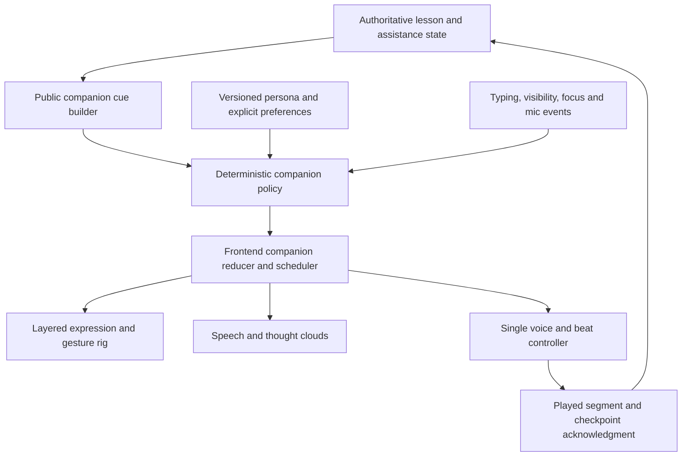

# Petros V2 implementation plan

**Date:** 8 October 2026  
**Status:** architecture approved in principle; planning extension for the Multimodal Interactive Teaching Engine recorded below. M0 has completed its audit with readiness **BLOCKED**; this update starts no remediation, M0-P or M1–M8 implementation. Application code, configuration, database roles, migrations and provider accounts are unchanged by this update.  
**Basis:** `PETROS_V2_BLUEPRINT.md`, the complete `docs/verification/petros-v2/readiness.md` M0 report, and inspection of the current working tree, including uncommitted teacher-guidance, account and avatar work. The report's observed blockers remain authoritative prerequisites; runtime settings, migrations, provider availability, audio quality and learner outcomes were not re-certified in this planning update.  
**Path convention:** every code path below is exact and relative to `/Volumes/Chris/Edrion Labs`. “Create” means a proposed future file. This existing document is the only deliverable updated now.

> **13 October 2026 planning amendment — M2 quality closure and document-format compatibility.** This file retains the approved 8 October baseline and its historical status statements. The separate `docs/verification/petros-v2/m1-foundations.md` and `docs/verification/petros-v2/m2-document-understanding.md` are later engineering reports and must be checked against the current checkout; their outcomes are not retrospectively recast as approved production deployment. M1 is reported ready for isolated review. M2 has actual PDF/PPTX extraction and isolated integration, but **full M2 acceptance remains OPEN**: cloud native recovery 19/21 (90.48%), English native recovery 18/18 (100%), both cloud important omissions flagged (2/2), zero genuine model inference requests, independent subject review missing, and legacy PPT/some production operational gates blocked. The additions below schedule **M2-G** (quality/semantic gate closure) and **M2-F-A/B/C** (progressive format support) without replacing M3–M8 or authorizing a live target/provider. These are new planning labels, not evidence of implementation.

## 1. Decision and changes to the blueprint

Build the approved evidence-driven architecture as a small, source-grounded teaching slice inside the existing NestJS modular monolith. Preserve PostgreSQL authority, existing permissions/RLS, durable commands, the routed AI gateway, trusted renderers, teacher approval and separate assessment. Move PDF/PPT interpretation and an enjoyable companion into the first prototype. Validate cloud computing and English argument analysis before calling the prototype subject independent.

Add an early **Petros Companion Playground (M0-P)** alongside M1–M3 backend work. Use the real current Petros artwork, then the revised production layers, to test a consistent personality, conversation, movement, expressions, contextual clouds, animation variation and supported natural voice before completing the teaching engine. M6 and M7 integrate and harden the behavior proven there; they are no longer the first opportunity to experience the companion. This is a targeted sequencing/delivery adjustment to the approved plan, not a new architecture. The present task updates this document only; it does not begin the playground or production learning-engine implementation.

Extend that same slice with a **Multimodal Interactive Teaching Engine**: one validated teaching action can read an anchored passage, progressively write an equation, construct an editable diagram, animate a meaningful process, invoke a trusted simulation or invite the student to alter the shared work. The canvas and avatar enact the same instructional action. M5 owns the engine; M6 integrates the supported rig and M7 hardens actual audio synchronization. The fixture-only M0-P may proceed independently of production database repair when implementation is separately authorized. Production-dependent work first passes the explicitly approved **M0-R remediation gate** in §8.

The first slice is complete when **upload → automatic proposal → authorized review/release → interactive learning → evaluated response → a different next teaching action → fresh verification → honest progress → resume** works from actual uploaded material. A prepared hand-authored lesson alone does not meet this definition.

| Blueprint decision | Revised implementation order |
|---|---|
| Content intelligence and second-subject reuse follow the cloud prototype | Implement bounded PDF/PPT extraction and semantic proposals before student teaching. Use both subjects in extraction, assessment and adaptation acceptance from the start. |
| Teacher scope/graph authoring is a substantial initial surface | Propose 2–3 objectives, a small concept map, claims and activities automatically. Teacher reviews the source-backed proposal and exceptions; graph editing is optional. |
| Ten new tables and several new modules describe the full target | Start with five new tables and six domain service classes. Keep small approved graph/mapping manifests and correction lineage in existing immutable stores. Extract additional tables only when queries/scale require them. |
| Broad tool loop/native tools and ordered streaming transport | Start with one structured next-action request over server-selected evidence and tools. Use durable polling. Add bounded application tool calls only where the same slice needs them; native tools/SSE are later optimizations. |
| Avatar rig and old voice remain fallback integration | Validate real artwork, friend-like personality and natural STT/TTS early in M0-P, parallel with initial backend work. Require aligned layers and supported animation controls before detailed motion logic; integrate lesson-aware behavior in M6 and harden voice in M7. |
| Experiences render validated instructional content and experiments | Extend their compiler/interpreter with typed shared canvas operations and one presentation timeline. M0-P proves a public fixture subset; M1–M4 establish representation, proposal and durable submission contracts; M5 delivers bidirectional demonstrations and evidence-driven selection. No second orchestrator or service per action. |
| M0 inventories readiness before M1 | The completed M0 report is BLOCKED. Add M0-R for reviewed migration-history, missing-table, restricted-role/RLS and real reviewer/course remediation, rehearsed on disposable databases before any separately approved production change. |

### 1.1 Boundaries retained without dilution

- Admission derives the institution/student principal on the server and re-resolves current assignment recipients, course/class/subject/campus, source entitlement, reviewer qualifications and approvals. A guidance attachment is not automatically a class-wide course material. Use `apps/api/src/modules/student/assignments/petros-guidance-visibility.ts` and `apps/api/src/modules/student/assignments/petros-guidance-files.ts`.
- Stable server-assigned concept/objective UUIDs and immutable versions survive wording changes. Approved mappings are explicit; matching titles or embeddings cannot merge concepts. Hard prerequisite edges must form a DAG in the approved manifest.
- Models propose instruction. They cannot grant approval, issue official marks, execute arbitrary code, write beliefs or call an evaluator with a suggested grade. All provider work goes through existing routing, credentials, budget reservations and release contracts.
- Keep public teaching/activity data separate from private answer/rubric/reference/discriminator contracts. The tutor, companion, TTS, frontend, public events, ordinary logs and shared caches receive public data only. Assessment context is fenced across every entry route, including the legacy companion and voice endpoints.
- Hold-out task families and assessment-only source units are excluded from teaching retrieval/model context. The public task may expose its own passage when issued, but source lookup cannot reveal private annotations/references or turn that passage into pre-answer coaching.
- Formative tasks may be generated within released teaching scope. A verified task requires the approved exact contract or validated parameterized family, current qualified review and known exposure conditions. Generated questions never self-approve.
- Engagement, confidence/self-report, assisted performance, unassisted observed performance, transfer, retention and educator verification remain separate. A click, completed lesson, experiment, eight-character answer, repeated equivalent task or avatar celebration does not establish understanding.
- Wrong answers create provisional hypotheses. A second distinguishing response is required to support a misconception; new unassisted discrimination and transfer are required to resolve it. Never infer emotion, disability or ability from response time, voice or camera.
- Maintain command hashes, revision/epoch/fence checks, append-only responses and correction lineage, source invalidation, cancellation, retry bounds and exactly-once logical publication under at-least-once delivery. Provider/parser work stays outside database transactions.
- Trusted components and kernels render strict validated data. No generated JS/JSX/HTML/SVG markup, selectors, imports, arbitrary expression execution or network tools. Preserve stricter existing payload limits and accessible alternatives.
- Preserve V1 routes, saved sessions, contracts and grading semantics. Pin an engine at session creation. A V2 failure never silently converts an existing V2 assessment to V1.

## 2. Minimum first-release architecture

Deploy the existing API, PostgreSQL, Redis/BullMQ and Next.js applications. Reuse the existing worker deployment, with a separately isolated parser/converter process. A second deployable teaching backend, new agent runtime or persistent voice service is unnecessary.

```mermaid
flowchart LR
  Upload[Authorized teacher upload] --> Content[Isolated extraction and content interpretation]
  Content --> Proposal[Automatic source-backed proposal]
  Proposal --> Review[Existing curriculum and qualified pack review]
  Review --> Scope[Released teaching scope]
  Scope --> Session[Durable V2 session and orchestrator]
  Session --> Actions[Teaching Action Engine: validation and compilation helpers]
  Actions --> Timeline[One validated presentation timeline]
  Timeline --> Canvas[Shared trusted interactive canvas]
  Timeline --> Companion[Public cues and companion controller]
  Canvas --> Response[Committed student response]
  Response --> Assessment[Private assessment service]
  Assessment --> Evidence[Existing evidence ledger and V2 admission]
  Evidence --> Session
  Companion --> Voice[Validated text to metered TTS]
  STT[Final speech transcript with assessment or uncertainty confirmation] --> Session
```

### 2.1 Six domain service classes, existing owners retained

| Service | Initial responsibility |
|---|---|
| `PetrosContentIntelligenceService` | Bounded PDF/PPT adapters, unit retrieval, quality/coverage checks and semantic interpretation through existing knowledge/source owners. |
| `PetrosLearningProposalService` | Suggest objectives, claims, minimal graph and activity/task drafts; delegate approval/publication to existing curriculum and pack owners. |
| `PetrosV2SessionService` | Admission, command/lease/epoch lifecycle, persistence, response commitment and recovery. Repository/worker are persistence/dispatch helpers. |
| `PetrosV2OrchestratorService` | Deterministic constraints first; choose one objective/action from real evidence; one validated structured decision, then compile public content using trusted functions. |
| `PetrosV2AssessmentService` | Task issue, exposure classification, deterministic checks and separately routed criterion evaluation; safe result/feedback publication. |
| `PetrosEvidenceAdmissionService` | Versioned eligibility, canonical criterion mapping and correction folding; existing learner-model owner persists evidence and calls a pure categorical belief reducer. |

The **Teaching Action Engine** extends `petros-experience-compiler.ts` with bounded validation/compilation helpers and shared reducers; `PetrosV2SessionService` remains the sole durable command authority. It does not add a seventh pedagogical service, a second planner or a separate backend. Companion persona, cue validation, expression selection and animation scheduling are functions/controllers, not autonomous services or agents. Reuse source preparation jobs, pack repositories, the objective evidence outbox, optional continuity and media retention. Do not require every gated V1 feature to be enabled.

### 2.2 Minimum contracts

Create ten contract files under `packages/schemas/src/petros-v2/`, plus its `packages/schemas/src/petros-v2/index.ts`; export through `packages/schemas/src/index.ts`. The three teaching-engine additions extend the existing contracts rather than replacing them:

| Exact file | Required contract content |
|---|---|
| `packages/schemas/src/petros-v2/content.ts` | Source binding/revision, typed page/slide units/locators, formulas/symbols, diagram/figure geometry, code lines, table cells and typed relationships, coverage, claim support and capability reasons. |
| `packages/schemas/src/petros-v2/proposal.ts` | Proposed objectives and stable concepts, bounded graph/mappings, public/private draft refs, required review and immutable release scope. |
| `packages/schemas/src/petros-v2/session.ts` | Engine/state, public session snapshot, commands, receipts, revision, epoch, canvas/action sequence, acknowledged presentation checkpoint and committed submission refs. |
| `packages/schemas/src/petros-v2/decision.ts` | Objective, action, evidence/hypothesis refs, concise student-safe reason, expected observation, branches, source pins, origin and termination. |
| `packages/schemas/src/petros-v2/experience.ts` | Registered family/version, public state, parameters, events, beats/targets, accessible alternative and opaque issued task ref. |
| `packages/schemas/src/petros-v2/assessment.ts` | Separate public task and server-only answer contract, committed response, criterion result, exposure and evidence classification. Private types are never exported into browser-facing DTO assembly. |
| `packages/schemas/src/petros-v2/companion.ts` | Public companion cue, persona/style and rig-capability versions, bounded behavioral modes, supported expression/gesture/callout IDs, utterance/beat IDs, epoch, turn intent/confirmation policy and voice/playback acknowledgments. |
| `packages/schemas/src/petros-v2/teaching-actions.ts` | Strict instructional action union, operation/target refs, prerequisites, required capabilities, server-resolved permissions, bounded parameters and execution receipts; `evaluate_submission` delegates only an already committed submission to the private assessment owner. |
| `packages/schemas/src/petros-v2/canvas.ts` | Typed elements/relations, editable regions, source/equation/code anchors, canvas revisions, operation batches, drafts, checkpoints, submission snapshots and undo/replay boundaries. |
| `packages/schemas/src/petros-v2/timeline.ts` | Versioned ordered presentation beats, action/canvas/utterance/rig refs, actual-playback triggers, barriers, student checkpoints, completion/cancellation and safe resume. Adapt existing presentation metadata; no general workflow DSL. |

No generic workflow DSL, arbitrary graph query API, tool discovery protocol or transport abstraction library is required. Small graph manifests are capped at 24 concepts/48 edges per first-release scope, traversed to depth two. Persist tool attempts in redacted, versioned command/session event payloads initially.

Preserve the blueprint's validated-experience bounds: at most 96 KiB JSON, 100 primitives, 32 variables, 16 parameters, 64 beats and 4,096 expression-DAG operations, or stricter existing component/kernel limits. Kernels enforce finite values, units, parameter domain, time/steps and reference invariants on client and server; assessed state is recomputed server-side. A Web Worker improves responsiveness but is not a hostile-code sandbox.

### 2.3 Initial API surface

Use the existing student guards and `/v1/student/petros/v2` namespace. Owner IDs always come from the principal. Mutations carry `commandId`, `expectedRevision` and a hashed payload; idempotent reuse with different data returns `409`.

- `POST /sessions`: verified intent plus approved objective selection/preferences; returns an owned shell or preparation receipt.
- `GET /sessions/:id`: public current action/task, objective evidence, revision/epoch, pending operation and source limitations.
- `POST /sessions/:id/commands`: next, ask, hint, interrupt, defer, pause, resume, close and activity checkpoint/draft commands. Use a strict discriminated union, not arbitrary state patches.
- `POST /sessions/:id/tasks/:questionId/responses`: typed answer commitment; returns an evaluation receipt, never a client-authored correctness result.
- `GET /sessions/:id/operations/:commandId`: durable stage/status/resulting revision; poll with bounded backoff while an operation runs.
- `POST /sessions/:id/utterances/:utteranceId/audio`: synthesizes only an existing authorized public utterance at the current epoch; returns bounded audio/segment metadata. Do not accept free-form TTS text as teaching authority.

Extend the same commands union with `canvas_edit`, `canvas_checkpoint`, `undo`, `redo`, `replay_demo` and `commit_activity_submission`; use bounded typed operations, `expectedCanvasRevision`, `expectedDraftRevision`, action sequence and activity identity alongside `expectedRevision`. No generic canvas patch or new action-specific endpoint is required. An assessed activity submission uses the existing task-response endpoint and pins its validated immutable canvas snapshot/hash atomically with the response; a formative non-task submission remains observation-only. `evaluate_submission` is a server lifecycle action, never a model-callable grading tool or a client correctness request.

Reuse media upload/process endpoints for STT. In opted-in ordinary conversation, a final usable transcript proceeds directly to `ask`, with a visible editable transcript and immediate stop/correction; there is no mandatory confirm/send step on every turn. The server determines turn intent from current session/task policy. Assessment answers require transcript review/confirmation and explicit task submission; uncertain or materially ambiguous speech requires targeted clarification before use (§7.1). A generic conversational voice route cannot auto-submit an answer or bypass a pending assessment. Teacher proposal preview/review/release endpoints live under existing portal teaching controllers; no separate graph editor is necessary. `404` hides foreign resources; distinguish stale pins (`409`), unsupported source/task (`422`), rate/budget limits (`429`) and unavailable runtime (`503`). All student/private responses are `private, no-store` with existing origin/CSRF controls.

## 3. Upload-first content intelligence and teacher experience

### 3.1 Teacher journey

1. In the current class/subject teaching screen, upload or select PDF/PPT material. Class, subject, recipients, course mapping and defaults come from existing authorized context. Optional input: “What should students be able to do?” and duration. Default to source-bound teaching; expose policy-approved alternatives only.
2. Return a durable “Reading material” receipt immediately. Show actual page/slide progress and separate stages for extraction, interpretation and proposal. An unread scan is never “ready.”
3. Present a ready-to-preview experience with 2–3 proposed observable objectives, prerequisite suggestions, source-backed claims, one interactive activity per objective, practice, fresh verification candidates and a small source preview. Highlight uncertain/unsupported regions and coverage gaps.
4. Teacher can accept/edit/remove objectives and preview the student's canvas. “Inspect details” exposes graph edges and task contracts; ordinary use requires no node-by-node graph construction. Proposed concepts may remain distinct when equivalence is uncertain.
5. A single review screen can submit multiple decisions, but records **teaching-scope approval** and **qualified assessment/task-family review** separately. Existing qualification checks decide whether the teacher can approve verification. Otherwise route the exact review request to the existing review workflow and display “Practice available; verification pending.” Do not manufacture qualifications or auto-send messages.
6. Release to the authorized recipients using existing publication/confirmation rules. Replacing material creates a new proposal/release; old sessions keep their pins until current revocation policy requires a pause or realignment.

Teacher approval covers claims, objectives, minimal prerequisites, allowed activity families and assessment instruments. Safe explanation wording/composition can vary inside that envelope. Approval of an activity does not approve its assessment key. Missing canonical class/subject-to-course association blocks verified course release; offer a concrete resolution in the existing academic owner.

**Teacher usability target:** at least 8 of 10 representative teachers release a clean, already-qualified proposal without graph editing; median active setup/review time ≤5 minutes for a 20-page/30-slide source, excluding waiting and qualification turnaround. Record review accuracy alongside speed. No forced configuration checklist or promise that every upload can be approved in one click.

### 3.2 Minimal pipeline required before the first teaching demo

`current source authorization → scan/type/resource checks → isolated extraction/render → selective recognition → immutable units → bounded semantic interpretation → validated proposal → human release → scoped retrieval`.

| Format | Required now | Explicit first-release limits |
|---|---|---|
| Digital PDF | Native text with reading-order/page geometry, headings, page rendering/crops and table cells where reliable; preserve hashes/spans. Extract relevant figure/caption relationships using a bounded vision call and show its uncertainty. | Multi-column order, equations and complex charts need review; uncertain facts are excluded from teaching/assessment. Encrypted/corrupt files fail explicitly. |
| PPTX | Slide IDs, shape IDs, text, notes separated from visible content, simple table structure and rendered slides. Link shape/crop/converted-page locators to the original. | SmartArt, animations, embedded media and unsupported math are flagged. A successful text preview is not full slide interpretation. |
| Legacy PPT | Convert in an isolated, credential-free, network-denied worker; retain original hash, converter version and slide/page mapping. This is required for the audited cloud attachment if it is still the pilot source. | Conversion readiness/fidelity is an admission gate. If unavailable, teacher supplies a supported export; do not silently teach binary-string heuristics. |
| Low-text/image regions | Selective OCR/vision on a bounded set of objective-relevant regions, with pixels, confidence and correction links. This is part of the early pipeline. | Broad scanned-document/handwriting support is deferred. Unsupported or unreadable objectives remain blocked; partial supported scope is explicit. |

Start admission at ≤20 MiB, ≤20 pages/30 slides for the pilot, ≤2 million extracted characters subject to stricter existing limits, bounded ZIP entry/expanded-size/ratio limits, and at most six selected OCR/vision regions per preparation. These are new V2 pilot limits, not changes to V1 limits. Enforce CPU/memory/deadline/stdout caps and no macros/external-link execution. Reuse PDF.js, JSZip and the converter where suitable; adding rendering must not weaken `apps/api/src/modules/student/knowledge/knowledge-pdf-process.ts` isolation. The existing converter's `execFile` timeout is not proof of network or credential isolation.

Canonical units initially need heading/paragraph/list, table, figure/diagram, formula-as-source, code, caption and unresolved kinds. Preserve native formulas/text/crops, symbols and assumptions; reviewed structured math is optional per unit and only allowlisted bounded validators/kernels compute results. Preserve code language and line anchors without execution; table headers/cells/units; diagram nodes/edges, chart axes/legends and caption/part-of/support relationships with confidence and review status. Do not convert a visible arrow into a causal claim without support. Each unit has immutable ID, source revision, order, locator, content hash, parser/render versions, extraction method and quality. PDF offsets use a declared encoding; PPT notes cannot masquerade as visible-slide claims. Renderability, editability, teachability and computational validity are separate capabilities, with unsupported reasons.

Semantic interpretation is a real gateway call over bounded extracted units, not a document-title heuristic. It proposes relationships, examples, objective criteria, claims and uncertainties, each with exact supporting locators. Validate locators/hashes mechanically and screen claim support separately; a valid citation is not proof of entailment. Review numeric facts and answer-relevant relationships. Deduplicate semantic jobs by source/extractor/prompt/schema pins. A teacher correction creates a new interpretation revision; never mutate cited units in place.

Extend `KnowledgeDocumentService` source authorization and retrieval to typed units. Begin with scoped PostgreSQL full-text/ranked lexical lookup plus objective/mapping filters and adjacent captions/table headers. Fetch 4–8 bounded units, at most two retrieval passes per adaptive turn. Recheck entitlement on cache hits and publication. No vector service, full-library upload to a provider or arbitrary web retrieval. An insufficient passage produces a content gap/source inspection option, not a general explanation disguised as grounded instruction.

Guidance attachments retain `guidance_attachment:<objectId>:<publicationVersion>` bindings and assignee visibility. Extend preparation/source schemas to support this binding directly; do not forge a class-material ID to satisfy existing columns. Shared extraction is reusable only under current access to that exact revision.

### 3.3 Versioned source-format expansion — M2-F-A/B/C (13 October 2026)

**Architecture decision:** use the same existing `ContentAdapter` family, `PetrosContentIntelligenceService`, source-revision/content-unit repository, current source/recipient authority, safe queue and routed interpretation gateway for every admitted format. Add format-specific **extractors and source-locator discriminators**, not a second ingestion platform, new agent, generic conversion shortcut or format-specific lesson runtime. Keep the originally approved PDF/PPTX/legacy-PPT admission and M2 semantic-quality obligations; future adapters do not automatically clear them. The original M2 pilot limits are defaults until per-format limits are separately qualified; use stricter existing limits.

| Format | Planned tranche | Exact structural expectations and admission caveats |
|---|---|---|
| PDF | Original M2 | Already implemented in isolated tests; improve the cloud visual facts, reading-order/table quality and full semantic validation; preserve page/span/geometry and content limits. |
| PPTX | Original M2 | Already implemented in isolated tests; preserve slide/shape/table/chart/notes separation, native-to-render transforms and partial/flattened-art warnings. |
| Legacy `.ppt` | Original M2 conditional blocker; also M2-F-C interoperability | Do **not** relabel as supported until an isolated credential-free genuine-file conversion, original slide inventory, stable original-to-converted mapping and fidelity tests pass; offer supported export meanwhile. |
| DOCX | **M2-F-A — next** | Native OOXML paragraphs/runs/styles/headings, list numbering, tables including merged cells, images/captions, formulas as native source or explicit unresolved, footnotes/endnotes/comments tracked by visibility and authority, section/page-break semantics, links inert and tracked-change/revision handling. Word pagination is layout-dependent; use paragraph/run/table-cell locators as canonical, optional rendered page maps only after qualified fidelity. |
| TXT | **M2-F-A — next** | Explicit/validated charset and newline/offset policy, lines/paragraphs, headings only when actually inferable, code as inert text, byte/UTF-16 span correspondence, BOM/malformed-character and extreme-line handling. No fabricated hierarchy. |
| Markdown (`.md`) | **M2-F-A — next** | CommonMark/GFM-compatible headings, lists, fenced code/language, quotes, tables where supported, inline math only as literal/source, source line/column/byte spans, sanitization of raw HTML, inert links/images with no remote fetching; no Markdown-to-executable HTML trust elevation. |
| HTML (`.html`, `.htm`) | **M2-F-B** | Offline inert parse of headings, semantics, table DOM, lists, code, links and local admissible assets; sanitized output only. Reject/disable scripts, event handlers, remote resources, external CSS/iframes, SSRF, active content; selector/DOM identity is version-pinned, not unrestricted CSS/JS execution. |
| XLSX | **M2-F-B** | Workbook/sheet/row/column/cell/formula-string and cached-value identifiers, headers, tables, units, merged ranges, numeric/date formats and charts where reliable. **Never execute spreadsheet formulas/macros, DDE, external references, queries or connections**; formulas are inert provenance-bearing source until reviewed bounded kernels exist. Empty/hidden sheets and formula-versus-cache distinction explicit. |
| CSV | **M2-F-B** | Encoding/delimiter/quoting/header uncertainty, stable row/column/cell offsets, typed-but-untrusted values, large-row/field/column bounds and CSV-formula-injection-safe previews/exports. No automatic claim that a data table constitutes a lesson. |
| ODT / ODP | **M2-F-C** | Qualified OpenDocument package parsing for paragraphs/tables and slide/shape IDs; preserve original structure and rendered fidelity separately, no active/external content. |
| JPG / JPEG / PNG | **M2-F-C** | Standalone original raster/EXIF-orientation/coordinate anchors, bounded dimensions and crop evidence, OCR/vision review with uncalibrated confidence honestly labelled; handwriting and diagrams require separately admitted recognition evidence. Existing embedded OCR is not proof of broad image-document support. |
| EPUB | **M2-F-C** | Offline container and spine/chapter order, HTML/text/assets, stable chapter/section anchors, edition/hash/copyright-rights checks, no scripts/network/DRM bypass; unsupported DRM fails closed. |
| Legacy DOC / XLS | **M2-F-C** | Strict legacy binary identification, isolated conversion or qualified native read, byte/converter/element provenance, fidelity/hidden-content checks; blocked where worker isolation or correct locator reconstruction is unqualified. |

**Sequencing:** M2-G's unresolved accuracy and genuine inference gates have first priority. M2-F-A (DOCX/TXT/Markdown) is the next isolated format implementation after a bounded M2-G remediation pass, and may run in parallel with later isolated M3 engineering **only when it does not weaken source/review authority or delay the source-to-teaching slice**. M2-F-B and C remain separately authorized, deferred implementation slices; record their interfaces and tests in this plan now, but do not build them merely because they are listed. A format is supported only after genuine-byte, source-locator, security, accessibility/preview, restricted-role, altered-source, bounded-job and regression checks have passed for that format. A successfully converted PDF preview is not proof that DOCX/XLSX native structure was recovered.

**Common contract and trust invariants:** each adapter emits immutable original hash; extractor/renderer/converter and interpretation pins; stable typed locators (PDF page/span; PPTX slide/shape; DOCX paragraph/run/table cell; TXT/Markdown line/span; HTML DOM region; spreadsheet sheet/cell; image pixel/crop; EPUB spine/chapter); quality and capability flags; coverage/omissions; separately authorized derived assets; render transformations only when observed; and strictly inert extracted code/formulas. Parser admission must enforce type-by-magic-and-structure (not filename alone), decompression/ZIP/XML/entity/traversal limits, sandbox limits, no macro/script/external-resource execution, denied cross-tenant/recipient access, idempotent queue and revocation fences. Preserve the M1 immutable revision/model, M2 typed unit schemas, guided-attachment bindings and V1 compatibility. Extend the locator union in an additive, versioned manner; do not coerce a paragraph into a fictitious PDF page or a spreadsheet cell into prose.

**Per-tranche acceptance:** review at least one clean file and one adverse/altered file per format using genuine bytes, independent labels where factual interpretation is claimed, hash/locator correctness on every admitted unit, source-linked reviewer inspector or faithful alternative, explicit unsupported features, no privileges added to renderer/model, and separate latency/cost measurements. Start with an isolated local QA harness; no new public upload, production flag or release authority arises from this plan. New formats do not automatically gain teaching/assessment capability even if their units are displayable.

## 4. Student experience and the first intelligent session

### 4.1 Learning canvas

The central surface is a work area with an objective, manipulable representation and contextual conversation. A compact companion dock sits beside it; sources and evidence are reachable without replacing the activity with a chat log. On mobile the companion stays in a reserved strip and the discussion opens below the activity. Keyboard, touch, numeric/text alternatives and screen-reader labels are required.

The teaching-engine section below makes this a shared work surface: Petros can construct and revise source-backed explanations through typed actions, and students can edit permitted elements/steps and commit their reasoning. All existing activity families use the same canvas revision/operation/checkpoint and presentation contracts; the avatar and voice refer to that actual work.

First-release activity families:

- **Relationship board:** classify items, connect concepts/claims/evidence, compare cases and revise a structure. Use existing classification/comparison/diagram primitives; all labels, permitted relations and answers come from approved content/task definitions.
- **Prediction → change → explain:** commit a prediction, manipulate a bounded parameter or relationship, inspect the resulting diagram/table/revised text, then explain the difference. The public exploration result is separate from an assessed task.
- **Worked example → faded practice:** reveal one justified step, ask the student for the next step/reason, reduce support, then use a fresh task. Step navigation alone remains engagement.
- **Fresh task panel:** a clearly marked check with typed response, optional confidence, allowed assistance and server-issued instance. The same canvas remains visible only if its revealed facts do not expose the check's hidden solution.

Add the blueprint's bounded resource kernel for an actual controlled cloud-capacity experiment; its dimensions, assumptions and price inputs are authored and reviewed. It has reusable capacity/demand/count semantics, no cloud-brand logic, arbitrary equations or claim to model real billing. English argument analysis experiments by changing a claim, removing evidence or adding a counterexample and comparing defensible interpretations; structural link validity can be immediate, while rhetorical adequacy requires the rubric/evaluator.

Feedback responds to committed work: acknowledge the valid part, identify one gap with a response span/source, then offer a useful next move. Do not display a correctness tick for a prediction/exploration observation unless an issued instrument evaluated it. Display “Practice with support,” “Explanation checked,” “New application demonstrated,” and “Delayed review due” independently. Close with unmet objectives and support used; step count/XP is never a learning claim.

### 4.2 Activity selection and contextual tutor

The orchestrator sees the current approved scope, task exposure, criterion evidence, provisional misconceptions, student-selected element/question, acknowledged canvas state, source units and explicit preferences. Resolve hard constraints first. Select an eligible action from no evidence → probe/orientation; incorrect relation → discriminator/contrast; correct method with slip → focused repair; assisted success → faded support/fresh family; sound explanation → transfer; ambiguity → clarification/review. Every decision names triggering evidence and what observation could change it.

Include committed equation/diagram/source/code/simulation work, tool/rig capabilities, accessibility and time/cost constraints in that context. Select the instructional family before compiling concrete shared canvas/avatar actions; a short explanation or targeted question remains an eligible choice. The Teaching Action Engine validates execution, not pedagogy or correctness.

One structured model request normally chooses and composes the next action from available instruments; deterministic code validates it. Allow at most one contract repair, two retrieval passes and a 20-second deadline. If a tool envelope is needed, cap at two model rounds/four calls for this slice, below the blueprint's maximum. Slider frames/local link manipulation make no model calls. Use approved fragments and deterministic compilation when possible; there is no mandatory PLAN call followed by another model RENDER call.

“Why this arrow?” carries a declared target ID and current activity revision, not inferred screen contents. `ask` suspends presentation within the same session; it resumes the acknowledged checkpoint. Explicit confusion may change representation. Hesitation alone offers optional help only under the companion policy and never updates knowledge. After two unsuccessful interventions, offer another approach, pause or teacher review instead of an endless hint loop.

### 4.3 Concrete end-to-end cloud trace

1. Teacher uploads the authorized cloud PPT. The system interprets its slides and proposes the consumer/provider control objective with source anchors and an interactive relationship board. Teacher reviews claims/scope; a qualified reviewer approves distinct practice/discriminator/transfer families.
2. Student enters through the released goal and sees the actual source/capability status. Petros gives one short orientation and asks a server-issued low-stakes relation question.
3. Student says the provider handles every layer. Persist the answer before evaluation. The evaluator identifies the claim as a **candidate** misconception and checks a competing misreading explanation with a distinguishing task.
4. If supported, show a comparison in which the student assigns responsibilities, predicts what changing consumer control changes, and discusses a selected layer. If the issue was terminology, use a small vocabulary/diagram repair instead. Strong initial evidence skips elementary repair and goes to transfer.
5. Student runs the bounded capacity experiment, first predicting then changing an input and explaining the observed result. Petros notices the committed prediction and later evaluation, not every slider movement. Source-grounded visuals and immediate deterministic model output make this interactive; exploration earns no verification credit.
6. Student interrupts with a contextual question. Audio stops locally, stale beats are invalidated, the server records any answer-relevant exposure, and the student returns to the same acknowledged work. A supported pending check becomes practice.
7. On a fresh approved non-equivalent task, submit classification and explanation. Correct label with false reasoning produces a boundary contrast; a sound explanation plus unseen application can contribute to `demonstrated_in_session` when all required criteria have sufficient evidence.
8. Pause/reload/resume preserves drafts, task instance, source pins and assistance history. Closure shows exactly which criteria were checked and which remain pending. Schedule new 24–72-hour retrieval and seven-day retention checks before refresher instruction.

**First intelligent prototype completion:** this trace and the English trace both start from uploaded sources, take at least two different evidence-driven paths through the same orchestrator, include manipulation/prediction/reasoning/discussion, commit real responses, produce grounded feedback, support a fresh approved check and retain state. Companion modes react coherently to teaching, practice and assessment. Text mode alone must pass; first release also requires the voice/usability gates below. Simulated scheduling proves scheduling only; actual retention requires elapsed real time.

### 4.4 Demonstrate subject independence early

| Dimension | Cloud computing | English: argument and evidence |
|---|---|---|
| Sources | Actual authorized PPT/PPTX plus an approved PDF reference where needed | Teacher-uploaded PDF argument with PPT commentary/examples; no model-authored source substitutes |
| Observable objective | Explain/control-classify a novel scenario; justify assumptions | Distinguish claim/evidence/warrant, test a counterargument and revise a defensible claim |
| Reusable interaction | Relationship board, comparison, bounded resource experiment | Same relationship board/comparison/prediction wrapper; revise a claim/evidence link and test a counterexample |
| Adaptation example | Control misconception versus terminology gap | Evidence confused with assertion versus missing warrant versus valid alternative reading |
| Evaluation | Deterministic classification/kernel checks plus criterion explanation | Deterministic structural validation plus criterion evaluation accepting multiple valid readings; uncertainty/qualified review |
| Fresh verification | Unseen scenario from a held-out family | New passage/argument withheld from teaching, source-authorized for the check, with private reviewed rubric |

Both fixtures enter content tests in milestone 2, private assessment in milestone 4 and real adaptation in milestone 5. Runtime code must contain no `if subject === cloud/English`, topic-name branch, fixed subject lesson order or answer key. Subject-specific material belongs in uploaded/released content and approved task records; deterministic tools declare their own capability/domain. Test renamed topics, changed labels and alternate sources. Generic UI structure may be shared, but the resulting activity and feedback must reflect the material's actual relationships.

## Multimodal Interactive Teaching Engine — Shared Canvas and Avatar Actions

Petros teaches through **shared educational work**: a source passage, a derivation, a constructed representation, an experiment or a student's revision. Each demonstration has an instructional purpose, a validated state change and, when useful, a student participation checkpoint. The avatar looks, speaks and gestures about that same work. Static figures remain useful source assets; generated static pictures are not the default substitute for structured, inspectable demonstrations.

### Engine ownership and reuse

The flow is `existing orchestrator decision → Teaching Action Engine → validated experience/timeline → canvas + companion + voice → committed student work → existing private evaluator → existing evidence admission → next decision`. The orchestrator chooses *why and what to teach*. The action engine checks *whether and how the chosen action can run*. The frontend performs only accepted operations; the companion enacts supported public cues. Neither renderer nor avatar can decide correctness, issue a task or write learning evidence.

| Existing or already planned owner | Extension, without a second architecture |
|---|---|
| `apps/api/src/modules/student/petros-v2/petros-v2-orchestrator.service.ts`, `apps/api/src/modules/student/petros-v2/petros-v2-context.ts`, `apps/api/src/modules/student/petros-v2/tools.ts` | Supply objective, sources, evidence, current canvas and registered capabilities; choose an action family. Keep the existing bounded teaching decision and gateway call. |
| `apps/api/src/modules/student/petros-v2/petros-experience-compiler.ts` | Own the Teaching Action Engine entry point; call pure action, equation and timeline validators, compile trusted public operations/cues, and reject unsupported intent. No per-operation service. |
| `packages/schemas/src/petros-engine-contract.ts`, `packages/schemas/src/petros-engine-compiler.ts`, `packages/schemas/src/petros-engine-interpreter.ts`, `packages/schemas/src/petros-engine-controller.ts` | Reuse strict primitive IDs, unit/domain checks, bounded expression DAG, parameter changes, deterministic interpretation and interruption/checkpoint behavior. Extend with a versioned V2 adapter instead of replacing V1 schemas. |
| `packages/schemas/src/petros-engine-registry.ts`, `packages/schemas/src/petros-engine-models.ts`, `packages/schemas/src/petros-engine-units.ts`, `packages/schemas/src/petros-visual-program.ts` | Register only tested data capabilities and approved kernels; preserve solver/domain/unit limits and disabled executable extensions. Typed mathematical data is never unrestricted expression execution. |
| `apps/api/src/modules/student/petros-loop/petros-workspace.service.ts`, `apps/api/src/modules/student/petros-loop/petros-workspace.repository.ts`, `packages/database/src/schema/petros-workspace.ts` | Reuse acknowledged workspace, operation receipts and immutable checkpoints through a V2 adapter under session command authority. Existing workspace prediction checks remain observation-only. |
| `apps/student-web/src/components/petros/petros-program-workspace.tsx`, `apps/student-web/src/components/petros/petros-program-worker.ts`, `apps/student-web/src/components/petros/petros-teaching-block-renderer.tsx`, `apps/student-web/src/components/petros/petros-math.tsx`, `packages/ui/src/petros-teaching-block-preview.tsx` | Reuse trusted SVG/math, worked steps, diagram/graph/table representations and worker evaluation. Add editing and progressive presentation wrappers around these components. |
| `packages/schemas/src/petros-presentation.ts`, `apps/student-web/src/features/learning-studio/target-registry.tsx`, `apps/student-web/src/features/learning-studio/use-teaching-playback.ts`, planned `apps/student-web/src/features/petros-v2/presentation-controller.ts` | Adapt legacy presentation metadata to one V2 timeline; reuse live target geometry and one playback owner. Do not add an independent avatar clock or timer-based diagram-advance loop. |
| Existing content, assessment, learner-model, companion and voice owners in §§2–7 | Preserve entitlement, qualified review, private answers, exposure, categorical evidence, persona, routed STT/TTS and metering. Rendering a demonstration grants no new authority. |

The current engine's source binding and `reviewed_source` compiler path are projectile-specific; its workspace admission expects uploaded-document diagram blocks. M5 must add a strict **versioned V2 source/claim binding** and generic activity adapter, retaining the existing projectile/V1 path. Admit each kernel only with its exact approved source/objective/assumption mapping. Do not cast a guidance source to a projectile binding, mark instructional simulations `engineering_comparison` to bypass review, or equate a registry entry with production readiness.

### Capability families and supported operations

The operation names below form a strict discriminated union, not separate services or a general-purpose scripting language. Higher-level teaching actions compile to a small set of shared canvas operations and presentation beats. Every capability declares input/output schemas, permissions, editable scope, runtime/rig requirements, bounds, cancellation, accessibility alternative, provenance and whether it may operate during assessment.

| Family / typed actions | Required behavior and validation |
|---|---|
| Reading: `read_source`, `highlight`, `annotate`, `focus_view`, `compare_states` | Read authorized units; highlight the exact sentence/paragraph/span, equation, table cell or figure region being discussed. Zoom/isolate sections; compare passages from separately authorized sources and show each locator. Annotations are overlays linked to immutable originals. Validate offsets, crop coordinates, render transforms, hashes and entitlement before display/read-aloud. Approximate timing permits phrase/segment highlights, not a false word-level claim. |
| Writing: `write_text`, `write_equation`, `type_code` | Progressively reveal validated text, pseudocode, calculations and equation steps; modify an existing approved editable span; pause for a question. Store complete semantic text and step IDs, with a transient reveal cursor. Use shared safe math rendering and reviewed pronunciation rules. Typing/reveal effects are labelled **progressive text**, not handwriting. |
| Mathematics: `transform_equation` | Reference before/after step IDs, symbols, units, declared domain/assumptions and an allowlisted transformation rule or reviewed worked step. Validate substitutions, arithmetic and equivalence only in supported bounded domains; retain side conditions such as a nonzero divisor. Unsupported symbolic work stays source display/review-needed, never a claimed proven transformation. |
| Construction: `draw_diagram`, `draw_graph`, `connect_elements` | Build typed nodes, edges, axes, points, labels, table cells and groups incrementally. Reuse flowcharts, concept/relationship maps, geometric figures, scientific/network/process diagrams, timelines, classification trees, cause-and-effect maps, data structures and tables as compositions of primitives. Validate relation endpoints/types, layout bounds, axis units/domain, graph samples and source-backed meaning. Use reviewed sampled data or approved bounded kernels for curves; no arbitrary formula evaluator. |
| Editing: `erase`, `replace_content`, `move_element`, `connect_elements`, `annotate`, `highlight`, `focus_view`, `compare_states` | Erase/replace a permitted element/span, add/remove a relation, rearrange a group, underline/bracket/arrow a step, highlight differences, pan/zoom and compare before/after checkpoints. Preserve stable logical IDs where identity is unchanged; replacements record lineage. Validate the entire operation batch so deletion never leaves dangling targets/edges. Correct Petros's own error with an appended repair and visible explanation. |
| Processes: `animate_process` | Reveal steps, move data tokens, show mathematical/physical transformations, scientific processes, algorithm execution, state transitions, sequences and causal changes. Use registered finite keyframes/state transitions or a trusted kernel's events; declare what relation the motion explains. Controls include pause, step, replay and reduced-motion text/table sequence. Motion completion is presentation only. |
| Experiments: `run_simulation`, `ask_prediction` | Commit a prediction before a gated outcome reveal, change bounded parameters, run a registered model, plot measurements, compare checkpoints and explain changed outcomes/assumptions. Student changes use the same typed parameter contract. Reuse existing projectile/pendulum/circuit kernels only after source/authority gates; initially require the bounded resource model and at least one existing kernel with golden reference tests. Advanced cooling/other kernels remain separately gated. No model-authored solver or arbitrary executable formula. |
| Participation: `request_student_action`, `wait_for_response` | Declare editable region/element IDs, allowed operations, response schema, support mode and checkpoint. Invite an equation completion, diagram drawing/edit, missing link, example correction, source annotation, parameter change, prediction, code/pseudocode edit, rearrangement or explanation. Yield the floor and retain unfinished Petros work. Waiting has no compulsory timeout-as-failure or repeated prompt. |
| Evaluation: `evaluate_submission` | Accept only an opaque **already committed** submission/task ref; the session owner dispatches the existing private assessment service. Validate structure independently from semantic correctness; return a public receipt and later sanitized feedback. The teaching model cannot pass a proposed grade, reference answer or diagnosis into this action, and cannot invoke the evaluator directly. |
| Code/algorithms: `type_code`, `animate_process`, `request_student_action` | Syntax-highlight inert code and pseudocode with stable line IDs; show authored/reviewed line traces, variables, memory cells, data structures, debugging diffs and algorithm states. Student code is editable text. A changed program invalidates its old trace; show stale/unavailable until an approved trace is selected. A tiny reviewed algorithm demonstrator may accept typed data under fixed bounds, but never interpret or execute arbitrary student/model code. |
| Companion/delivery: `gesture`, `speak`, `wait_for_response` | Supported expression/gaze/gesture/position/cloud IDs refer to the same action/beat and visible target. `speak` references validated public utterances; audio comes from §7's route. A writing gesture must bind to a real writing/drawing operation and its presentation progress. Unsupported gestures settle neutrally with a useful canvas highlight/caption. |

Diagrams retain editable semantic structure, not only pixels. A flowchart's order/branch constraints differ from an argument map's evidential relations; relation schemas come from a registered family and approved scope, not a universal claim that every graph must be acyclic. Geometry and rendered shape alone do not certify mathematical/scientific truth. Source figures may be raster crops with anchored overlays; construction uses trusted primitives. Hand-authored local SVG assets are permitted; model-supplied SVG/HTML/JS/JSX, selectors, shell, imports, arbitrary URLs and executable TeX are prohibited. Escape student and source labels and keep renderer trust/HTML options disabled.

### Strict action contracts and validation

| Contract | Required fields and invariants |
|---|---|
| `TeachingActionEnvelope` (`petros.v2.teaching-action.v1`) | Server-assigned action/command/session/activity IDs; schema/compiler/capability versions; session revision/epoch/fence; expected canvas/draft revision and action sequence; objective/scope/source/claim pins; action union; concise purpose/expected observation; target refs; bounded parameters; assistance/exposure mode; cancellation/resume rule and resulting-state hash. Permissions and actor are resolved server-side, never trusted from the model/client. |
| `CanvasElement` / `CanvasOperation` | Stable element ID and version, kind, parent/group, semantic payload, validated layout, provenance, owner/editability and accessible label; immutable source/step/line/cell anchors. Strict add/update/replace/remove/connect/disconnect/set-parameter/annotate operations plus presentation-only focus/highlight/reveal. Element refs include activity/branch identity; no raw DOM selector or model-authored avatar screen coordinates. |
| `DiagramSpec`, `EquationStep`, `ProcessSpec`, `SimulationRequest`, `CodeTrace` | Versioned registered family, permitted primitives/rules, source-backed meaning, input/domain/units, reference/checker version and accessible equivalent. Equation steps preserve assumptions and dependencies; process/trace steps reference exact element/line revisions. Simulation includes solver version, ranges, time/step/sample budget and result/measurement hash. |
| `StudentInteractionCheckpoint` / `CommittedCanvasSubmission` | Checkpoint/invitation ID, allowed edit region/operations, frozen prompt/task/support conditions; base/current revisions, ordered student operations, immutable committed work snapshot/hash, explanation and modality refs. Client correctness fields are forbidden. Assessed submissions bind to a server-issued task; no task means no verified evidence. |
| `PresentationTimeline` / `PresentationReceipt` | Ordered beat IDs, action/operation/utterance/segment/target/rig refs, dependency barriers, expected state hashes, trigger/completion/fallback policy and interaction checkpoints; epoch/sequence, acknowledged semantic prefix, played position and meaningful committed checkpoint. No private evaluator text in any presentation field. |

Public state hashes describe only public scene/work; hidden correct states, evaluator references and their answer-revealing hashes remain server-only. Model proposals reference registered logical targets; the server assigns newly created element/action IDs and validates their ordered creation before dependent operations/cues.

Validation follows the existing compiler: preflight bytes/depth/cardinality → strict schema/unknown-field rejection → registered capability and server permission → current source/review/objective/assistance pins → stable targets/operation preconditions → diagram/equation/domain/unit checks → accessible alternative → factual support screening → public/private allowlist → bounded simulation dry-run where needed → accepted timeline and atomic publication. A well-formed operation is not proof its teaching claim is true. One targeted repair is allowed under existing turn limits; otherwise use approved content, ask for clarification or report unsupported work.

Apply the stricter of V2 limits (§2.2) and each component/kernel limit to **aggregate** canvas, action-batch and timeline payloads. Initially cap one mutation command at 32 semantic operations; longer demonstrations split at explicit resumable checkpoints within the 64-beat bound. Bound text/code length, points per stroke/graph, keyframes, attachment refs and undo history; inherit existing stricter 8,000-character workspace draft and renderer limits. No unbounded op log, recursive subprogram, continuous model loop or unlimited simulation. Student-drawn annotations may use bounded point arrays as inert marks; they are not automatically recognized as equations or diagram semantics.

### Shared state, persistence and bidirectional editing

`SharedCanvasState` records activity/branch identity, canvas revision, last accepted action sequence, typed elements/relations, source/claim refs, student draft revision, published demonstration/timeline version, completed semantic operations, invitation/task state, checkpoint/parent refs and allowed undo range. Simulation execution version is separate from presentation position; source, program and draft versions remain separately pinned. Keep one reducer contract on client and server. The server recomputes accepted operations and state hashes rather than accepting an arbitrary client snapshot.

- **One durable writer:** V2 session commands serialize Petros and student commits using existing revision/fence checks, with workspace checkpoint writes in the same owner transaction. The workspace adapter does not retain an independent V2 command writer. Pause presentation while the student edits a relevant region; Petros cannot erase or overwrite a draft while responding. A concurrent/stale edit returns `409` with a refresh/reconcile path and retained local work, never silent last-write-wins. Multi-person collaboration/CRDT infrastructure is deferred.
- **Local draft versus commit:** typing, dragging and bounded stroke previews are immediately local and untrusted. Coalesce typed edit batches for autosave; acknowledge validated draft checkpoints, then flush and atomically pin the exact submission before evaluation. Selected-element questions carry ID, activity/branch/revision and relevant committed state; meaningful unsaved changes require a validated save or an explicitly uncommitted context label. No grading from cursor motion or unfinished keystrokes.
- **Source and work ownership:** original passages/figures are read-only; overlays and derived teaching copies are editable only within the invitation/policy. Students can construct shapes/connectors, complete equation slots, change permitted graph/simulation data, annotate regions, rearrange elements, edit inert code and explain reasoning. Trusted element references and relationship edits enable immediate inspection without requiring handwriting/sketch recognition.
- **Checkpoints and recovery:** reuse existing `petros_workspaces`, `petros_workspace_checkpoints`, `petros_workspace_operations` and V2 session/events; no new canvas table. Save accepted semantic changes, demonstration prefix, pending invitation/task, source pins and acknowledged playback boundary. On reload recheck authority and restore the last acknowledged state plus disclosed unsaved local work where retained; do not claim unacknowledged changes survived. Prefer a saved paused state to auto-playing a recap or overwriting student work.
- **Undo/redo and replay:** inverse operations or restored checkpoints create new revisioned operations within the current practice edit range. Undo cannot delete submitted answers, evaluation history, assistance or exposure. Redo rejects after incompatible edits/source changes. Authored demonstration replay uses a separate read-only presentation branch or explicit practice copy; it cannot resubmit work, roll beliefs backward or replay rewards. Answer-relevant replay still records exposure and may make equivalent future tasks assisted.
- **Cancellation and correction:** immediate local stop cancels the transient frame/cursor and pending gesture/audio; committed semantic operations remain. Durable interrupt advances epoch and fences all old callbacks, worker results and remaining operations. Recompute and commit an approved prefix at a safe beat boundary when saving an interruption; never mark the entire demonstration completed. If Petros's demonstration is wrong, append a repair with before/after lineage, invalidate dependent stale beats and revalidate affected work; assessment/evidence corrections use existing append-only owners, not a canvas undo.

Transient text reveal, hand/mouth/blink frames, pointer paths, interpolated motion, worker samples and viewport easing are not saved educational facts. A completed derivation step, changed relation, committed parameter set, meaningful annotation, student submission or acknowledged interaction checkpoint is. Store durable state at semantic boundaries, not every frame or character. Delivered answer-relevant content is conservatively exposure even if a played/visible acknowledgment is missing; replay/hide/erase never restores independence.

### One presentation timeline: narration, canvas, avatar and interruptions

Extend the existing presentation beats rather than inventing a choreography language. Each beat binds accepted canvas operations to a public utterance segment, declared target, supported rig cue and completion barrier. Dependencies may refer only to earlier validated beats/operations; target creation precedes pointing. A barrier completes when its required operations and actual playback segment have completed, or a declared text-only/user-step alternative has been taken. It never advances an assessment on an animation timeout.

In voice mode, actual player `playing`, `currentTime`/media events, `pause`, `ended`, error and interruption drive narration-relative effects. `canplay`, a downloaded/generated segment or a `play()` request is not proof of audible output. Use reliable provider timings only after adapter validation. Without them, coordinate semantic/sentence start/end and highlight a phrase/step; use bounded visual durations for writing/drawing within the segment and wait for the completion barrier. Do not infer exact words from duration, use input STT timestamps for output, or promise accurate hand/phoneme alignment from guessed timing. An audio stall freezes dependent canvas/gesture progress; already committed work remains visible. Text mode supplies explicit step/continue controls and equivalent captions.

Example public slope fixture: a beat says “Let's work out the slope first,” creates the reviewed slope-expression element, and progressively reveals it; the avatar looks at that expression. The next beat highlights its declared variable IDs, performs a checked substitution and narrates the relation. The next pauses with an editable next-step slot and asks the student for the step and reason. Local changes produce no TTS request; commitment goes to the evaluator, whose evidence determines a focused arithmetic repair, an assumption question, a contrast or fresh practice. A contextual interruption freezes the same derivation, answers within source/assistance scope, then explicitly returns to the acknowledged step. This demonstrates the engine without hardcoding a mathematics lesson into runtime selection.

One `presentation-controller.ts` owns this timeline and delegates audio to the existing V2 playback controller and poses to the companion controller. It deduplicates `(epoch, timelineId, beatId, actionId)` receipts and rejects stale activity/branch/revision targets. On stop/mic/pause/hidden/revocation, mute locally within §7's stop target, clear future cues and send the existing idempotent interrupt. Persist the valid semantic prefix and playback boundary under the new epoch, best-effort cancel provider work, and ignore late canvas/voice/rig callbacks. Resume explicitly after current-authority checks; rebind geometry and continue from a safe sentence/step boundary without duplicated writes. A committed answer continues evaluation exactly once even if presentation is cancelled.

Generate speech only for accepted public utterances, normally one useful idea per segment with §7's one-segment lookahead. Slider frames, progressive text characters, gesture frames, edit autosave, local undo and step-back over already available content make no new voice-generation request. Use available approved audio under current entitlement and §7's cache keys; explicit new explanation may use the normal bounded teaching call. Assessment-safe mode freezes/hides answer-relevant prior work and disables predictive hints, reveals and evaluative expressions across every entry route, including the source inspector and simulation controls.

### Avatar integration and artwork dependencies

Retain §6's friend-like personality, truthful status clouds, natural uncertainty, restrained movement, quiet waiting, reaction limits and assessment neutrality. For a constructed diagram Petros's gaze follows the currently revealed node/relationship, then settles. At a student checkpoint it yields without repeating praise or a fake thinking loop. Feedback refers to actual committed work. After a detour it returns to the saved step. Speech clouds/captions refer to the same utterance; thought/status clouds describe real retrieval/evaluation stages and never private reasoning.

Current static pointing poses and the unused `pointAngle` prop cannot produce accurate continuous hand tracking or writing. **The first prototype must teach with progressive text, structured diagrams, real highlights and manifest-supported directional gestures even when actual character writing is unavailable.** Revised basic expression/pose assets remain §6's companion gate; advanced writing/hand/arm assets are not an additional prerequisite for canvas teaching.

| Additional art/engineering deliverable | Required specification before enabling it |
|---|---|
| Writing and drawing poses | Independently authored shoulder/upper-arm/forearm/wrist/hand/pen layers or reviewed clips; start/contact/travel/lift/settle poses, left/right reach where supported, pen-tip/contact anchor, shared viewBox/baseline and layering/occlusion rules. A static full-image translation does not count as articulation. |
| Precise pointing and hand-to-canvas placement | Shoulder/elbow/wrist pivots, reachable-angle/range limits, palm/finger-tip anchors, coordinate transforms into live registered target/sub-element geometry, safe exclusion zones and fallback. Clamp/decline unreachable/off-screen/mobile targets; do not invent a joint or mirror an asymmetric pose without review. |
| Genuine handwriting strokes | Reviewed glyph/stroke/path data with order, pen-up/down, bounds, baseline and a canvas stroke-progress channel; every hand/pen movement binds to that same stroke/reveal operation. Progressive font reveal remains a different mode. Broad handwriting recognition is separate future work. |
| Advanced synchronization | Validated audio/beat timing, interruption-safe gesture clips and tested contact/progress transforms. No unsupported word-perfect lip/gesture promise. Writing gesture cancels/pauses with its actual canvas operation and never runs behind unrelated text. |

Extend planned `apps/student-web/public/petros/v2/rig/manifest.json` and `apps/student-web/public/petros/v2/rig/layers.svg` with explicit writing/pointing capability IDs, pivots, hand/pen/contact anchors, reach/clip limits and operation-progress bindings only after real art review. If separate pose artwork is needed, the exact conditional export is `apps/student-web/public/petros/v2/rig/teaching-poses.svg`; the editable handoff and contact/pose studies go in `docs/verification/petros-v2/avatar-art/teaching-poses.svg` and `docs/verification/petros-v2/avatar-art/teaching-actions.md`. Reviewed stroke data, if later commissioned, goes in `apps/student-web/public/petros/v2/rig/handwriting-strokes.json`. These are future assets, not files generated now. Unknown/missing/unsupported controls use neutral/docked explanation plus target highlight, never a randomly moving hand.

### Understanding committed student work and selecting the next action

The existing private evaluator examines the committed response and exact relevant canvas snapshot, source/assumption refs, allowed task contract and assistance/exposure conditions. Structural validity and meaningful reasoning are different judgments. Compare equation steps, diagram relationships, prediction/parameter/outcome differences, code revisions and cited argument links at their declared IDs; cite response spans/element IDs in public feedback. A source/claim disagreement or insufficient evidence requires clarification or review rather than an invented preferred answer.

| Available evidence | Targeted next action, subject to uncertainty |
|---|---|
| Sound method/reasoning, incorrect final answer | Preserve the valid steps; check a specific calculation/unit slip and ask for its correction. |
| Correct final answer with invalid reasoning | Probe the unsupported relation/assumption or contrast a boundary case; a correct label alone is insufficient. |
| Candidate conceptual misunderstanding | Ask a reviewed discriminator distinguishing the hypothesis from misreading/terminology; then select a representation if supported. |
| Incorrect assumption | Highlight the assumption and compare a permitted alternative, then request a new prediction/explanation. |
| Terminology confusion | Clarify the narrow term/source location, then return to the same work without reteaching all steps. |
| Missing explanation step | Ask the student to supply that link/justification or complete one faded step. |
| Unsupported argument | Inspect the cited passage and revise a claim–evidence/warrant link; do not score an annotation as proof. |
| Ambiguous but potentially valid interpretation | Preserve the alternative, ask a targeted clarification, and evaluate against accepted alternatives; abstain/review when unresolved. |

These are evidence-conditioned strategies, not deterministic labels from one wrong value or a rigid subject dispatcher. A single response may leave several hypotheses open. Selection considers objective/concept/prerequisites, approved claims and sources, prior responses/hypotheses, current canvas and student-selected target, pace/modality preferences, accessibility, registered tools/art support, time/cost and expected discriminating observation. Mathematics may benefit from an equation transformation, computing from a trace, physics from a bounded experiment, biology from a process diagram, and literature from annotations/argument links; the same capability/constraint policy selects them without topic-name branches.

Choose **no animation/simulation** when a short explanation, static comparison or targeted question is sufficient, the evidence is uncertain, motion is inaccessible, the source lacks support or the tool's assumptions do not fit. Measure correctness, appropriateness of the next action and unseen learning/retention separately from effects count or avatar activity. Keep §4.2's turn/call limits and two-unsuccessful-intervention escape. Only the existing evidence admission service can update verified learning; edits, activity completion, a correct workspace prediction and enthusiastic reactions remain engagement/formative observations unless a valid issued assessment supplies eligible evidence.

### Exact future file targets and milestone ownership

Every path is relative to the repository root. The files in this table and §§2/6/7/8 are a future implementation map; **only this plan is modified now**. Reuse already-planned files instead of creating duplicate compiler, presentation, assessment or companion services.

| Stage | Create / extend planned new files |
|---|---|
| M0-P / M1 contracts | Create `packages/schemas/src/petros-v2/teaching-actions.ts`, `packages/schemas/src/petros-v2/canvas.ts`, `packages/schemas/src/petros-v2/timeline.ts`, `packages/schemas/src/petros-v2/canvas-reducer.ts`; add `packages/schemas/src/petros-v2/teaching-actions.spec.ts`, `packages/schemas/src/petros-v2/canvas-reducer.spec.ts`, `packages/schemas/src/petros-v2/timeline.spec.ts`. Land only the reviewed public fixture subset for M0-P; M1 completes authority/source/assessment contracts. Export through the planned V2 index and existing root index. |
| M0-P fixture canvas | Create `apps/student-web/src/features/petros-v2/playground/teaching-fixtures.ts`, `apps/student-web/src/features/petros-v2/playground/teaching-playground.spec.tsx`. Extend the planned playground scenarios/adapter/component to use the shared canvas/reducer/presentation controller in fixture mode, with local checkpoints and no learning evidence. |
| M3 demonstration proposal | Extend planned `apps/api/src/modules/portal/teaching/petros-learning-proposal.service.ts`, `apps/api/src/modules/portal/teaching/petros-learning-proposal.spec.ts`, `apps/institution-web/src/components/teaching/petros-learning-proposal.tsx`, `apps/institution-web/src/components/teaching/petros-learning-proposal.spec.tsx` and `packages/schemas/src/petros-v2/proposal.ts`: objective-linked demonstration/activity proposals, capability requirements, editable regions, source support and reviewed preview. |
| M4 durable work | Extend planned `apps/api/src/modules/student/petros-v2/petros-v2-session.service.ts`, `apps/api/src/modules/student/petros-v2/petros-v2-session.repository.ts`, `apps/api/src/modules/student/petros-v2/petros-v2.controller.ts`, `apps/api/src/modules/student/petros-v2/petros-v2-assessment.service.ts`, `packages/schemas/src/petros-v2/session.ts`, `packages/schemas/src/petros-v2/assessment.ts`, `apps/student-web/src/features/petros-v2/use-petros-session.ts`, `apps/student-web/src/features/petros-v2/assessment-panel.tsx`. Add `apps/api/src/modules/student/petros-v2/petros-v2-canvas.integration.spec.ts` for serialized commits, immutable submissions and safe recovery. |
| M5 action engine | Create `apps/api/src/modules/student/petros-v2/petros-teaching-actions.ts`, `apps/api/src/modules/student/petros-v2/petros-equation-validator.ts`, `apps/api/src/modules/student/petros-v2/petros-teaching-actions.spec.ts`, `apps/api/src/modules/student/petros-v2/petros-equation-validator.spec.ts`. Extend planned `petros-experience-compiler.ts`, `petros-v2-orchestrator.service.ts`, `petros-v2-context.ts`, `tools.ts` in that same directory; equation helpers reuse safe bounded math checks, not a second general solver. |
| M0-P subset / M5 canvas | Create `apps/student-web/src/features/petros-v2/canvas/teaching-canvas.tsx`, `apps/student-web/src/features/petros-v2/canvas/diagram-editor.tsx`, `apps/student-web/src/features/petros-v2/canvas/equation-board.tsx`, `apps/student-web/src/features/petros-v2/canvas/code-trace.tsx`, `apps/student-web/src/features/petros-v2/canvas/teaching-canvas.module.css`, `apps/student-web/src/features/petros-v2/canvas/teaching-canvas.spec.tsx`. Extend planned `experience-renderer.tsx`, `source-inspector.tsx`, `presentation-controller.ts`, `petros-session-shell.tsx` in `apps/student-web/src/features/petros-v2/`; source overlays belong in the inspector, not a second document viewer. |
| M5–M8 verification | Create `apps/student-web/src/features/petros-v2/presentation-controller.spec.ts`, `apps/student-web/src/features/petros-v2/canvas/canvas-accessibility.spec.tsx`, `packages/learn-evals/src/petros-v2/teaching-actions.ts`, `packages/learn-evals/src/petros-v2/student-work.ts`, `docs/verification/petros-v2/teaching-engine.md`. Extend the already-planned adaptation/assessment/runner, replay integration and browser checks. |
| M6–M7 integration/art | Extend the existing future targets in §§6.7/7.6, the conditional teaching-pose/stroke exports above and `apps/api/src/modules/student/petros-v2/petros-companion-cues.spec.ts`; no new avatar or voice service. |

**Modify existing for M1–M5:** `packages/schemas/src/petros-presentation.ts`, `packages/schemas/src/petros-engine-contract.ts`, `packages/schemas/src/petros-engine-compiler.ts`, `packages/schemas/src/petros-engine-interpreter.ts`, `packages/schemas/src/petros-engine-controller.ts`, `packages/schemas/src/petros-engine-registry.ts`, `packages/schemas/src/petros-engine-models.ts`, `packages/schemas/src/petros-engine-units.ts`, `packages/schemas/src/petros-visual-program.ts` and their existing tests through versioned adapters, not V1 schema replacement. Modify `apps/api/src/modules/student/petros-loop/petros-math-evaluator.ts` only to share bounded validation helpers while preserving V1 result semantics; unsupported V2 work returns unavailable/abstention, never its legacy scalar fallback. Modify `apps/api/src/modules/student/petros-loop/petros-workspace.service.ts`, `apps/api/src/modules/student/petros-loop/petros-workspace.repository.ts`, `packages/database/src/schema/petros-workspace.ts` for V2 checkpoint/receipt dispatch and version-filtered readers. Modify `apps/student-web/src/components/petros/petros-program-workspace.tsx`, `apps/student-web/src/components/petros/petros-program-worker.ts`, `apps/student-web/src/components/petros/petros-teaching-block-renderer.tsx`, `apps/student-web/src/components/petros/petros-math.tsx`, `packages/ui/src/petros-teaching-block-preview.tsx` only where shared render/preview adapters need extension. Keep §6.7's existing target-registry/playback/rig adapters and §3/M2's content owners.

Reuse typed JSONB workspace/checkpoint payloads and session events; this extension adds **no sixth V2 table or extra migration sequence**. Necessary composite ownership/FK/CHECK/version-filter refinements to existing workspace/session records belong to the planned M4 session migration (§5.3), after M0-R. Source/representation compatibility belongs to M1's migration; no per-frame storage or duplicate student-work/evidence ledger. Register kernel/capability additions with reference fixtures and current admission; a new contract alone never enables a tool.

### Prototype acceptance, accessibility, performance and cost

These gates add to all original M0–M8 and §9 gates. They are proposed criteria, not tests run or outcomes observed in this planning update.

- **Coherent demonstration:** M0-P public fixtures demonstrate anchored reading/highlighting, progressive text, stepwise equation writing, incremental nodes/edges, contextual supported gestures/clouds, actual segment-driven narration or explicit text stepping, and interrupt/resume. For M5–M6 both uploaded-source subject traces include real construction/transformation, participation and evaluated evidence changing the next action. Additional public math/code fixtures test reusable capabilities; they do not certify a new production subject or broad source understanding.
- **Correctness and edits:** 100% reviewed equation transformations and deterministic kernel gold cases pass their domain/unit/tolerance conditions; unsupported cases reject/abstain. Structured diagram/graph/code trace fixtures preserve references and source meaning through edits, erasure, rearrangement and correction. Test all participation families in the capability table, including alternate valid reasoning, correct method/wrong final value and correct answer/invalid reasoning; only committed work enters semantic evaluation.
- **Consistency and interruptions:** duplicate/stale/delete-target/branch-change/concurrent student–Petros commands, interruption midway through typing/drawing/audio, worker failure, hidden tab, reload and revocation preserve the acknowledged prefix/draft and one immutable submission. No duplicate write, lost committed answer or old-epoch canvas/gesture/audio occurs in §9's injected-failure suite. Recovery does not replay rewards or erase exposure. Missing/unsupported hand assets cannot pass writing-gesture acceptance.
- **Participation and assessment boundaries:** every invitation has allowed edits and an explicit commit; Petros yields while the learner works. Private keys/reference states stay out of canvas, timeline, tutor, code trace, simulation views and avatar cues. Verification uses a clean assessment-safe view with no solution-bearing reveal; an answer-changing detour/hint marks support and requires a fresh task. Apply §9's real evaluator/calibration/adaptation gates; a canvas completion never increments mastery.
- **Accessibility and visual quality:** keyboard/touch controls and text/numeric/table alternatives cover every drag/draw/graph/simulation operation; equations have readable math/text, diagrams have structured descriptions, code traces have line/state tables and sources have text/locator alternatives. Preserve equivalent task difficulty/criteria or explicitly use an approved alternative instrument. Test real screen readers, 360px, zoom, reduced motion, quiet mode and minimized avatar. No focus theft, occluded controls, frame-level announcements, inaccessible bubbles or necessary color-only distinction. Pause/step/skip-animation remain available without bypassing assessment commitment.
- **Performance:** keep local edit/highlight/step response p95 ≤100 ms; aim for ≥30 fps during admitted motion on named baseline devices and degrade smoothly to stepped/static equivalents. Keep §7's actual-playback skew p95 ≤250 ms and local stop p95 ≤200 ms. Enforce aggregate payload/operation/solver budgets; bound undo/checkpoint history and worker concurrency, drop transient backlog and reject stale results. Measure canvas commit/recovery, rendering memory and worst-case diagram/equation/simulation loads separately from provider delay.
- **Cost:** preserve §9's session budgets and gateway reservations; use one structured action selection, approved reuse and deterministic local execution. No model/TTS request per character/frame/slider/edit. Count equation/claim validation, selected recognition, new narration, evaluator calls, retries and cancellations; report amortized preparation/artwork plus storage/CPU/reviewer costs separately. Disable unsupported/high-cost effects or offer a short question/text demonstration when constrained; never relax source or assessment validity.
- **Teaching quality:** expert review verifies each animation's instructional purpose and evidence-conditioned branch; learner usability tests measure participation, clarity, interruption and distraction. M8 still requires unseen explanation/application and actual delayed retention/effectiveness checks. More visual effects, avatar preference and activity completion do not establish learning.

### Priority groups and future extension points

| Priority | Scope and dependency |
|---|---|
| **Required for the first intelligent prototype (M0–M6)** | Reading/highlighting; progressive writing/typing/equations; editable diagram/graph construction; transforms/annotations/comparisons; meaningful process animations; a small reviewed simulation set; student participation/editing; committed student-work evaluation; evidence-driven adaptation; shared canvas/avatar actions with supported gestures; durable pause/interrupt/resume and accessible equivalents. Text mode fully works; early supported narration follows M0-P/§7, with M7's full release voice gates retained. |
| **Requires additional artwork or engineering** | Actual character writing/drawing poses, accurate hand/pen-to-canvas placement, articulated arms/hands, advanced reliable speech/gesture alignment and genuine handwriting stroke animation. Expose each only when manifest-supported and tested; neutral/gaze/highlight plus progressive text completes the initial capability. These additions cannot block the first prototype. |
| **Future expansion, separately designed and admitted** | Broad handwriting recognition, interpretation of student sketches, oral explanation/pronunciation assessment, advanced scientific libraries, interactive 3D educational models, virtual laboratories and richer multimodal interaction. Arbitrary student/model code execution requires a separately secured execution environment, task-specific evaluation and approved isolation/resource/network design. Full live voice and a broad source-format catalogue retain their existing deferred status. |

Extension points are versioned content-unit/response modalities, registered operation/renderer/kernel/checker capabilities and rig/timeline manifests. A future recognizer proposes a confidence-bearing interpretation of original student work for confirmation; recognition alone is not proof or evidence of mastery. Oral explanation can later reuse committed transcript/rubric evaluation; pronunciation needs its own consent, suitable reviewers, validity and error model. Advanced simulations/3D/labs must supply trusted implementations, assumptions, bounds, accessible alternatives and reference tests before admission. No placeholder recognizer, sandbox, physics engine or animation service is required now.

## 5. Database changes: five new tables, existing lineage reused

### 5.1 Required new tables

| Table and declaration file | Required columns and constraints |
|---|---|
| `petros_concepts` and `petros_concept_versions` in `packages/database/src/schema/petros-concepts.ts` | Identity: UUID, institution/course namespace, creator/time. Version: `(concept_id, version)` PK, typed payload, hash and existing review receipt ref. Owner/course composite FK, immutable versions, no label-derived identity. This is **two tables**. |
| `petros_content_units` in `packages/database/src/schema/petros-content-units.ts` | UUID, institution/source-revision FK, parent/order, typed locator/payload/quality, hash and searchable text. Unique `(source_revision_id, ordinal)`; immutable; scoped text index and authorized asset refs. |
| `petros_task_exposures` in `packages/database/src/schema/petros-v2-assessment.ts` | UUID, institution/student, issued question, task/family/equivalence version, instance hash, exposure kind, command/time and assistance refs. Append-only; unique owner/question/kind/command; index owner/family/time. Record issue even without an answer. |
| `petros_concept_beliefs` in `packages/database/src/schema/petros-concept-beliefs.ts` | Owner, concept/version, graph/scope ref, algorithm version, categorical criterion status, evidence watermark/refs, hypotheses/counterevidence, uncertainty and review due. Unique owner/concept/version/algorithm/graph. Rebuildable, no invented numeric mastery. |

Use UTC timestamps, strict JSONB schemas, CHECKs, grants/RLS and matching tenant/student composite constraints in the same migration release. Authoritative records are append-only; rebuildable beliefs may update transactionally. Privileged worker scope never replaces ordinary current-authority checks.

### 5.2 Required additive changes

| Existing exact declaration file | Changes required for the slice |
|---|---|
| `packages/database/src/schema/petros-learning.ts` | Add `engine_version default 'v1'`, V2 state/scope manifest, `turn_epoch`; preserve `version` concurrency and `active/paused/closed`. Reuse command lease/fence/input/hash fields; distinguish V2 execution version and review in-flight unique predicates. Add ordered V2 event sequence. Add nullable server-only answer contract/hash/authority to question specs; typed response/evaluation metadata and V2-only nullable numeric credit for abstention/criterion results. Keep V1 credit constraints and DTO shape. |
| `packages/database/src/schema/petros-workspace.ts` | Reuse workspace/snapshot, immutable checkpoint and operation receipt tables with a V2 payload discriminator, canvas/action/draft revisions, timeline prefix, validated submission snapshot refs and owner/session/block consistency. Version-filter existing engine readers; strengthen necessary composite FKs/CHECKs in the session migration. Preserve observation-only prediction records and their exclusion from mastery. No new canvas table. |
| `packages/database/src/schema/petros-document-learning.ts` | Versioned content capability/coverage and binding in source revision structure; immutable interpretation identity including extraction/model/prompt/schema/correction pins. Replace V2 upsert-in-place behavior. Use preparation `document_map` for proposed graph/objectives, with source/generator pins and lease recovery. |
| `packages/database/src/schema/student-knowledge.ts` | Generalize `knowledge_preparations` with source kind/binding and operation version. Existing `material_id/material_version` are non-null: make them nullable only for explicitly checked V2 guidance bindings; preserve V1 material checks and uniqueness, add guidance-specific dedupe index. Extend `knowledge_item_versions.snapshot` format discriminator/capabilities while keeping PDF readers/tombstones intact. |
| `packages/database/src/schema/curriculum-alignment.ts` | Versioned manifest in existing records/revisions: objective UUIDs/versions, concept refs, approved source mappings, bounded edges/DAG and release review pins. Publication checks referenced identities and authority. No new syllabus authority. |
| `packages/database/src/schema/petros-teaching-packs.ts` | Dispatch by candidate schema version. Add explicit V2 source binding/revision capability; existing `source_item_id` is non-null in candidates/reviews, so use a checked union/additive FK for V2 guidance sources rather than a fake item ID. Preserve V1 source checks, immutable review hashes and qualifications. |
| `packages/database/src/schema/petros-objective-evidence.ts` | Extend typed evidence/classification for V2 task/criterion/mapping conditions and correction/review receipt. Reuse `corrects_event_id`, correction-chain uniqueness and existing outbox. First-slice verified tasks are genuinely pack/review bound, satisfying existing pack columns. No fabricated pack IDs for future non-pack evidence. |
| `packages/database/src/schema/petros-learner-model.ts` | Versioned V3 normalized classification and canonical refs; nullable credit only for V3 nonnumeric/unevaluated events. Schema/algorithm filters keep legacy numeric reducers from reading V3. Reference exact objective/evaluation/correction receipts; do not copy raw answers or create a second truth stream. |
| `packages/database/src/schema/index.ts` | Export new declarations; corresponding migration journal entries and metadata must match. |

For small scopes, put immutable approved edges/mappings in curriculum records and release manifests; retain full origin/relation/review/hash/version data. Put active misconception state in the rebuildable belief payload, derived from ledger evidence. Put tool records in command/event payloads. Reuse objective correction events for append-only reviewed admission changes; never overwrite the original answer/evaluation. V2 readers resolve the latest lawful correction before updating beliefs or emitting feedback. If existing correction semantics cannot cover an instrument, keep that instrument unavailable until extended and tested; a sixth independent approval store is not a shortcut.

Defer dedicated concept relation/mapping tables, tool invocation table, assessment decision table and misconception projection table. Their contracts/identities are preserved in manifests/events so later normalization does not require invented historical provenance. For the initial institutional course pilot, no independent-owner schema migration is implied.

### 5.3 Migration and compatibility order

Proposed exact migration paths, **reserve/re-number against the implementation-time journal**; these replace the blueprint's proposed sequence rather than coexisting with it:

1. `packages/database/migrations/0234_petros_v2_content_identity.sql`: concepts/versions/units, source bindings and preparation/manifest compatibility.
2. `packages/database/migrations/0235_petros_v2_session_assessment.sql`: engine/epoch/events/private contracts, exposure, V2 evaluation and reviewed evidence compatibility.
3. `packages/database/migrations/0236_petros_v2_beliefs.sql`: categorical projection and V3 normalized evidence compatibility.

Modify `packages/database/migrations/meta/_journal.json` and generated metadata through the repository's established workflow. Inventory actual grants, RLS and the four document tables reported missing in the blueprint; a source declaration is not an applied table. Read `packages/database/src/migrate.ts` and ordered `migrations/sql` effects before running anything, including existing backfills.

**M0-R is a prerequisite:** the completed report confirms a superuser/BYPASSRLS runtime connection, absent owner-private policies/owner-role bypass, migration-history drift, four missing document tables and no real pilot course/reviewer bindings. Do not use proposed `0234`–`0236` names until approved reconciliation establishes the actual next journal slots. This planning update approves no live role change, journal repair or migration execution. Rehearse the complete ordered migration/grants/RLS/backfill effects on disposable databases before staging and separately approved production changes.

Ship reader/schema-version isolation before V2 writes; rehearse additive migration on disposable historical fixtures and staging. Backfill only explicit canonical mappings/new projections, with dry-run counts, cursor, hashes and current validity checks. Do not rewrite V1 responses, identifiers, source hashes, official marks or old scores. Replay under pinned graph/algorithm versions must produce the same projection hash; a withdrawal/correction makes old evidence ineligible without deleting history.

Initial belief states: `not_assessed`, `developing`, `demonstrated_in_session`, `retention_supported`, `review_due`. Demonstration requires all released objective criteria across at least two non-equivalent approved tasks including explanation and unseen application, with no observed Petros help/exposure; outside assistance remains unknown unless independently observed. Assisted successes may guide instruction but cannot fill those requirements. Seven-day retention needs an actual new task after the delay, before refresh; no immediate recap or simulated clock satisfies it.

## 6. Avatar / Companion Redesign

### 6.1 What the avatar actually does today

This is a source/asset audit of the working tree, not a claim that each path is enabled in the running application. The current implementation has **several presentation paths** with different behavior:

| Question | Evidence and current behavior |
|---|---|
| Where is the main avatar mounted? | `apps/student-web/src/components/app-shell/app-shell.tsx:350` mounts `PetrosMentor` for institutional students with `student.learn.use`, except `/petros/pilot` and `/petros/document`. `apps/student-web/src/components/petros/petros-companion-context.tsx` owns page registration, explicit focus, thread messages and navigation requests. |
| Where does main logic live? | `apps/student-web/src/components/petros/petros-mentor.tsx` is a 1,186-line component combining portal priorities, guides, dialogue, placement, reactions, lesson narration, interruptions and voice. Backend dialogue/context/actions are in `apps/api/src/modules/student/petros-companion/`; durable learning remains in session/loop owners. |
| How is it triggered? | Click character/open/ask buttons, explicit page selection, guide requests, mentor-priority data, local busy/voice states, registered lesson narration and browser `petros:*` custom events. `apps/student-web/src/components/petros/petros-repair-session.tsx` emits `petros:session-pulse`, `petros:session-reaction` and diagram events. Proactive behavior is preference/policy gated and suppressed in an active learning session. |
| How does it move? | `apps/student-web/src/components/petros/petros-mentor.tsx:736` chooses guide → diagram → lesson → portal/speech target. `apps/student-web/src/components/petros/petros-spatial.ts` resolves declared `data-petros-target` anchors, scores placements using live bounds, insets, overlap and previous travel, prefers desktop gutters and uses a lower corner fallback. The mentor measures after mutation/scroll/resize, sometimes scrolls the target into view, freezes movement during speech, and docks the character in an open conversation. CSS transitions plus a 760 ms movement flag simulate travel. There is no articulated walking rig or whole-interface obstacle model. |
| How does it point? | Placement selects one of four static directional poses. Target elements get `data-petros-active`. `apps/student-web/src/features/learning-studio/target-registry.tsx` is a separate teaching registry using refs/ResizeObserver. The integrals demo draws an SVG line toward a target and passes `pointAngle`; **`apps/student-web/src/features/learning-studio/petros-rig.tsx` accepts but does not use that angle**. No continuous hand/eye alignment follows the target. |
| Supported visual states? | Mentor assets include idle, listening, thinking, talking and point up/down/left/right. CSS adds arrival, idle sway, walking bob, listening tilt, thinking bob, teaching/answering sway, nod/pop/checkpoint/celebration, mic pulse, thought float and a rotating signal ring. These are primarily transforms of full static images, with reduced-motion/animate preferences. Correct/checkpoint/celebrate share point-up in the pose selector. |
| Does the shared rig implement its states? | `apps/student-web/src/features/learning-studio/petros-rig.tsx` declares enter/walk/point/speak/listen/think/acknowledge/rest/paused. It implements entry fade/translation and speaking rendering; **every other state renders `/petros/petros-pointing.png`**. Facing mirrors the image. The state union is broader than the actual animation support. |
| How does the mouth work? | `apps/student-web/src/components/petros/petros-speaking-avatar.tsx:7` toggles a hand-drawn mouth every 135 ms while speaking. It overlays the idle PNG with a skin mask. The comment explicitly keeps head/hands/body in the same pose. Timing follows a boolean, not audio energy, phonemes or word alignment. |
| Are the visual assets sound? | Inspection of `apps/student-web/public/petros/states/petros-idle.png` and `apps/student-web/public/petros/states/petros-thinking.png` shows a strongly cartoon-like mascot with static facial/hand poses. Both files are 384×512 PNGs with an alpha channel and transparent corner pixels; the image preview's checkerboard is not evidence of an opaque on-screen backdrop. Verify composited cutout edges, consistent silhouette, eye/mouth anchors and crop alignment before reuse. These assets do not supply independent facial controls. |
| Which other surfaces differ? | `apps/student-web/src/components/petros/petros-companion-panel.tsx` shows a static pointing image. `apps/student-web/src/components/petros/petros-home.tsx` uses a static point-right hero. `apps/student-web/src/features/learning-studio/integrals-teaching-studio.tsx` is an authored local demo using `apps/student-web/src/features/learning-studio/use-teaching-playback.ts`, with optional `audioSrc` or browser `SpeechSynthesisUtterance(rate=0.96)`. Browser voices depend on the device and are not the main portal TTS system. |
| What voice does the main mentor use? | `apps/student-web/src/components/petros/use-petros-voice.ts` records explicit MediaRecorder turns (up to 120 seconds), uploads/processes media, puts recognized text in the composer and calls `/student/petros/companion/speech` for playback. It downloads a complete base64 audio response into `Audio`; no active duplex stream is implemented here. It stops/cancels on microphone start, background and cleanup. Voice settings Cedar/Marin, language and auto-read are stored in per-student local storage. |
| Which backend/provider generates speech? | `PetrosCompanionService.speak` routes `speech.synthesise` through `PetrosAiGatewayService`, disables shared caching and accepts ≤2,000 characters. `apps/api/src/modules/petros-ai-routing/petros-provider-adapters.ts:270` calls `/audio/speech`, requests WAV, honors Cedar/Marin only for model keys matching `gpt-4o.*tts`, otherwise selects Onyx; it supplies natural-tutor instructions only for that model pattern. `speech.transcribe` uses `/audio/transcriptions` with format/language handling by model. The **effective model/route is configuration-driven and was not queried or listened to**, so the robotic result cannot be attributed to a particular deployed model from source alone. |
| How are text/speech generated? | Portal replies combine deterministic status/action blocks and schema-validated routed dialogue using authorized page context, preferences, history and optional continuity. The main mentor reads public reply/lesson/diagram text. `apps/api/src/modules/student/petros-input-modes/petros-input-modes.service.ts:635` also has a separate voice-turn route that tries `interaction.spoken` and falls back to `speech.synthesise`/text; that HTTP spoken path is not proof of a live WebRTC system. |
| Persona and memory? | **Some already exist.** `apps/api/src/modules/student/petros-companion/petros-companion.prompt.ts` versions a study-partner charter, depth/energy/humour rules, name-use limits, truthful context and sensitivity/distress handling. Preferences and threads persist; `apps/api/src/modules/student/petros-companion/petros-companion.service.ts` compacts older turns and optionally uses `PetrosContinuityService`, memory cutoffs, journey linkage and context fencing. This is not an empty-memory chatbot. Persona is primarily textual; it does not drive a unified visual/voice controller. |
| Emotional/context/task awareness? | There is authorized page/focus/priority context, lesson narration/detour awareness, transient reaction state and distress/humour rules. There is no unified persistent companion affect/behavior state tied to criterion evidence and current task assistance policy. Existing learner/memory records are separate owners, not an avatar brain. Task context varies by route; do not assume all routes share a safe pending-assessment view. |
| Lesson/diagram/student synchronization? | `apps/student-web/src/components/petros/petros-repair-session.tsx:490` emits diagram-step events; mentor speech end/error dispatches diagram advance. The diagram has a fallback timer of at least 20 seconds or word count ×520 ms. Lesson pause points and detour callbacks preserve a place; `apps/student-web/src/components/petros/use-petros-voice.ts` highlights words by weighted text position against total player duration. This is useful coordination but **approximate word timing and local custom events**, without universal durable epoch/playback receipts. |
| Teaching/questioning/feedback/idle behavior? | Teaching points/narrates and bobs; questioning generally listens or shows busy/thinking; retry selects listening/nod; success/checkpoint points up with pop/celebration; idle sways and can offer policy-permitted guidance. Local completion currently triggers “Route complete” celebration for up to eight seconds (`apps/student-web/src/components/petros/petros-repair-session.tsx:1103`) independently of verified conceptual evidence. These are UI reactions, not a reliable evidence-aware companion policy. |

**Diagnosis:** existing persona/context/continuity are useful foundations. The weak presence comes from inconsistent renderers, whole-image transforms, a binary mechanical mouth, decorative pointing, repeated busy/thought effects, and behavior spread across local events rather than one lesson-aware controller. Naturalness needs better authored behavior, delivery and relevance; adding a more expensive voice connection alone does not fix those causes.

### 6.2 Personality: a thoughtful partner with room for the student

Petros has a consistent, recognizable **friend-like study-partner personality**: observant, curious, calm, lightly warm and quietly playful when welcome. Its signature is attention to the learner's particular idea, a useful question and an unhurried response. It explores with the learner, notices actual reasoning, admits uncertainty and is comfortable waiting. That recognizable manner persists across subject, visual expression and voice; energy/verbosity preferences adjust delivery without replacing the character. It remains clearly an AI companion, with no claims of human feelings, exclusivity or needing the student's attention.

Speaking manner: conversational contractions, short sentences, specific acknowledgment, one question at a time, few exclamation marks and no recurrent catchphrase/name greeting. “That explanation separates the two cases. Let's test it in a new one.” “Your claim is clear; which passage supports that link?” “I can't tell from this slide whether that arrow is causal. Let's inspect it.” Avoid automatic “Great job!” after every click, baby talk, celebratory noise, guilt, exaggerated disappointment and claims about the student's mental state.

The modes in §6.3 constrain delivery; they are not a catalogue of canned reactions or dialogue scripts. Generate context-dependent wording, follow-up questions, brief relevant humour and varied facial/gesture combinations through the existing routed dialogue/teaching call, using the learner's actual words and public context. In explanation/practice, an analogy or counterexample may vary inside released source-backed claims and approved activity boundaries; do not introduce unsupported facts or turn a playful aside into new teaching authority. Assessment hints, answer signals, private evaluator thoughts and fabricated memory remain prohibited. Models propose semantic intent and supported cue IDs; deterministic policy validates scope, assistance, length, timing and art capabilities before presentation. No per-frame model calls or separate companion teaching engine.

Natural conversation includes answering the question asked, responding to “No, I meant…” without restarting a greeting, carrying forward an unresolved question under existing memory rules and returning to the learner's place after a detour. Yield after one useful idea, permit pauses/interruptions and avoid compulsory questions, filler, repeated encouragement or an unsolicited joke on every turn. Example tone: “You mean who controls the operating system? Let's look at that row.” / “That quotation supports the claim; the missing link is why it supports it.” The playground tests unexpected learner phrasing and follow-ups as well as scripted scenarios. Friendliness, presence and enjoyment must remain age-appropriate without baby talk or exaggerated animation.

Persona version and explicit calm/warm/energy, verbosity, voice and motion preferences are stable inputs. Lesson evidence and student choice change the behavior **within** that personality. Optional conversational memory stores preference/referenced unresolved-question facts under existing consent/deletion rules; mandatory assessment lineage stays separate. No new emotion-history table or personality score is needed.

### 6.3 Behavior modes and contextual reactions

| Mode | Visual/audio behavior | Trigger and limit |
|---|---|---|
| Teaching | Look toward the representation, small open-hand gesture, measured sentence, optional meaningful point/reveal | A published instructional beat. One gesture per meaningful relation; let the student manipulate afterward. |
| Encouraging | Soft expression/nod; short, specific offer | Explicit frustration/confusion or reviewed difficulty signal. Offer simplify/change representation/pause; do not diagnose emotion. |
| Waiting | Relaxed posture, occasional blink, no repeated speech | Student is reading, typing or working. The companion yields the floor. |
| Thinking | Subtle gaze/head shift; one compact thought cloud such as “Checking that source…” | Real queued retrieval/evaluation stage after 400 ms. No fabricated inner monologue or hidden chain of thought. |
| Reacting | Brief glance/nod toward the changed feature | Meaningful committed experiment/prediction event; no reaction for every slider frame. |
| Celebrating | Brief smile/nod or restrained flourish; evidence-specific phrase | An evaluated successful criterion or explicit completion milestone, labelled distinctly. No mastery claim after navigation, no looping celebration. |
| Correcting gently | Attentive neutral face, show one contrasting relation | Published feedback for a committed response. No shame/sad face; no reaction based on guessed correctness. |
| Listening | Face the learner, quiet receptive posture; transcript/status caption | Microphone capture or explicit discussion input. Mouth remains still while the student speaks. |
| Idle | Stable dock, infrequent blink/breath variation | No active cue. Silent by default; no roaming or busy decorative loop. |
| Uncertain / paused | Thoughtful/neutral face, honest limitation or frozen settled pose | Abstention, unsupported source, learner pause/reduced motion. Never invent reassurance about correctness. |

Explicit “I don't understand” selects one narrower explanation or representation. A wrong response first receives accurate feedback and an optional discriminator. Hesitation offers a single optional help choice after a configurable delay; it is not a misconception. An evaluated repair can earn a small acknowledgment. Sound unassisted transfer gets specific recognition. Ambiguous results show uncertainty without a positive/negative signal that could bias a pending check.

### 6.4 Companion subsystem and state ownership

**Lesson state is authoritative.** A backend cue references a published public action/feedback and includes `eventId`, session/revision/epoch, activity revision, mode/intent, public utterance ID, permitted target/beat IDs, assistance policy, priority, expiry and acknowledgment rule. Cue builder reads already-sanitized result views, never private contracts. It cannot evaluate or update learning. Explanation/feedback text may be generated in the existing teaching call; no extra LLM “emotion agent” runs per event.

**Persona state** selects bounded tone/style, not knowledge. **Animation state** selects an approved clip/expression/gaze and settles automatically. **Voice state** is idle/capturing/transcribing/queued/buffering/playing/interrupted/failed, with actual playback position. **Local interaction state** suppresses proactive behavior while typing/dragging, on hidden pages or while a check is pending. A reducer combines these orthogonal states; avoid a giant ambiguous `isThinking/isTalking` boolean combination.

Priority: revocation/pause/hidden → interruption/listening → assessment safety → committed feedback → instruction → optional encouragement → idle. Deduplicate cue IDs, discard stale epochs/revisions and expire queued cues. Backend commands cancel old presentation epochs; local stop is immediate. Reload restores lesson/draft/checkpoint and preferred style, then settles the avatar rather than replaying old applause. Only one avatar/audio controller owns an active teaching surface; portal mentor delegates to it for V2 and yields its own audio/placement.

**Assessment behavior:** during explanation, gesture/reveal approved content; during practice, offer the policy-approved hint ladder and record exposure before delivery; during verification, stay docked and neutral, read only the public prompt on request, and give permitted procedural clarification. Do not point at a correct option, vary expression by answer choice, show speculative evaluation thoughts or generate answer-relevant tutoring. If a learner requests a substantive hint, explicitly convert the pending attempt to supported practice and later issue a genuinely fresh family. Other companion/STT/TTS routes must enforce the same task policy server-side. The frontend mode alone cannot protect hidden answers.

### 6.5 Visual design and purposeful motion

Retain recognizable Petros identity initially, with a cleaner silhouette and less exaggerated expression. Commission a small **layered 2D rig** rendered through a hand-authored React SVG shell using trusted local assets and existing Motion/CSS. Separate eyes/lids/brows/mouth/head/hands/body where the art permits; accept reviewed frame clips for difficult poses. No need for a 3D engine, skeletal authoring platform or generated code to make this first version feel alive.

Required palette: neutral, attentive, thoughtful, mildly pleased, uncertain; gestures: settled/lean/nod/open hand/meaningful point/brief celebration. Mouth uses 3–4 bounded amplitude shapes from decoded playback/Web Audio energy, smoothed and closed during silence; label it amplitude animation, not phoneme-perfect lip sync. Reduced motion uses settled expressions/captions without mouth/body cycling. Missing assets fall back to neutral, not permanent pointing.

#### 6.5.1 Art-production handoff and animation deliverables

Art and frontend work share a reviewed capability manifest. Deliver the following in M0-P before implementing detailed gesture/mouth logic; early exploration can use current assets with their actual limitations clearly listed.

| Deliverable | Required contents and acceptance |
|---|---|
| Character/model sheet and editable layered master | Preserve Petros's recognizable silhouette, palette and proportions; refine excessive cartoon exaggeration. Provide front/three-quarter reference, five expression studies and an editable SVG or artist source with independently authored head/body, eyes/pupils/lids/brows, mouth and usable arm/hand layers. Painted features cannot remain underneath replacement layers and produce doubled eyes/mouths. |
| Aligned runtime exports | `layers.svg` contains reviewed named groups; five flattened expression PNGs are previews/fallbacks, not substitutes for controllable layers. All poses/exports use one declared canvas/viewBox, scale, origin, foot baseline and matching head/eye/mouth/hand anchors. Preserve transparent edges and clean compositing on light/dark backgrounds; pose changes must not jump or change character size. |
| Rig capability/anchor manifest | `manifest.json` records asset/version/hash, group/clip IDs, z-order, pivots, local coordinate system, gaze/head/arm limits, supported facial combinations, mouth shapes, pointing directions, callout attachment points/bounds and neutral fallback. Declare unsupported controls explicitly. Cue validation only admits capabilities present in the shipped art. |
| Facial and gesture control set | Independently demonstrate blink/lid motion, bounded gaze/brow/head changes and neutral/attentive/thoughtful/pleased/uncertain faces. Deliver settled, lean, nod, open-hand, brief acknowledgment and meaningful directional pointing through actual layers or reviewed clips. At least two equivalent listening/thinking/acknowledgment variants should compose without collision; meaningful variation cannot consist solely of shifting one complete PNG. |
| Audio-reactive mouth set | Author closed/rest, small, medium and wide mouth shapes at the same mouth anchor. Supply smoothing/amplitude thresholds with the frontend handoff and demonstrate decoded speech, silence, pause, interruption and unavailable audio analysis. Silence/stop closes the mouth; missing analysis settles the face. Do not continue the existing 135 ms boolean mouth loop for V2. |
| Motion/callout storyboard and working sampler | Demonstrate listen → think → speak → settle, look → point → highlight → settle, quiet waiting and immediate interruption. Use contextual speech captions and truthful short thought/status clouds at declared anchors, including wrapping, readable dwell time, dismissal and non-occlusion at 360px. Thought clouds never expose private evaluation or hidden reasoning. Provide a contact sheet and recorded playground examples with voice. |
| Artwork and accessibility QA packet | Record alignment/edge/pose-combination checks at intended small display sizes, dark/light surfaces, mirrored/directional poses where allowed, reduced motion and minimized/mobile layouts. Unknown cues/targets/missing layers settle neutrally. The art owner and frontend owner review the same sampler before the rig is accepted. |

Do not implement articulated walking, continuous arm aiming or a new face control against a static image that cannot support it. Dock-to-anchor repositioning uses the delivered lean/settle motion; a real walk cycle remains optional and needs an authored clip or compatible articulated layers before it is exposed. Freeze supported controls only after inspecting the exports, then build the controller against that manifest. This avoids declaring states or angle props that the renderer cannot actually perform.

For shared teaching actions, bind gaze/point cues to the exact current canvas element/step/region, and any future writing gesture to that operation's real progress. The teaching-engine section specifies conditional hand/arm/pen/pose/stroke assets and transforms. Basic directional pointing and progressive text are valid initial fallbacks; accurate hand contact, articulation and genuine handwriting are additional gated work, not invented capabilities of the current PNGs.

Desktop: use a reserved companion gutter/dock by default. Move to a safe nearby anchor only when a teaching beat needs it, then settle; gaze/highlight often replaces movement. Reuse target registries/live geometry, add control/source/response-panel exclusion zones and include cloud bounds. Never cover text, answer inputs, menus, focused controls or selected content. On narrow/mobile layouts stay docked and indicate targets with a subtle highlight and caption. Do not chase viewport scrolling. Auto-scroll occurs only for explicit guidance or user-approved presentation playback, never steals typing/focus.

Pointing needs a visible declared target, a pedagogical purpose and a brief beat duration. Use look → gesture → target highlight → settle. Cap arm angles or pick a reviewed directional clip; unknown/off-screen targets use a docked explanation and optional “Show this” control. Raw CSS selectors/model-authored pixel coordinates are prohibited. No permanent line from avatar to target.

Speech clouds show the current short utterance/caption with a reachable transcript; thought clouds show one truthful operational stage. The visible cloud stays until the text can be read or dismissed; transient pose duration does not dictate text disappearance. Full feedback stays in the canvas, not only in a bubble. Announce committed captions/status sparingly through `aria-live`, never every animated mouth/word/frame.

### 6.6 Variation and repetition controls

- Determine permissible semantic intent from public evidence/policy; allow context-sensitive wording and creative expression inside that envelope (§6.2). Choose only manifest-supported equivalent visual variants: blink timing, gaze/brow/head/nod combinations and settled poses. Random visual variation never picks instructional actions, correctness, emotional diagnosis or hint content.
- Seed visual selection from session/epoch/event/persona version so behavior can be replayed in tests. Maintain a recent-variant ring: avoid the same salient gesture in the last three cues; avoid the same optional phrase in the last ten turns. If no suitable variant exists, be still.
- Initial tunable limits: one unsolicited help offer after ≥45 seconds of inactivity, no repeat for ≥3 minutes and stop for the activity after dismissal; silence in verified checks. While typing/dragging, no relocation/unsolicited speech. Idle expressive micro-action no more than once per 8–15 seconds, none when hidden.
- One meaningful point per beat, normally ≤2 per minute; salient celebratory animation ≤1.2 seconds and no more than one per objective achievement. Small success acknowledgment may be used when specific; no automatic applause/confetti/sound effects.
- Thought cloud appears only for a real stage, updates on stage change and offers an actionable pending/error status if slow. No carousel of “thinking” bubbles or endless signal rings.
- Quiet/mute/minimize/motion controls take effect immediately. Text feedback remains usable with the companion minimized. Respect existing humour/distress/sensitive-surface rules.

### 6.7 Exact companion file targets

**Modify existing:**

- `apps/student-web/src/components/petros/petros-mentor.tsx` and `apps/student-web/src/components/petros/petros-mentor.module.css`: delegate V2 teaching behavior/audio to one controller; retain V1 portal navigation/legacy behavior behind engine routing.
- `apps/student-web/src/components/petros/petros-companion-context.tsx`: register an active V2 session/public cue bridge; prevent the portal dialogue path from bypassing pending-task assistance policy.
- `apps/student-web/src/components/petros/petros-spatial.ts`: reuse safe targeting; add exclusion rectangles, settled dock fallback and explicit movement intent.
- `apps/student-web/src/components/petros/petros-speaking-avatar.tsx` and `apps/student-web/src/features/learning-studio/petros-rig.tsx`: keep V1 compatibility exports; introduce versioned rig adapter and remove the V2 dependence on unused state/angle props and binary timed mouth.
- `apps/student-web/src/features/learning-studio/target-registry.tsx`: instance/revision-aware target availability and exclusion integration. `apps/student-web/src/features/learning-studio/use-teaching-playback.ts`: adapter to one playback owner for V2; keep the local demo separate.
- `apps/student-web/src/components/app-shell/app-shell.tsx`: suppress/delegate the legacy mentor when a V2 companion owns the teaching session.
- `apps/api/src/modules/student/petros-companion/petros-companion.service.ts`, `apps/api/src/modules/student/petros-companion/petros-companion.prompt.ts`, `apps/api/src/modules/student/petros-companion/petros-student-context.service.ts`: reuse persona/preferences/continuity and sanitize active V2 task context on every route. Persona adds wording guidance, not new assessment authority.

**Create:**

- `apps/api/src/modules/student/petros-v2/petros-companion-cues.ts`: build bounded public cues from accepted action/evaluation events.
- `apps/student-web/src/features/petros-v2/companion/companion-controller.ts`: orthogonal reducer, cue priorities, epoch/dedupe/quiet rules.
- `apps/student-web/src/features/petros-v2/companion/companion-persona.ts`: versioned character charter, stable style/defaults and bounded creative-expression guidance; reviewed examples guide natural language rather than limiting it to fixed phrases. Keep the server prompt and UI/voice style on the same version.
- `apps/student-web/src/features/petros-v2/companion/companion-policy.ts`: no answer-dependent pre-commit reactions, timing/novelty limits and seeded equivalent variants.
- `apps/student-web/src/features/petros-v2/companion/companion-rig.tsx`, `apps/student-web/src/features/petros-v2/companion/companion-cloud.tsx`, `apps/student-web/src/features/petros-v2/companion/companion.module.css`: layered renderer, safe placement, captions/thoughts and accessible controls.
- `apps/student-web/public/petros/v2/rig/manifest.json`, `apps/student-web/public/petros/v2/rig/neutral.png`, `apps/student-web/public/petros/v2/rig/attentive.png`, `apps/student-web/public/petros/v2/rig/thoughtful.png`, `apps/student-web/public/petros/v2/rig/pleased.png`, `apps/student-web/public/petros/v2/rig/uncertain.png`, `apps/student-web/public/petros/v2/rig/layers.svg`: aligned runtime layers and flattened preview/fallback assets from §6.5.1. Runtime code uses registered layers/clip IDs; never arbitrary SVG from a model. Keep the editable source and production handoff in `docs/verification/petros-v2/avatar-art/`; record the final export/clip inventory there.
- `apps/student-web/src/features/petros-v2/companion/companion-rig.spec.tsx`: supported group/anchor/cue resolution, safe unsupported-control fallback, audio/silence/stop mouth behavior and reduced motion. Visual alignment is verified with the real exported artwork in the playground, not only mocked props.
- `apps/student-web/src/features/petros-v2/companion/companion-controller.spec.ts` and `apps/student-web/src/features/petros-v2/companion/companion-accessibility.spec.tsx`: meaningful stale-event, policy, interaction and accessibility tests.

The art paths are planned deliverables, not assets generated during this review. Start with a small coherent palette; avoid an asset for every feeling or a new clip per topic.

### 6.8 Build first and prove that it feels better

First prove **attentive listening, honest thinking, gentle specific correction, brief earned acknowledgment and quiet waiting** in M0-P using real artwork, reviewed public example contexts and free conversational follow-ups. Use a small fixture-driven canvas before the teaching engine exists; it emits no real assessments or knowledge evidence. Then carry the same controller, rig and persona into a five-minute source-grounded activity in M6. Add consistent eyes/brows/head/gaze, useful callouts and immediate stop. Point only to the one relationship under discussion and preserve the student's place after a question. These behaviors are required for prototype completion; rich locomotion and advanced lip sync can wait.

In M0-P, use identical reviewed example context/audio in a counterbalanced comparison of current versus revised visual behavior, then hold rig/text constant for the supported-route voice comparison (§7.3). Include a ten-minute multi-turn conversation to expose repetitive wording/gestures, repairs, detours and quiet waiting; evaluators should recognize the same personality across varied replies. Pilot at least 12 representative learners across both subjects, including keyboard/reduced-motion users; this detects usability problems, not educational superiority. Capture supportiveness, naturalness, distraction, clarity, interruptibility, quiet-mode use and repetition/dismissal counts. Repeat the relevant checks with real lesson/task events and time-on-task/task-success measures in M6–M7; playground preference alone cannot satisfy learning or assessment gates.

Proposed acceptance: ≥75% prefer the new companion; median supportiveness/naturalness ≥4/5, distraction ≤2/5, no reduction in task success or assessment fairness, no occluded controls, and every learner can stop/minimize within one action. At least 90% of sampled reactions should be judged context-appropriate by blinded reviewers. Review disliked moments directly; a low dismissal rate alone is not evidence of enjoyment. If gates fail, reduce proactive behavior and animation before adding more assets.

## 7. Voice Architecture Recommendation

### 7.1 Recommendation

Prefer **opt-in push-to-talk STT → final transcript with selective confirmation → the existing dialogue/teaching owner → validated short text → high-quality TTS** for first release. An ordinary conversational turn proceeds when recording ends and a usable final transcript is available, with editable captions and easy correction; do not force manual transcript confirmation on every question. Start with complete short sentence/beat audio for predictable playback and portable browsers; enable streamed TTS within this chained architecture only after latency measurements justify it. Keep one persona/voice per session. This supplies inspectable grounding, controllable spoken length, private-answer isolation and straightforward cost metering while still allowing natural delivery and interruption. Early route/voice selection happens in M0-P, before production teaching integration.

**Confirmation policy:** assessment answers always retain review/confirmation plus explicit submission to the issued task. Require targeted clarification for uncertain segments, incomplete speech, ambiguous intent or materially uncertain numbers/negations/subject terms; do not demand confirmation merely because an ordinary utterance contains a technical word. Use calibrated provider signals where actually available and observable ambiguity checks. Missing confidence is unknown, not an automatic confirmation dialog for all conversation and not evidence of high certainty. Confirm record-changing actions under their existing policies separately. Partial STT can display a draft but cannot trigger teaching, commit an answer or change records. If a correction arrives after ordinary `ask`, cancel superseded presentation under a new epoch and use the corrected turn; never mutate a committed assessment answer in place.

The local code already implements much of STT/TTS. The key improvements are verified effective route/voice, conversational spoken wording, mode-specific delivery, shorter segments, coherent animation, actual playback timing and durable cancellation. Do not retain device `speechSynthesis` as the normal teaching voice; offer it only as an explicitly labelled optional device fallback if desired. Default failure is usable text/captions.

### 7.2 Explicit comparison

| Dimension | STT + TTS turns | Partially streamed chained voice | Full live/realtime voice |
|---|---|---|---|
| Pipeline | Complete recorded turn → final STT → ordinary ask automatically, assessment/uncertainty confirmation when needed → validated text → TTS | Partial transcription for display/read-only preparation; final turn follows the same confirmation policy; validated sentences stream to TTS/audio | Persistent duplex audio conversation, provider turn detection and native audio output |
| Naturalness | High-quality synthesis can sound warm; turn gaps need clear UI | Same voice quality with earlier output; short segments can hurt prosody if chopped too finely | Greater potential for fluid overlap/turn-taking/prosodic interaction; quality still requires real learner testing |
| Grounding/assessment | Final text can be checked before speaking; easiest policy boundary | Validate each semantic segment before playback; no raw token/audio leakage | Direct audio may reach the learner before factual checks; instruction alone cannot enforce pre-playback validation |
| Cost control | Pay for recorded input/generated output actually used; speech length and cache reuse are controllable | Similar units, plus discarded speculative/buffered work; enforce bounded lookahead | Depends on provider billing, context replay, session duration/cache/tool calls and interruptions; not uniformly more expensive on every model |
| Latency | Serial STT/plan/TTS delays, mitigated by short replies/cached approved beats | Earlier first useful audio; requires transport/backpressure/decoder work | Best potential conversational responsiveness; WebRTC/VAD/recovery/usage complexity |
| Interruption | Button/mic immediately stops local audio; cancel/epoch old work | Also flush buffered audio and stale segments/cues | Cancel/truncate provider context to actual playback; race-free connection fencing |
| Initial scope | **Required first release** | Optional optimization after measured turn mode | Deferred optional practice/discussion capability after gates; never the first teaching dependency |

Streaming TTS is not the same as a duplex speech-to-speech tutor. OpenAI documents speech audio streaming, controllable tone/intonation and Cedar/Marin quality recommendations, while noting English optimization. Treat these as capabilities to audition, not proof the deployed voice is natural. [Official text-to-speech guide](https://developers.openai.com/api/docs/guides/text-to-speech).

### 7.3 Provider/model choice and realistic costs

Run the early comparison in **M0-P through the actual supported gateway routes**, not a provider-name/mock/demo comparison. M0 inventories enabled function versions, eligible provider/model candidates, adapter audio capabilities, credentials, language/voice support, retries/fallbacks and available budget without exposing secrets. A model appearing in configuration or advertising audio support does not prove the installed adapter can execute it. Current explicit STT/TTS/spoken implementations live in the OpenAI-compatible adapter; the Anthropic/Gemini adapters inspected here do not implement equivalent speech-output routes. Verify actual endpoint/model behavior before admitting any candidate. New providers/adapters are not a prerequisite for this comparison.

Use the following comparison protocol and save results in `docs/verification/petros-v2/voice-comparison.md`:

1. Capture the effective current mentor TTS route/voice as the baseline, including any silent substitution. Audition at least two supported voice/route configurations if available (Cedar/Marin only where genuinely supported); otherwise record the single-route limitation and unresolved quality gate. Include the existing `interaction.spoken` route only if it is eligible and working, label its current HTTP turn behavior accurately, and check its returned transcript before playing comparison audio. Do not assume it provides duplex/realtime transport.
2. Hold source-backed wording, persona, rig and volume constant for listening trials: short explanation, inviting question, gentle correction, uncertainty, numbers/negation, cloud-computing terminology and English argument-analysis terminology. Compare eligible STT routes on identical consenting audio samples, holding TTS constant, and score transcript/semantic accuracy separately from voice preference. Then compare complete STT → ordinary conversation → TTS turns, including accented speech, a mid-reply interruption and “No, I meant…” repairs. Add offered-language trials only with appropriate reviewers.
3. Counterbalance/blind route labels with at least 12 representative listeners (§6.8). Score warmth, prosody, intelligibility, character consistency and friction separately. Measure end-of-recording → final transcript → first useful text → audible reply, local stop latency, stale playback, pronunciation/semantic preservation and metered retry/cancel/fallback cost. Capture requested and **effective** route/model/voice/style/config pins for every trial; compare qualified fallback audio too.
4. Select and pin a primary STT/TTS combination and a qualified backup only if they meet §7.6 quality/interruption gates. Prefer natural prosody and fewer unnecessary user actions alongside grounding, reliability and cost. If nothing passes, retain useful text and record the concrete deficiency; do not label the voice ready or postpone the discovery until M7. M7 repeats end-to-end gates with the real lesson engine.

Replace regex/voice assumptions with an explicit tested capability/voice map. Unsupported requested voices must produce an explicit supported choice or honest unavailable state, not silently change Petros's character. Gateway fallback may use only quality-qualified compatible routes, records its effective voice/style and remains fenced by the same authority/epoch. Avoid mid-utterance or unexplained mid-session voice changes. Reference model/pricing figures below are planning inputs, not proof of current route availability; recheck them against the selected provider at readiness.

There is a documentation lifecycle discrepancy to resolve during readiness: the fetched TTS guide still recommends `gpt-4o-mini-tts`, but its model catalog labels the model/snapshots deprecated. Do not make that alias an unconditional new production dependency. Its documented reference rates are $0.60/M input text tokens and $12/M output audio tokens; confirm a supported route and current rates before deployment. [TTS model catalog](https://developers.openai.com/api/docs/models/gpt-4o-mini-tts).

The fetched pricing page lists mini transcription at an estimated $0.003/minute, full transcription at $0.006/minute, live sessions at $0.05/minute plus backend/tool usage, and realtime mini audio at $10/M input and $20/M output tokens (larger realtime: $32/M and $64/M). Rates/access can change; pin billing versions at release. [Official pricing](https://developers.openai.com/api/docs/pricing).

Illustrative arithmetic, **not a measured 15-minute-session quote**: three recorded input minutes at the mini STT reference rate cost $0.009. If TTS reports 1,800 input text tokens and 20,000 output audio tokens at the catalog reference rates, synthesis costs $0.24108, giving $0.25008 for the audio chain before teaching/evaluation, infrastructure and retries. A continuously admitted 15-minute live session at the listed per-minute rate contributes $0.75 before backend/tool use. Token-based realtime comparison must use its own measured input/output/cache quantities; audio minutes are not interchangeable with text tokens or another model's audio tokenizer.

This arithmetic suggests the chained approach can fit an incremental p95 voice budget of $0.50 when output is selective; it does **not** prove every realtime route costs more or that this deprecated TTS route is the release choice. Reserve cost before calls, meter cancelled/retried/discarded work, and use server-observed recording/playback duration when provider units are unavailable. The current TTS adapter estimates characters even for token-priced models; fix model-specific accounting and mark estimates explicitly. Compare warmth, intelligibility, latency and cost per completed useful interaction; no paid provider benchmark was run for this document.

#### 7.3.1 Current fallback audit and required corrections

These findings are from the current working tree; deployed configurations and audio were not queried or auditioned during this plan update.

| Path / evidence | Current behavior | Planned correction / early test |
|---|---|---|
| Main mentor: `use-petros-voice.ts`, `petros-mentor.tsx`, `PetrosCompanionService.speak` | STT fills/focuses the composer and waits for send. TTS calls the gateway, downloads complete WAV/base64 audio and shows text/error/retry on failure. There is no automatic device-speech fallback in this hook. | Separate V2 ordinary conversation from assessment submission; remove unnecessary composer confirmation in ordinary voice mode. Keep text immediately usable and test actual provider/autoplay failure. |
| TTS adapter: `petros-provider-adapters.ts` | Cedar/Marin and natural-tutor instructions apply only to model keys matching `gpt-4o.*tts`; all other keys silently use Onyx. Gateway retries/fallbacks may change effective model and therefore voice/style. | Explicit capability map, effective-route telemetry and qualified fallback listening tests. Eliminate silent voice substitution for V2; do not infer deployed voice from the UI selection. |
| Legacy `PetrosInputModesService.voiceTurn` | Requires `needs_confirmation`; can submit an active legacy question. Tries `interaction.spoken` → `speech.synthesise` → text. Spoken adapter hardcodes Alloy via HTTP `/chat/completions`; the TTS fallback does not pass the selected voice/style. Returned spoken transcript is not checked against the intended `spokenText` before returning audio. | Preserve V1 grading/confirmation semantics. V2 uses validated public utterance TTS and explicit task commitment, with assistance fencing on every route. Do not reuse direct spoken audio for source-bound teaching without content validation; label degradation accurately and test fallback voice consistency. |
| Local demo: `use-teaching-playback.ts` | Uses `beat.audioSrc` when supplied, otherwise automatically uses device `speechSynthesis` at rate 0.96. Device/browser voice differs from routed mentor speech. | Keep it an identified V1/demo baseline. V2 default failure is captions/text; any optional device voice is labelled and user-selected, never a silent quality fallback. |
| STT confidence: `transcriptConfidence()` | Returns `0.8` without segments; otherwise uses `1 - no_speech_prob`, which does not establish word/semantic accuracy. | Represent unavailable confidence as unknown and calibrate uncertainty handling on real samples. Do not use this synthetic score to auto-confirm assessment content or to impose blanket ordinary-turn confirmation. |
| Cancellation and usage | Frontend stop aborts its fetch and clears local audio; adapters accept a signal, but the current companion speech controller/service do not forward a disconnect/cancel signal or a durable presentation epoch. TTS meters characters/estimated text tokens without output-audio usage. | Propagate cancellation through the versioned voice adapter, fence late results/cues and reconcile billed retries/discarded audio. Verify immediate stop and route-specific audio billing in M0-P, then durable lesson cancellation in M7. |

### 7.4 Natural delivery and synchronization

Generate concise spoken wording as part of the validated teaching result, with equivalent factual meaning to the visible text. Speak one useful idea, then yield. Preserve source numbers/units and uncertainty; expand abbreviations/mathematical symbols through reviewed pronunciation rules. No TTS rewriting of assessed prompts/answer options. Use a small allowlisted delivery preset: calm explanation, inviting question, reassuring correction, restrained acknowledgment, cautious uncertainty. Vary pause/emphasis modestly; do not synthesize a character voice by excessive pitch/rate changes or fake filler/laughter.

Each published beat references a public utterance and declared target: `{utteranceId, segmentId, beatId, activityRevision, turnEpoch, styleVersion}`. Create sentence/semantic-unit segments after claim/scope validation, normally ≤35–60 spoken words, with at most one segment lookahead. Avoid fragmenting clauses just for first-byte latency. Treat audible content as source/assistance exposure when served, conservatively if a playback acknowledgment is missing.

These beats belong to the **same validated presentation timeline** as canvas operations, target creation/transforms, companion cues and student checkpoints (teaching-engine section). Add timeline/action/operation refs and canvas-prefix hashes to their versioned contract; the single presentation controller advances only after the declared canvas/audio barriers. Pausing or interruption fences all channels together. Local edits, animation frames and simulation parameter previews require no new synthesis; request audio only for an authorized new utterance or explicit available read-aloud action.

Drive mouth amplitude and speak posture from actual decoded audio playback; gaze/point/reveal from segment start/end or provider alignment when genuinely available. The first version promises sentence-level synchronization, not word-perfect lips/captions. A generated token, a completed download and an `Audio.play()` request are not proof of audible playback. Weighted-word highlighting remains an explicitly approximate V1 adapter; do not use it to decide which content was heard. Transcription timestamps describe **student input**, not TTS output alignment. OpenAI's file guide restricts its `timestamp_granularities` option to Whisper; adapters must not invent alignment for other models. [Official file transcription guide](https://developers.openai.com/api/docs/guides/speech-to-text).

### 7.5 Interruption, fallback and privacy

1. Stop button/mic-down stops or mutes audio locally immediately and clears unplayed cues. Then send an idempotent interrupt with epoch, utterance/segment and playback position. Recording begins only after output is muted to reduce echo.
2. Durably increment epoch/fence, abort old provider work best effort, expire pending synthesis and ignore late audio/results. A submitted answer keeps its committed evaluation; it is not undone by a voice interruption.
3. Persist acknowledged presentation/checkpoint and distinguish generated/served/played content. Resume from a safe sentence/beat boundary on explicit action, with no automatic replay of discarded speech or rewards.
4. Apply §7.1 selective confirmation: ordinary final conversation flows without a confirmation dialog; assessment answers require review/confirmation and explicit submit; material uncertainty needs targeted correction/clarification. No partial transcript submits a task. Report absent reliable confidence metadata as unknown; the current synthetic score cannot establish certainty.
5. Mic denial, scanner/ASR/TTS timeout, budget cap or autoplay failure shows status and immediate text controls. Preserve the activity/draft; no endless silent spinner or automatic downgrade to a robotic device voice. Allow explicit retry/read aloud.

Audio mode is opt-in; no always-on listening. Background/navigation/pause stop capture and output. Apply existing scanner/quarantine and raw media retention; minimize stored audio, exclude provider keys/private answers and keep personalized synthesis owner-private. Cache reviewed static narration only by approved source/policy/model/voice/style hash with entitlement/revocation rechecks; a revoked source cannot play through a cached asset. Enforce session/concurrent-operation/rate limits and reconcile final usage after cancellation. Display AI-voice disclosure and captions.

If live voice is added later, keep provider protocol handling in an adapter, server-only tools/current authority and one fenced connection. OpenAI distinguishes automatic unplayed-audio truncation for WebRTC/SIP from client-managed stop/truncation for WebSockets; implement the chosen protocol rather than mixing event names. Live transport remains subject to the same teaching/assessment policies, with direct unvalidated audio disabled for source-bound/verified delivery. [Official interruption guidance](https://developers.openai.com/api/docs/guides/realtime-conversations).

### 7.6 Exact voice targets and acceptance

Modify `apps/student-web/src/components/petros/use-petros-voice.ts` through a versioned V2 adapter; preserve V1. Modify `apps/api/src/modules/student/petros-companion/petros-companion.controller.ts` and `apps/api/src/modules/student/petros-companion/petros-companion.service.ts` to fence old free-text speech/context routes during V2 assessment. Modify `apps/api/src/modules/student/petros-input-modes/petros-input-modes.service.ts` for final transcript reuse, server-owned turn intent and selective confirmation without changing V1 task commitment; keep `apps/api/src/modules/student/petros-input-modes/petros-media-safety.ts` controls. Extend `packages/schemas/src/petros-input-modes.ts` with a versioned unknown/calibrated confidence representation; isolate legacy numeric readers rather than treating their existing `0.8` default as certainty.

Modify `apps/api/src/modules/petros-ai-routing/petros-provider-adapters.ts`, `apps/api/src/modules/petros-ai-routing/petros-ai-gateway.service.ts`, `apps/api/src/modules/petros-ai-routing/petros-routing-engine.ts` and `apps/api/src/modules/petros-ai-routing/petros-ai-routing.repository.ts` for explicit voice/style capabilities, cancellation, per-model usage and bounded authorized binary/segment delivery. Reuse the gateway's release/application-contract pins. Create `apps/api/src/modules/student/petros-v2/petros-v2-voice.service.ts` as a thin transport helper, not a new teaching domain owner; create `apps/student-web/src/features/petros-v2/voice/use-companion-voice.ts` and `apps/student-web/src/features/petros-v2/voice/audio-playback-controller.ts`. Stream-specific adapter/decoder work is optional and cannot bypass gateway metering.

Targets on real devices: local stop p95 ≤200 ms; segment/visual skew p95 ≤250 ms; p95 validated audio start ≤6 seconds after the **usable final transcript** for an ordinary short question on the selected warm route. Also report end-of-recording → final transcript → audible reply including upload/scanning/STT, with a proposed warm end-to-end p95 ≤10 seconds. For assessment/uncertain turns measure from required confirmation and report preceding recognition and human review time separately; never hide conversational friction by measuring only after a mandatory click. If streaming is added, aim for ≤4 seconds from final transcript while preserving validation. Median warmth/prosody/intelligibility ≥4/5 on ≥12 listener comparisons; critical numbers/negations/subject terms preserved in ≥95% of reviewed speech trials. Ordinary clear turns require no manual confirmation; all assessment answers are reviewed/confirmed, uncertain content is clarified, and no partial/ordinary turn commits a task. Require no hidden-answer leakage or stale playback and one-action stop/correction. Evaluate English first; Hindi/Malayalam/other offered languages require their own reviewers/accent/term tests rather than inheriting an English result.

## 8. Dependency-ordered implementation milestones

Each milestone is a reviewable slice with its own exit gate. Within it, submit schema/contracts, backend behavior and UI in small dependent changes; do not accumulate a single multi-week rewrite. The completed M0 audit is BLOCKED: **M0 → explicitly approved M0-R remediation → M1 → M2 → M3 → M4 → M5 → M6 → M7 → M8** is the production-dependent track. The 13 October 2026 amendment adds a **M2-G quality closure gate** and independently authorized **M2-F-A/B/C format extensions** (see §§3.3 and 8), not a requirement to complete B/C before M3. The current M2 engineering report documents genuine isolated implementation but not full academic/provider or real-environment acceptance. The isolated public-fixture **M0-P** can proceed after its own implementation authorization without waiting for production repairs, then runs in parallel with the backend track. Make the current-asset playground usable early; complete the original revised-basic-art/personality/voice comparison gates before M5 completion, while advanced writing/hand/stroke assets remain optional gates. M6/M7 reuse those results for lesson integration and release hardening rather than deferring companion discovery until the engine is finished. The original 6–10-week internal-release planning range assumed two backend/full-stack engineers, one frontend engineer, an art/motion contributor and available subject reviewers; it is not a commitment for this expanded scope. Re-estimate after remediation and the M0-P/M1 capability slice clarify M5 effort. Art handoff, reviewer turnaround, parser isolation and measured voice quality remain dependencies. A real retention/effectiveness pilot adds calendar time. All original milestone responsibilities and acceptance gates below remain required; teaching-engine additions are additive.

### M0 — Reproduce readiness and preserve the V1 baseline

**Dependencies:** none. **Create:** `apps/api/scripts/verify-petros-v2-readiness.ts`; `docs/verification/petros-v2/readiness.md`.

**Recorded status:** these deliverables now exist. The 8 October M0 report records audit completion, 957 passed baseline assertions at their stated disposable/mocked scope, and readiness **BLOCKED**. Preserve it as evidence, not a readiness pass or fresh test result from this plan update. Its original inventory, source/reviewer, V1, parser and authorization acceptance responsibilities remain; M0-R must close the production blockers before M1.

Read/inventory `packages/database/src/migrate.ts`, migration journal/grants, current queues/storage/scanner/converter, `apps/api/src/modules/student/core/owner-scope.ts`, `apps/api/src/modules/student/core/student-owned-transactions.ts`, teacher attachment/visibility routes and effective gateway configurations. Record V1 active/paused/history and teacher upload/goal journeys with representative historical data in a disposable clone. Inventory the running STT/TTS/spoken routes, requested/effective voices, adapter capabilities and fallback order using §7.3.1; prepare the bounded audition matrix and benchmark budget for M0-P. No provider experiment or database change is part of this plan-writing task.

**Database:** no new writes outside the disposable readiness fixtures. Determine installed source/document/pack/evidence tables and actual course mapping/reviewer authority; missing capabilities have explicit reasons.

**Acceptance:** reproducible inventory; all cross-owner/withdrawn-source/reviewer-expiry negative cases deny; V1 journeys are captured; at least one course/reviewer binding per subject is valid before verified tests. Clean digital PDF/PPTX and legacy cloud PPT can be parsed/rendered under an isolated worker or show an honest unsupported result. Record existing uncommitted changes and avoid overwriting them.

### M0-R — Explicitly approved readiness remediation before production-dependent M1

**Status/authorization:** proposed separate remediation step; **not executed or approved for live changes by this plan update**. Obtain explicit approval of the concrete repair/rehearsal dossier before remediation, and approval of its exact deployment/production diff before any live change. Preserve the M0 report's requirement for new authorization before M1. Planning approval alone does not change roles, policies, history, tables, course bindings, reviewer qualifications or feature/provider settings.

**Dependencies:** completed M0 report and preserved V1 baseline. **Create, only during authorized remediation:** `docs/verification/petros-v2/readiness-remediation.md` (root causes, current/expected schema/security diff, immutable history evidence, proposed repair, rehearsal results, rollout/restore and approval receipts); `apps/api/scripts/rehearse-petros-v2-readiness-repair.ts` (disposable-only harness with application database URLs excluded and explicit target refusal); `apps/api/scripts/petros-v2-readiness-repair.sql` (reviewable targeted rehearsal SQL, outside the automatic migration directories); `apps/api/src/modules/integrations/petros-v2-readiness-security.integration.spec.ts`. **Modify as justified by the approved diff:** `packages/database/migrations/sql/zzz_grants.sql`, `packages/database/migrations/sql/zzz_rls.sql`, `packages/database/src/client.ts`, `apps/api/src/modules/student/core/student-tenant.interceptor.ts`, `apps/api/src/modules/student/core/student-owned-transactions.ts`; migration journal/metadata only after its history is reconciled. Retain `packages/database/src/migrate.ts` as the audited runner; change it only if the approved repair identifies a concrete defect. Update readiness through a new dated verification record without erasing the M0 findings. Exact new journaled repair filename/sequence must be reserved in this dossier after reconciliation; the rehearsal SQL is not automatically a production migration.

**Required repair work:**

1. Reconcile 153 applied rows against 156 journal entries using tags/hashes/timestamps, installed DDL and trustworthy deployment history. Investigate the unmatched `0190_petros_quality_harness`, `0208_petros_document_teaching_plans`, `0209_petros_document_learning_path`, `0233_petros_teacher_guidance`, unknown applied hash and extraction/preparation timestamp drift. Do not overwrite applied SQL, forge matching hashes, mark unapplied work applied or replay the runner blindly; some expected columns already exist. Reserve the next V2 migration numbers only after resolution.
2. Rehearse narrowly restoring `petros_document_source_revisions`, `petros_document_preparations`, `petros_document_lesson_artifacts`, `petros_document_learner_paths` and their actual required constraints/indexes/grants. Inspect other declared/installed differences without treating all 49 missing declarations as authorized scope. Existing data, sources, answers and official marks remain intact.
3. Prove the ordinary runtime connection is non-superuser/non-BYPASSRLS and cannot inherit an owner/admin bypass; separate migration and narrowly scoped worker roles. Reconcile standalone grant/RLS ordering and FORCE RLS or non-owner role requirements as applicable. Prove tenant/student/request/worker scope, append-only constraints and source entitlement under the **effective restricted roles**, not only admin test connections. Reject cross-owner/cross-institution, revoked source/session, unscoped and stale-worker cases.
4. Use existing academic/review owners to select real canonical course/subject bindings and currently permitted, qualified reviewers for both pilot subjects. Synthetic qualifications and title matches cannot authorize a pilot. Keep verification unavailable where authority/task coverage is still missing; no automatic qualification or staff messaging.
5. Rehearse migration, ordered standalone grants/RLS, existing backfill effects and restore on newly initialized disposable historical databases first, then approved staging. Record row/hash preservation, lock/statement bounds, repeated-run behavior and negative security cases. Only an explicitly approved exact production rollout may follow; no such execution occurs here.

**Acceptance:** signed-off repair dossier and reproducible disposable results; actual installed table/history consistency or an explicitly accounted historical discrepancy; effective restricted-role denials and scoped successful journeys; real pilot course/reviewer authority before verification; V1 histories/account/goal/file behavior preserved; DB-plus-assets restore/rollback rehearsed. Rerun the read-only readiness inventory after any separately approved deployment and record remaining blockers honestly. A fixture test or a green health endpoint alone cannot clear this gate. Public-fixture M0-P remains independent and cannot write production learning evidence.

### M0-P — Petros Companion Playground (early parallel milestone)

**Dependencies/order:** M0 permission/provider/asset inventory, separate playground implementation authorization and a reviewed public-only companion/action/canvas/timeline subset. May start while M0-R is blocked using local public fixtures; do not wait for M2–M5, the assessment service or the production teaching engine. Share the narrow contracts with §2.2 as M1 lands. An initial working current-asset preview should be available early; the original revised basic layered-art and early voice decision are exit gates before M5 completion. Exact writing poses, hand alignment and genuine stroke animation are additional gated capabilities, not exit prerequisites. Production-dependent backend milestones require M0-R; art/playground work can proceed independently.

**Create:** `apps/student-web/src/app/(app)/petros/companion-playground/page.tsx`; `apps/student-web/src/features/petros-v2/playground/companion-playground.tsx`, `apps/student-web/src/features/petros-v2/playground/playground-scenarios.ts`, `apps/student-web/src/features/petros-v2/playground/playground-adapter.ts`; `apps/api/scripts/benchmark-petros-companion-voice.ts`; `docs/verification/petros-v2/companion-playground.md`, `docs/verification/petros-v2/voice-comparison.md`, `docs/verification/petros-v2/avatar-art/handoff.md`. Build the shared persona/controller/rig/cloud and voice-preview pieces from §6.7/7.6 as soon as their art/capabilities are ready; do not build a throwaway second companion. Add default-off `PETROS_V2_COMPANION_PLAYGROUND_ENABLED` through `packages/config/src/index.ts` and existing admission/feature-flag owners; restrict the preview to authorized internal testers with existing student permissions.

**Experience:** show the real `/petros/states/*.png` assets and `/petros/petros-pointing.png` as the explicit current baseline, then the real revised `apps/student-web/public/petros/v2/rig/` exports. The initial static-art baseline must label unsupported facial/gesture controls; revised-art exit acceptance requires the actual controllable layers (§6.5.1). Provide toggles/interactive scenarios for listening, truthful pending/thinking, explanation, gentle correction, acknowledgment, waiting, uncertainty and neutral verification; exercise safe dock/anchor movement, live gaze/point targets, contextual thought/speech clouds, animation variants and reduced motion. Include ordinary free-form typed/spoken follow-ups against reviewed public example contexts from both subjects, without a full adaptive lesson engine. Use the stable persona and bounded creative behavior, not only preset reaction buttons. Test changed phrasing, interruption, repair, detour/resume and at least ten minutes of conversation/quiet time.

**Fixture teaching canvas:** add the exact shared contract/reducer/canvas and fixture targets in the teaching-engine file map. Use public/licensed demonstration passages, a reviewed slope/linear-equation example and a small diagram/relationship board: read/highlight an exact region, progressively type text, write equation steps, construct nodes/edges, annotate/change one relation, and pause for a student edit. Drive supported contextual look/point cues and speech/status clouds from those same operations. Demonstrate synchronized narration from actual playback of approved fixture audio, with text stepping during voice unavailability, and interruption/resume of the completed semantic prefix. Local fixture checkpoints survive a playground reload without production session/evidence writes; scripted feedback is explicitly demonstration-only. No random hand movement or claim that progressive font reveal is handwriting. Ordinary conversational follow-ups still use the authorized public preview adapter.

**Voice:** reuse authorized media/STT and routed dialogue/TTS owners through the preview adapter; run §7.3's comparison on the effective supported routes, with metering and fallback traces. Automatic progression from final ordinary STT, targeted uncertainty clarification, explicit assessment-confirmation previews, audio-reactive mouth/caption synchronization and immediate stop must be testable here. The benchmark uses the existing gateway/credentials/release/budget contracts, not direct provider calls. Previews receive public cues only; simulated assessment modes contain no real private rubric or answer keys, and real pending-task context remains fenced on reused endpoints.

**Database:** no new table/migration and no task submission, grading, belief/admission or official learning-progress writes. Reviewed public fixtures demonstrate delivery only; ordinary preview thread/media/preferences use existing ownership/retention. Record comparison receipts and art review in the verification docs. A successful playground conversation does not satisfy source ingestion, both-subject learning or assessment acceptance.

**Isolation while M0-R remains blocked:** the initial canvas/art preview uses local fixture state and approved public audio, with no access to real student sources, tasks, answers or learning records. Any optional backend dialogue, media, thread/preference or metered voice preview must use disposable fixtures or an independently qualified restricted-role staging target under existing ownership/retention and gateway controls; it cannot use the unsafe configured production database connection to bypass M0-R. Provider/route changes and paid auditions retain their separate concrete authorization/budget gates. Local preview progress does not certify those dependent voice/runtime gates.

**Acceptance:** reviewers can experience personality, conversation, movement, facial control, contextual clouds, nonrepetitive animation and supported natural voice before the teaching engine is complete. Deliver the real aligned layered master/exports, manifest, working sampler and QA packet in §6.5.1. Apply §6.8's preference/naturalness/distraction/context/stop gates to the preview; run §7.6's applicable real-device listening, transcript-friction, interruption and sync gates. Record primary/qualified backup voice selection or a concrete unresolved gate. Publish reproducible scenarios, effective-route results and a short recorded walkthrough; unsupported art controls cannot masquerade as implemented motion. M6–M8 still require actual released-source, evaluator and engine integration checks.

**Additional canvas exit gate:** all fixture operations above use stable IDs and the shared reducer/timeline; one interruption during equation writing and one during diagram construction resume without duplicate content or lost acknowledged student edits. Keyboard/reduced-motion/text alternatives work at 360px, every gesture references its real operation/visible target, and no fixture event submits a real task or learning receipt. A text-only current-art preview can progress while voice/art gates remain honestly unresolved; it does not clear the original full M0-P acceptance.

### M1 — Establish immutable source/identity contracts

**Dependencies:** M0 and completed, explicitly approved M0-R for production-dependent work; separate M1 implementation authorization. **Create:** the ten schema files and `packages/schemas/src/petros-v2/index.ts` in §2.2, plus the shared canvas reducer/action/timeline tests in the teaching-engine file map; `packages/database/src/schema/petros-concepts.ts`, `packages/database/src/schema/petros-content-units.ts`; migration `packages/database/migrations/0234_petros_v2_content_identity.sql` only if that number remains available after reconciliation. Create `apps/api/src/modules/student/knowledge/petros-content-unit.repository.ts` and `packages/schemas/src/petros-v2/content.spec.ts`. Reuse any M0-P fixture subset instead of duplicating contracts.

**Modify:** `packages/schemas/src/index.ts`; `packages/database/src/schema/index.ts`, `packages/database/src/schema/student-knowledge.ts`, `packages/database/src/schema/petros-document-learning.ts`, `packages/database/src/schema/curriculum-alignment.ts`, `packages/database/src/schema/petros-teaching-packs.ts`; migration journal/metadata. Add explicit guidance bindings and source version discriminators without admitting unread files or widening recipients. Initially graph validation/resolution are bounded functions inside proposal/content handling; do not create a separate graph module.

**Database:** concepts/versions/units; additive source/preparation bindings and versioned manifests. Install legacy reader filters before modern snapshots are written. Rehearse RLS/immutable constraints and migration rollback of derived state.

**Acceptance:** 100% unit locators resolve to immutable source hashes in fixtures; a corrected extraction has a new revision; same-label foreign concepts do not merge; invalid/cyclic graph refs reject; personalized guidance remains recipient scoped; V1 PDF snapshots still deserialize. Duplicate preparation/revision identity is idempotent.

**Interactive representation acceptance:** content units preserve formula originals/symbols/assumptions, code lines/language, figure/caption/axis geometry, table headers/cells/units and typed relationships with quality/review flags. Stable source/element/step/line/cell IDs and operation preconditions resolve; unknown action fields, forged permissions, stale revisions and unsupported targets reject. Render-only content cannot silently acquire computational/assessment authority. No general code executor, handwritten recognition or new source format is needed.

### M2 — Interpret uploaded PDF/PPT before building a lesson

**Dependencies:** M1. **Create:** `apps/api/src/modules/student/knowledge/petros-content-intelligence.service.ts`; `apps/api/src/modules/student/knowledge/adapters/pdf-content.adapter.ts`, `apps/api/src/modules/student/knowledge/adapters/pptx-content.adapter.ts`, `apps/api/src/modules/student/knowledge/adapters/content-adapter.ts`; `apps/api/src/modules/student/knowledge/petros-content-intelligence.spec.ts`.

**Modify:** `apps/api/src/modules/student/knowledge/knowledge-pdf-process.ts`, `apps/api/src/modules/student/knowledge/pdf-extract.cjs`, `apps/api/src/modules/student/knowledge/knowledge-document.service.ts`, `apps/api/src/modules/student/knowledge/knowledge-preparation.repository.ts`, `apps/api/src/modules/student/knowledge/knowledge-document.module.ts`; `apps/api/src/modules/student/materials/presentation-converter.ts`; `apps/api/src/modules/portal/course-content/portal-material-preparation.jobs.ts`; `apps/api/src/modules/portal/teaching/petros-teacher-guidance-files.service.ts`; existing queue registration in `apps/api/src/common/queue/jobs.service.ts` and `apps/api/src/common/queue/queue.worker.ts`. Reuse preview output only when its fidelity/provenance is explicitly suitable; don't treat preview heuristics as authoritative.

**Create both-subject fixtures now:** `packages/learn-evals/src/petros-v2/fixtures/cloud-computing.ts`, `packages/learn-evals/src/petros-v2/fixtures/argument-analysis.ts`, `packages/learn-evals/src/petros-v2/fixtures/manifest.ts`; `packages/learn-evals/src/petros-v2/fixtures/sources/cloud-models.pptx`, `packages/learn-evals/src/petros-v2/fixtures/sources/cloud-reference.pdf`, `packages/learn-evals/src/petros-v2/fixtures/sources/argument.pdf`, `packages/learn-evals/src/petros-v2/fixtures/sources/argument-commentary.pptx`. Use authorized/copyright-permitted real educational samples and reviewer-labelled expected facts. Actual teacher attachment remains a separate integration case; sample fixtures do not certify its visibility or fidelity.

**Database:** existing durable preparation rows/source revisions plus units; no extra ingestion table. Queue work is idempotent, leased and recoverable; source withdrawal during work invalidates publication.

**Acceptance:** for both subjects, ≥95% of reviewer-labelled objective-relevant facts recovered on admitted clean fixtures and 100% important omissions flagged; exact page/slide/shape/crop provenance; no 600-character excerpt as sole teaching context. Include image-only/low-text figure, table, multi-column PDF, malformed/encrypted file, ZIP bomb and parser timeout tests. A quoted source instruction to expose answers/register code cannot alter system policy. Target p95 ≤60 seconds for clean pilot extraction; report conversion/OCR separately. Queue acknowledgment p95 ≤500 ms. Unsupported scans remain blocked.

**Interactive content additions:** extend the same adapters/content-unit repository and tests to retain formula/code/diagram/table structure and relationships needed by the canvas, original-to-render transforms for highlight/zoom overlays, and separate visible shapes/notes/captions. Include equation symbols/ambiguous tokens, code line anchors, chart axes and changed arrow/cell fixtures. A complex diagram may remain an authorized crop plus reviewed description/overlays; missing editable structure or supported formula interpretation has an explicit capability reason. Source comparison rechecks each entitlement and retains separate provenance.

### M2-G — Close extraction accuracy and genuine semantic interpretation gates (13 October 2026 amendment)

**Dependency and scope:** inspect the *actual current* M2 report and code before changing anything. The reported isolated M2 native baseline is cloud **19/21 (90.48%)**, English **18/18 (100%)**, flagged important cloud omissions **2/2**, local OCR Gateway label **1/1 outside the native score**, a flattened pixel-arrow relation unresolved, and **zero genuine provider requests**. The original reviewer-labelled extraction goal remains ≥95% for **both** subjects with all important omissions flagged, and §9 adds ≥98% claim support on reviewer-labelled pilot claims/zero critical unsupported claims. Engineering-author gold labels are provisional until independent qualified subject review; controlled gateway outputs are not genuine model results.

**Work package:** (1) preserve exact original bytes, hashes, locators and the old denominator; diagnose and improve the flattened visual facts without claiming native parse can read pixels; use the existing at-most-six crop/local-OCR facility and an explicitly approved bounded vision route when available; produce separate native, OCR-assisted, vision-assisted and overall admissible coverage numerators; never quietly move a missed fact out of the denominator. (2) Implement an authorized staff/teacher document source gateway spending-reservation context using existing routing/ledger owners, *not* a fabricated learner-session/command ID; default deny and no request or charge without separate explicit route, budget and material authorization. (3) On authorization, run a small real model pilot across cloud and English actual fixture bytes, including an image-supported region if approved, then expand to held-out adversarial/numeric/negation/table/diagram/argument cases; pin prompts/model/schema/hash/usage and keep tentative semantics review-required. (4) Compare model claims to authentic source spans/cells/nodes/crops mechanically **and** independently judge entailment separately; a valid citation alone is not support. Include cross-subject changed-source and prompt-injection cases. (5) secure independent academic review/qualification rather than invent reviewer approvals; report accuracy/claim-support uncertainty and refusal/abstention. Preserve source recipient and private assessment segregation.

**Hard bounds:** no production/staging/migration, unsanctioned external upload or paid model call; use the existing M2 isolated feature flag, restricted-role disposable database, bounded gateway limits (report: eight visible units, 48 KiB input, 3,000 output tokens, 15-second deadline, no retries, no caching), no notes/hidden content masquerading as visible. Restore/honor current scan, revocation, worker fence and source authority before/after interpretation. A first two-call live pilot is only **prepared**, not authorized, by this plan. An expensive or unavailable semantic route must leave `LIVE MODEL-VERIFIED: OPEN`, not substitute mock output.

**Exit and handoff:** report native structural recovery unchanged from its actual measured series, OCR/vision-assisted recovery separately, independently reviewed fact recall and important omission flags, semantic precision/support and critical unsupported claims against reviewer-labelled cases, exact citations and false-support/abstention, consumed spend, qualified route and leak/cross-tenant checks. M2 stays **OPEN** until these applicable gates pass or the original plan is explicitly revised by its owner. M3 may investigate isolated proposal UI/contract integration from supported source units, but must not publish unverified claims, authorize assessment, or mark a blocked source as teachable. Incomplete platform Office isolation, legacy PPT correctness, persistent assets, real crash/restart recovery and M0-R staging gates remain separately recorded blockers; closing semantic accuracy does not automatically close them.

### M2-F-A/B/C — Format-expansion implementation slices

**Dependencies and targets:** Implement **A** next only after M2-G's immediate diagnosis/safety remediation is addressed. A comprises DOCX, TXT and Markdown adapters and native-source/locator fixtures under the existing M2 service, source authorization and repository. **B** comprises HTML, XLSX and CSV; **C** comprises ODT/ODP, standalone JPG/PNG, EPUB, legacy DOC/XLS and the unresolved legacy PPT qualification. §3.3 contains the detailed capability/security/locator and admission requirements. Expand tests and gold fixtures by format. Do not create M3 approval, M4 assessment or M5 teaching behavior here, or assume a new format's data is immediately approved for instruction. A/B/C are independent scope approvals; the present plan edit authorizes **none** of their code changes or provider spend.

**Performance/cost:** report latency/storage/CPU/gateway spend per format and failed cases, not just an aggregate. `≤20 MiB` original, `≤2 million` characters and the existing page/slide/OCR restrictions remain conservative pilot defaults where relevant; format-specific sheet/row/cell/line/DOM/container/image budgets must be explicitly designed and enforced before admission. Do not imply PDF page or PPT slide limits directly describe DOCX/CSV. Require V1 and M0-P/M1/M2 regressions with the original gate and fallback status preserved.

### M3 — Upload produces a reviewable learning proposal

**Dependencies:** M2. **Create:** `apps/api/src/modules/portal/teaching/petros-learning-proposal.service.ts`, `apps/api/src/modules/portal/teaching/petros-learning-proposal.spec.ts`; `apps/institution-web/src/components/teaching/petros-learning-proposal.tsx`, `apps/institution-web/src/components/teaching/petros-learning-proposal.spec.tsx`.

**Modify:** `apps/api/src/modules/portal/teaching/portal-teaching.controller.ts`, `apps/api/src/modules/portal/teaching/petros-teacher-guidance.service.ts`; `apps/api/src/modules/student/knowledge/petros-teaching-pack.service.ts`, `apps/api/src/modules/student/knowledge/petros-teaching-pack.repository.ts`; `apps/api/src/modules/portal/courses/course-curriculum.repository.ts`; `apps/api/src/modules/portal/portal.module.ts`; `apps/institution-web/src/components/teaching/petros-teacher-guidance.tsx`, `apps/institution-web/src/components/teaching/petros-guidance-attachments.tsx`; `apps/institution-web/src/app/(app)/teaching/[classId]/[subjectId]/page.tsx`; `packages/database/src/schema/petros-teaching-packs.ts` for V2 checked source bindings. Register a proposal gateway function through existing routing/release owners; never call the provider directly from this feature.

**Database:** proposed map in document preparation; approved objectives/edges/mappings in curriculum records/revisions; real task families in pack candidates and qualified reviews. Include pack/review source-binding DDL in M1's `packages/database/migrations/0234_petros_v2_content_identity.sql`; M3 enables the corresponding readers/writes after the migration passes.

**Acceptance:** both uploads propose different source-derived objectives/claims/activities with resolvable anchors; no graph construction required. A changed slide/passage changes the proposal appropriately. Review screen distinguishes teaching release from instrument verification; unqualified teacher cannot verify, expired/withdrawn review cannot release. Clean-source teacher usability gate in §3.1 passes; ambiguous source claims show review-needed and cannot silently enter the release. Held-out families are reserved before teaching content generation.

**Demonstration proposals:** extend the planned proposal contracts/service/UI with source-backed reading, writing/equation, diagram/graph, transformation, process, trusted simulation, safe trace and student-edit activity candidates. Each candidate names objective/expected observation, exact source support, registered capability requirements, editable regions, accessible alternative and unresolved assumptions; teachers preview the same trusted canvas/timeline. Prefer a short question/static comparison where richer media adds no instructional value. Unsupported tools/art cannot enter released capabilities, and demonstration approval cannot self-approve its evaluation key. Existing proposal tests cover changed source relationships and at least two appropriate activity families per subject without topic-name dispatch.

### M4 — Durable session, private assessment and honest evidence

**Dependencies:** M3. **Create:** `apps/api/src/modules/student/petros-v2/petros-v2.module.ts`, `apps/api/src/modules/student/petros-v2/petros-v2.controller.ts`, `apps/api/src/modules/student/petros-v2/petros-v2-session.service.ts`, `apps/api/src/modules/student/petros-v2/petros-v2-session.repository.ts`, `apps/api/src/modules/student/petros-v2/petros-v2-command.worker.ts`, `apps/api/src/modules/student/petros-v2/petros-v2-assessment.service.ts`; `apps/api/src/modules/petros-learner-model/petros-evidence-admission.service.ts`. Create `packages/database/src/schema/petros-v2-assessment.ts`; migration `packages/database/migrations/0235_petros_v2_session_assessment.sql`.

**Modify:** `apps/api/src/modules/student/student.module.ts`; `apps/api/src/modules/student/petros-session-intent/petros-session-intent.service.ts`, `apps/api/src/modules/student/petros-session-intent/petros-session-intent.repository.ts`; `packages/database/src/schema/petros-learning.ts`, `packages/database/src/schema/petros-objective-evidence.ts`; `apps/api/src/modules/petros-learner-model/petros-objective-evidence.service.ts`, `apps/api/src/modules/petros-learner-model/petros-objective-evidence.repository.ts`, `apps/api/src/modules/petros-learner-model/petros-learner-model.module.ts`. Add a versioned criterion admission path alongside `packages/schemas/src/petros-assessment.ts`; retain V1 `assessmentAdmission()` behavior.

**Create minimal UI:** `apps/student-web/src/features/petros-v2/petros-session-shell.tsx`, `apps/student-web/src/features/petros-v2/use-petros-session.ts`, `apps/student-web/src/features/petros-v2/assessment-panel.tsx`; modify `apps/student-web/src/app/(app)/petros/session/page.tsx` to dispatch using the server-owned engine discriminator. Preserve `PetrosRepairSession` for V1. Teach an approved source-backed explanation and issue an actual task before attempting complex adaptive UI.

**Create tests before enabling task issue:** `apps/api/src/modules/student/petros-v2/petros-v2-ownership.integration.spec.ts`, `apps/api/src/modules/student/petros-v2/petros-v2-commands.integration.spec.ts`, `apps/api/src/modules/student/petros-v2/petros-v2-assessment.integration.spec.ts`, `apps/api/src/modules/student/petros-v2/petros-v2-migration.integration.spec.ts`. First-slice tasks bind to one objective with multiple explicit criteria; do not circumvent the existing one-receipt-per-evaluation constraints to fabricate multiple objective scores.

**Database:** engine/epoch/commands/events, server-only task contract/hash, exposure at issue/reveal/hint, committed response and separately evaluated criteria, existing correction/outbox lineage. V1 numeric readers stay isolated. Evaluate outside transactions; commit under current source/review/task/evidence/epoch/fence pins. Duplicate submit is one logical observation/evaluation/admission.

**Durable canvas additions:** create the canvas integration test and extend the session/assessment/UI targets in the teaching-engine file map. Modify `packages/database/src/schema/petros-workspace.ts` and workspace service/repository through versioned V2 adapters; include necessary ownership/version CHECK/FK refinements in the existing session migration. Persist typed revisioned elements/relations, action sequence, validated drafts/checkpoints, timeline prefix and immutable committed student snapshot/hash. Save/submit/pause races are serialized by session commands; assessment pins the exact validated work and assistance history. Preserve original workspace predictions as observation-only and keep a single authoritative evidence lineage.

Keep the blueprint's orthogonal V2 states: admitting, planning, delivering, awaiting_response, evaluating, paused, blocked and closed. Resume revalidates authority and restores a valid outstanding task; interruption suspends presentation, while a committed answer finishes once without new instruction if paused. Measure active UI heartbeat time separately from elapsed duration and response latency; background gaps and long-open tabs never become knowledge evidence.

**Acceptance:** both subjects issue public tasks with no private keys; arbitrary fluent/length-based answers cannot pass. All hint/repeated-equivalent/self-report/failure cases remain ineligible for verified demonstration. Deterministic golden cases pass 100%; ambiguous qualitative cases abstain/review. Revocation during issue/evaluation, timeout, duplicate command and worker restart cannot lose answers or publish stale output. Persisted response/draft resumes exactly; explanation continuation remains navigation. V1 starts/reads remain valid.

**Canvas recovery acceptance:** stale operation/target, concurrent Petros–student update, duplicate save/submit, undo-after-submit, interruption midway through a demonstration, crash and source revocation preserve the acknowledged state and committed response once. Reload restores pending invitation/task, valid local draft disclosure, source pins and safe prefix; no animation frame or playback completion becomes assessment evidence. Public snapshots strip private references even from code traces/simulation states.

### M5 — Multimodal Interactive Teaching Engine (adaptive canvas in both subjects)

**Dependencies:** M4. **Create:** `apps/api/src/modules/student/petros-v2/petros-v2-orchestrator.service.ts`, `apps/api/src/modules/student/petros-v2/petros-v2-context.ts`, `apps/api/src/modules/student/petros-v2/petros-experience-compiler.ts`, `apps/api/src/modules/student/petros-v2/tools.ts`; `apps/api/src/modules/petros-learner-model/petros-concept-belief.engine.ts`, `apps/api/src/modules/petros-learner-model/petros-concept-belief.repository.ts`; `packages/database/src/schema/petros-concept-beliefs.ts`; migration `packages/database/migrations/0236_petros_v2_beliefs.sql`.

**Create UI/tools:** `apps/student-web/src/features/petros-v2/experience-renderer.tsx`, `apps/student-web/src/features/petros-v2/source-inspector.tsx`, `apps/student-web/src/features/petros-v2/objective-status.tsx`, `apps/student-web/src/features/petros-v2/presentation-controller.ts`; `apps/student-web/src/features/petros-v2/experiences/relationship-board.tsx`, `apps/student-web/src/features/petros-v2/experiences/prediction-explanation.tsx`; `packages/schemas/src/petros-v2/models/bounded-resource-model.ts`. Reuse the established SVG/classification/worked-example renderers. Modify `packages/schemas/src/petros-engine-registry.ts` only to register tested reusable capabilities; keep executable extensions disabled. Modify `apps/api/src/modules/student/petros-loop/petros-workspace.service.ts` and `apps/student-web/src/components/petros/petros-program-workspace.tsx` through versioned adapters for acknowledged checkpoints, not V2 grading.

**Modify evidence owners:** `apps/api/src/modules/petros-learner-model/petros-learner-model.repository.ts`, `apps/api/src/modules/petros-learner-model/petros-learning-source-ingestion.service.ts`, `apps/api/src/modules/petros-learner-model/petros-learning-source-normalizers.ts`; `packages/database/src/schema/petros-learner-model.ts`; V2 session/module. V2 reads only admitted V3/reclassified evidence, never the old numeric mastery projection. Use scoped pure tool executors (`source lookup`, `approved task selection`, `compose`, `trusted experiment`, `safe hint`) before building native tool protocols.

**Create tests/runners:** `apps/api/src/modules/student/petros-v2/petros-v2-replay.integration.spec.ts`; `apps/api/src/modules/petros-learner-model/petros-concept-belief.engine.spec.ts`; `packages/learn-evals/src/petros-v2/adaptation.ts`, `packages/learn-evals/src/petros-v2/assessment.ts`, `packages/learn-evals/src/petros-v2/runner.ts`. Real evaluator outputs feed paired planning cases; mocked outcomes alone cannot satisfy adaptation acceptance.

**Primary engine scope:** create the exact action/equation validators, canvas components and focused tests/runners in the teaching-engine file map. Extend the existing planned experience compiler, orchestrator/context/tools and presentation controller with strict actions, shared revisioned writing/drawing/editing, checked equation steps, structured diagram/graph construction, meaningful animations, student invitations/edits, committed-work evaluation and evidence-driven adaptation. Reuse engine compiler/interpreter/controller/registry/models/units, trusted math/visual components, target geometry and workspace persistence via V2 adapters. Replace projectile-specific source admission only through the versioned generic V2 binding; never loosen V1 reviewed-source checks. Register a small golden-tested simulation set: the bounded resource model and at least one existing appropriate kernel. Safe code typing/line/state traces are reusable data presentations; arbitrary code execution remains disabled.

**Database:** categorical beliefs/hypotheses derived from valid ledger receipts; graph/mapping manifest stays pinned. Draft/checkpoints remain existing session/workspace state. No model call on continuous interaction; save bounded coalesced snapshots and flush before answer commitment.

**Acceptance:** both source-derived traces pass §4.3/4.4 with actual evaluated answers feeding decisions. At least 20 paired cases per subject cover misconception, vocabulary/warrant gap, supported success, sound explanation and ambiguity; ≥90% expert-judged suitable adaptation with 100% scope rules. Cosmetic changes alone do not count. Local interaction feedback p95 ≤100 ms on target devices; keyboard/text alternatives work at 360px. Cold/malformed experiences reject safely. Projection replay/correction/withdrawal produces the expected hash without resurrecting invalid evidence. No topic-name dispatch or hardcoded lesson answer exists.

**Additional engine acceptance:** pass the teaching-engine prototype gates for all required action families and participation types, supported-domain equation transformations, diagrams/graphs, source annotations, two trusted simulations, meaningful process/trace steps and before/after repairs. Evaluate correct reasoning/wrong result, false reasoning/correct label, conceptual/assumption/terminology gaps, missing steps, unsupported arguments and valid alternatives using real committed work. Two-subject evaluated responses select materially different actions; a short targeted question can win over animation. Timeline and canvas state survive interruptions, edits, undo/replay and resume without stale output. No private answer enters the timeline and no interaction-only event raises verified learning. Advanced hand/stroke/3D/recognition/execution features do not block this exit.

### M6 — Companion becomes a useful learning presence

**Dependencies:** M5 and M0-P's personality/real-art gate. **Create/modify:** complete the exact targets in §6.7 plus `apps/api/src/modules/student/petros-v2/petros-companion-cues.spec.ts`. Reuse the playground's accepted persona, rig capabilities, clouds, movement rules and voice choice. Bridge public session/assessment events into that controller; don't introduce a parallel tutoring loop.

**Shared-action integration:** bind gaze/expression/position/pointing/cloud cues to actual source/element/equation/diagram/trace beats from M5's one timeline. Track progressive construction only with delivered controls, react to committed student changes and wait quietly at edit checkpoints. Return to the same unfinished work after detours. Extend the rig manifest/anchors and conditional teaching-pose assets only when commissioned and reviewed; writing/hand contact must follow the corresponding real canvas operation's progress. Neutral/gaze/highlight fallback is required for unsupported or unreachable poses. Precise writing/articulated arms/genuine handwriting remain additional artwork/engineering, not initial-prototype dependencies.

**Database:** no new table. Reuse preference/continuity records; session stores only meaningful cue/utterance/checkpoint receipts. Blinks/frames never become durable learner evidence.

**Acceptance:** repeat §6.8 with real source/task events and show consistent personality with context-sensitive conversation, supported facial/gesture variety and quiet waiting. Explanation/practice/verification visibly behave differently; verified checks stay neutral and cannot reveal answers through speech/pointing/expression. Dedupe, cooldown, reduced motion, missing target, typing/dragging, source invalidation, stale event and reload tests pass. One companion owns the surface. **M0–M6, including M0-P, together are the first intelligent interactive prototype**, including uploaded source interpretation and both subjects. Natural voice has already been auditioned early; M7 completes lesson-integrated first-release gates.

**Gesture correspondence acceptance:** every instructional gesture has a validated current operation/target; no unrelated/random writing hand, ghost target or invented rig control. Pause/edit/cancel stops the related motion, and saved prefix/resume retains the matching content. Include mobile/reduced-motion/missing-hand fallbacks and a real canvas–avatar recording in `docs/verification/petros-v2/teaching-engine.md`. M0-R must have cleared the production prerequisites for the M0–M6 prototype; its approval gate is additional to the original milestone gates.

### M7 — Natural, interruptible voice with controlled spend

**Dependencies:** M6 and M0-P's supported-route voice comparison. **Create/modify:** complete exact targets in §7.6 using the selected STT/TTS architecture/voice; create `apps/student-web/src/features/petros-v2/voice/audio-playback-controller.spec.ts`, `apps/student-web/src/features/petros-v2/voice/use-companion-voice.spec.tsx`, `apps/api/src/modules/student/petros-v2/petros-v2-voice.spec.ts`; extend the existing `apps/api/src/modules/petros-ai-routing/petros-provider-adapters.spec.ts`. M7 integrates durable session interruption/utterance admission and hardens voice; it is not the initial quality audition.

**Database:** no voice transcript/emotion/connection table. Existing media/message ownership and session utterance/checkpoint/usage refs suffice for recorded turns. Register actual voice functions/capabilities and versioned billing through existing routing configuration owners. Fix per-model estimates before spending claims; binary delivery is owner-scoped and no-store.

**Unified playback:** complete the timeline contract/presentation-controller tests with actual audio events, canvas operation barriers, supported gesture progress, source highlights and student checkpoints. Preserve STT + high-quality TTS, sentence/semantic synchronization when reliable word timing is unavailable, one-segment lookahead and captions/text fallback. No synthesis for local drawing/typing/parameters; interruption invalidates voice, rig and canvas together and resumes only the validated prefix. Verify pause during an audio stall or partial reveal, correction and return from contextual questions with no duplicate write or extra voice request for a local edit.

**Acceptance:** §7.6 listening/device/sync/stop/cost gates pass on the real lesson engine; one-action text fallback and transcript editing work. Ordinary clear conversations proceed from final STT without forced manual confirmation; uncertain turns are clarified and assessment answers retain review/confirmation plus explicit submission. Test mic denial, silence, accented speech, technical words/numbers, correction after an ordinary ask, autoplay denial, background/navigation, interrupted downloads, cancellation, repeated requests, slow network and each qualified fallback route. Recording or speculative speech cannot submit an assessment. Full live voice remains disabled; partially streamed output is admitted only if validated segments improve measured latency and pass stale-buffer tests.

### M8 — Controlled first release and subsequent learning pilot

**Dependencies:** M7 plus all safety/quality/compatibility gates. Extend the integration/evaluation suites created in M4–M5. **Create:** `apps/student-web/scripts/petros-v2-browser-check.mjs`; `docs/verification/petros-v2/acceptance.md`, `docs/verification/petros-v2/operator-runbook.md`.

**Modify:** `packages/learn-evals/src/cli.ts` only after the V2 runners exist; `packages/config/src/index.ts` (`apiEnvSchema`) for default-off `PETROS_V2_ENABLED`, `PETROS_V2_VERIFIED_ASSESSMENT_ENABLED`, `PETROS_V2_VOICE_ENABLED` and capability admission. Existing feature flags and owner policy continue to apply. Do not assume a flag installs schema, qualifies reviewers or configures provider routes.

**Database:** rehearse migration against representative V1 histories, restore DB plus original/derived assets, recover interrupted commands/usage reservations and compare projection hashes. No destructive old-engine cleanup.

**Teaching-engine validation:** extend the M4–M5 suites, teaching-actions/student-work evaluation runners, browser check and `docs/verification/petros-v2/teaching-engine.md` with instructional/mathematical correctness, source locators, all student participation modes, faithful graph/diagram/code traces, trusted-kernel reference cases, shared-state race/replay/undo/correction tests, avatar–canvas correspondence and one-timeline interruption/audio-stall recovery. Measure accessibility equivalence, visual alignment, device memory/frame rate, latency and metered costs against the engine and §9 gates. Record supported rig/tool capabilities and deferred assets honestly; test a no-animation/short-question choice as well as expressive teaching.

**Acceptance:** release packet records subject/source/route/version, sample sizes, uncertainty and measured results for §9. Cohort opt-in/new intents use V2; V1 active/paused/history remain usable. Kill switch stops new V2 admission and stale publication while saved V2 reads/drafts/committed evaluations remain recoverable under current authority. Run the operator scenarios before a class pilot. Start an actual seven-day/21-day independent check programme; don't advertise learning improvement from engineering fixtures or companion preference.

## 9. Acceptance, performance and operating constraints

All numbers in this document are **proposed gates**, not observed results. Report cached/cold state, provider route, source type, device, workload, sample size and failures. No averaged quality score compensates for a private-answer or authorization failure.

| Area | Required first-release gate |
|---|---|
| Content/source grounding | Both subjects meet original M2 extraction targets; preserve separate native and OCR/vision-assisted coverage denominators, 100% locator/hash consistency, **≥98% claim support on independently reviewer-labelled pilot claims**, and zero critical unsupported claims. Important unresolved regions/coverage are visible. Controlled model tests and model self-labels cannot satisfy live semantic verification. |
| Assessment privacy | Zero hidden answer/reference/discriminator leakage across HTTP, companion, TTS, prompt context, logs, browser bundle/cache and ≥200 adversarial attempts. Include “tell me the answer,” wrong task IDs and alternate entry routes. |
| Qualitative verification | Preserve blueprint gate: ≥500 human-labelled two-subject responses, including ≥200 incorrect/≥200 correct, ≥95% criterion agreement and one-sided 95% upper bound on critical false acceptance ≤2%. Include alternative valid interpretations, contradictions, copied/keyword-stuffed text and uncertainty. **Until this passes, model-only explanation judgments are formative or require qualified review**; deterministic verified criteria remain available. An internal intelligent prototype need not pretend this calibration is finished. |
| Misconceptions | Candidate after one suggestive answer; supported only with distinguishing evidence. Precision ≥90% on ≥50 labelled instances per admitted hypothesis; unsupported hypotheses remain provisional. |
| Evidence | 100% exclusion of assisted/equivalent-repeat/self-rated/unmapped/failed results from demonstration/retention. Outside-help/supervision unknown is explicit. Corrected/revoked evidence never re-enters via legacy normalization. |
| Adaptation | ≥90% suitable next actions on ≥40 paired cases from both subjects, actual evaluator → planner integration; all scope/assessment restrictions pass. |
| Reliability | ≥1,000 injected duplicate/crash/retry/cancel/revocation cases: zero lost committed answers, duplicate logical evaluations/admissions or stale action/audio publication. Redis loss uses DB polling/recovery. |
| Interactive teaching correctness | All required action families meet the teaching-engine gates; 100% reviewed equation/kernel golden cases and supported-domain invariants pass. Diagram/graph relations, source highlights and code traces resolve to current stable IDs/revisions; unsupported scientific/symbolic work rejects or remains explicitly unverified. Motion has an instructional purpose. |
| Shared canvas and student participation | Validated bidirectional edits, exact immutable submitted work and evidence-driven feedback; stale/concurrent operations, undo/replay, halfway interruptions and reload preserve the acknowledged prefix and drafts. One action/timeline drives canvas/avatar/voice; zero duplicate writes or stale gestures. A student edit/checkpoint is not automatically learning evidence. |
| Canvas accessibility and performance | Required edits and demonstrations work through equivalent keyboard/text/numeric/table routes at 360px, zoom and reduced motion. Local response p95 ≤100 ms; proposed admitted-animation target ≥30 fps on stated baseline devices with static/step fallback. No focus theft, occlusion or per-frame announcements; aggregate payload/operation/solver limits hold. |
| Companion | M0-P real-asset/personality/art gates followed by §6.8 with actual lesson events; recognizable personality, context-sensitive creativity and manifest-supported controls. No occlusion/focus theft, repeated unsolicited speech or assessment signals. Reduced motion and minimized companion preserve learning access. |
| Voice | Early actual-route comparison/fallback audit in M0-P, then §7.6 engine-integrated device/listening/interruption/sync gates. Ordinary final turns flow without mandatory confirmation; assessment and uncertain content retain their checks. Supported route/billing confirmed; text usable during any voice failure. English quality does not certify other languages. |
| V1 compatibility | Old active/paused/closed sessions, PDF plan versions, teacher goals/files, ownership/account switching and legacy numeric evidence readers pass. V2 disabled leaves V1 operational. |

Operational targets: warm admission p95 ≤500 ms; reviewed cached action ≤1.5 seconds; new text action p50 ≤4 seconds/p95 ≤10 seconds, hard planning deadline 20 seconds with approved fallback or honest unavailable state. Deterministic server evaluation p95 ≤300 ms; explanation evaluation p95 ≤5 seconds or show recorded/pending without fabricated partial credit. Text/canvas must stay responsive during provider delays.

Initial 15-minute-session model budgets retain blueprint targets: median text/visual ≤$0.25, p95 ≤$0.75; incremental optional voice p95 ≤$0.50. Use measured versioned rates and include retries/cancellations; these are feasibility targets requiring a selected route. Separate one-time extraction/vision, review labor, storage/CPU and amortized costs. If a cap is reached, use approved reuse/text/pause; never relax evaluation/grounding to hit cost. Track cost per useful independently checked objective alongside interaction cost.

Aim for ≥99.5% successful authorized core operations in the initial pilot, counting provider failures and their recovery honestly. Preserve student work even when instruction is unavailable. Parser/worker/gateway outbox recovery, bounded concurrency/queue age, storage consistency and scanner outages have explicit runbooks. Local storage is acceptable on one persistent host; multiple hosts require a shared durable volume or approved object-storage driver before rollout. Rehearse DB-plus-file restore; the blueprint's pilot RPO ≤15 minutes/RTO ≤4 hours remain targets to demonstrate, not assumed infrastructure features.

Use existing observability with redacted traces linking source/review/scope → command/fence/epoch → accepted action/task → canvas revision/action sequence/timeline prefix → committed answer/work hash → evaluation/admission → belief watermark → played cue. Log concise factors and references, not chain of thought, raw media, student text or private keys in ordinary telemetry. Monitor grounding abstention, evaluation disagreement, stale publications, source/reviewer revocations, repeated exposure, quiet/dismissal behavior, canvas conflicts/interrupted prefixes, unsupported rig cues and latency/spend.

Run existing applicable API/schema/student/institution tests and typechecks plus the new focused suites. Repository commands include `pnpm --filter @edrion/api test`, `pnpm --filter @edrion/student-web test`, their `typecheck` scripts, and `pnpm --filter @edrion/learn-evals run:core`/`run:full`. Select specific files while iterating; run full relevant regression checks at release. Do not claim proposed V2 CLI commands/tests already exist. No application test or live provider benchmark was run merely to produce this plan.

After engineering gates, a 40–60-learner feasibility pilot can identify learning failures/accessibility needs; it is not automatically powered for superiority. Measure blinded unseen explanation/application, assistance dependence and actual seven-/21-day retrieval before refresh. Preregister a powered adaptive-versus-matched-fixed comparison before claims of improvement, preserve content/time/modality equality and held-out tasks, report confidence intervals and attrition. Companion enjoyment and session completion remain separate outcomes from learning/retention.

## 10. Required now, deferred, and first build recommendation

| Required for the first release | Defer until evidence justifies it |
|---|---|
| Source-grounded PDF/PPTX, admitted legacy PPT only after its original qualification, and truthful bounded OCR/vision; **DOCX/TXT/Markdown** are the next separately gated M2-F-A document expansion (not yet first-release verified) | M2-F-B **HTML/XLSX/CSV** and M2-F-C **ODT/ODP, standalone JPG/PNG, EPUB, legacy DOC/XLS**, broad handwriting, video, arbitrary web crawling and unqualified binary conversion remain deferred |
| Automatic objective/claim/activity proposal, compact review and qualified instrument approval | Manual full-graph authoring UI, global taxonomy reconciliation, standalone relation/mapping/query services |
| Durable V2 session, separate formative/verified tasks, exposure, criterion admission and categorical evidence | Dedicated tool/assessment-decision/hypothesis tables, Bayesian/IRT mastery, new official grade store |
| Shared reading/highlighting, progressive writing/equations, structured diagram/graph construction, transforms/annotations, meaningful process animations, a small trusted simulation set, student editing/committed-work evaluation, evidence-driven adaptation, durable pause/resume and both-subject validation | Broad handwriting/sketch recognition, arbitrary code labs/untrusted execution, learned pedagogical policy, advanced simulation libraries, 3D educational models and virtual laboratories |
| Early real-asset Companion Playground, stable friend-like personality with bounded creativity, aligned layered rig/art handoff, meaningful facial/gesture controls, audio-reactive mouth, contextual clouds and quiet behavior | 3D avatar, unconstrained roaming, extensive emotional memory, phoneme/viseme-perfect lips and topic-specific mascot choreography; real walking requires compatible authored art |
| Early supported-route voice comparison/fallback audit; final recorded STT + natural TTS with selective confirmation, played-segment synchronization, immediate stop and text fallback | Persistent duplex/live voice, speculative answer generation, mandatory streaming ASR/TTS/SSE and a separate voice microservice |
| Existing monolith/Postgres/queues/auth/gateway/approval owners with additive schema and V1 engine pinning | Graph/vector databases, new autonomous agents, workflow platform, microservice mesh, independent-account expansion and V1 deletion |

The teaching-engine section's **three priority groups** govern prototype scope: required interactive capabilities; conditional actual writing/precise hand placement/articulated arm/advanced synchronization/handwritten-stroke engineering; future recognition, secured execution, advanced simulation and 3D/laboratory work. Keep those additional art/engineering gates distinct from required basic companion expression/directional gestures and §7's release voice quality gates. A working prototype cannot depend on an unshipped hand rig or a future sandbox.

**Build first, once implementation is separately authorized:** preserve the completed M0 baseline and pass the explicitly approved M0-R remediation gate before production-dependent source/schema changes. Develop the isolated public-fixture **Petros Companion Playground** and its small shared teaching canvas independently, then alongside immutable source bindings/content/proposal work. Put actual current and revised basic avatar assets, the recognizable personality, conversational follow-ups, source highlighting, progressive equation writing, diagram construction, supported contextual gestures/clouds, interruption/resume and qualified STT/TTS auditions in front of reviewers early. Accept the art capability handoff before detailed motion logic, and gate actual writing/hand contact separately. Continue the approved upload → review → committed-task canvas/evaluation sequence; M5 completes the reusable Teaching Action Engine, then M6–M7 connect and harden the same companion/voice controller with actual source/evidence/timeline events. Make it attentive, specific, quiet while the learner works and easy to interrupt. The useful companion constructs a real explanation, asks about a prediction, examines the student's reasoning, adapts the next action and remembers the place after a question. No remediation, production learning-engine implementation or paid audition starts as part of this document revision.

Full live voice, more elaborate walking and more animation states are optional improvements after this behavior earns learner preference. Content interpretation, authorization and assessment integrity are first-release dependencies, not later polish.

---

**13 October 2026 amendment provenance:** This version adds the §3.3 source-format roadmap, the M2-G and M2-F entries, and small cross-reference/gate clarifications only. The historical original plan and its planned migration filenames are retained for traceability; current implemented migrations, security overlays and engineering test claims must be reconciled against the latest repository before use. Editing this plan is not implementation authorization, a qualified reviewer receipt, live-provider spending approval or deployment approval.
