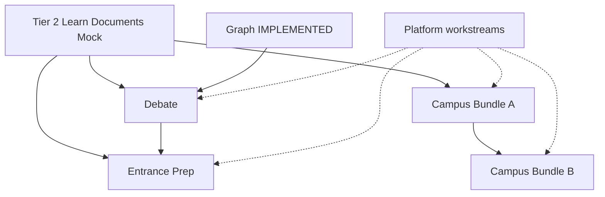

# Tier 3 Execution Overview

## Execution header

| Field | Value |
|---|---|
| **Target** | Tier 3 program coordination (Tracks A & B + Platform Readiness) |
| **Hyperspec sources** | `06S3-DEBATE-P1-HYPERSPEC.md`, `07-EXAM-PREP-MODE-HYPERSPEC.md`, `15-CAMPUS-MIRRORS-A-HYPERSPEC.md`, `03S6-S8-S9-S10-S11-08S6-CAMPUS-LIFE-BUNDLE-B-HYPERSPEC.md`, `08S7-PLATFORM-READINESS-HYPERSPEC.md` |
| **Authoritative context** | `/Users/macbook/.codex/attachments/f8ccb111-39ac-405c-a3fd-8b47c2d0c291/pasted-text.txt` |
| **Tier 2 prerequisite IMPLEMENTED records (hard gate)** | `IMPLEMENTED-EDRION-LEARN.md`, `IMPLEMENTED-DOCUMENTS.md`, `IMPLEMENTED-MOCK-EXAMS.md`, `IMPLEMENTED-GRAPH-PIPELINE.md` — **closed 2026-07-25** |
| **Tier 0/1 baseline IMPLEMENTED** | `IMPLEMENTED.md`, `IMPLEMENTED-TIMETABLE.md`, `IMPLEMENTED-ATTENDANCE.md`, `IMPLEMENTED-MARKS.md`, `IMPLEMENTED-LIBRARY.md`, `IMPLEMENTED-GRAPH-PIPELINE.md` |
| **Migration reservation ledger** | See §4 |
| **Open blockers** | Content Lead named for Entrance Prep; US partner gate for OIDC/OneRoster/Clever/ClassLink |
| **Approved defaults (binding)** | Finish Tier 2 first; Debate `visual_canvases.debate_id` nullable FK; Deepgram batch STT behind `SttProvider`; Prep versioned annotations over derived mistakes projection; Prep Content Lead from day zero (founder names owner); US integration workstreams gated |

---

## 1. Program outcome

Tier 3 delivers five student-facing capabilities across two independent execution tracks plus threaded platform hardening:

- **Track A (Learning):** Debate P1 → Entrance Prep (SAT-first international profile, then ACT, then thinner JEE/NEET).
- **Track B (Campus):** Campus Bundle A (library → transport → digital ID → hostel/outpass) → Campus Bundle B (placements → clubs/events/PTM → diary → health mirror → grievance → sensitive-report sealing).
- **Platform Readiness:** Independent one-session workstreams (webhooks, MFA, support-session sweep, metrics/dashboard, compliance, audit debt) — not one mega-phase.

Tracks A and B may run in parallel once their respective prerequisites are merged. Platform workstreams may run in gaps; they must not block feature tracks except where a workstream is explicitly a security gate (e.g. sensitive-report sealing review).

---

## 2. Track structure and strict ordering

### Track A — Learning

```text
Tier 2 gate (Learn + Documents + Mock IMPLEMENTED)
        │
        ▼
PLAN-DEBATE.md (0110–0119) → IMPLEMENTED-DEBATE.md
        │
        ▼
PLAN-ENTRANCE-PREP.md (0130–0139) → IMPLEMENTED-ENTRANCE-PREP.md
```

**Parallelization boundary:** Nothing in Track A may start Debate Phase 1 until `IMPLEMENTED-GRAPH-PIPELINE.md` contracts are merged. Entrance Prep Phase 1 may not start until Debate closeout is recorded.

**Pipeline gate (Debate):** Solo recorded audio → resumable upload → STT → canonical transcript → deterministic metrics → adjudication → verdict → report must ship and pass acceptance before Prep Pad, AI opponent, or 1v1 phases.

### Track B — Campus

```text
Tier 2 gate (Documents IMPLEMENTED for ID templates)
        │
        ▼
PLAN-CAMPUS-BUNDLE-A.md (0120–0129) → IMPLEMENTED-CAMPUS-BUNDLE-A.md
        │
        ▼
PLAN-CAMPUS-BUNDLE-B.md (0140–0159) → IMPLEMENTED-CAMPUS-BUNDLE-B.md
```

**Parallelization boundary:** Bundle B requires Bundle A identity token + `campus_access_logs` scan contract, plus `IMPLEMENTED-TIMETABLE.md`, `IMPLEMENTED-ATTENDANCE.md`, `IMPLEMENTED-MARKS.md` for placements eligibility.

**Implementation order inside Bundle A:** Campus Library → Transport → Digital ID → Hostel/outpass (migration PR for entire bundle lands first).

**Implementation order inside Bundle B:** Placements → Clubs/Events/PTM → Diary → Health mirror → ordinary grievance → sensitive-report sealing (independent security review phase).

### Platform Readiness (threaded)

```text
Any time after baseline deploy discipline is stable
        │
        ├── WS1–WS3 Webhooks (envelope, rotation overlap, delivery UI/ops)
        ├── WS4 MFA (factors, challenge, recovery, AAL2 catalogue)
        ├── WS5 Support-session expiry sweep
        ├── WS6–WS7 Principal metrics + dashboard UI
        ├── WS8 Compliance posture + evidence
        ├── WS9 Audit-flagged technical debt
        └── GATED: OIDC/SAML SSO, OneRoster, ClassLink, Clever (US customer/partner)
```

Migration range **0160–0179** reserved for platform workstreams only.

---

## 3. Tier 2 prerequisite gate (verified)

| Planned Tier 2 deliverable | Plan file | IMPLEMENTED record | Journal / schema evidence |
|---|---|---|---|
| Graph Pipeline | `PLAN-GRAPH-PIPELINE.md` | `IMPLEMENTED-GRAPH-PIPELINE.md` | **Done** — `0095`, `0096` |
| Edrion Learn | `PLAN-EDRION-LEARN.md` | `IMPLEMENTED-EDRION-LEARN.md` | **Closed** — `0097`, `0100`; orchestrator + evals |
| Documents + issuance | `PLAN-DOCUMENTS.md` | `IMPLEMENTED-DOCUMENTS.md` | **Closed** — `0098`; issuance API + term aggregate |
| Mock Exams | `PLAN-MOCK-EXAMS.md` | `IMPLEMENTED-MOCK-EXAMS.md` | **Closed** — `0099`, `0101`; past-mistakes + visibility |

**Binding rule:** Tier 3 must consume **completed** Tier 2 canonical contracts (`exam_profiles` + `exam_profile_key` FK, Learn session entry `{entryPoint, topic/knowledgeItemId, goal, sessionContext}`, Documents ID template + issuance, Mock player + past-mistakes projection). Do not bind Prep or Campus Digital ID to obsolete partial APIs.

**Reserved migrations 0097–0109:** Tier 2 completion and reconciliation (per `PLAN-TIER2-OVERVIEW.md` numbering, shifted if journal advances before Tier 2 merges).

---

## 4. Migration reservation ledger

Central rule: **one serialized numeric migration train** on `packages/database/migrations/meta/_journal.json`. Parallel feature branches may develop concurrently; each migration PR rebases and claims the next free index before merge.

| Range | Owner | Purpose |
|---|---|---|
| 0097–0109 | Tier 2 completion | Learn, Documents, Mock, reconciliation |
| 0110–0119 | Debate P1 | Formats, transcripts, adjudication, consent, canvas FK |
| 0120–0129 | Campus Bundle A | Gates, library holds, transport broadcasts, ID token, outpass columns |
| 0130–0139 | Entrance Prep | `exam_profiles`, plans, error notebook annotations, adaptive routing |
| 0140–0159 | Campus Bundle B | Placements, events, diary, grievance, sensitive seal |
| 0160–0179 | Platform Readiness | Webhook overlap secrets, MFA tables, metric rollups, compliance artifacts |

**Current journal tip:** `0096_lab_canvas_flags` (idx 96). Next unmerged index: **0097**.

### Serialized migration-train procedure

1. Before opening a migration PR, fetch `main` and read `_journal.json` tip.
2. Rename migration file to the next integer; run `drizzle-kit` generate only if schema changed in that PR.
3. Rebase branch; resolve journal conflicts by taking higher index for the later merge.
4. CI must apply migrations on empty DB and on DB at previous tip.
5. Never merge two PRs both claiming the same index; if collision occurs, bump the later PR and re-run grants/RLS SQL companions.

---

## 5. Shared-contract ledger

| Contract | Owner | Tier 3 consumers | Rule |
|---|---|---|---|
| `CanvasGraph` v1 + revision gateway | Graph Pipeline | Debate Clash Map | Implement `buildClashMap`; no `graph-json@1.1`; `clash` edge + ≤40 nodes |
| `visual_canvases.debate_id` | Debate | Graph provenance | Nullable FK `debates.id` ON DELETE SET NULL; keep `source_meta` for transcript/adjudication refs |
| Dual-owner XOR | Repo convention | Debate artefacts, Prep learner tables | `institution_id + student_id` OR `independent_user_id`; not `owner_user_id` |
| `student_requests` + registry | Request Engine | Bundle A/B types | Config + hooks only; gates via `student_request_gates` |
| `fee_invoice_items` | Fees | Transport renewal, paid events | Money bridge; no parallel ledger |
| Rotating identity token | Bundle A | Outpass, library desk, Bundle B event check-in | One token; no event-specific QR |
| `campus_access_logs` | Security | Gate, events check-in | Append-only scans |
| `Obligation` + `TodayService` | Today | Prep plan blocks | `study_block`, `mock` only; max 3 Prep obligations/day |
| Mock engine + `exam_profile_key` | Mock (Tier 2) | Prep | FK to `exam_profiles`; standard player; `nta` → standard resolver |
| Past mistakes projection | Mock D7/D8 | Prep Error Notebook | Derived; mutable learner state in annotation table only |
| Learn session entry | Edrion Learn (Tier 2) | Prep Learn blocks | Canonical entry contract only |
| Documents templates + issuance | Documents (Tier 2) | Digital ID card | `render_kind` / card theme extension |
| `computeTermAggregate` / marks | Marks | Placements eligibility | CGPA/backlogs resolvers; unavailable ≠ ineligible |
| Health / counseling tables | Institution health | Bundle B mirror | Wire-only; no counselor notes on student surfaces |
| Feature visibility | `packages/feature-flags` | All Tier 3 UI | **`student.surface.*` + capability keys** (e.g. `lab.canvas.enabled`, `lab.mock_exams.visibility`); **never** new `student.module.*` keys (hyperspecs using `student.module.*` are amended at execution) |

---

## 6. Feature-flag ledger (authoritative patterns)

| Surface | Visibility module key (student-modules) | Capability / surface flags | Notes |
|---|---|---|---|
| Lab / Debate | `lab` via `student.surface.lab` | `lab.debate.enabled` (new capability, register in feature_definitions) | Gate debate routes |
| Exam Prep | `exam_prep` | `prep.profile.<key>`, `prep.adaptive_routing`, `prep.cohort_dashboard`, `prep.parent_digest` | Profile gates separate from module |
| Campus Library | `campus_library` | `campus_library.holds`, `campus_library.fines` | Terminology `campusLibrary.*` |
| Hostel | `hostel` | `hostel.outpass`, `hostel.complaints` | Not `student.module.hostel` in new code |
| Transport | `transport` | `transport.broadcasts` | GPS interface slot only |
| ID Card | `id_card` | `id_card.digital` | Shares token service |
| Placements | `placements` | `portal.module.placement_cell` (institution) | Requires season rows |
| Clubs / Events | `clubs`, `events` | `clubs.directory_enabled` (preset) | No feed scope |
| Grievance | `grievance` | `grievance.lane.formal`, `grievance.lane.sensitive` | Not `support_cases` |
| Health | `health` | Mirror read keys only | Request type `health_profile_update` |
| Diary | `diary` | K-12 preset default | Composes assignments |

---

## 7. Cross-track dependency graph



No hard dependency from Track A to Track B or vice versa. Soft dependencies: shared notification layer, Redis, BullMQ, feature-flag admin.

---

## 8. Integration gates

### Security review gates

| Gate | Feature | Trigger |
|---|---|---|
| SR-1 | Debate | Before recording phase ships (consent + minor safety) |
| SR-2 | Bundle A outpass | Before scanner production pilot (revocation SLO, offline asymmetry) |
| SR-3 | Bundle B sensitive_report | Dedicated phase; sealed identity + unseal two-person |
| SR-4 | Platform MFA | Before `required_all` policy enabled for pilot tenant |
| SR-5 | Webhook rotation | Before documenting zero-downtime rotation for enterprises |

### Content readiness gates (Entrance Prep)

| Gate | Blocks |
|---|---|
| CR-1 | SAT syllabus + atom map + item density | `prep.profile.sat_digital` → `active` |
| CR-2 | ACT corpus | `prep.profile.act_enhanced` |
| CR-3 | JEE/NEET PYQ minimum | Thinner profiles only |

**Founder assignment gate:** Content Lead must be **named** before Prep code Phase 1 starts (licensing, provenance, SAT framework first).

### Operational readiness gates

- Debate: WER benchmark gate (≤12% WER Indian-English corpus) before STT provider locked for prod.
- Bundle A: Outpass revocation P95 ≤2s / heartbeat ≤15s validated in staging with synthetic scanners.
- Bundle B: Placement registration + eligibility `unavailable` copy reviewed with placement cell pilot.
- Platform: Support-session sweep verified with multi-worker chaos test.

---

## 9. Human-decision register

| ID | Decision | Recommendation | Blocks |
|---|---|---|---|
| HD-T3-001 | Tier 2 sequencing when multiple lanes | Complete Learn → parallel Documents + Mock → closeout files | All Tier 3 Phase 1 |
| HD-T3-002 | Debate canvas binding | `visual_canvases.debate_id` nullable FK (approved) | Debate migration |
| HD-T3-003 | STT provider | Deepgram Nova batch via `SttProvider` (approved) | Debate Phase 2 |
| HD-T3-004 | Mutable error notebook | Versioned `prep_error_notebook_entries` over projection; no `mistakes` table (approved) | Prep Phase 3 |
| HD-T3-005 | Prep Content Lead | Founder names owner before Prep code | Prep content + Phase 1 |
| HD-T3-006 | SAT before other profiles | SAT end-to-end is launch evidence (approved) | Prep launch |
| HD-T3-007 | US integrations | Gate SSO/roster until US partner/customer | Platform WS gated |
| HD-T3-008 | `sensitive_report` student_id nullability | Only type allowing null `student_requests.student_id`; seal table | Bundle B Phase 6 |
| HD-T3-009 | Webhook envelope vs current `{event,sentAt,data}` | Align to rubric R1–R10 in Platform plan; breaking change via version bump | Platform WS1 |

Record accepted decisions in root `DECISIONS.md` as **D-T3-001** onward when execution starts.

---

## 10. Baseline hazards (repository worktree)

Do **not** clean or reset the dirty worktree as part of Tier 3 planning execution.

- **AppleDouble / `._*` files:** May appear on volume-mounted workspaces; exclude from migration PRs and `.gitignore` already should list them — verify before commit.
- **Unrelated modified paths:** Large git status surface (design HTML, API modules) — Tier 3 PRs must be scoped; rebase carefully.
- **Git pack-index warnings:** If present locally, treat as environment hazard; use fresh fetch before migration train work.

---

## 11. Security, privacy, and safety (program-level)

- Tenant isolation: all institution tables via `runInInstitutionTenant` + RLS GUC.
- Sensitive data: counseling notes, sealed grievance identity, health writes — fail closed; audited reads only.
- Minors: Debate consent + motion NSFW gates; outpass guardian gates non-waivable.
- AI labels: Debate scores/verdicts/analytics **beta practice feedback** until calibration program lifts per format.
- No shadow sources of truth: complaints → `work_orders`; mistakes → projection; placements eligibility → closed DSL on authoritative marks/enrollment/attendance.

---

## 12. Test strategy (program-level)

- Each phase: unit + integration + contract tests; RLS tests for new tables; feature-flag-off deploy safety.
- Cross-track contract tests: Clash Map fixture, identity token verify, `exam_profile_key` FK, Obligation merge caps.
- Load tests: event seat allocation (Bundle B), outpass scanner degraded mode, webhook idempotent delivery.

---

## 13. Final closeout order (IMPLEMENTED records)

1. `IMPLEMENTED-EDRION-LEARN.md`
2. `IMPLEMENTED-DOCUMENTS.md`
3. `IMPLEMENTED-MOCK-EXAMS.md`
4. `IMPLEMENTED-DEBATE.md`
5. `IMPLEMENTED-CAMPUS-BUNDLE-A.md`
6. `IMPLEMENTED-ENTRANCE-PREP.md` (may parallel Bundle B after Debate; migration ranges do not overlap)
7. `IMPLEMENTED-CAMPUS-BUNDLE-B.md`
8. Platform workstreams: `IMPLEMENTED-PLATFORM-READINESS.md` (or per-workstream addenda) as each WS completes

---

## 14. Plan file index

| File | Track | Migration range |
|---|---|---|
| `PLAN-DEBATE.md` | A1 | 0110–0119 |
| `PLAN-ENTRANCE-PREP.md` | A2 | 0130–0139 |
| `PLAN-CAMPUS-BUNDLE-A.md` | B1 | 0120–0129 |
| `PLAN-CAMPUS-BUNDLE-B.md` | B2 | 0140–0159 |
| `PLAN-PLATFORM-READINESS.md` | Threaded | 0160–0179 |

---

## 15. Conditions before any Tier 3 Phase 1 starts

1. Tier 2 prerequisite IMPLEMENTED trio merged **or** explicit founder waiver documented in `DECISIONS.md` (default: **no waiver**).
2. Migration index reserved and journal tip confirmed on branch.
3. Feature plan Execution Header blockers cleared for that feature.
4. For Prep: Content Lead named and licensing memo drafted.
5. For sensitive_report: security review scheduled before phase kickoff.
