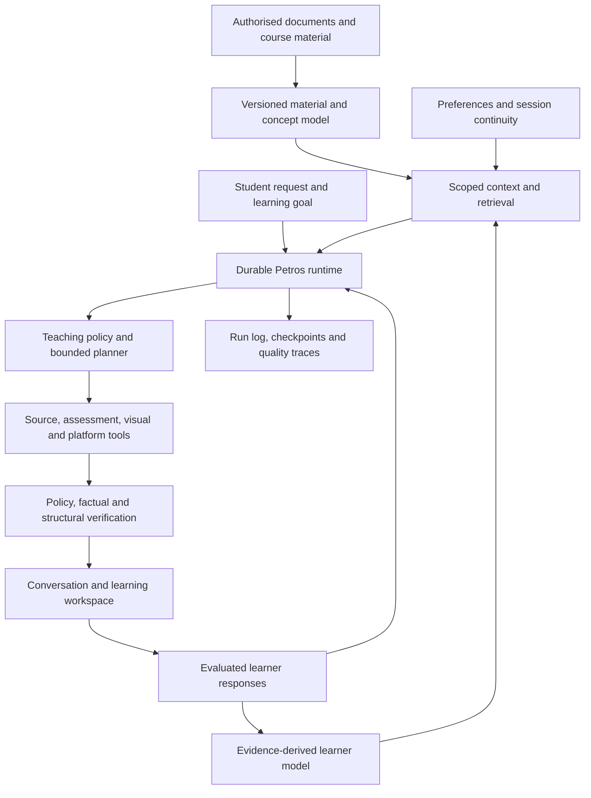

# Petros: a complete learning companion and AI harness

Architecture assessment and implementation plan · 15 September 2026

Status: Phase 1 engineering verified; human/pedagogical/production/pilot gates open. Phase 2 generic implementation and final primary synthetic verification pass within documented boundaries; scoped independent reviews are complete and real educational/institutional acceptance remains open. Phase 3 bounded synthetic engineering verification for P3-V1–V12 passed on a frozen source identity; see `docs/PETROS-PHASE-3-VERIFICATION-RESULTS.md` and its command index. Phase 4 supported synthetic engineering verification for P4-V1–V14 passed on its frozen source identity; see `docs/PETROS-PHASE-4-VERIFICATION-RESULTS.md`. Real educational, institutional, retention/erasure, physical-device accessibility, partner, executable-isolation and pilot acceptance remain open. Production configuration, deployed behaviour and real student outcomes have not been verified here.

Reading guide: §§1–4 cover the assessment, capability audit and target experience; §§5–10 describe documents/standards/knowledge policy, tutoring, qualitative evidence, visuals, memory, classrooms, guardians and connectivity; §§11–14 specify execution/abuse controls, institutional integration, data, permissions and evaluation; §§15–17 separate architecture-now, pilot and later priorities; §18 links supporting code.

## Execution Ledger

Current execution status (2026-10-03): Phase 5 independent engineering work is implemented and verified on frozen-final-r5 source `55f11e10edaca878b246fa62061029822cb74728569ca5581c96148d1f4dc8de`. P5-E1–E8 pass; final Chromium and WebKit styled journeys each pass 61 checkpoints with zero page errors. P5-E9/E10 full browser completeness and the unqualified engineering exit remain blocked by R1: Firefox151/Playwright1532 cannot launch on this Darwin27 host. Exact evidence and dependency remedy are in [PETROS-PHASE-5-VERIFICATION-RESULTS.md](PETROS-PHASE-5-VERIFICATION-RESULTS.md). Real educator/curriculum, consent/privacy/retention, physical-device/AT, partner and pilot authorities remain pending. Admissions, real instrumentation and generated executable extensions remain disabled. No deployment, commit or Phase 6 is authorized.

Historical Phase 4 closure (2026-10-02): Phase 4 supported, bounded synthetic engineering P4-V1–V14 passed against source manifest `2ae29edfafa19c3e4712aa2eb2419c883ff9afdd99a92b07d1e8dbcbcd205e40` (2,612 files); frozen, verified and closing identities match. Same-source closure passed 72 API files / 602 tests, 61 schema files / 481 tests, 37 student-web files / 196 tests, all six package typechecks/lints (zero lint errors), three production builds and diff hygiene. A separate styled full-AppModule browser journey passed 53 checkpoints with zero page errors and two controlled synthetic provider calls, including actual companion-question linkage, notebook/review navigation, memory controls, durable offline-note reconciliation, mobile next-day resume, low bandwidth and second-staff correction/intervention review. See [PETROS-PHASE-4-VERIFICATION-RESULTS.md](PETROS-PHASE-4-VERIFICATION-RESULTS.md) for exact evidence and limits. New guardian output, unrequired partners, independent accounts and full offline remain explicitly gated; all new Phase 2–4 admissions remain default-off. Real educator/curriculum, retention/erasure, physical-device, partner, executable-isolation and pilot acceptance remain open. No Phase 5, commit or deployment occurred.

Historical Phase 3 closure (2026-10-02): Phase 2 evidence and authority boundaries remain as recorded in [PETROS-PHASE-2-VERIFICATION-RESULTS.md](PETROS-PHASE-2-VERIFICATION-RESULTS.md). Phase 3 bounded synthetic engineering verification for P3-V1–V12 passed against frozen-r4 source manifest `db526cc2f3915935846aa3abba52021c2458dcf87b496698fbeec61ea6001e8a` (2,576 files); post-verification identity matches. Same-source schema/web tests passed (60 files / 475 schema tests; 33 files / 181 student-web tests), API closure passed (67 files / 583 tests), all five package typechecks passed, both builds passed, five-project lint passed (729 API warnings, 0 errors), `git diff --check` passed, and the frozen full-AppModule browser journey passed with no page errors. The focused browser run additionally covered continuous timeline checkpointing, focus restoration, circuit reclose/rewind and invalid-unit HTTP 400. Qualified educator approval, canonical curriculum/content adoption, live-data policy, physical-device accessibility and pilot authorization remain external gates. Executable specialist isolation remains unproved and disabled. All new Phase 2 and Phase 3 flags stay default-off. P2-D1–D3 remain historical groundwork records.

Implementation record started 15 September 2026 against `89c1ca29c117b2f9926e97e12a2738fa110cd2ca`. Requirements and phase exit gates below remain binding. The architectural assessment is historical evidence until rechecked here.

| Requirement / increment | Status | Files / integration points | Acceptance / evidence |
|---|---|---|---|
| Phase 0 / P0-E1 engineering inventory | verified | Existing portal course-content producer; student materials viewer; session-intent repository/service; loop service/policy; learner-model ingestion/engine; AI gateway; student guards/tenant interceptor; repair-session renderer; quality service | Re-read current code. Initial checkout had only two modified database dumps and this untracked plan. No AGENTS.md found in repository/ancestor paths. README and DEVELOPMENT conventions read. API baseline: 78 files / 524 tests passed; student-web baseline: 23 files / 125 tests passed. These are synthetic/unit/component checks, not deployed traces. |
| Phase 0 / P0-P1 product and human acceptance | explicitly deferred | Decisions in §17, educator review and pilot contracts | User authorised necessary implementation and requested working production paths without demo data. Test fixtures remain test-only. No age, policy, cohort, spend, retention, educator approval or learning outcome invented; these gates remain required before pilot enablement. |
| Phase 1 / P1-S1 source readiness admission and snapshot locators (review repair P1-S1-R1) | verified | Shared `petros-document-source` contract/helper → portal course-content publication → knowledge items/pages → session-intent resolve/cache/read/start → real loop creation/source-context persistence; Materials status UI | All five review findings confirmed and repaired. Applicable engineering checks: 112 API tests (including 11 disposable-Postgres cases with authenticated HTTP, real migrations/constraints/RLS and concurrent starts), 21 schema tests, 24 rendered UI tests; all three non-emitting typechecks passed. See exact files, commands and limits below. Phase 1 overall remains incomplete. |
| Phase 1 / P1-S2 immutable PDF extraction snapshots | verified | Canonical knowledge versions/pages/deletion receipts; portal publish/republish; intent/outline/source-list/session/loop/artifact/companion consumers | Engineering acceptance: 159 API tests including 26 disposable-Postgres cases, 30 schema tests, 24 UI regressions; four typechecks and lint/diff checks. Details below. Human review and production/pilot gates remain open. |
| Phase 1 / P1-S3 restricted extraction execution | verified | Canonical knowledge preparation state/outbox → existing BullMQ → restricted PDF process → S2 atomic publisher; portal status/retry/cancel | Engineering acceptance: 177 API tests including 38 disposable-Postgres cases and 6 real sandbox tests; 32 schema tests; 31 UI tests; Chromium keyboard/failure checks; five typechecks, API build, lint and diff checks. Deployment and human gates remain open; details below. |
| Phase 1 / P1-S4 owner-scoped PDF retrieval | verified | Canonical immutable snapshot reader → bounded lexical spans/coverage trace → existing lesson-question command, AI gateway and observation owner | Engineering acceptance: 197 API tests including 48 disposable-Postgres cases; 33 schema and 54 UI tests; three typechecks, API build, lint and diff checks. Exact locators, selected scope, missing evidence, current entitlement, replay, rollback and previous-reader compatibility verified below. Retrieval defaults off; human/production/pilot gates remain open. |
| Phase 1 / P1-S5 durable document-question execution | verified | Existing session command owner → short scoped transactions → BullMQ dispatch → pinned S4 answer/trace commit → question status/cancel UI | Engineering acceptance: 238 API tests including 64 disposable-Postgres cases; 35 schema and 59 UI tests; four typechecks, API build, Chromium keyboard/recovery checks, lint and diff review. Default-off rollout and remaining gates detailed below. |
| Phase 1 / P1-S6 atomic question-attempt budget reservation | verified | Existing AI routing/budget/usage owners → durable question command/fence → per-provider-attempt hold → usage settlement/recovery | Engineering acceptance: 245 API tests including 68 disposable-Postgres cases; 35 schema and 60 UI tests; four typechecks, API build, Chromium budget-recovery checks, lint and diff review. Configuration and live-provider limits detailed below. |
| Phase 1 / P1-S7 minimal composable visual contracts and bounded validation | engineering verified; awaiting review | Existing teaching diagram producer → validated primitive program adapter → canonical teaching-block snapshot → authenticated controls → repair-session composed renderer; original artifact bundle retained | Current acceptance: 282 API tests across the final regression and affected-file rerun, including 74 disposable-Postgres cases; 56 schema and 67 UI tests; four typechecks, API build, Chromium keyboard/recovery checks, lint and diff review. Default-off rollout; generated behavior remains disabled. Details below. |
| Phase 1 / P1-S8 assessment-condition/result compatibility contracts | engineering verified; awaiting review | Existing objective evaluator → typed assessment on canonical answer evaluation → existing learner evidence ingestion/admission → deterministic projection; legacy adapters and protected diagnostics/export | Current acceptance: 318 API tests including 80 disposable-Postgres cases; 69 schema and 67 UI regressions; four typechecks, API build, lint and diff review. Enabled loop path is default-off. Criterion/mixed contracts validate but qualitative execution/admission stays gated. Details below. |
| Phase 1 / P1-S9 knowledge-mode enforcement and category-aware admission | engineering verified; awaiting review | Institutional authority → immutable question policy → per-attempt gateway checks → provenance/atomic commit → compatible status/history consumers | 352 distinct API tests (91 disposable-Postgres), 73 schema and 68 UI tests across final regression/affected reruns; four typechecks, API build, Chromium keyboard/recovery, lint and diff checks. Default-off rollout and conservative source-bound behavior detailed below. No human/production/pilot acceptance. |
| Phase 1 / P1-S10 provider-mapping and standard-alignment compatibility contracts | engineering verified | Existing federation connection/CSV producer → integration mapping revisions and preview receipts; existing course syllabus producer/review commands → immutable curriculum records/revisions → portal and enrolled-student syllabus consumers; migrations 0215–0217 | Authenticated HTTP, restricted-role RLS, migration, permission, compatibility, exact replay/race, lifecycle, projection, rollback and browser evidence passed on the final frozen build. Human/pedagogical/production/pilot gates remain open. |
| Phase 1 / P1-S11 build closure | engineering verified | Existing question/command/budget owners; voice caller; federation gate/settings; curriculum student projection and instructor read guard | V1–V11 and the literal integrated positive/negative S1–S11 journey passed on one frozen identity. Exact evidence is in `docs/PETROS-PHASE-1-VERIFICATION-RESULTS.md`; human/pedagogical/production/pilot gates remain open. |
| Phase 2 / P2-D1 prerequisite-bound groundwork | implementation incomplete; verification pending | Isolated trusted projectile model; existing owner/consumer audit; `docs/PETROS-PHASE-2-DEFERRED-VERIFICATION-PLAN.md` | No production route, flag, migration or Phase 1 gate changed. The pure model is unreachable from current clients. P2-V1–V12 and integrated journey are planned / NOT RUN. No educator approval or Phase 2 acceptance implied. |
| Phase 2 / P2-D2 isolated teaching contracts | implementation incomplete; verification pending | Candidate concept pack, objective evidence classifier, adaptive-policy proposal and draft-only assignment learning-release contracts; assignment atomicity audit | Pure contracts only; not exported or used by production. No pack content, approval, persistence, evidence write, published assignment release or student UI exists. Two high-reasoning subagent builds failed from usage limits and were not credited; completed medium assignment audit informed boundaries. |
| Phase 2 / P2-D3 isolated binding and review contracts | implementation incomplete; verification pending | Projectile concept/source views; concept-pack educator-review resolver; qualitative revision review resolver; artifact/evidence/delayed-review binding | Unreachable contracts only. Existing S7/S8/S9 gates and legacy clients remain unchanged. No real review, persistence, runtime, UI or production admission exists. Cross-owner xhigh audit defects were repaired in isolated contracts; all verification remains NOT RUN. |
| Phase 2 / P2-E1 production integration and primary verification | synthetic checks passed within documented scope; scoped independent reviews complete; real external acceptance open | A–J owners, migrations 0218–0226, student reviewed-objective/analytic/resume UI, qualitative/inspection APIs, immutable evidence and receipts, bounded assignment release | P2-V1–V12 scoped results, final identity, exact logs, negative and compatibility evidence in `PETROS-PHASE-2-VERIFICATION-RESULTS.md`. Not a real educator review or full browser-to-live-stack journey. All new flags default-off; no Phase 3, commit or deployment. |
| Phase 3 | bounded synthetic engineering verification passed | Existing owners and dependency order in §15 | P3-V1–V12 passed on frozen and post-verified matching identity. Real educator, institutional, physical-device accessibility, executable-isolation and pilot gates remain open; flags remain default-off. See `PETROS-PHASE-3-VERIFICATION-RESULTS.md`. |
| Phase 4 | supported bounded synthetic engineering verified | Additive journey/memory/context, artifacts/recommendations, workspace/intermittent notes, institutional corrections/cohorts/assignments; migrations 0228–0229 | P4-V1–V14, real-owner integrations and separate styled full-AppModule browser pass on matching frozen/verified/closing identity. Exact commands and boundaries in `PETROS-PHASE-4-VERIFICATION-RESULTS.md`. Admissions default-off; conditional unsupported capabilities explicitly gated; external acceptance open. |
| Phase 5 | independent engineering verified; full exit blocked by R1 Firefox; real pilot pending | Actual quality/source/loop/teacher owners, immutable release/migration 0230, per-attempt routing/gateway checks, aggregate-only operations, default-off stable synthetic cohorts/privacy collector, styled accessibility/recovery | P5-E1–E8 PASS on frozen/verified/closing-final-r5. 628 API, 485 schema, 197 student tests; 8 typechecks, 7 lints, 4 production builds, 46 eval tests, 240 fixture sessions and Chrome/WebKit 61-checkpoint journeys pass. P5-E9/E10 Firefox completeness BLOCKED; X1–X7 pending/disabled. Exact results and external authorities recorded separately; no full pilot exit. |
| Phase 6 | not started; not authorized | Existing owners and dependency order in §15 | Original exit gates retained. |

### Current-checkout findings and owners

- **Documents:** `PortalCourseContentService.publishMaterialFile → prepareForPetros` writes per-student `knowledgeItems/knowledgeItemPages`; PDF uses pdfjs; Office/text uses `MaterialDocumentPreviewService`. Before P1-S1 every result was marked extracted/indexed/AI-read, preview truncation was discarded, and placeholder text could become source text. `StudentMaterialsService` owns current class/course visibility and the protected original viewer. No active `knowledgeChunks` API consumer found.
- **Tutoring:** registered session-intent routes resolve/start owner-scoped previews into `PetrosLoopService`; direct contextual create is rejected. Cached page-group outlines are navigation, not concept packs; 1,200-character excerpts and 3/5-move horizons remain. Document ordering defaults and planner overrides still live in loop/policy.
- **Evidence:** current learner service validates, deduplicates, rejects synthetic/evaluation ingestion and rebuilds deterministic projections. Objective outcome/credit remain required; caught answer-to-learner update failures still lack the planned durable outbox. Do not equate diagram interactions with independent learning.
- **Visuals:** current repair-session renderer uses a diagram enum, local progressive SVG/narration and graph interaction. No active universal program/simulation runtime or historical Visual Studio modules in student module registration. Existing schema/layout packages are extension inputs, not completed runtime dependencies.
- **Runtime/configuration:** gateway uses provider routing, prompt activation, snapshot quotas and cache flags; quality liveSession still constructs a separate loop. Student tenant interceptor wraps the whole request. Config defaults AI mode to demo; deployed settings were not inspected. No worker, reservation or production-quality gate credited.
- **Permissions:** contextual routes require institutional student authentication, portal/permission/rate guards and owner filters; independent accounts remain gated. Rate limiter fails open on Redis failure. Current student permission guard derives default-role permissions. Teacher material copies require current membership revalidation rather than assuming possession remains an entitlement.

### Initial acceptance journey (synthetic, not educator-approved)

`cloud-reference-v1`: a synthetic three-page PDF defines scalability, elasticity and a demand-spike example. Learner asks “Teach me this; I mix up scalability and elasticity.” First prove trustworthy readable text and an exact supporting locator through production extraction/intent services. Later increments must retrieve relevant evidence, teach the contrast, accept a prediction, record only tentative diagnosis, change explanation, assess a new independent scenario, distinguish coverage from demonstration and schedule delayed review through existing owners. No educator approval or learner-outcome claim attaches to this fixture.

P1-S1 failure/recovery fixtures: blank/scanned page → explicit unavailable/confirmation state; readable page beside missing text → selected page only with omitted coverage; truncated text/table or Office preview → no complete teaching claim or invented physical page; pending/OCR confirmation → retry after verified extraction; source text/object/readiness update → stale preview and re-resolve; deleted/revoked/foreign owner source → deny before content; duplicate resolve/start → no second logical session. PDF page references mean physical 1-based file page, not printed folio; offsets mean UTF-16 code units in that version's extracted text, not PDF coordinates.

Door-level lost-response retry, remount/reload key reuse and stale-preview recovery are now tested. Journey cases reserved for later gates: interruption and stop/cancellation inside a lesson, provider timeout, wrong or ambiguous answer, assisted answer, qualitative revision, learner update crash and delayed review. Tests exercise portions, not the full journey. No live model, real student data, deployed UI recording, production migration or shared database access is authorised by this record.

### Scope decisions and risks

- P1-S1 is an integrity increment, not the whole Phase 1 exit. Reuse existing JSON metadata and versioned intent/outline/session snapshots; do not pretend mutable knowledge pages constitute an immutable historical source store. Immutable versions are P1-S2; restricted workers and cancellation remain subsequent Phase 1 work.
- Until format-aware original locators are implemented, non-PDF previews remain viewable but cannot enter this PDF text teaching path. Legacy PDF readiness must be derived conservatively from persisted pages; legacy booleans alone prove neither quality nor an index. Source text readiness does not prove figure/formula completeness, factual support or educator-approved teachability.
- Before pilot enablement, product/qualified reviewers still need to establish subjects/age/languages/accessibility, account/pilot scope, educator and correction approvers, authority/knowledge modes and sources, retention/sharing, spend/latency, success/delayed evaluation and conditional LMS/guardian/offline/accommodation needs. User delegated implementation choices; test fixtures do not establish these human/governance facts.


### P1-S1-R1 review repair — verified engineering boundary

All five findings were valid; no disagreement with the review:

| Finding / requirement | Actual repair and acceptance evidence |
|---|---|
| 1 — stale preview recovery | `PetrosDoorButton` clears a definitive stale resolve key and automatically resolves once with a fresh key. A stale start clears both keys and returns to preview. Transport failures preserve their keys. Actual `PetrosDocumentDoor` + `StudentApiClient` component tests cover retry, remount, topic selection, Escape and focus return. |
| 2 — companion material admission | `PetrosActionRegistryService.learningSourceForMaterial` uses `PetrosSessionIntentService.documentAdmission`, which checks canonical material entitlement and the shared readiness helper. A newly published `indexReady: false` PDF produces a proposal and the authenticated companion decision route creates its lesson. A blank source cannot produce that action. |
| 3 — selected session coverage | Start derives selected pages from the exact citations passed to the loop and updates omitted-page disclosure. The authenticated page-2-topic case persists citations `[2]`, readiness `[2]`, omitted count `1` and the matching disclosure. Outline page ranges never inflate actual excerpt coverage. |
| 4 — recovery error envelope | Source admission writes `meta.readiness`; the existing exception filter preserves it, `StudentApiClient` retains it, and the document door validates/displays unavailable pages and reason-specific recovery text. Authenticated HTTP 409 and rendered recovery to an available page are tested. |
| 5 — previous-reader and rollback compatibility | `petrosSessionIntentV1` writes the original strict v1 JSON shape. Readiness and exact locators are reconstructed only after current entitlement, full source hash and excerpt equality checks. HTTP defaults to v1; clients explicitly negotiate `x-petros-document-source: petros.document-source.v1` for extensions. Responses are private/no-store and vary by that header. Tests use the frozen actual `89c1ca2` reader, reject unprojected extensions, accept new stored/default-HTTP payloads, round-trip through the previous reader and reconstruct locators on the new reader. Changed-source reads/starts fail closed and a fresh preview succeeds. |
| Concurrent start / failure persistence | The existing intent row is locked with `FOR NO KEY UPDATE` for the student request transaction. A forced-overlap HTTP test observes the second request waiting at the database lock and verifies one loop creation/session. This lock also permits the separate failure-telemetry connection's FK key-share lock. Stale-start 409 and persisted failure telemetry are verified. |
| Existing-source publication rollback | Real `prepareForPetros` replacement runs inside the portal tenant transaction; an injected page-insert failure preserves the existing item version, page rows and previously resolved locator. The original new-source rollback case remains covered. |

**Compatible rollout adjustment:** no new persisted intent keys or database migration are needed for P1-S1. Deploy the reader/API first, then the web client that requests extensions; old clients continue receiving strict v1. Different backend generations use different source fingerprints, so pending previews require re-resolution when switching generations. The previous backend still has its old index-flag admission and may refuse newly unindexed materials after rollback; this repair does not fabricate an index or promise old-backend teaching availability. No rolling production deployment or old-backend runtime has been executed. Immutable source history remains P1-S2; reconstructing from changed or deleted pages is deliberately refused.

### P1-S1 files and integration evidence

Paths below are repository-relative; no new database schema or migration was required.

- **Shared contract:** `packages/schemas/src/petros-document-source.ts`, `petros-document-source.spec.ts`, `petros-session-intent.ts`, `petros-learning.ts`, `index.ts` — versioned extraction/readiness/locator schemas; optional intent and session fields; legacy citation compatibility, strict v1 storage/wire projection, frozen previous-reader tests in `__fixtures__/petros-session-intent-89c1ca2.ts` and `petros-session-intent.spec.ts`, and cross-field locator validation.
- **Source producer:** `apps/api/src/modules/portal/course-content/portal-course-content.service.ts` — file SHA-256, 20 MiB / 500 PDF pages / 2 million extracted characters, no false index/AI-read flags or automatic confirmation, per-owner atomic item/page publication. `apps/api/src/modules/student/materials/material-document-preview.service.ts` and `.service.spec.ts` — unreadable fallback metadata and explicit text/column truncation; over-limit XLSX columns no longer overwrite the final visible column.
- **Admission/consumers:** `apps/api/src/modules/student/petros-session-intent/petros-document-source.ts`, `.spec.ts`, `.integration.spec.ts`; `petros-session-intent.service.ts`, `.service.spec.ts`, `.repository.ts`, `.module.ts`, `.controller.ts`; `apps/api/src/modules/student/petros-companion/petros-action-registry.service.ts`; `apps/api/src/modules/student/materials/student-materials.service.ts` — content-hashed cache/admission/start identity; exact single-file PDF page excerpts; selected-page scope; current original-viewer entitlement on source reads, including cached intent reads/retries. `PetrosLoopService.create` and `PetrosLoopRepository` consume and persist the enriched context without a parallel session owner.
- **UI:** `apps/student-web/src/app/(app)/materials/page.tsx`, `page.spec.tsx`; `apps/student-web/src/components/petros/petros-door-button.tsx` — source-check status, unsupported/unreadable states, preserved original viewer/download, accurate disabled action, stale-key recovery and readiness reasons. `apps/student-web/src/lib/api-client.ts` retains error metadata; `petros-document-door.spec.tsx` renders the actual door with that client. Component tests exercise focus, viewer opening, Escape close and HTTP transport errors; no cosmetic demo or application seed was added.

Reproducible checks actually run:

| Check | Result |
|---|---|
| Initial `pnpm --filter @edrion/api test -- …` and student-web equivalent | Scripts ran the full suites despite intended filters: 78 API files / 524 tests; 23 UI files / 125 tests passed. |
| `PETROS_LOCAL_DB_TESTS=1 pnpm --filter @edrion/api exec vitest run src/modules/student/petros-session-intent src/modules/student/materials src/modules/student/petros-loop/petros-loop.service.spec.ts src/modules/student/petros-companion/petros-companion.spec.ts src/common/all-exceptions.filter.spec.ts` | Final repair: 10 files / 112 tests passed, including 11 disposable-Postgres scenarios. Real parser/storage/source publication, authenticated intent/companion HTTP, session persistence, real role/RLS/FK/check constraints, tenant/owner denial, membership revocation, concurrent resolve/start, failure telemetry, previous-reader round-trip and new/existing-source rollback exercised. |
| `pnpm --filter @edrion/schemas exec vitest run src/petros-document-source.spec.ts src/petros-session-intent.spec.ts src/petros-learning.spec.ts` | 3 files / 21 tests passed. |
| `pnpm --filter @edrion/student-web exec vitest run 'src/app/(app)/materials/page.spec.tsx' src/components/petros/petros-context-entry.spec.tsx src/components/petros/petros-document-door.spec.tsx src/components/materials/document-viewer.spec.tsx src/lib/api-client.spec.ts` | Final repair: 4 files / 24 tests passed. There is no standalone `api-client.spec.ts`; actual client/error decoding is exercised by the document-door test. |
| `pnpm --filter <@edrion/api, @edrion/schemas, @edrion/student-web> exec tsc --noEmit` (three separate commands) | All passed; API typecheck also passed before editing. |
| ESLint across changed TS/TSX; `git diff --check`; manual diff review | No lint errors; 20 warnings (existing test `any` and constructor-injection import patterns, plus the repository's Next pages-directory notice). Diff whitespace passed. Default Prettier could not load the absent Tailwind plugin; new TS files were formatted with equivalent base options and no plugin, without changing dependencies. |

The opt-in integration suite runs `initdb` itself in a unique temporary directory with a private Unix socket and TCP disabled. It applies all journaled Drizzle migrations plus the repository's post-migration SQL, then uses `edrion_app` without superuser/BYPASSRLS privileges through the production tenant proxy/interceptor. Bootstrap uses the real policy helper definitions from `zzz_rls.sql` and creates the application role first: historical migrations assume those prerequisites already exist. This is not a claim that the unmodified production migration CLI bootstraps an empty deployment. Neither `.env`, `DATABASE_URL`, dumps nor shared data are loaded. The cluster and file storage are removed afterward; test query timeouts and forced connection shutdown bound failed-test cleanup.

The strengthened tests first exposed missing fixture FK rows and the `FOR UPDATE`/out-of-transaction telemetry lock conflict. Fixture rows are now persisted, the lock is `FOR NO KEY UPDATE`, and the full final command passes. The failed run's disposable cluster was stopped and removed. The PDF fixture parser emits its existing standard-font-data warning; extraction assertions pass.

**Review boundary and remaining limits:** source readiness is a conservative text heuristic (at least 24 Unicode letters/digits, no replacement-character corruption), not OCR accuracy, scientific correctness or complete figure/formula/teaching coverage. Known preview truncation is blocked; historical extraction completeness remains explicitly unverified. Non-PDF and ambiguous multi-file teaching are gated until original locators exist; their viewers remain available. Legacy intents with old fingerprints require a fresh preview. Exact excerpts currently cover one physical page per outline topic, at most 1,200 characters; no retrieval index or concept packs are claimed. Current source pages remain mutable; session snapshots preserve their shown citations, but immutable historical locator resolution is P1-S2. Source revocation checks in this increment cover document source/intent admission and retries; revocation throughout already-running loop/history/artifact caches remains a later Phase 1 runtime gate. No worker isolation, archive expansion/CPU/time containment, preparation cancellation, concurrent publish deduplication, real browser/device/assistive-technology acceptance, paid provider evaluation, educator review or production validation was performed. Test profile generation, teacher CRUD/audit envelope, portal feature enablement, visual conversion and full learner/session response projection use controlled adapters; Redis rate limiting is disabled in the local HTTP fixture. Authentication uses the real signed-cookie/session/principal services; HTTP controllers, permission guard, exception filter and tenant interceptor are real. UI tests render in jsdom with controlled HTTP responses, not a running browser connected to the test API; actual lesson creation and its source JSON write use production services. Do not declare the overall harness or Phase 1 complete.

The existing SQL and gzip dump hashes are unchanged from the first inspection (`6a3d616e…f4b4d`, `a281acd5…918b`). No commit, push, deploy, shared database access or demo seed occurred. **Historical S1 handoff:** the user subsequently confirmed S1 review complete and requested S2. The current S2 record follows; broader human, live-integration, qualitative-evidence, visual-runtime and learner-pilot gates remain open.


### P1-S2 — verified engineering, awaiting review · 16 September 2026

Dependency: user-confirmed S1 acceptance; full plan, ledger, README/DEVELOPMENT conventions and current production paths read before editing. No applicable AGENTS.md found. Existing S1 work preserved.

**Behaviour and acceptance**

- Immutable versions/pages remain children of the canonical knowledge item. Each version stores UUID, ordinal, deterministic SHA-256 fingerprint, original object/hash, filename/type/size, extraction metadata, owner/material revision, creation time and physical pages. Fingerprinting canonicalizes JSON keys across PostgreSQL round-trips. Identical publication/object/extractor/text replay reuses a version; changed content/extractor/material revision creates one. Reverting to an earlier original creates a new publication version. Distinct new materials remain distinct owners.
- Portal tenant transactions, material/owner locks, unique fingerprint/page constraints and database triggers enforce atomic complete page sets, immutable content and bounded text. Failed extraction/page writes preserve the previous material/item/pages/version. A blank extraction is recorded without displacing a prior admissible source. S1 selected-scope checks and 20 MiB / 500 pages / 2 million UTF-16 unit limits remain; PostgreSQL astral-character limit enforcement is tested.
- Existing source fingerprints pin strict-v1 intents, outline caches and session contexts. Cached reads, pending starts, started retries, fresh planning/rendering, completed-command replay and historical locator reads resolve that exact version. New intents/source discovery use the latest snapshot with admissible text; superseded previews disclose their pin. Locators retain physical page, immutable page ID, text hash and exact UTF-16 range, with at most 1,200 returned characters.
- Historical access rechecks live item/tenant/student ownership, current material/class/course visibility, original object tenant/status/checksum metadata and local-file existence/size. Supersession permits access; one-way extraction invalidation retains content and denies reads/replay. Item revocation denies every version. Original-object loss denies that original's snapshots; another authorized original remains usable.
- Owner deletion cascades its pages/versions and records a content-free tombstone, preventing retry resurrection. Material deletion leaves copied snapshots inaccessible. Loop/history and artifact bundle/list/export/review/source/restore paths recheck access before returning content; companion session/artifact discovery does too. Affected saved products are hidden without deleting learner-owned artifact rows; deletion remains available. Lesson/artifact/locator responses are private/no-store.
- Legacy rows are not backfilled into invented history. Their current fingerprint must still match; unknown/unpinned sessions fail closed. The immutable locator endpoint refuses legacy-only rows. The actual frozen old strict reader accepts and round-trips S2 intent JSON; older mutable-page writes cannot change snapshots.

**Actual files / integration points** (repository-relative)

- Database: `packages/database/src/schema/student-knowledge.ts`, `migrations/0208_knowledge_extraction_versions.sql`, `migrations/meta/_journal.json`: version/page tables, immutable and complete-set checks, owner RLS, revocation marker and deletion receipts.
- Contracts: `packages/schemas/src/petros-document-source.ts`, `.spec.ts`, `portal-course-content.ts`: immutable snapshot, exact locator response, UTF-16 validation and republish input.
- Canonical service: `apps/api/src/modules/student/knowledge/knowledge-document.service.ts`, `.module.ts`; existing `petros-session-intent/petros-document-source.ts` fingerprint helper.
- Producer: `apps/api/src/modules/portal/course-content/portal-course-content.service.ts`, `.controller.ts`. New `POST /portal/course-content/materials/:id/publish` uses an uploaded staff-owned object and existing permission/scope/version/CRUD/audit/tenant boundaries.
- Intent/source consumers: `apps/api/src/modules/student/petros-session-intent/{petros-session-intent.repository,petros-session-intent.service,petros-session-intent.controller,petros-session-intent.module}.ts`; `petros-document-source.integration.spec.ts`. Authenticated historical API: `POST /student/petros/documents/:sourceId/resolve-locator`.
- Runtime consumers: `apps/api/src/modules/student/petros-loop/{petros-loop.repository,petros-loop.service,petros-loop.controller,petros-loop.module}.ts`; `petros-artifacts/{petros-artifacts.repository,petros-artifacts.service,petros-artifacts.controller,petros-artifacts.module}.ts`; `petros-companion/{petros-action-registry.service,petros-student-context.service,petros-companion.module,petros-companion.spec}.ts`. No S2 web component changes.

**Checks actually run**

| Check | Final result |
|---|---|
| `PETROS_LOCAL_DB_TESTS=1 pnpm --filter @edrion/api exec vitest run src/modules/student/petros-session-intent src/modules/student/materials src/modules/student/petros-loop/petros-loop.service.spec.ts src/modules/student/petros-companion src/modules/student/petros-artifacts/petros-artifacts.service.spec.ts src/common/all-exceptions.filter.spec.ts` | **13 files / 159 passed**, including **26 disposable-Postgres cases**: real parser/storage, pre-S2 migration data, constraints/RLS/tenant transactions, authenticated student HTTP, old/new pins and fresh/cached continuation, exact locators, concurrent first/repeat publication, rollback/retry, invalidation, class/course revocation, deleted/missing originals, deletion receipts and artifact denial. |
| `pnpm --filter @edrion/schemas exec vitest run src/petros-document-source.spec.ts src/petros-session-intent.spec.ts src/petros-learning.spec.ts src/petros-artifacts.spec.ts` | **4 files / 30 passed**. |
| `pnpm --filter @edrion/student-web exec vitest run 'src/app/(app)/materials/page.spec.tsx' src/components/petros/petros-context-entry.spec.tsx src/components/petros/petros-document-door.spec.tsx src/components/materials/document-viewer.spec.tsx` | **4 files / 24 passed** (jsdom S1 regressions). |
| Separate `pnpm --filter <@edrion/api, @edrion/database, @edrion/schemas, @edrion/student-web> exec tsc --noEmit` | **All four passed**; API repeated after final fixture changes. |
| ESLint all accumulated changed/untracked TS/TSX; final integration-test lint; `git diff --check`; manual diff review | **0 errors, 38 warnings** (DI imports/test any); final test lint passed. Existing Next pages-directory notice. One pre-existing artifact sanitizer regex received a documented lint exception; behaviour unchanged. New source/contract/test files formatted with base Prettier options without the unavailable Tailwind plugin. |

Tests first exposed JSON-key-order replay instability; canonical serialization fixed it. The suite creates/removes its own PostgreSQL cluster with TCP disabled, applies pre-S2 migrations, inserts synthetic legacy rows, then applies 0208. Application queries use the real non-superuser/non-BYPASSRLS role and tenant helpers. No .env, dumps, shared data or real student records are loaded. Fresh continuation uses real planning/rendering/session persistence with a throwing provider adapter, proving the existing deterministic fallback and pinned input without external transport.

**Migration and rollback:** apply the additive migration before this backend; retain mutable pages for old readers. Route source/lesson/artifact traffic through the new access checks before enabling republish traffic. Retain snapshot tables, receipts and pins on application rollback; no destructive down migration is supplied. A safe rollback keeps the new reader/access checks. If reverting the entire backend to pre-S2, drain/disable the affected publication and student document/session/artifact routes first. Old-reader JSON compatibility does not prove old-server historical resolution or revocation safety. Actual rolling deployment/old-server rollback was not performed. Existing portal/permission gates apply; no new rollout flag or production enablement is claimed.

**Recorded adjustments / limits:** the proposed mutable current-version pointer was unnecessary: snapshot ordinal/admissibility selects the version. Deletion receipts are necessary to prevent retry resurrection. Loop/history/artifact/companion checks and source-list readiness are S2 prerequisites, not owner redesigns. Invalidation is an internal scoped service boundary; no moderation UI, automatic reversal or deletion-receipt purge policy is invented. Retention and exceptional recovery remain Phase 0 decisions. Existing per-student preparation still requires publication for newly enrolled students; no enrollment backfill is added. Only local PDFs have historical resolution; unsupported storage/unknown history fails closed.

Extraction still runs in the API and long tenant transactions. Worker isolation, CPU/time/expansion limits, durable claims/outbox/budgets and cancellation remain outstanding. Student auth/controllers/filter/RLS are real in tests; learner/profile generation, feature enablement, rate limiting, visual conversion and audit use controlled adapters. Republish uses real portal CRUD/scope/version services; its teacher HTTP route has not been exercised with a live teacher login. No browser/device, assistive-technology, educator/human, live-provider, production, qualitative-evidence, visual-runtime or learner-pilot gate is marked complete. No erasure of already-delivered client content or broader reflection/memory/evidence redesign is claimed. Heuristic readiness is not pedagogical correctness.

Dump hashes remain unchanged (`6a3d616e…f4b4d`, `a281acd5…918b`). No commit, push, deploy or shared data mutation occurred. **Stop for P1-S2 review. Exact next increment: P1-S3 restricted PDF extraction execution with durable claims, bounded worker isolation, cancellation and retry/status integration into this atomic publisher. Phase 1 remains incomplete.**


### P1-S3 restricted execution — verified engineering boundary

User continued after the S2 handoff. The full plan and repository conventions were reread; existing BullMQ delivery was verified and the stale build-script claim of an existing ingest worker was corrected. This increment implements the restricted PDF preparation portion of §15 Phase 1 and the applicable durability/resource boundaries in §§5 and 11. Teaching execution, retrieval, evidence and visual-runtime gates remain separate.

| Requirement | Implemented integration / acceptance evidence |
|---|---|
| Durable admission and publication | The existing portal publish/republish path commits the original material plus a canonical `knowledge_preparations` receipt before extraction. Admission is serialized before new file writes. The receipt doubles as the dispatch outbox; BullMQ carries strict ID/tenant messages only. Repeated delivery and concurrent claims produce one immutable S2 result. |
| Crash, cancellation and recovery | Versioned cancel/retry commands; 30-second leases with monotonically increasing fences; progress never extends a lease. Expired work is redispatched, stale workers cannot commit, and cancellation is observed during parsing. Missing handlers fail visibly. Real disposable Redis loss/restart and lost-dispatch recovery passed. |
| Current authority and atomic commit | Existing staff permissions, portal scope, material revision, original ownership/availability and current recipients are rechecked. Parsing runs outside tenant transactions. Final publication locks material/original before the preparation receipt, follows deletion lock order, and commits snapshots/projection/result together. Failure preserves prior admissible snapshots. Current S1/S2 intent, companion, historical-source and rollback regressions pass. |
| Bounded extraction | Child receives bytes over stdin and no application credentials. OS sandbox plus Node permissions deny foreign reads/writes, subprocesses and network. Limits: 20 MiB input, 500 pages, 2 million UTF-16 units, 16 MiB output, 20-second wall deadline, 15 CPU seconds, 128 MiB JS heap and sampled 256 MiB process-tree RSS. Sandbox startup failure fails closed. Actual malformed PDF, page-limit, CPU, wall, RSS, output, cancellation and denial tests passed. |
| Bounded durable work | One active parser per process; at most two claimed jobs per institution, five active preparations per initiating staff member, twenty per institution and one hundred admissions per rolling 24 hours. Three automatic attempts per cycle and six lifetime attempts. Atomic publication caps recipients at 100 and copied text at 20 million UTF-16 units. These are engineering safety limits, not approved commercial/pilot budgets. |
| Status and recovery UI | Existing teacher Files tab uses the real portal client for progress, cancel, retry and refresh. Expected versions prevent overwriting newer state; lost responses trigger authoritative reads. Disabled processing and reason-specific failures are visible. Native keyboard controls preserve focus, and success explicitly leaves readable-coverage assessment to lesson admission. No demo or application seed was added. |

**Actual files (repository-relative)**

- Contracts/configuration: `packages/schemas/src/petros-document-preparation.ts`, `.spec.ts`, `index.ts`; `packages/config/src/index.ts` (`PETROS_PDF_PREPARATION_ENABLED`, default **false**).
- Canonical persistence: `packages/database/src/schema/student-knowledge.ts`; `migrations/0209_knowledge_preparations.sql`, `migrations/meta/_journal.json`; `apps/api/src/modules/student/knowledge/knowledge-preparation.repository.ts`.
- Worker/publication: `apps/api/src/modules/student/knowledge/knowledge-pdf-process.ts`, `.spec.ts`, `pdf-extract.cjs`; `apps/api/src/modules/portal/course-content/portal-material-preparation.jobs.ts`, `portal-course-content.service.ts`, `.controller.ts`; `portal/portal.module.ts`; existing `common/queue/queue.worker.ts`; `apps/api/scripts/copy-build-assets.mjs`.
- UI: `apps/institution-web/src/components/materials/material-preparation-status.tsx`, `src/app/(app)/teaching/[classId]/[subjectId]/page.tsx`; test-only `apps/student-web/src/components/petros/material-preparation-status.spec.tsx` and `scripts/petros-preparation-browser-check.mjs`.
- Production-boundary acceptance extends `apps/api/src/modules/student/petros-session-intent/petros-document-source.integration.spec.ts`, including authenticated teacher publication/status/commands and current S1/S2 student/companion journeys.

**Checks actually run**

| Command / check | Result |
|---|---|
| `PETROS_LOCAL_DB_TESTS=1 pnpm --filter @edrion/api exec vitest run src/modules/student/petros-session-intent src/modules/student/materials src/modules/student/knowledge/knowledge-pdf-process.spec.ts src/modules/student/petros-loop/petros-loop.service.spec.ts src/modules/student/petros-companion src/modules/student/petros-artifacts/petros-artifacts.service.spec.ts src/common/all-exceptions.filter.spec.ts` | **14 files / 177 passed**, including **38 disposable-Postgres cases** and **6 actual sandbox cases**. S2 baseline before editing: 159 passed, including 26 database cases. |
| `pnpm --filter @edrion/schemas exec vitest run src/petros-document-source.spec.ts src/petros-session-intent.spec.ts src/petros-learning.spec.ts src/petros-artifacts.spec.ts src/petros-document-preparation.spec.ts` | **5 files / 32 passed**. |
| `pnpm --filter @edrion/student-web exec vitest run 'src/app/(app)/materials/page.spec.tsx' src/components/petros/petros-context-entry.spec.tsx src/components/petros/petros-document-door.spec.tsx src/components/petros/material-preparation-status.spec.tsx src/components/materials/document-viewer.spec.tsx` | **5 files / 31 passed**. Actual institution component and HTTP client are exercised in the existing jsdom runner. |
| Separate `pnpm --filter <@edrion/api, @edrion/database, @edrion/schemas, @edrion/student-web, @edrion/institution-web> exec tsc --noEmit` | **All five passed**. |
| `pnpm --filter @edrion/api build`; runtime asset copy and byte comparison | **Passed**; compiled output contains the exact `pdf-extract.cjs` executable. |
| `node apps/student-web/scripts/petros-preparation-browser-check.mjs` | **Passed** in local Chromium: keyboard cancel/retry, focus, version/scope propagation, disabled processing and error recovery; no browser errors. Production component/client/providers with test-only HTTP responses, not a deployed teacher page or live login. |
| ESLint accumulated changed/untracked TS/TSX/CJS/MJS; final integration-file lint; `git diff --check`; manual review | **0 errors, 47 warnings**, primarily Nest DI value imports and existing test `any`; final integration-file lint and whitespace passed. Existing Next pages-directory notice. New files use base Prettier options without the unavailable Tailwind plugin. |

Disposable infrastructure is created by the tests, uses private Unix sockets with TCP disabled for PostgreSQL/Redis, and is removed afterward. Migrations run against representative pre-S2 rows and a real S2 snapshot inserted before 0209; that snapshot remains identical as a decoded database row. Business queries use non-superuser/non-BYPASSRLS `edrion_app`, real tenant transactions, constraints and RLS. Teacher/student authentication and permission guards are exercised; audit, visual conversion, profile/model and some feature/rate adapters remain controlled. No .env, dump, shared database, paid provider or real student data was used.

**Migration, rollout and rollback:** 0209 is additive. Its narrowly scoped SECURITY DEFINER dispatcher returns IDs only and requires a privileged migration owner with BYPASSRLS (or superuser); migration now fails explicitly if that prerequisite is missing. Application business access still uses RLS. Preparation identity/attempt history cannot be rewritten; material deletion cancels pending work and preserves content-free receipts, preventing deletion from resetting admission accounting. No receipt purge/retention policy is invented.

Apply migration before the backend, deploy the reader/status UI, verify the target sandbox and enable the preparation flag only on compatible worker processes with Redis and queue workers enabled. Publication remains queued while execution is disabled; it never falls back to inline PDF parsing. To roll back, disable dispatch, drain or cancel active work and retain preparation rows, S2 snapshots and all current access checks. A whole-backend rollback that restores inline parsing must gate PDF publication first. Existing wire/pin shapes are unchanged; an old backend cannot operate these new preparation controls. An actual mixed-server deployment/rollback was not performed.

**Recorded adjustments / remaining limits:** sharing the original now succeeds before text preparation; an extraction failure no longer rolls back the original material revision, but never replaces the prior valid snapshot. This is the required asynchronous recovery boundary. The canonical receipt also serves as the outbox rather than introducing a second job owner. SQL statements/locks have 10-second/2-second limits and commit fanout is bounded; this is not a benchmark or global transaction-deadline guarantee. RSS enforcement is sampled, not a kernel memory quota. macOS sandbox and Node 25.6.0 were exercised; Linux bwrap/prlimit, Node 20, deployment images, broader preview/format isolation, physical devices and assistive technology remain unverified. New-student enrollment backfill, retention policy, commercial reservations, lesson-execution recovery, pedagogical correctness and all educator/production/pilot gates remain open.

Dump hashes remain unchanged (`6a3d616e…f4b4d`, `a281acd5…918b`). No commit, push, deploy or shared data mutation occurred. **Stop at the P1-S3 review boundary. Exact next increment: P1-S4 owner-scoped PDF retrieval with coverage traces — extend the canonical S2 snapshot/locator reader with bounded relevant-span retrieval, wire an existing teaching consumer, and verify relevance, missing evidence, current entitlement and historical pins. Do not begin concept packs or visual execution in that increment. Phase 1 remains incomplete.**


### P1-S4 owner-scoped retrieval — verified engineering boundary

User authorised continuation in this task. Current code was checked against §§5.3, 11 and 15; the canonical knowledge reader, lesson-question command, observation owner and AI gateway were extended. S3 baseline: **177 API tests passed**. This increment provides retrieval to the existing document lesson-question interaction; the complete Phase 1 exit and teaching/pedagogical gates remain open.

| Requirement | Implemented integration / acceptance evidence |
|---|---|
| Relevant, exact source spans | Authenticated `POST /student/petros/documents/:sourceId/search` and the lesson-question consumer search immutable S2 page text beyond the 1,200-character preview. Stable span IDs include extraction version, page identity and exact UTF-16 offsets. Returned locators resolve to identical text through the existing locator HTTP endpoint. |
| Scope and coverage | Existing tenant/owner, current membership, original availability and version checks run before ranking. Questions inherit the lesson's pinned citation pages; they cannot widen that selection. Trace records requested/searched/unavailable/returned pages, omitted pages/matches/query terms and extracted-text/structural limitations. Matches have **unverified** sufficiency; absence is scoped to the searched pages. Republish preserves historical retrieval; invalidated, foreign, missing and revoked sources deny access. |
| Bounded query execution | Shared strict input caps query at 2,000 characters, 64 lexical terms, 500 selected pages and four returned spans (lesson consumer requests three). Snapshot admission retains the 2 million UTF-16-unit limit; sentence windows cap spans at 1,200 characters and the transient index at 5,000 units. Adjacent sentences overlap where they fit; forced boundaries are disclosed and preserve surrogate pairs. HTTP disconnect aborts local retrieval; it yields between pages. Existing authenticated route/rate guards remain in use. |
| Actual teaching consumer and trace | Document questions use only retrieved evidence in the source-answer request. No match returns an explicit missing-evidence response without a model call. Provider failure or an invented span ID returns a labelled exact passage fallback. Successful responses include server-derived physical-page citations and coverage disclosure in the existing detour UI. Typed retrieval, cited IDs and answer basis persist atomically with the question observation/detour; no assessment or learner outcome is created. |
| Concurrency, access and failure | Completed same-key question retries replay before checking the now-incremented session version, with current entitlement rechecked. Concurrent authenticated requests create one answer/trace. Post-generation revocation denies commit. Injected post-write failure rolls back answer and trace together; the same key can retry. Tests use real tenant transactions, application-role RLS, constraints and HTTP guards. |
| Effective model contract | Inspection found that activated gateway prompts/schemas replaced the caller's citation interface. A trusted internal application-contract version now preserves mandatory source guidance and the output schema, disables cache reads/writes, and records effective prompt/schema hashes. The actual gateway is tested with a controlled provider adapter; other operations retain their existing behavior. Source/question text remains untrusted input. Span-ID validation establishes citation identity, not factual support for every generated claim. |

**Actual files (repository-relative)**

- Shared contract/configuration: `packages/schemas/src/petros-document-retrieval.ts`, `.spec.ts`, `index.ts`, `__fixtures__/petros-detour-89c1ca2.ts`; `packages/config/src/index.ts` (`PETROS_DOCUMENT_RETRIEVAL_ENABLED`, default **false**).
- Reader/query: `apps/api/src/modules/student/knowledge/knowledge-document-retrieval.ts`, `.spec.ts`, `knowledge-document.service.ts`; session-intent `.repository.ts`, `.service.ts`, `.controller.ts` under `apps/api/src/modules/student/petros-session-intent/`.
- Teaching/gateway: `apps/api/src/modules/student/petros-loop/petros-loop.repository.ts`, `.service.ts`; `apps/api/src/modules/petros-ai-routing/petros-ai-gateway.service.ts`, `.spec.ts`.
- Boundary tests: `apps/api/src/modules/student/petros-session-intent/petros-document-source.integration.spec.ts`; `apps/student-web/src/components/petros/petros-repair-session.spec.tsx`. PDF fixtures now wrap text within physical page bounds so actual pdfjs extraction can read the passage beyond the preview. Fixtures remain test-only; no application seed was added.

**Checks actually run**

| Command / check | Result |
|---|---|
| `PETROS_LOCAL_DB_TESTS=1 pnpm --filter @edrion/api exec vitest run src/modules/student/petros-session-intent src/modules/student/materials src/modules/student/knowledge/knowledge-pdf-process.spec.ts src/modules/student/knowledge/knowledge-document-retrieval.spec.ts src/modules/student/petros-loop/petros-loop.service.spec.ts src/modules/student/petros-companion src/modules/student/petros-artifacts/petros-artifacts.service.spec.ts src/modules/petros-ai-routing/petros-ai-gateway.service.spec.ts src/common/all-exceptions.filter.spec.ts` | **16 files / 197 passed**, including **48 disposable-Postgres**, **7 lexical retrieval**, **6 actual sandbox** and **3 gateway** cases. Existing companion, door readiness, source rollback and preparation/Redis recovery regressions pass. |
| `pnpm --filter @edrion/schemas exec vitest run src/petros-document-source.spec.ts src/petros-session-intent.spec.ts src/petros-learning.spec.ts src/petros-artifacts.spec.ts src/petros-document-preparation.spec.ts src/petros-document-retrieval.spec.ts` | **6 files / 33 passed**. |
| `pnpm --filter @edrion/student-web exec vitest run 'src/app/(app)/materials/page.spec.tsx' src/components/petros/petros-context-entry.spec.tsx src/components/petros/petros-document-door.spec.tsx src/components/petros/material-preparation-status.spec.tsx src/components/materials/document-viewer.spec.tsx src/components/petros/petros-repair-session.spec.tsx` | **6 files / 54 passed**. Actual repair-session component renders missing-evidence/coverage text and the return plan in its existing live region. No production UI component changed. |
| Separate `pnpm --filter <@edrion/api, @edrion/schemas, @edrion/student-web> exec tsc --noEmit`; `pnpm --filter @edrion/api build` | **All passed**; build copies the extraction executable. |
| ESLint accumulated changed/untracked source files; `git diff --check`; manual diff review | **0 errors / 51 warnings**, chiefly Nest DI value imports and test `any`; existing Next pages-directory notice. Whitespace and review passed. |

Database tests create and remove their own disposable local infrastructure, apply existing migrations, and run business paths as non-superuser/non-BYPASSRLS `edrion_app`. Authentication, controller/filter, tenant and persistence boundaries are real; AI/profile/visual/audit and some rate/feature adapters remain controlled. No new migration, shared database, live provider, paid call or real student data was used. S4 UI validation is jsdom; no new Chromium/device/assistive-technology or deployed-login run is credited.

**Recorded adjustment / rollout:** use a deterministic per-query lexical index over immutable S2 text rather than a new persisted/vector index. This supplies the complete snapshot → query → question-consumer path without a new owner or migration and leaves `indexReady` false. Persistent indexing, richer semantic units, multilingual retrieval quality and table/formula/figure alignment remain incomplete under §5.3. Deploy compatible readers/gateway code before enabling the retrieval flag on the document path. Flag-off restores the previous question path and explicitly disables the new search endpoint; retain snapshots and observation traces. Detour/intent/session wire shapes do not acquire retrieval keys. The frozen actual HEAD detour reader accepts new responses, and the flag-off reader projects persisted answers unchanged. No actual old-backend/mixed-server deployment or rollback was executed.

**Remaining limits and exact next increment:** only document lesson questions consume retrieval; lexical matches and prompt instructions do not prove pedagogical correctness or complete knowledge-policy enforcement. Retrieved excerpts use the existing private observation retention/access lifecycle; no new retention policy or erasure guarantee is invented. Lesson model work still runs inside the existing request transaction; crash recovery, durable cancellation, global reservations and broader runtime/cache semantics remain outstanding. Educator, live-provider, human review, production and learner-pilot gates remain open.

Dump hashes remain unchanged (`6a3d616e…f4b4d`, `a281acd5…918b`). No commit, push, deploy or shared data mutation occurred. **Stop for P1-S4 review. Exact next increment: P1-S5 durable document lesson-question execution — extend the existing command owner with short tenant read/claim/commit transactions, fenced execution and dispatch outbox, cancellation/status recovery and retry deduplication; preserve pinned retrieval and atomic answer/trace persistence. Do not begin concept packs or visual execution. Phase 1 remains incomplete.**


### P1-S5 durable document-question execution — verified engineering boundary

User authorised continuation after S4. Repository status/instructions and the applicable runtime requirements were rechecked; baseline **197 API tests passed**. This increment implements the document lesson-question portion of §§11.1–11.2, cancellation/recovery in §§11.4–11.7 and the narrow execution requirement in §15 Phase 1. It does not complete the full teaching runtime or Phase 1 exit.

| Requirement | Implemented integration / acceptance evidence |
|---|---|
| Canonical durable command and dispatch | Additive execution fields on `petros_session_commands` preserve the existing session/command owner. Immutable input/hash, initiating user and source pin; explicit queued/running/succeeded/failed/cancelled state, revision, attempts and fence. The same row is the dispatch outbox. Existing BullMQ `ai` queue receives strict command/tenant/student IDs only. Lost dispatch and disposable Redis loss/restart recover from Postgres. |
| Short tenant transactions | Admission/status commands stay inside normal authenticated request transactions and never call a model. Worker claim, authorized snapshot/retrieval, gateway database operations and final commit use separate short student-scoped transactions. Production gateway/routing/usage repositories were exercised with a local provider adapter; no tenant transaction was active at the adapter call. Existing S4 answer generation and observation/detour commit are shared with the compatibility path. |
| Current authority and pinned evidence | Worker reconstructs identity through the existing student-auth service, rechecks active account/student role/permission, portal enablement, session version/status and canonical source entitlement. Source/version is rechecked before reads, during execution and before commit. Portal/account/source revocation before generation and membership revocation after generation produce no answer. Historical pins remain under S2/S4 checks. |
| Cancellation, fencing and recovery | 60-second leases use database time and monotonically increasing fences; generation deadline is 45 seconds maximum, configurable down to 1 second. Cancellation/deadline signals reach OpenAI-compatible, Anthropic and Gemini transports. A non-cooperating adapter cannot commit after cancellation. Hard-crash/expired claims and graceful shutdown redispatch; stale workers cannot commit. Cancel/retry commands use expected revisions; same-key submission retries require identical input hashes. |
| Atomic effects and bounded attempts | Answer, retrieval trace, session version, completed receipt, transition event and audit write commit together. An injected post-receipt failure rolls back answer/trace; retry preserves command identity. Concurrent admissions/workers produce one logical answer. One active command per student, two local worker slots, at most three attempts and a 15-minute admission lifetime; at most 100 fresh commands per student per rolling 24 hours. SQL/lock timeouts are 10/2 seconds in worker transactions. These are engineering bounds, not approved pilot/commercial budgets. |
| Student recovery | Existing repair-session question callback submits durable work; status polling recovers after reload. Cancel/retry/refresh controls use native buttons, a live region and restored focus. Transport retries preserve the exact request/key; older status responses cannot overwrite newer revisions. Last valid lesson content remains available. Chromium exercised the production hook/client with synthetic local HTTP; actual repair-session component is exercised in jsdom. |
| Existing readers and rollback | New status contract has its own `/student/petros/sessions/:sessionId/document-questions` routes. Intent/session/detour response shapes remain unchanged. Pre-S5 command fields survive migration unchanged; the frozen HEAD detour reader accepts completed results. New command states cannot be reset through legacy failed-status updates. Existing question API is gated for document sessions when durable execution is enabled or pending, preventing a synchronous bypass. |

**Actual files (repository-relative)**

- Contract/configuration: `packages/schemas/src/petros-question-execution.ts`, `.spec.ts`, `index.ts`; `packages/config/src/index.ts` (`PETROS_DOCUMENT_QUESTION_EXECUTION_ENABLED`, default **false**, and bounded `PETROS_DOCUMENT_QUESTION_TIMEOUT_MS`).
- Persistence: `packages/database/src/schema/petros-learning.ts`; `packages/database/migrations/0210_petros_question_execution.sql`, `meta/_journal.json`. Migration adds execution fields, constraints, partial indexes, immutable identity guard and a narrow IDs-only dispatcher function; no parallel run/session table.
- Runtime/API: `apps/api/src/modules/student/petros-loop/petros-question-execution.repository.ts`, `.service.ts`, `.controller.ts`; existing `petros-loop.repository.ts`, `.service.ts`, `.controller.ts`, `.module.ts`; `apps/api/src/modules/student/auth/student-auth.service.ts`.
- Gateway/transports: `apps/api/src/modules/petros-ai-routing/petros-ai-gateway.service.ts`, `.spec.ts`, `petros-provider-adapters.ts`, `.spec.ts` — trusted callback scopes database operations individually and signals reach provider transports; other call sites retain existing behavior.
- UI: `apps/student-web/src/components/petros/use-document-question.tsx`, `.spec.tsx`, `petros-repair-session.tsx`, `.spec.tsx`; test-only `apps/student-web/scripts/petros-question-browser-check.mjs`.
- Integration: existing `apps/api/src/modules/student/petros-session-intent/petros-document-source.integration.spec.ts`, extended with 16 S5 cases and real audit/gateway repository coverage.

**Checks actually run**

| Command / check | Result |
|---|---|
| `PETROS_LOCAL_DB_TESTS=1 pnpm --filter @edrion/api exec vitest run src/modules/student/petros-session-intent src/modules/student/materials src/modules/student/knowledge/knowledge-pdf-process.spec.ts src/modules/student/knowledge/knowledge-document-retrieval.spec.ts src/modules/student/petros-loop/petros-loop.service.spec.ts src/modules/student/petros-companion src/modules/student/petros-artifacts/petros-artifacts.service.spec.ts src/modules/petros-ai-routing src/modules/student/auth src/common/all-exceptions.filter.spec.ts` | **19 files / 238 passed**, including **64 disposable-Postgres**, **6 actual extraction sandbox**, **7 retrieval**, **3 gateway** and **14 provider-adapter** tests. The auth folder has no standalone tests; worker identity is exercised through the database/HTTP suite. |
| `pnpm --filter @edrion/schemas exec vitest run src/petros-document-source.spec.ts src/petros-session-intent.spec.ts src/petros-learning.spec.ts src/petros-artifacts.spec.ts src/petros-document-preparation.spec.ts src/petros-document-retrieval.spec.ts src/petros-question-execution.spec.ts` | **7 files / 35 passed**. |
| `pnpm --filter @edrion/student-web exec vitest run 'src/app/(app)/materials/page.spec.tsx' src/components/petros/petros-context-entry.spec.tsx src/components/petros/petros-document-door.spec.tsx src/components/petros/material-preparation-status.spec.tsx src/components/materials/document-viewer.spec.tsx src/components/petros/petros-repair-session.spec.tsx src/components/petros/use-document-question.spec.tsx` | **7 files / 59 passed**. After dependency-array cleanup, the two affected files were rerun: **28 passed**. |
| Separate `pnpm --filter <@edrion/api, @edrion/database, @edrion/schemas, @edrion/student-web> exec tsc --noEmit`; `pnpm --filter @edrion/api build` | **All passed**; build includes extraction executable. |
| `node apps/student-web/scripts/petros-question-browser-check.mjs` | **Passed** in local Chromium: keyboard submit/cancel/retry, focus, reload recovery, disabled processing and refresh-error recovery; no browser errors. Screenshot inspected. This uses synthetic HTTP and the production hook/client, not a deployed learner login. |
| ESLint 23 S5 source/test files; `git diff --check`; new-file whitespace; manual diff/owner/wiring review | **0 errors / 26 warnings** (25 Nest DI value-import warnings and one pre-existing interaction-timer hook warning). Final whitespace passed. New files use repository base formatting without the unavailable Tailwind plugin. |

All database work used the test-created disposable local cluster, private Unix sockets, actual migrations/constraints and the non-superuser/non-BYPASSRLS `edrion_app` role for business queries. Queue recovery uses its own disposable Redis. Current teacher/student authentication and source/RLS boundaries are exercised. Actual routing, usage and audit repositories are covered; external providers, some feature/rate controls, profiles and visual services use controlled adapters. An earlier concurrent run timed out in the existing S3 parser-cancellation case; its subsequent isolated and final regression runs passed. Deliberate Redis-outage and missing-handler diagnostics are expected. No shared database, .env change, production migration, paid call or real student data was used.

**Rollout and rollback:** apply additive 0210 before deploying these readers; its dispatcher requires the same privileged BYPASSRLS migration role as S3. Deploy compatible API/worker nodes and the updated client before enabling execution, with S4 retrieval and Redis/queue workers available. Admission can remain queued when workers are disabled; processing status states this explicitly. The old document question route fails closed once durable execution is enabled. For rollback, stop new admissions, drain or cancel pending work, disable execution and retain command receipts/source snapshots. New readers still expose stored status/results when execution is off, and ordinary old question behavior is available once no durable work is pending. A whole-backend rollback requires document-question admission to remain gated until pending work is drained; an old backend cannot operate new status/cancel controls. No live mixed-server deployment or old-backend runtime rollback was performed.

**Recorded adjustments and limits:** use versioned command extensions and authoritative status polling rather than a second run owner or a new SSE stream. Transition events/audit use existing owners and record command revision, state, attempt and fence without question/source text. S5 covers document lesson questions only; other teaching/planning calls retain their existing transaction behavior. A worker crash after an external provider accepts a request can repeat provider work, although fencing prevents duplicate committed answers. Atomic spend reservations, conservative reconciliation of ambiguous usage, institution/provider aggregate budgets and broader cache/replay semantics remain open. Transport tests use local fetch adapters; no live-provider cancellation or billing behavior is claimed. Physical devices/assistive technology, educator validation, pedagogical correctness, production and learner-pilot gates remain unverified.

Dump hashes remain unchanged (`6a3d616e…f4b4d`, `a281acd5…918b`); original requirements from §1 onward are byte-for-byte unchanged. No commit, push, deploy or shared data mutation occurred. **Stop for P1-S5 review. Exact next increment: P1-S6 atomic budget reservation and attempt accounting for this durable document-question path — extend existing AI budget/usage owners, reserve before provider execution, reconcile retries and ambiguous cancellation/timeouts, and test concurrent admission plus release/recovery under tenant transactions. Keep concept packs, qualitative assessment and visual execution in their dependency order. Phase 1 remains incomplete.**

### P1-S6 atomic question-attempt budget reservation — verified engineering boundary

User started this increment in a new task after the S5 review handoff. Current routing, function quotas, provider budgets and append-only usage events were verified: the gateway checked snapshots and wrote usage only after attempts, so concurrent workers could exceed limits. This increment implements the atomic reservation and full-attempt accounting portion of §§11.4, 11.7 and Phase 1 for the durable document-question path. It does not approve commercial limits or complete Phase 1.

| Requirement | Implemented integration / acceptance evidence |
|---|---|
| Canonical budget and usage owners | Additive `petros_ai_attempt_reservations` extends the existing AI routing/budget/usage domain. Each row is tied to the durable command, session, owner, claim fence, function, provider and model. `petros_ai_usage_events.budget_reservation_id` gives every settled attempt one append-only usage record; no parallel billing or lesson owner was added. |
| Reserve before provider execution | The document-question gateway reserves the greater of the configured per-request maximum and the selected model's maximum input/output price before each provider retry or fallback. The repository independently recomputes and enforces that floor, verifies the running command/fence and `hint.generate` route, and fails closed when pricing or the global daily/monthly budget is unconfigured. The provider runs outside database transactions. |
| Atomic concurrent admission | A transaction advisory lock serializes durable spend admission across workers. The reservation snapshot includes settled usage and all outstanding holds, with explicit UTC day and calendar-month windows. It enforces global/provider daily and monthly cost caps, student monthly cost, and function daily/monthly plus institution monthly request limits. Provider configuration and the global policy are read-locked while admitting. A provider-specific denial can try an eligible fallback; owner/global/quota denials stop before any provider call. |
| Retry, timeout and crash accounting | Every provider retry/fallback gets a deterministic command/fence/route/retry key. Measured success or failure settles the hold and usage event atomically. Transport failures without usage are charged at the full reserved maximum. Cancellation, terminal worker failure and recovery from an expired fence conservatively reconcile any unresolved hold as `PROVIDER_OUTCOME_UNKNOWN`; a stale later result cannot write a second event. A cancellation detected after reservation but before dispatch releases the hold at zero. |
| Tenant and recovery boundary | Reservation mutations run in the existing short student transaction and use owner RLS. A narrow `SECURITY DEFINER` aggregate returns totals only after verifying the transaction's institution/student scope against the running durable command and fence. Tests use `edrion_app` without BYPASSRLS, deny cross-student reads/admission, race concurrent holds at a real provider cap, exercise idempotent re-entry, measured settlement, release, cancellation and expired-fence recovery. |
| Student recovery and cache semantics | Budget/quota denial becomes terminal `PETROS_QUESTION_BUDGET_LIMIT`; the existing status UI explains that another attempt is unavailable, retains the lesson and omits retry. The document path continues to set `disableCache: true`; its application contract bypasses cache reads and writes explicitly, so reservations cannot be bypassed by cache behavior. Chromium verifies the rendered denial and recovery control. |

**Actual files and integration points**

- Persistence/migration: `packages/database/src/schema/petros-ai-routing.ts`; `packages/database/migrations/0211_petros_ai_attempt_reservations.sql`; `packages/database/migrations/meta/_journal.json`.
- Existing AI owners: `apps/api/src/modules/petros-ai-routing/petros-ai-routing.repository.ts`, `petros-ai-routing.service.ts`, `petros-ai-gateway.service.ts` and gateway tests.
- Existing durable lesson path: `apps/api/src/modules/student/petros-loop/petros-question-execution.service.ts`, `petros-loop.service.ts`; disposable-Postgres production integration tests in `petros-document-source.integration.spec.ts`.
- Existing learner recovery: `apps/student-web/src/components/petros/use-document-question.tsx`, its tests and `apps/student-web/scripts/petros-question-browser-check.mjs`.

**Acceptance evidence**

| Check | Result |
|---|---|
| Applicable API regression command from S5, with `PETROS_LOCAL_DB_TESTS=1` | **19 files / 245 passed**, including **68 disposable-Postgres** cases. New coverage exercises actual migrations, `edrion_app` RLS, production gateway/routing/usage repositories, a provider-cap race, idempotency, cross-owner denial, measured settlement, release, cancellation and conservative expired-fence recovery. Deliberate Redis outage/missing-handler diagnostics remain expected. |
| Applicable schema and student UI regressions | **7 schema files / 35 passed**; **7 UI files / 60 passed**. |
| API, database, schemas and student-web `tsc --noEmit`; API build | **All passed**. |
| `node apps/student-web/scripts/petros-question-browser-check.mjs` | **Passed** in local Chromium: keyboard submit/cancel/retry, focus, reload, disabled processing, refresh failure recovery and visible terminal budget denial with no retry; no browser errors. Synthetic local HTTP, not a deployed learner login. |
| ESLint on changed S6 API/UI sources; `git diff --check`; migration whitespace and visual screenshot inspection | **0 errors**; warnings are the repository's Nest DI value-import convention. Whitespace clean; budget-denial screenshot inspected. |

**Rollout, deviations and limits:** migration 0211 is additive and must precede the S6 API/worker. Durable question execution remains default-off and now also requires a positive priced route plus an enabled global daily or monthly budget; this deliberate fail-closed boundary replaces the old snapshot-only behavior for this path. Existing non-durable gateway consumers retain their previous snapshot checks and usage writes. Function `maxInstitutionUsage` remains a request count because that is the existing authoritative setting; no unapproved institution monetary cap or commercial price was invented. A timeout with no provider receipt is charged at the full hold and may overstate actual cost; this is intentional conservative accounting until provider reconciliation APIs exist. A measured provider result after an ambiguous terminal reconciliation is retained as an external reconciliation concern rather than rewriting append-only application usage. No live provider billing/cancellation, production migration, admin budget UI, educator review, pedagogical correctness or learner-pilot validation was performed.

Dump hashes remain unchanged (`6a3d616e…f4b4d`, `a281acd5…918b`). No commit, push, deploy, shared database, paid call or real student data was used. **Stop for P1-S6 review. Exact next increment: P1-S7 minimal composable visual-program contracts and bounded validation — extend the existing visual owner with typed parameters and units, shared simulation state/view bindings, capability manifests and execution limits, wire one current teaching producer/consumer through the validated contract, and keep generated behavior execution disabled until its worker/security boundary is verified. Do not begin concept packs or qualitative assessment in that increment. Phase 1 remains incomplete.**


### P1-S7 minimal composable visual contracts — verified engineering boundary · 17 September 2026

The entire plan and applicable README/DEVELOPMENT instructions were read before editing; no applicable AGENTS.md was found. Git status and the active architecture were checked against the uncommitted S1–S6 implementation at `89c1ca2`. S6's ledger counts were treated as history, not new evidence. This increment implements only the minimal visual-contract portion of Phase 1.

**Verified existing producer, validation, persistence and consumer**

- The active producer is `PetrosLoopService.renderDecision`: the existing gateway function `teaching.move.diagram.render`, with `deterministicRender` as its fallback. Its validator is `petrosTeachingBlockContentSchema`, whose strict legacy diagram contract uses nodes, edges and four diagram types. It did not validate dangling edge references. Historical Visual Studio modules are not registered in the current student module and were not chosen as an integration.
- `PetrosLoopRepository.insertRenderedBlock` persists those diagrams in `petros_teaching_blocks.content`; `interaction_state` holds the existing learner interaction/draft. `PetrosRepairSession` actually consumes them through `AnimatedDiagram`, progressive SVG, narration, concept-map interaction and editable labels. S7 keeps those paths and payloads intact, adding an optional composed explorer beside the original diagram.
- The real diagram-save path is `PetrosArtifactsService.bundle` / `proposalSeeds` after an artifact-commit beat, followed by selected-proposal commit through the existing repository into `petros_saved_artifacts`, revision and canvas owners. The block note/flashcard-save endpoint is not the diagram-save path. S7 verifies the actual bundle path with the produced original diagram; it introduces no parallel artifact owner.

**Implemented behavior and boundaries**

| Requirement | Actual wiring and acceptance |
|---|---|
| Composable contract | Versioned programs compose rect, line, text and numeric-readout primitives into up to four views, without a root diagram catalogue. Number/boolean parameters have explicit domains and units; shared model variables and presentation variables are separate. Bindings copy or convert compatible units, and teaching beats reference primitives. Test-only metre/centimetre views prove a novel composition through the same production validator, service and renderer. |
| Typed, bounded validation | Iterative preflight precedes recursive parsing/serialization. References, duplicate IDs/targets, parameter domains, state scope, types, unit dimensions, finite values and rendered binding values are checked. Hard limits include 96,000 input bytes, depth 16, 8,000 input nodes, 100 aggregate primitives, 200 bindings, 32 variables, 16 parameters, four views and 64 beats. Physical units cannot bind directly to display pixels. Unsupported capabilities/versions/operations and executable fields fail explicitly. |
| Disabled generated execution | A platform-owned versioned capability registry allows only primitive rendering, scalar copying/unit conversion, parameter setting and teaching-beat selection. `computations` must be empty; generated-operation and solver-step limits are zero. No eval, arbitrary generated JavaScript, dynamic executable import, generated expression interpreter or program-supplied network/asset access exists. A generated-behavior worker/security boundary is still unimplemented, so that capability remains disabled. |
| Working producer and persistence | When `PETROS_VISUAL_PROGRAM_ENABLED` is true, the existing teaching producer adapts and validates diagrams before their block insert. Invalid generated diagrams recover through the existing deterministic renderer. The additive nullable `visual_snapshot` column stores program, canonical checkpoint, validator version and latest command receipt atomically with the original block. Read-time legacy adaptation does not rewrite historical content; a control change persists its checkpoint. |
| Permissions and atomic controls | Separate private/no-store `GET` and `PUT /student/petros/sessions/:sessionId/blocks/:blockId/visual` routes use existing authentication, student permission/portal/rate guards and tenant transactions. Reads, writes and retries recheck session/source authority. A block row lock serializes commands; expected revision/version and command hash protect conflicts and identical latest-command retry. Checkpoint, existing session event and real audit write commit together; audit failure rolls back. Source revocation denies replay. Inspection found this legacy table lacked enabled RLS; migration 0212 enables/forces owner RLS, preserving the repository's platform/staff scope convention. Real restricted-role tests deny foreign student and tenant rows. |
| Separation and compatibility | Visual controls change only the checkpoint plus content-free event/audit metadata. Original teaching content, interaction state, observed outcome and block teaching version stay unchanged. No material model, learner evidence, concept pack or teaching-policy owner is replaced. A frozen strict diagram reader from HEAD accepts the original payload; the new snapshot is absent from the old session/block wire contract. The original artifact bundle still saves the diagram to its canonical canvas product. |
| Actual consumer and recovery | `PetrosVisualExplorer` validates the response and block identity before primitive rendering. Native labelled number/checkbox controls and previous/next explanation buttons persist through the real API client; linked views derive from one checkpoint. Text alternatives, non-color-only highlighting, keyboard focus restoration, no autoplay, mobile sizing and reduced-motion interaction were checked. Lost response retains the last acknowledged view and command ID for exact retry; refresh/reload restores persisted state. Corrupt snapshots fail closed; definitive access loss removes composed content. Existing diagram/narration/editing remains available through its original lifecycle. |

**Actual changed files / integration points** (repository-relative)

- Shared contract and adapter: `packages/schemas/src/petros-visual-program.ts`, `petros-visual-adapter.ts`, `index.ts`; production-validator tests in `petros-visual-program.spec.ts`; test-only fixtures `__fixtures__/petros-visual.ts` and `__fixtures__/petros-diagram-89c1ca2.ts`.
- Persistence and rollout: `packages/database/src/schema/petros-learning.ts`, `packages/database/migrations/0212_petros_visual_snapshot.sql`, `migrations/meta/_journal.json`; `packages/config/src/index.ts`.
- Existing producer/API owner: `apps/api/src/modules/student/petros-loop/{petros-loop.service,petros-loop.repository,petros-loop.controller}.ts`; actual HTTP/DB integration in `apps/api/src/modules/student/petros-session-intent/petros-document-source.integration.spec.ts`.
- Actual UI consumer: `apps/student-web/src/components/petros/petros-visual-explorer.tsx`, `.module.css`, `.spec.tsx`, `petros-repair-session.tsx`, `petros-repair-session.spec.tsx`; browser harness `apps/student-web/scripts/petros-visual-browser-check.mjs`. This ledger is the only documentation file changed by S7.

**Checks actually run**

| Check | Final evidence |
|---|---|
| `PETROS_LOCAL_DB_TESTS=1 pnpm --filter @edrion/api exec vitest run src/modules/student/petros-session-intent src/modules/student/materials src/modules/student/knowledge/knowledge-pdf-process.spec.ts src/modules/student/knowledge/knowledge-document-retrieval.spec.ts src/modules/student/petros-loop src/modules/student/petros-companion src/modules/student/petros-artifacts/petros-artifacts.service.spec.ts src/modules/petros-ai-routing src/modules/student/auth src/common/all-exceptions.filter.spec.ts` | **21 files / 282 tests covered.** Twenty files / 208 tests passed in that run. After fixture fixes, the affected integration file alone was rerun with `PETROS_LOCAL_DB_TESTS=1 pnpm --filter @edrion/api exec vitest run src/modules/student/petros-session-intent/petros-document-source.integration.spec.ts`: **74/74 passed**. Includes six S7 production-boundary cases, real migrations/RLS, authenticated HTTP, generic multi-view controls, concurrency/replay, audit rollback, malformed producer recovery, legacy/default-off/corrupt checkpoints, source revocation and real diagram artifact commit. |
| `pnpm --filter @edrion/schemas exec vitest run src/petros-document-source.spec.ts src/petros-session-intent.spec.ts src/petros-learning.spec.ts src/petros-artifacts.spec.ts src/petros-document-preparation.spec.ts src/petros-document-retrieval.spec.ts src/petros-question-execution.spec.ts src/petros-visual-program.spec.ts` | **8 files / 56 passed**, including 21 visual validation/compatibility cases. |
| `pnpm --filter @edrion/student-web exec vitest run 'src/app/(app)/materials/page.spec.tsx' src/components/petros/petros-context-entry.spec.tsx src/components/petros/petros-document-door.spec.tsx src/components/petros/material-preparation-status.spec.tsx src/components/materials/document-viewer.spec.tsx src/components/petros/petros-repair-session.spec.tsx src/components/petros/use-document-question.spec.tsx src/components/petros/petros-visual-explorer.spec.tsx src/components/petros/petros-lesson-narration.spec.ts` | **9 files / 66 passed** initially. Then one actual repair-session enabled-adapter integration test was added; that file alone reran **27/27 passed**, making **67 final UI tests** across the nine files. Four explorer tests use the production client, validator and rendered component for controls, lost response/reload, access loss and flag-off/corrupt recovery. |
| Separate API, database, schemas and student-web `tsc --noEmit`; `pnpm --filter @edrion/api build` | **All passed**. API and student typechecks repeated after their final test changes. |
| `node apps/student-web/scripts/petros-visual-browser-check.mjs` | **Passed** in local Chromium: keyboard number/toggle/step controls, linked values, focus preservation, lost-response exact retry, reload, reduced-motion context, 390-pixel viewport and disabled rendering; zero browser errors. Rendered screenshot inspected. Synthetic localhost HTTP using production UI/client/validators, not a live learner login or an application demo. |
| ESLint across S7 TS/TSX/MJS and changed-file reruns; `git diff --check`; review against the pre-S7 baseline | **0 remaining lint errors; 10 warnings** from existing DI value-import patterns and an existing interaction-timer hook. Existing Next pages-directory notice remains. Whitespace and final diff reviewed. Original requirements and acceptance gates below are byte-identical to the initial plan. |

The integration suite creates and removes its own temporary PostgreSQL cluster with a private socket and TCP disabled, applies the migration journal, and uses the real non-superuser/non-BYPASSRLS application role for scoped queries. The existing sandbox/Redis outage regressions ran locally; expected outage and parser diagnostics remain. External/model transport is controlled and synthetic. Initial tests exposed the missing teaching-block RLS boundary, which was repaired and retested. Final regression also exposed shared gateway-call history and the added fixtures consuming the existing daily preparation cap: mock history now resets between tests, and only S7 synthetic preparation receipts are cleaned up with the disposable bootstrap role after each case. Production limits and receipt permissions were not weakened. No repeated full regression run was used to mask these failures; only affected files were rerun.

**Rollout, limitations and next increment:** apply additive migration 0212 before the new backend. `PETROS_VISUAL_PROGRAM_ENABLED` defaults false; enabling it admits the optional producer/consumer adapter. Rollback disables the flag and retains original payloads, snapshots and owner RLS; no destructive down migration or data backfill is supplied. Historical diagrams that exceed the new bounds retain their original renderer and report exploration unavailable. Original draft edits and diagram artifact exports remain separate from the interactive checkpoint; program export/sharing is not implemented. Only the latest operation receipt is retained: a retry after a newer accepted command requires refresh, not complete input-history replay. Model time is fixed at zero; model state supports typed initial values and direct parameter bindings, not analytic dynamics, solver execution, branching or later simulation capabilities. Hard caps are engineering bounds, not approved institution/pilot targets. S7's RLS repair is confined to the selected canonical owner, not a system-wide permission audit.

Schematic adaptation and bounded validation establish structural safety, not scientific or pedagogical correctness. No concept packs, qualitative assessment execution, educator review, live-provider checks, deployed rolling migration, physical-device/screen-reader acceptance, production enablement or learner-pilot acceptance were performed. Phase 1 and all applicable human/production/pilot gates remain incomplete. Existing material models, evidence and teaching plans retain their own owners.

Prior uncommitted S1–S6 and unrelated files were preserved; dump hashes remain `6a3d616e8f215a071a25c7ed717f6b03a2aee514ecce87ef2b7dbb5a512f4b4d` and `a281acd5986dac80e4b0326b7f2c9a09249f73411ffd4951c59c01ddc5eb918b`. No commit, push, deploy, shared database mutation, paid external call or real student data was used. **Stop for P1-S7 review. Exact next increment: P1-S8 typed assessment-condition/result compatibility contracts, wired through the existing objective evaluator and learner-evidence boundary with legacy adapters and admission tests. Keep qualitative assessment execution gated; provider/standard alignment and knowledge-mode/category admission remain separate outstanding Phase 1 work. Do not start P1-S8 in this increment.**


### P1-S8 assessment-condition/result compatibility — verified engineering boundary · 18 September 2026

The user instructed proceeding after the S7 handoff. The full authoritative plan had been read for S7; this increment reread the execution ledger, assessment/provenance requirements in §7, permissions/accessibility requirements and Phase 1 scope, plus README/DEVELOPMENT conventions. No applicable AGENTS.md was found. A fresh Git-status/hash baseline preserved all 98 initially changed/untracked files, including S1–S7 and the two database dumps. This is the one bounded S8 increment; proceeding is not evidence of educator, pedagogical, production or learner-pilot acceptance.

**Verified owners and implemented path**

- `StudentPetrosLoopController.answer` already admits authenticated institutional learners through the student permission/portal/rate guards and tenant interceptor. `PetrosLoopService.submitAnswer → evaluateAnswer` uses the registered question's deterministic answer contract or existing AI evaluator, with `safeFallbackEvaluation` on failure. The legacy fallback is a numeric partial result. `PetrosLoopRepository.commitAnswer` owns the canonical observation, answer evaluation, question lock and struggle transition; `PetrosLearnerModelService.ingest` previously accepted only strict-v1 objective evidence, and the deterministic engine consumes its numeric projection.
- S8 adds versioned `AssessmentConditions` and a discriminated result: objective, criterion profile, or mixed. Objective results distinguish evaluated from not-evaluated; unavailable/invalid work needs no fabricated numeric result in the new contract. Criterion profiles carry rubric/criterion IDs and versions, explicit ordinal/narrative/numeric scales, descriptors, work-revision hashes/spans, feedback, uncertainty and review requirements. Weights require an explicit aggregation rule; ordinal/narrative weights and incompatible numeric ranges are rejected. No criterion-to-correctness or ordinal-to-mastery conversion exists. Work references are structural contracts only while qualitative execution is gated.
- Conditions are independent dimensions: supervision, timing, resource policy, response modality, environment, observed Petros assistance, answer exposure, external assistance, attempt history and attestations. Each fact identifies its basis (`required`, `self_reported`, `system_observed`, `independently_verified`), actor, method and timestamp. Empty fact lists explicitly mean unknown. Authority/basis combinations and collection chronology are validated. A requirement never silently becomes an observed fact; no absence-of-hints claim becomes proof of independent authorship.
- With `PETROS_ASSESSMENT_CONTRACT_ENABLED=true`, `objectiveAssessment` derives prior hint/support/exposure and equivalent-attempt facts from persisted observations of the same owner/session/equivalence key. Current-answer feedback is excluded from prior assistance. Modality comes from the registered question type. Supervision, timed status, external assistance, environment and policy remain unknown when the server has no evidence. Student answer bodies still reject extra assessment assertions. The adapter preserves the legacy evaluator/response shape while writing the typed result and conditions to the same answer-evaluation row.
- The learner owner accepts a strict-v2 input carrying the assessment without mandatory legacy outcome/credit fields. It validates/adapts the whole batch before its first write. New criterion/mixed results return `qualitative_assessment_disabled`; not-evaluated, review-required, assisted/exposed and repeated-equivalent results receive explicit non-admission reasons. Answer assessments remain in their canonical session record, but these results do not create numeric learner evidence, errors or mastery. Eligible objective evidence alone becomes the existing numeric projection and retains the assessment alongside it. This conservative exclusion is not a claim that assisted practice has no educational value.
- Existing strict-v1 source producers remain accepted through an explicit legacy adapter, preserving their numeric behavior and first-write-wins deduplication, with unknown historical conditions. Old rows are not backfilled. Typed assessment retries deduplicate; a changed typed assessment at the same source-event identity conflicts. Repository validation and rebuild parsing reject incompatible typed projections. Protected existing diagnostics and exports retain the assessment; no new learner database, artifact domain or grade owner was introduced.
- Additive nullable `assessment` JSON columns on `petros_answer_evaluations` and `petros_learner_evidence_events` retain the old projection columns. Migration 0213 imposes version/object/objective-only/96,000-byte storage checks and enables/forces owner RLS on these selected legacy tables, preserving platform/staff scope conventions. New payload preflight bounds depth (16), nodes (12,000), a conservative 96,000-byte budget, criterion count (24), per-criterion work spans (8), references and finite values before recursive validation. Prior-observation reads fail explicitly above 1,000 rows rather than silently truncate conditions.
- Enabled answer submission writes evaluation, admitted learner evidence/projection and a content-free `AuditWriter` event within the existing student request transaction. Learner/audit failure now propagates on this path so the whole answer rolls back and the same request can recover. This is synchronous atomicity using the current transaction owner, not the later asynchronous learner-update outbox. The legacy flag-off path retains its existing behavior. Canonical source access is rechecked through the existing session path; revoked sources and foreign owners are denied.

**Actual files changed** (repository-relative; 18 including this ledger)

- Contracts and compatibility: `packages/schemas/src/petros-assessment.ts`, `petros-assessment.spec.ts`, `petros-learner-model.ts`, `index.ts`; synthetic test-only `__fixtures__/petros-assessment.ts`.
- Canonical persistence and rollout: `packages/database/src/schema/{petros-learning,petros-learner-model}.ts`, `packages/database/migrations/0213_petros_assessment_contract.sql`, `migrations/meta/_journal.json`; `packages/config/src/index.ts`.
- Existing evaluator boundary: `apps/api/src/modules/student/petros-loop/petros-assessment.adapter.ts`, `petros-loop.service.ts`, `petros-loop.repository.ts`.
- Existing evidence owner/consumer: `apps/api/src/modules/petros-learner-model/petros-learner-model.service.ts`, `petros-learner-model.repository.ts`, `petros-learner-model.service.spec.ts`.
- Actual authenticated HTTP, migration and database integration: `apps/api/src/modules/student/petros-session-intent/petros-document-source.integration.spec.ts`. No UI source or synthetic viewing feature was added.

**Checks actually run**

| Check | Result |
|---|---|
| `PETROS_LOCAL_DB_TESTS=1 pnpm --filter @edrion/api exec vitest run src/modules/student/petros-session-intent src/modules/student/materials src/modules/student/knowledge/knowledge-pdf-process.spec.ts src/modules/student/knowledge/knowledge-document-retrieval.spec.ts src/modules/student/petros-loop src/modules/student/petros-companion src/modules/student/petros-artifacts/petros-artifacts.service.spec.ts src/modules/petros-ai-routing src/modules/petros-learner-model src/modules/student/auth src/common/all-exceptions.filter.spec.ts` | **25 files / 318 passed**, including **80 disposable-Postgres cases** and the existing sandbox/Redis recovery regressions. Six S8 integration scenarios exercise actual answer evaluation, persistence, learner service/repository/projection, legacy session reader, prior hints/repetition, fallback non-admission, audit rollback/retry, authentication/client assertion rejection, source revocation, foreign student/tenant RLS, import gates and storage limits. |
| Final compatibility adjustment: same integration command narrowed to `-t 'S8 gates non-objective imports'` | **1 passed / 79 skipped** after explicitly preserving legacy first-write-wins behavior and adding its DB assertion. Typed changed-retry rejection still passed. Earlier targeted S8 and learner-service tests also ran; failed early fixture runs are explained below. |
| `pnpm --filter @edrion/schemas exec vitest run src/petros-document-source.spec.ts src/petros-session-intent.spec.ts src/petros-learning.spec.ts src/petros-artifacts.spec.ts src/petros-document-preparation.spec.ts src/petros-document-retrieval.spec.ts src/petros-question-execution.spec.ts src/petros-visual-program.spec.ts src/petros-assessment.spec.ts` | **9 files / 69 passed**, including 13 result/conditions/compatibility cases: ordinal/narrative/mixed forms without synthetic credit, reference/scale/span/authority failures, nonfinite values, bounds, legacy unknown conditions and unavailable evaluator handling. |
| Student UI regression command recorded for S7 (same nine files, including narration, repair-session and visual explorer) | **9 files / 67 passed**. Actual answer/session consumers remain compatible with unchanged public JSON. No new UI was implemented; no new browser, keyboard or physical-device run is claimed for S8. |
| Separate `pnpm --filter <@edrion/api, @edrion/database, @edrion/schemas, @edrion/student-web> exec tsc --noEmit`; `pnpm --filter @edrion/api build` | **All passed**. API typecheck reran after the final compatibility test edit; build includes the final repository behavior. |
| ESLint on S8 TS files and final changed-file checks; `git diff --check`; baseline diff inspection | **0 errors; 8 existing DI import warnings** across S8 sources. No new dependency installed. New files formatted with the base configuration; unrelated formatter churn was removed. Original requirements/acceptance gates below and unrelated pre-existing files are unchanged. |

Tests use the existing opt-in harness, which initializes a disposable PostgreSQL cluster, disables TCP, applies the real migration journal and tests scoped operations as `edrion_app` without superuser/BYPASSRLS. Existing local Redis/sandbox recovery tests emit deliberate outage diagnostics. The S8 fixture keeps the controlled topic-profile adapter and explicitly selects an objective recall practice move in a longer existing document lesson. Initial fixture failures exposed that the default short document lesson closes without such a check; production teaching policy was not changed to force the test through. Answer controllers, validators, storage, learner ingestion/projection and audit are real; profile/planning support and external/model transport remain controlled. Test-only preparation receipts are cleaned up in the disposable cluster so the additional documents do not consume later tests' daily cap. No shared database, real learner data or paid provider was used.

**Rollout, deviations and remaining gates:** apply migration 0213 before this backend. `PETROS_ASSESSMENT_CONTRACT_ENABLED` defaults false and gates the new loop producer/atomic admission path. The learner service's strict-v1 compatibility adapter and strict-v2 admission validator are active service boundaries; the flag is not permission to execute qualitative assessment. Disable the loop flag for application rollback while retaining both nullable columns, accepted evidence and RLS. Existing strict-v1 answer/session payloads and numeric columns remain available to older readers. An old backend does not provide the new admission protections, so flag-off/old-server behavior is not claimed to have S8's evidence filtering. No destructive down migration, historical rewrite, live rolling deployment or automatic evidence correction was performed.

Criterion/mixed execution, ordinal aggregation, educator rubric/review workflows and work-reference authorization/resolution remain gated. Privileged imports declare conditions under existing `ai.configure` authority; this increment validates structure, not real-world supervision or authorship. Unknown external help stays unknown. The enabled loop records only the instrumented question/support history, not all off-platform assistance or every other Petros surface. Repeated/assisted attempts remain available in canonical answer history but are excluded from the current numeric learner projection until a separately reviewed evidence policy exists. Historical legacy fallback scores and other strict-v1 sources retain compatibility semantics; no global evidence cleanse, calibrated confidence or pedagogical validity is claimed. General outbox delivery, provider/standard mappings, knowledge-mode/category enforcement and enabled federation remain outstanding Phase 1 work. S7 generated behavior execution stays disabled.

Both dump hashes remain `6a3d616e8f215a071a25c7ed717f6b03a2aee514ecce87ef2b7dbb5a512f4b4d` and `a281acd5986dac80e4b0326b7f2c9a09249f73411ffd4951c59c01ddc5eb918b`. No commit, push, deploy, shared-database mutation, paid external call or message to another person occurred. **Stop for P1-S8 review. Exact next increment: P1-S9 knowledge-mode enforcement and category-aware admission on the existing owner-scoped document-question path, with explicit source-bound/source-primary/general modes, permission/policy precedence, compatible rollout and production-boundary tests. Provider/standard-alignment contracts and federation remain separate outstanding gates. Phase 1, human review, pedagogical correctness, production and learner-pilot gates remain incomplete.**


### P1-S9 knowledge modes and categorized admission — engineering verified; awaiting review · 18 September 2026

The entire plan, README and docs/DEVELOPMENT.md were read before editing. No applicable AGENTS.md was found. Git status and a file/hash baseline were captured before editing; the uncommitted S1–S8 implementation and database dumps are retained. Proceeding supplies no human, pedagogical, production or learner-pilot acceptance.

**Current-checkout inventory and integration decision:**

- Admission: authenticated `StudentPetrosQuestionExecutionController` uses the existing student permission, portal, rate and tenant guards. `PetrosQuestionExecutionRepository` owns the command, immutable source/input identity, one-active-owner and rolling fresh-command limits, dispatch, leases and fences. Redis rate limiting fails open; the durable limits and S6 reservation boundary remain mandatory for expensive work.
- Policy: `PetrosInstitutionalService` and its engine/repository own scoped published policy resolution, `syllabus.allowExternalSources`, approved sources/topics and homework decisions, permissioned draft/publish/rollback and audit. Existing session snapshots deliberately defer policy changes, so they cannot alone authorize new S9 work. The source's subject is available from its canonical knowledge-item origin and current class material, not a question/client field. Existing assignments/homework and their assignees remain binding-policy owners; a claimed unrelated question cannot erase an established binding.
- Retrieval: `PetrosLoopRepository.searchDocumentContext → KnowledgeDocumentService.searchContext` checks current owner/material/original entitlement and exact immutable pins, then retrieves selected PDF pages with bounded lexical evidence and incomplete-coverage disclosure. Missing hits are not a mode grant.
- Generation: `prepareDocumentQuestion → generateDocumentComposerAnswer` uses `hint.generate` through the existing gateway/application contract. The durable worker scopes DB operations outside the provider call; S6 reserves every provider attempt. Existing S4 source answers validate span identity but do not prove factual entailment. The synchronous legacy fallback also permits general definitions, so S9 must close that bypass when enabled.
- Persistence/consumers: `commitComposerAnswer → createDetour` writes the answer and question observation/retrieval trace, then the command receipt and event/audit commit atomically. `useDocumentQuestion` consumes status; `PetrosRepairSession` renders the existing detour acknowledgement and return plan. Session reads, stored command replay and planner observation/detour reads can also expose answers and require policy-aware projection. Assessment/evidence, teaching blocks/plans and visual checkpoints stay distinct.

**Implemented behaviour and acceptance**

- Authoritative resolution stays in the institutional owner. S9 intersects applicable institution/campus/programme/grade/subject restrictions; narrower scopes cannot broaden a parent restriction. The canonical material supplies subject scope. Historical session mode/source/topic/depth restrictions remain ceilings, and current published restrictions are rechecked. Legacy `allowExternalSources: false` means `source_bound`; `true` permits at most `source_primary`; `general_learning` requires an explicit authorized policy setting. A student request may narrow this ceiling only. Unsupported mode values and client-supplied authority fields are rejected by production schemas.
- New enabled commands persist `petros.knowledge-policy.v1`, authorized mode/request, source fingerprint/pages, subject, policy versions/hash, assignment restrictions, maximum depth, retrieval permissions, authority and learner explanation. The existing command row owns this immutable snapshot; migration 0214 enforces immutability, source-pin agreement and size/category limits. There is no second policy, budget or audit owner.
- `source_bound` produces a server-copied exact authorized passage or an explicit missing-evidence response without a provider call. Source-supported units in other modes also contain server-copied passages selected by validated span IDs. `source_primary` and `general_learning` permit separately labelled general knowledge, analogy, inference and uncertainty through the existing `hint.generate` gateway, strict application contract and budget reservation. Invented span IDs, extra generated source text and citation-looking outside units fail validation. No approved supplemental retriever exists here, so `supplemental_retrieved` generation, web access and external tool execution are rejected/unavailable. Missing evidence never grants another mode; permitted ordinary curiosity still works when the open document has no match.
- Current source entitlement and immutable pins remain mandatory. Current authority is checked at new admission, same-key replay, explicit retry, worker preparation/pulse, every gateway retry/fallback (before and after reservation), result commit and result/history consumption. Policy publication/rollback shares an institutional transaction lock with S9; existing assignment/homework rows and related matches are read under share locks. An `off`/`hints_only` binding or established guidance-only decision denies this answer-producing path. A student false-match claim cannot clear that binding. Unavailable authority fails closed; changing policy requires a fresh command rather than rewriting a pin.
- Answer, provenance units, retrieval trace, detour, receipt and content-free transition audit use the existing transactional commit. Cancellation/fence, timeout, source revocation and S6 accounting still apply. Failed post-receipt writes roll back all answer effects and preserve safe same-key retry. A failed provider/invalid answer returns a disclosed exact-passage fallback or missing-evidence result; policy/access/budget failures cannot become outside-knowledge fallbacks. Pre-dispatch authority loss releases its budget hold. Redis loss retains durable admission and provider reservations.
- Four admission categories now accompany existing reasons: resource/access/concurrency protection, configured product/function allowance, request/fresh-key abuse throttling, and binding learning/assignment policy. These extend the existing guard, command admission and AI governance boundaries; no new commercial allowance, graded-attempt count, accommodation or institutional decision was invented. Failed commands persist category/reason/correlation/recovery information and audit it. HTTP admission denials return safe typed metadata; requests rejected before admission do not invent a durable command.
- The real status consumer negotiates policy metadata, renders the effective boundary and categorized recovery, and keeps refresh/cancel/retry keyboard accessible. Same-revision policy denial wins over an older in-flight successful read. Strict legacy session/detour payloads stay unchanged; plain-text labels reach old readers. Normal session reads, saved command responses and planner observation/detour reads filter currently disallowed question content, including after the flag is disabled. Original historical rows are retained. Material snapshots, teaching plans/blocks, question observations, assessment/learner evidence and visual checkpoints retain separate owners; these questions create no learner evidence or visual execution.

**Actual S9 files / wiring** (30 files relative to the captured S8 working tree)

- Contracts: `packages/schemas/src/petros-knowledge-policy.ts`, `petros-knowledge-policy.spec.ts`, `petros-institutional.ts`, `petros-learning.ts`, `petros-question-execution.ts`, `index.ts`.
- Canonical persistence/configuration: `packages/database/src/schema/petros-learning.ts`, `migrations/0214_petros_question_knowledge_policy.sql`, `migrations/meta/_journal.json`; `packages/config/src/index.ts`.
- Existing policy/admission owner: `apps/api/src/modules/petros-institutional/{petros-institutional.engine,petros-institutional.repository,petros-institutional.service,petros-admission,petros-knowledge-policy.spec}.ts`; `apps/api/src/modules/student/core/student-rate-limit.guard.ts`.
- Producer, execution and consumers: `apps/api/src/modules/student/petros-loop/{petros-loop.service,petros-knowledge-answer,petros-question-execution.controller,petros-question-execution.repository,petros-question-execution.service}.ts`; `apps/api/src/modules/petros-ai-routing/{petros-ai-gateway.service,petros-ai-gateway.service.spec}.ts`.
- Actual authenticated HTTP/RLS/migration/service tests: `apps/api/src/modules/student/petros-session-intent/petros-document-source.integration.spec.ts`.
- Web consumer: `apps/student-web/src/components/petros/{use-document-question.tsx,use-document-question.spec.tsx,petros-repair-session.spec.tsx}`, `src/lib/api-client.ts`, `scripts/petros-question-browser-check.mjs`. Documentation: this Execution Ledger.

**Checks actually run for S9**

| Check | Result |
|---|---|
| `PETROS_LOCAL_DB_TESTS=1 pnpm --filter @edrion/api exec vitest run src/modules/student/petros-session-intent src/modules/student/materials src/modules/student/knowledge/knowledge-pdf-process.spec.ts src/modules/student/knowledge/knowledge-document-retrieval.spec.ts src/modules/student/petros-loop src/modules/student/petros-companion src/modules/student/petros-artifacts/petros-artifacts.service.spec.ts src/modules/petros-ai-routing src/modules/petros-learner-model src/modules/petros-institutional src/modules/student/core/student-rate-limit.guard.spec.ts src/modules/student/auth src/common/all-exceptions.filter.spec.ts` | **31 files / 351 passed**, including **90 disposable-Postgres cases**, existing sandbox/Redis recovery, source revocation, cancellation, accounting, assessment and visual gating. |
| After final review: `PETROS_LOCAL_DB_TESTS=1 pnpm --filter @edrion/api exec vitest run src/modules/student/petros-session-intent/petros-document-source.integration.spec.ts src/modules/petros-institutional -t 'S9\|institutional'` | **29 passed / 82 skipped**; eleven S9 DB cases plus eighteen affected institutional tests. Added historical-topic and established-guidance/student-correction coverage. Across regression and affected rerun: **352 distinct API tests, including 91 distinct disposable-Postgres cases**. |
| `pnpm --filter @edrion/schemas exec vitest run src/petros-document-source.spec.ts src/petros-document-preparation.spec.ts src/petros-document-retrieval.spec.ts src/petros-session-intent.spec.ts src/petros-learning.spec.ts src/petros-artifacts.spec.ts src/petros-question-execution.spec.ts src/petros-visual-program.spec.ts src/petros-assessment.spec.ts src/petros-knowledge-policy.spec.ts` | **10 files / 73 passed**. |
| `pnpm --filter @edrion/student-web exec vitest run 'src/app/(app)/materials/page.spec.tsx' src/components/petros/petros-context-entry.spec.tsx src/components/petros/petros-document-door.spec.tsx src/components/materials/document-viewer.spec.tsx src/components/petros/material-preparation-status.spec.tsx src/components/petros/petros-repair-session.spec.tsx src/components/petros/petros-lesson-narration.spec.ts src/components/petros/petros-visual-explorer.spec.tsx src/components/petros/use-document-question.spec.tsx` | Initial final regression: **67 passed / 1 failed** due to an old HTTP-call assertion omitting negotiation headers. Updated that assertion; affected `petros-repair-session.spec.tsx` rerun: **27 passed**. **68 distinct UI tests covered and passing** across the regression and affected rerun. |
| Separate `pnpm --filter <@edrion/api, @edrion/database, @edrion/schemas, @edrion/student-web> exec tsc --noEmit`; `pnpm --filter @edrion/api build` | **All four typechecks and API build passed**. API/student typechecks rerun after final affected edits; API build repeated after the final policy fix. |
| `node apps/student-web/scripts/petros-question-browser-check.mjs` | **Chromium passed**: actual production hook/component/client against test-only local HTTP, keyboard submit/cancel/retry/refresh, focus, reload recovery, disabled processing, budget denial, knowledge boundary and categorized policy denial. No browser errors. Screenshot `/tmp/petros-s9-browser.png` inspected: readable boundary/denial and visible refresh focus. |
| ESLint on S9 TS/TSX/MJS; `git diff --check`; S9 diff against captured dirty baseline | **0 lint errors / 30 warnings** (DI type imports/test `any`); whitespace and manual scope/diff review passed. No formatting sweep or dependency changes. |

Earlier targeted runs exposed fixture cleanup/field errors and JSON-key-order/historical-baseline replay drift; those were corrected before the passing regression. The final review added historical topic and established homework-decision enforcement and reran the affected production boundaries. Historical S8 counts are not counted as newly run evidence.

The existing opt-in harness created its own temporary PostgreSQL cluster, private Unix socket and no TCP listener, applied the journaled migrations including 0214, and used the real `edrion_app` RLS/tenant transaction path. It removed the cluster afterward. Synthetic fixtures remain in test files. Neither `.env`, dump files nor any shared database was loaded; gateway/provider responses use controlled test adapters. Chromium used a temporary localhost test server, not production or a seeded viewing feature.

**Compatible feature-gated rollout and recovery**

1. Apply additive migration 0214 before this backend. Deploy the S9 policy-aware readers and worker code across the fleet before enabling admission; old servers/workers cannot enforce S9 pins. Keep `PETROS_DOCUMENT_KNOWLEDGE_POLICY_ENABLED=false` initially (the default). S4 retrieval, S5 execution, Redis/worker enablement and existing S6 budget configuration remain prerequisites. An enabled S9 flag closes the synchronous document-question bypass even when execution is disabled.
2. Enable only after authorized policy review through the existing permissioned institutional draft/publish APIs. The optional syllabus setting selects the institutional ceiling; optional question `knowledgeMode` only narrows it. There is no new student/admin mode-selector UI. The web consumer sends `x-petros-knowledge-policy: petros.knowledge-policy.v1`; absence/unknown negotiation returns the legacy status shape. Existing boolean policy documents remain readable without migration/backfill.
3. Queued unpinned pre-S9 commands cannot be upgraded implicitly: enabled workers/readers deny them and the learner starts a fresh question. Already pinned commands always revalidate even if the rollout flag is turned off. Policy/membership/source change prevents dispatch/commit/replay as applicable; category/reason/correlation identify the recovery path. Refresh to reconcile uncertain transport results; use the existing safe retry only for retryable infrastructure failures. Policy changes require a new question; assignment restrictions require the authorized owner to resolve them.
4. Retain 0214 columns, snapshots and reader enforcement on rollback. Turning off the flag restores legacy admission for new unpinned commands, so it is not a safe way to preserve S9 restrictions fleet-wide. Disable/drain affected question routes before reverting to a pre-S9 binary; do not run old workers on S9 commands. No destructive down migration or actual rolling deployment was performed.

**Limits, deviations and review boundary**

- To enforce source grounding without pretending a citation proves entailment, this bounded slice uses exact source quotations, not free-form source-bound paraphrases. Quotations disclose that relevance remains unverified. Model-generated outside units are labelled, not fact-checked; the system cannot guarantee their scientific correctness, adequate uncertainty, semantic topic/depth compliance or absence of every misleading attribution. Depth zero/source/topic admission is enforced; positive maximum depth is a prompt constraint. Source-primary material preference is instructed; no semantic relevance classifier is claimed.
- Current policy and established assignment bindings are enforced, but arbitrary question-to-assignment semantic matching, cross-course conflict resolution, rubric interpretation and an educator review workflow are not implemented. `hints_only`/guidance-only bindings conservatively deny this answer path rather than inventing a validated hint generator. A student-corrected binding remains conservative here until authorized resolution. General curiosity is permitted when there is no binding restriction.
- The effective boundary appears in existing question status and answer text; a broader source-drawer/settings redesign and admin admission dashboard are deferred. Existing quota/rate/concurrency values are engineering configuration, not approved commercial, learner-age, budget or pilot decisions. No new appeal/override workflow or abuse classifier is claimed.
- Current answer/history/planner reads are filtered; no erasure of already delivered client text or retrospective rewriting of derived teaching artifacts is claimed. This increment does not impose these new modes on unrelated companion, assessment or lesson-generation paths. Qualitative/mixed assessment and generated visual behavior execution remain gated. Material models, learner evidence, teaching plans and visual state are not conflated.
- Live-provider behavior, educator/pedagogical review, physical-device/assistive-technology acceptance, load/fairness/false-positive measurement, deployment and student learning outcomes were not tested. All original phase and human gates remain binding. No concept packs, provider/standard implementation, federation, simulations or broader institutional product decisions were added.

Both dump hashes are unchanged: `6a3d616e8f215a071a25c7ed717f6b03a2aee514ecce87ef2b7dbb5a512f4b4d` and `a281acd5986dac80e4b0326b7f2c9a09249f73411ffd4951c59c01ddc5eb918b`. Files outside the listed S9 changes match the captured working-tree baseline; the original specification from §1 onward is byte-for-byte preserved. No commit, push, deploy, shared-database mutation, paid external call or real student-data transfer occurred. No subagents were used.

**Stop for P1-S9 review. Exact next increment: P1-S10 provider-mapping and standard-alignment compatibility contracts wired through existing identity/integration/curriculum owners and compatible adapters, with production-boundary tests; no provider/standard implementation or federation enablement. This next increment is recorded only, not started. Phase 1, human review, pedagogical correctness, production and learner-pilot gates remain incomplete.**


### P1-S10 provider-mapping and standard-alignment contracts — implemented; verification pending

Implementation record · 21 September 2026. The full plan and repository instructions were read before editing; Git status and the affected architecture were inspected against the dirty S1–S9 checkout. No repository/ancestor `AGENTS.md` was found; README and `docs/DEVELOPMENT.md` conventions apply. Earlier ledger evidence is historical, not fresh verification or acceptance by this pass. The user's later instruction authorized subagents: a high-reasoning agent inspected authority/isolation/recovery in source, and a lower-reasoning agent inspected existing verification commands. Neither ran verification or changed files.

**Actual producers, persistence, permissions, adapters and consumers located before integration choices**

| Boundary | Current owner and finding | S10 integration decision |
|---|---|---|
| External connection and identity | `FederationService` / `PortalFederationController` own `institution_identity_providers`, with OIDC/SAML configuration. Existing callbacks are not a complete verified local authentication/linking flow. There is no separate durable roster connection registry. | Reuse an explicitly selected existing connection as an administrative namespace anchor, with a versioned configuration snapshot. The selection does not prove that CSV data came from that issuer. Namespace, entity kind, purpose, provenance and reviewed canonical reference are explicit; no email/name matching, account merge, role grant or new connection is introduced. Authentication start/callback methods are hard-gated before network/session behavior. |
| Roster producer | `importOnerosterCsv` and `oneroster-csv.ts` parse a limited users CSV and store counts in `roster_sync_jobs`; they do not apply people or enrollment changes. Existing Clever/ClassLink/OneRoster REST methods fetch one users page and call the count `synced`; they are not reconciliation engines. | Add an optional reviewed-mapping preview to the actual CSV import path. Persist an immutable compatibility result in the same job transaction with `applied: 0`. Existing external methods are unchanged and their labels are not credited as synchronization evidence. No checkpoint/apply/passback engine is added. |
| Integration persistence and audit | `IntegrationsModule/Service/Repository` own existing webhook jobs/delivery infrastructure; `AuditWriter` and the tenant database proxy are shared owners. | Register `ProviderMappingsService/Repository` in this module and import it into FederationModule. Append mapping revisions and audit atomically under the existing institutional transaction; do not add an identity authority or tutor-side provider adapter. |
| Canonical curriculum | `PortalCoursesService.upsertSyllabus` writes `course_syllabus_modules`; portal syllabus panel and `StudentCoursesService.syllabus` / student course plan consume it. No durable objective/standard graph exists in this checkout. `learn_topics`/topic profiles have curriculum keys but are not standard items or immutable objective identities. | Extend the existing course curriculum owner with course-scoped internal objective, framework, release, standard-item, relationship and alignment records, plus manifest revisions. Do not reinterpret topic names, course module row IDs or curriculum keys as external standards. Module associations use week numbers in a syllabus identity snapshot. No concept compiler or global framework catalogue is introduced. |
| Permissions and tenancy | Portal auth/permissions guards, `PortalCrudEngine` institution/campus scope, `resolveCurrentStaffId`, student permission/tenant guards and course enrollment are the applicable owners. `PortalTenantInterceptor` / `StudentTenantInterceptor` provide scoped transactions. | Mapping access requires institution-wide scope plus integration and matching canonical-owner permission. Syllabus updates require `syllabus.manage` plus course management or current assigned instructor authority. Alignment decisions use a separate sensitive review route; enrolled-student reads pin current course/enrollment/student rows. No independent-account route is added. |

**Implemented contracts and actual production wiring**

- `packages/schemas/src/{petros-compatibility,provider-mapping,curriculum-alignment}.ts`, `federation.ts`, `portal-courses.ts`, `index.ts`: strict versioned contracts, exact namespace/external IDs, bounded strings/arrays/depth/size, dates, provenance/licensing, reference validation and compatible read adapters. Provider mappings use `petros.provider-mapping.v1`; curriculum uses `petros.curriculum-alignment.v1`. Mapping input has a conservative 24 KB preflight bound, curriculum payload 192 KB, and derived curriculum reads 256 KB; database JSON size bounds remain an additional guard. Versions/revisions are bounded to 100,000 and must advance explicitly; exhaustion requires a later contract change, not wraparound.
- `apps/api/src/modules/integrations/{provider-mappings.repository,provider-mappings.service,integrations.module}.ts` and `apps/api/src/modules/federation/{federation.module,federation.service,portal-federation.controller}.ts`: `PUT /portal/federation/identity-providers/:id/mappings` appends proposed/approved/rejected/tombstoned mappings; `POST .../:id/mappings/resolve` returns the latest stored statement separately from current resolution. Supported references are institutions, campuses, institutional accounts, students, staff, courses, classes, terms and assignments. Current canonical existence/lifecycle/version and connection configuration are rechecked; classes have no lifecycle column, so their reference snapshot records existence/version only. A proposal must precede approval with identical mapping basis and current reference/configuration hashes. The same authorized actor may propose and approve; this is not a two-person review policy.
- The existing `POST /portal/federation/roster/oneroster/import` accepts optional `mappingContext`; it matches only exact `sourcedId` plus explicit namespace/kind/connection and the approved parsed-row hash/upstream revision. `teacher` selects a staff-reference lookup; it never grants a teacher role. Other roles resolve as incompatible. Mapped preview requires at most 200 distinct IDs, explicit role/source columns, uniform unquoted rows and no padded identifiers; unsupported CSV is rejected rather than guessed. `upstreamHash` is SHA-256 of `compatibilityCanonicalJson` over the existing parser's complete `{sourcedId,givenName,familyName,email,role}` row (including its existing trimming/email normalization). Preview returns that hash for an authorized reviewer; email/name never select a canonical identity. Plain legacy CSV retains counts-only behavior, with a 2,000,000-character request ceiling.
- `apps/api/src/modules/portal/courses/{course-curriculum.repository,portal-courses.service,portal-courses.controller}.ts`: existing syllabus POST accepts optional `curriculum` (expected revision, UUID command receipt, reason, versioned payload). The new `POST /portal/courses/:id/syllabus/review` requires both `syllabus.manage` and sensitive `academics.alignments.approve`, using the existing recent-auth/MFA policy. Ordinary syllabus POST cannot carry approval/rejection/override decisions, even if a caller includes that permission in their principal. Syllabus modules, immutable records, manifest and audit commit together under a course lock. The record identities are scoped to the course and institution, not a new global curriculum owner.
- Curriculum manifests support up to 64 independent objectives, 16 frameworks, 32 releases, 128 items/relationships/alignments each, and 52 module associations. Explicit UUID/version references, external publisher IDs, jurisdiction/subject/level/issuer, descriptors, effective intervals, source hashes/licences, many-to-many rationale/confidence/gaps and educator overrides are retained. Missing references, reused IDs with different same-version content, duplicate publisher items, hierarchy/supersession cycles and skipped record versions are rejected. Alignment relations describe coverage/prerequisites/association, not verified equivalence. Approval requires the exact previously proposed objective/item versions; removal of an approved alignment first requires explicit rejection and an override reason. Effective superseding releases make old approvals stale; replacement alignment requires a new proposal/review. Historical records and assessments are not rewritten.
- `apps/api/src/modules/student/courses/{student-courses.service,student-courses.controller}.ts`, `apps/institution-web/src/lib/courses.ts`, `apps/institution-web/src/components/courses/course-syllabus-panel.tsx`, `apps/student-web/src/app/(app)/courses/[id]/page.tsx`: actual syllabus readers negotiate the extension and display its current state. The institutional syllabus exposes objective/standard descriptors, source, rationale, gaps, confidence, override and recent revision reasons; the enrolled-student plan shows current approved alignments and explicit unmapped objectives. Both state that alignment is course-plan metadata, not evidence of learning. The existing syllabus editor remains a legacy modules producer; the typed proposal/review producer is the permissioned API, with no new standalone mapping editor.
- `apps/institution-web/src/app/(app)/settings/federation/page.tsx`: existing CSV settings can select a connection/namespace/revision for the actual preview and display its result. Historical roster-job extensions expose counts **at preview**, with `currentMappingStatus: not_revalidated`; old snapshots are never presented as fresh canonical matches. The connection configuration form does not enable authentication.
- `packages/database/src/schema/{integrations,federation,institutional-bridge,curriculum-alignment,index}.ts`, `migrations/0215_petros_compatibility_contracts.sql`, `migrations/meta/_journal.json`, `migrations/sql/zzz_grants.sql`: additive mapping/record/revision tables, composite institution-parent FKs, bounded JSON/version constraints, receipt uniqueness, append-only triggers, forced RLS and mutation privilege revocation. Compatibility-bearing roster jobs require an explicit matching institutional tenant; legacy jobs with no compatibility retain the platform/unscoped convention. Students can read only their enrolled course manifests, not mapping tables or normalized staff records. `zzz_grants.sql` conditionally reapplies revocations, including in the historical-migration test setup where these tables do not yet exist. No migration was executed.
- `packages/config/src/index.ts` adds default-false `PETROS_PROVIDER_MAPPING_ENABLED` and `PETROS_CURRICULUM_ALIGNMENT_ENABLED`. `packages/permissions/src/institution/catalogue.ts` adds sensitive `integrations.mappings.manage` and `academics.alignments.approve`. Existing role resolution, tenant/audit ownership and canonical IDs remain authoritative. No S9 knowledge-mode or categorized admission path was edited for S10; no source material, learner evidence, teaching state, qualitative execution or generated visual behavior is created by these contracts.

**Compatibility, rollout and recovery**

1. In an authorized later rollout, apply additive migration 0215 after 0214 and before the S10 backend. Even with both flags false, new database schema selections and negotiated readers require 0215. Preserve the existing migration helpers/role/grants procedure. Deploy readers/backend first, then clients. There is no backfill, dump import or automatic promotion of legacy records.
2. Keep both new flags false until independent engineering verification and the applicable owner/policy review. Grant new permissions through existing role-management owners where needed; the static institution-admin catalogue follows its existing all-permissions convention, while persisted role overrides may need explicit additions. No permissions/configuration have been changed in a live database. Mapping writes require a sensitive permission plus canonical-owner write permission; reads/CSV resolution require integration view plus that owner's read permission. Course review uses the existing sensitive-action recent-auth/MFA handling. Approval here records an authorized mapping decision, not educator acceptance of Petros or a pilot decision.
3. Default HTTP shapes remain the original portal modules array, student `{modules}` and CSV counts/job rows. New consumers request `x-petros-provider-mapping: petros.provider-mapping.v1` or `x-petros-curriculum-alignment: petros.curriculum-alignment.v1`; absent/unknown negotiation returns the legacy projection. New clients tolerate missing extensions/legacy arrays. Versioned input with an unknown version is rejected; malformed/unknown stored versions read as unsupported and block typed mutation. Never fall back from an unknown latest revision to an older approved one. Legacy records lacking contracts remain unmapped, never inferred from names or booleans. Responses are private/no-store and vary by the negotiation header where applicable.
4. Mapping resolution yields explicit missing, unreviewed, tombstoned, stale, not-effective, missing-reference, unsupported-version or incompatible states. Only a current approved reference returns `canonicalId` in the resolution; historical `record.input.internalId` is a stored statement, not a usable grant. Changed canonical version, disabled/changed connection, mismatched upstream revision/hash or effective dates require correction and fresh proposal/review. Field authority is retained as a reviewed declaration; no provider-owned field is actually applied in this slice. The CSV preview always reports `applied: 0` and has no external side effects.
5. Curriculum readers compare current subject and a canonical week/title/topic syllabus hash; a legacy module/subject edit makes the mapping stale. `covered` and `coveredAt` are teaching activity, excluded from curriculum identity. Missing/version-incompatible records never become approved coverage. Full command receipts include the submitted modules (including covered values), payload and subject; exact retry of the latest command returns the existing revision without reapplying teaching state. Changed command contents, older receipts or stale expected versions return conflicts. After uncertain transport, read current state and retry the same command only if unchanged; otherwise refresh and submit a new explicit revision.
6. Mapping and curriculum appends, associated syllabus/job writes and audit share their owner transaction. Validation, missing references, constraints, storage or audit failure abort the whole command; the caller receives failure, not partial success. New IDs/versions must not be invented on a retry until the current durable receipt/state is reconciled. A lost CSV preview response may be repeated as a new preview job; it performs no canonical apply and does not claim exactly-once synchronization.
7. To roll back safely, disable new write/preview flags and retain S10 readers plus history. Reads continue to diagnose stored contracts with flags off. Do not delete/down-migrate 0215 or rewrite historical records. New FKs deliberately prevent destructive deletion of referenced course/connection parents; use current lifecycle owners and explicit rejection/tombstones. If returning to a pre-S10 binary, first block/drain typed mapping/review/import commands and affected syllabus writes; keep OIDC/SAML start/callback endpoints blocked at ingress because the old binary lacks the hard gate. Old binaries may ignore future request fields and cannot enforce these receipts or S10 permissions. Keep the S9 rollout/enforcement safeguards above; no rollback permission for S9 bypass is implied.

**Known limits, deviations and unresolved decisions**

- Connection snapshots reuse existing IdP configuration as the only durable connection owner. CSV provenance remains an authorized assertion, not authenticated publisher origin; no OIDC/SAML enablement, new roster connection, CASE import, external sync, LTI/grade mapping or federation certification is claimed. No live identity, provider or standard data was fetched.
- Course-owned objectives/frameworks are a bounded compatibility model because the checkout lacks a durable concept/objective compiler. Cross-course identity unification, broad standards catalogues, assignment standard-version pinning, automated realignment, formal CASE/provider adapters and fuller review authoring UI remain future work under their owners. Existing assignments, assessments, curricula/learning-topic keys and historical evidence are not silently migrated. An institution-specific standard/age/pilot scope or a two-person approval rule remains an explicit future decision.
- Provider field-authority declarations, manual provenance and educator review do not prove semantic equivalence or pedagogical correctness. Current course/source labels cannot prove a publisher's license rights. Licensing/provenance fields record the supplied assertion for review. There is no automatic source verification or ontology engine.
- Current `class` references have no lifecycle status in their owner; existence/version is the available check. Parent deletion is restricted by retained compatibility history and needs a separately reviewed retention/deletion policy. No broader repository refactor, existing sync-label cleanup, changed grader, qualitative execution or generated simulation was added.
- Existing module constructors/dependency injection, permission defaults/overrides, PostgreSQL policy/grant reapplication, enum/column compatibility, locks/concurrent updates, client negotiation and browser behavior still require the independent verification pass. Manual source inspection corrected the class-column mismatch and tightened exact CSV identifiers and current student enrollment; this is not runtime acceptance evidence.

**Explicitly deferred acceptance evidence and verification handoff**

No S10 tests were authored or run. No typecheck, build, lint, browser run, database startup/migration or live-provider call was performed. Manual final diff inspection is the only implementation review credited. All original engineering, human, pedagogical, production and learner-pilot exit gates remain required.

The next model must author focused contract/service/HTTP/RLS and component tests using existing Vitest/Nest/Supertest infrastructure, then run them. Required scenarios include:

- Authority: integration-only vs canonical-owner permissions, institution-wide vs campus principals, active assigned instructor vs unrelated staff, course scope, sensitive review route/recent-auth/MFA, ordinary POST rejection of decisions, independent/student denial, no auto-merge/permission grant from email/role/purpose, and zero SSO network/session behavior.
- Isolation: two institutions, two students in one institution, withdrawn/revoked enrollment, foreign course/connection/reference, direct `edrion_app` RLS (including absent tenant), normalized-record denial for students, composite FKs, append-only/roster immutability, grant reapplication and no cross-tenant existence disclosure. Assert active-student and enrollment locks against concurrent revocation.
- Compatibility: frozen previous reader/client shapes and stored legacy rows; absent/unknown header vs known version; unsupported input/stored versions; unchanged canonical IDs, exact case-sensitive namespaces and parsed-row hash; missing/changed/disabled references; proposed/rejected/tombstoned/expired/superseded mappings; no false equivalence/evidence; mixed/quoted/duplicate/padded/oversized CSV. All whitelisted entity owners, especially classes/campuses, need real queries.
- Curriculum/recovery: missing/cyclic/versioned references, cross-framework many-to-many mapping, immutable IDs/versions after removal, exact proposal-before-approval, overrides/history, default flags off, subject/module changes vs coverage-only changes, effective/superseding releases, same-command replay/conflict, overlapping writers, injected record/manifest/syllabus/job/audit failures, no partial mutation, delayed/lost responses and reader/write rollback ordering.
- Regressions: existing S9 modes and categorized admission, S8 qualitative gate, S7 generated behavior gate, source permissions, evidence separation and native course/roster behavior. UI must exercise actual API adapters, legacy responses, stale/unsupported/unmapped states, keyboard/error/retry behavior and current approved-only student presentation. Do not use a disconnected seeded viewing feature as evidence.

Suggested commands, **not executed**, from the repository root. The three S10 schema specs, API `provider-mappings.service.spec.ts` / `petros-compatibility.integration.spec.ts` / `course-curriculum.spec.ts`, student course `page.spec.tsx` and `petros-compatibility-surfaces.spec.tsx` below are **future test files to author first**, not existing evidence. The latter can reuse the existing student-web Vitest/React setup to import the real institution components (as existing material-preparation tests do); institution-web has no test script/config of its own.

```bash
cd '/Volumes/Chris/Edrion Labs'
pnpm --filter @edrion/schemas exec vitest run src/provider-mapping.spec.ts src/curriculum-alignment.spec.ts src/petros-compatibility.spec.ts src/integrations.spec.ts src/petros-knowledge-policy.spec.ts src/petros-assessment.spec.ts src/petros-visual-program.spec.ts
PETROS_LOCAL_DB_TESTS=1 pnpm --filter @edrion/api exec vitest run src/modules/integrations/provider-mappings.service.spec.ts src/modules/integrations/petros-compatibility.integration.spec.ts src/modules/portal/courses/course-curriculum.spec.ts src/modules/federation src/modules/student/petros-session-intent/petros-document-source.integration.spec.ts src/modules/petros-institutional src/modules/petros-learner-model src/modules/student/petros-loop src/modules/petros-ai-routing
pnpm --filter @edrion/student-web exec vitest run 'src/app/(app)/courses/[id]/page.spec.tsx' src/components/petros/petros-compatibility-surfaces.spec.tsx src/components/petros/use-document-question.spec.tsx src/components/petros/petros-repair-session.spec.tsx src/components/petros/petros-visual-explorer.spec.tsx
pnpm --filter @edrion/schemas exec tsc --noEmit
pnpm --filter @edrion/database exec tsc --noEmit
pnpm --filter @edrion/config exec tsc --noEmit
pnpm --filter @edrion/permissions exec tsc --noEmit
pnpm --filter @edrion/api exec tsc --noEmit
pnpm --filter @edrion/institution-web exec tsc --noEmit
pnpm --filter @edrion/student-web exec tsc --noEmit
pnpm --filter @edrion/api build
pnpm --filter @edrion/api exec eslint src/modules/integrations/provider-mappings.repository.ts src/modules/integrations/provider-mappings.service.ts src/modules/integrations/integrations.module.ts src/modules/federation/federation.module.ts src/modules/federation/federation.service.ts src/modules/federation/portal-federation.controller.ts src/modules/portal/courses src/modules/student/courses
pnpm --filter @edrion/schemas exec eslint src/provider-mapping.ts src/curriculum-alignment.ts src/petros-compatibility.ts src/federation.ts src/portal-courses.ts src/index.ts
pnpm --filter @edrion/database exec eslint src/schema/curriculum-alignment.ts src/schema/federation.ts src/schema/institutional-bridge.ts src/schema/integrations.ts src/schema/index.ts
pnpm --filter @edrion/config exec eslint src/index.ts
pnpm --filter @edrion/permissions exec eslint src/institution/catalogue.ts
pnpm --filter @edrion/institution-web exec eslint 'src/app/(app)/settings/federation/page.tsx' src/components/courses/course-syllabus-panel.tsx src/lib/courses.ts
pnpm --filter @edrion/student-web exec eslint 'src/app/(app)/courses/[id]/page.tsx'
node apps/student-web/scripts/petros-question-browser-check.mjs
```

The browser command is an existing S9 regression, not S10 browser coverage; author/exercise the actual course/federation compatibility flows against controlled synthetic localhost services in the verification pass. Add lint for newly authored test files and inspect the final combined diff then. Use `exec vitest run` to pass exact paths; earlier `test -- ...` scripts did not reliably narrow execution. Add broader checks only for affected failures/unresolved concerns, and never credit a missing-file filter or skipped DB suite as a pass.

Disposable database prerequisites: reuse the opt-in construction in `apps/api/src/modules/student/petros-session-intent/petros-document-source.integration.spec.ts`; `initdb` and `pg_ctl` must be available on PATH and able to run as a non-root local user. It creates its own temporary cluster/private Unix socket with TCP disabled, creates non-superuser `edrion_app` with `NOBYPASSRLS`, loads the existing policy helpers and real journaled migrations, and tears down the cluster. New S10 coverage must apply 0215 and exercise post-migration `zzz_grants.sql` reapplication; retain earlier migrations for legacy-record setup. The existing regression also needs local `redis-server`/`redis-cli` for its disposable Redis cases and the existing supported PDF sandbox dependencies. Do not use `.env`, `DATABASE_URL`, shared databases, production credentials, dump files or real student data; never invoke `packages/database/src/migrate.ts` as a test shortcut.

The final S10-only diff was inspected against the captured dirty baseline. Changes are confined to the 31 implementation files identified above plus this ledger; no baseline files were removed. The original specification from §1 onward is byte-for-byte preserved. Both database dumps retain their starting hashes: SQL `6a3d616e8f215a071a25c7ed717f6b03a2aee514ecce87ef2b7dbb5a512f4b4d`, gzip `a281acd5986dac80e4b0326b7f2c9a09249f73411ffd4951c59c01ddc5eb918b`. S1–S9 and unrelated work were preserved; no commit, push, deploy, migration execution, shared-database mutation, paid call or real student-data transfer occurred. Final source inspection also added bounded validation of stored roster preview receipts: unsupported history is reported explicitly rather than projected as a current-version preview.

**Exact next increment: P1-S10-V1 — independent verification and review by the next model: author the deferred tests, execute the targeted checks, inspect production-boundary failures and repair only within S10 before recording evidence. It has not started. Stop here for the model switch. No Phase 1 completion, earlier-increment acceptance, human review, pedagogical correctness, production or learner-pilot approval is recorded.**

### P1-S11 — Phase 1 engineering verified · 22 September 2026

**Status: Phase 1 build candidate; verification pending.** This is a development closure record based on production-source tracing and final diff inspection, not engineering acceptance. It supersedes the S10-only next-step handoff: the next authorized pass must freeze this accumulated build and verify V1–V11 plus the integrated journey in `docs/PETROS-PHASE-1-VERIFICATION-PLAN.md`. Earlier test counts are historical and are not evidence for this checkout. No Phase 2 work started.

The entire authoritative plan, Execution Ledger, deferred verification plan, README and `docs/DEVELOPMENT.md` were read before editing. No applicable repository/ancestor `AGENTS.md` was found. The starting checkout is dirty at `89c1ca29c117b2f9926e97e12a2738fa110cd2ca`; S1–S10 and unrelated edits were preserved against a captured working-tree baseline. User-requested independent bounded subagents used GPT-6 Astra high for source/entitlement inspection, Astra xhigh for transaction/policy/recovery inspection, GPT-5.6 Sol high for compatibility contracts, and Sol medium for the two-file roster gate. Usage-limit interruptions were resumed; unfinished agent output was not credited as completed inspection.

**Phase 1 gap matrix — requirement, actual evidence, owner and bounded disposition**

Paths are repository-relative. “Covered” means a producer/persistence/consumer path was found in this checkout, not that its runtime behavior has passed verification. G1–G6 identify the six demonstrated gaps repaired below.

| §15 requirement / exit condition | Current path and code evidence | Missing implementation before S11; owner; bounded change / disposition |
|---|---|---|
| Source versions, extraction quality, meaningful locators | `PortalCourseContentService.prepareForPetros` → `publishKnowledgeExtraction`; `KnowledgeDocumentService.resolve/resolveLocator`; shared `petros-document-source.ts`; migration 0208 immutable versions/pages/complete-set checks/deletion receipts | Covered by S1/S2. Existing knowledge/material owners; no source rewrite, backfill or forced change. Physical PDF page and exact UTF-16 text locators remain pinned. |
| Restricted worker, selected-scope readiness, retry/status UI | PDF publication queues `KnowledgePreparationRepository`; `PortalMaterialPreparationJobs.execute` parses through `KnowledgePdfProcess` outside tenant transactions; `documentReadiness` rejects truncation/unsupported scope; institution `material-preparation-status.tsx` consumes versioned controls | Covered by S1/S3. Existing portal/knowledge/queue/UI owners; no parser/viewer redesign. Sandbox/resource bounds, leases/fences, cancellation and atomic publication remain. |
| Owner-scoped retrieval with coverage traces | `KnowledgeDocumentService.search/searchContext` resolves live entitlement and exact pin before `retrieveDocumentSpans`; selected citation pages bound `prepareDocumentQuestion`; observations store trace | Covered by S4. Existing knowledge/loop owners; no vector index, concept pack or supplemental retriever added. Lexical sufficiency remains unverified, omissions explicit. |
| Claims, short tenant transactions, outbox and cancellation | `PetrosQuestionExecutionRepository` extends `petros_session_commands`; worker scopes claim/read/commit and gateway DB operations independently; canonical command row dispatches IDs through BullMQ; status hook handles retry/cancel | **G1:** confirmed voice turn called `PetrosLoopService.composerQuestion` without the controller's S5 guard. Added service-level document gate before legacy profile generation and an owner-scoped pending-command check in `PetrosLoopRepository.beginCommand`. Existing voice owner preserves typed denial. S5 owner reused; no second command or voice runtime. |
| Current authority for every provider attempt | Worker supplies `authorizeAttempt` with lease/auth/source/policy checks; gateway invokes it before each retry/fallback and after reservation | **G2:** non-S9 generator dropped callback; both generators could convert callback failures into excerpt fallback. Existing loop/gateway boundary now forwards callback and propagates any callback failure, including uncoded authority failures. No policy relaxation or extra provider path. |
| Atomic reservation and explicit cache semantics | `reserveDocumentAttempt` serializes budgets, reserves each provider attempt and settles append-only usage; application contracts and `disableCache` bypass reads and writes | **G3:** recovered older-fence hold could remain reserved if replacement returned a no-provider fallback. Existing execution owner now invokes `reconcileDocumentCommand(id, beforeFence)` in a separate short transaction after claim and before preparation. Older holds become conservatively ambiguous; current/newer holds untouched. No new budget owner/table. |
| Minimal visual contracts and execution limits | `renderDecision` → `adaptPetrosDiagram`/validator → `visual_snapshot`; owner-scoped visual commands → `PetrosVisualExplorer`; typed units/parameters/state/bindings, versioned capabilities, bounded program | Covered by S7. Generated computations and solver steps remain zero/unsupported. Existing diagram payload/artifact renderer preserved. No simulation or generated-execution work. |
| Typed assessment conditions/results and compatible admission | Objective evaluator → `objectiveAssessment` → canonical answer evaluation → typed learner admission/projection/audit; legacy adapters in shared assessment/learner schemas | Covered by S8. Conditions remain independent facts with unknowns; criterion/mixed execution/admission remains disabled. No qualitative grader, evidence outbox redesign or new learner owner. |
| Provider mapping compatibility; federation gated | `ProviderMappingsService` → immutable mapping revisions → exact-ID CSV preview, with integration plus canonical-owner authority, current references, review and audit; OIDC/SAML service start/callback hard gates | Mapping contract covered by S10. **G4:** Clever/ClassLink/OneRoster REST sync methods still performed external fetches. Existing federation owner now hard-gates all three before any job/credential/network effect; actual settings UI removes sync/credential controls. CSV remains preview-only. |
| Standard-alignment compatibility and authorized consumers | Existing syllabus command/review → immutable course records/revisions → portal and enrolled-student readers; exact version refs, approval history and current subject/syllabus identity | **G5:** student HTTP returned full review manifest while UI alone filtered approved rows. Shared `studentCurriculumReadView` now projects effective objectives, approved alignments and requisite referenced records at student service boundary. **G6:** GET required both course management and syllabus permission, blocking assigned instructors whom service already authorized. GET now requires `syllabus.manage`; existing current assigned-instructor/course-manager scope remains mandatory. |
| Knowledge-mode enforcement and categorized admission on first path | Institutional policy resolver → immutable command policy → per-attempt/current commit/replay checks → labelled units and policy-aware history; existing admission category helper | Covered by S9, strengthened by G1/G2. Existing mode ceilings, assignment restrictions, flag-off pinned-command enforcement and categorized denials retained. No new mode, authority grant or outside retrieval. |
| Exit: unreadable/truncated content cannot masquerade as complete teaching source | Readiness helper, immutable snapshot reader and intent selected-page validation fail closed; original viewer remains separate | Implementation present. V1–V4 and V11 integrated negative cases remain mandatory; source readability is not factual or pedagogical correctness. |
| Exit: interrupted preparation/execution recovers without duplicate effects | Preparation receipt/fence/atomic publisher; question idempotency/input hash/lease/fence/atomic detour-trace-receipt-audit; reservation attempt identity and recovery | Implementation present after G1–G3. V3/V5/V6/V9/V11 crash, cancellation, uncertain response and failed-write scenarios remain mandatory. No exactly-once remote provider effect claimed. |

**Actual S11 production files and wiring**

1. `apps/api/src/modules/student/petros-loop/petros-loop.service.ts`: rejects synchronous uploaded-document questions when S5 is enabled, retaining S9's stricter mode gate. Reads source/session without legacy profile generation before that decision. Passes the worker's authority callback to both question-generation variants; records callback failure locally so it cannot become a successful passage fallback. The gateway completes release of an undispatched hold before that original error propagates.
2. `apps/api/src/modules/student/petros-loop/petros-loop.repository.ts`: before any `composer_question` insert/replay, rejects owner-scoped queued/running commands for that session, irrespective of execution contract version. This covers flag-off pending work and direct service callers without circular service injection or a new lock order. Under uniform flags, enabled execution rejects legacy calls at the service; with both flags off, new durable admissions/retries are disabled and existing pending work can only remain or terminate. Fleet transitions still require stopping admissions and draining work. Static review removed a proposed extra advisory lock because legacy history projection could invert S9 policy/admission lock ordering; no broader locking refactor was introduced.
3. `apps/api/src/modules/student/petros-input-modes/petros-input-modes.service.ts`: the confirmed voice route propagates the existing `PETROS_QUESTION_EXECUTION_REQUIRED` / `PETROS_KNOWLEDGE_DURABLE_EXECUTION_REQUIRED` response and category rather than masking it as retryable voice failure. It does not complete the teaching block, synthesize speech or consume the confirmed media on that denial. The existing document question surface is the supported route; no async voice adapter is invented.
4. `apps/api/src/modules/student/petros-loop/petros-question-execution.service.ts`: after successful fenced claim, reconciles older-fence reservations before input preparation. This is a separate short student transaction after the claim lock is released, avoiding a new command-row-lock → global-budget-lock inversion. Existing budget repository handles conservative usage, uniqueness and stale settlement denial.
5. `apps/api/src/modules/federation/federation.service.ts`: `requireVerifiedRosterSync` runs first in `syncClever`, `syncClasslink`, `syncOnerosterRest`; stable HTTP 409 `EXTERNAL_ROSTER_SYNC_DISABLED`. Routes/signatures remain; no job, credential access or network work follows the gate.
6. `apps/institution-web/src/app/(app)/settings/federation/page.tsx`: removes external sync mutations and REST credential fields; labels those providers unavailable. Existing IdP configuration, exact-ID CSV mapping preview and history remain.
7. `packages/schemas/src/curriculum-alignment.ts`: adds `studentCurriculumReadView` within the existing negotiated read shape. Keeps effective objectives, including explicitly unmapped objectives; approved alignments only; directly referenced standard items; relationships only between retained items; release-to-framework and transitive `supersedes` ancestry; filtered module-objective references. Immutable reference fields are retained, never rewritten to conceal missing records. Required historical release ancestry is descriptive provenance, not a current approved alignment.
8. `apps/api/src/modules/student/courses/student-courses.service.ts`: applies that projection only after existing active course/student/enrollment checks and current curriculum read. Unnegotiated `{modules}` stays unchanged; portal keeps its full review manifest.
9. `apps/api/src/modules/portal/courses/portal-courses.controller.ts`: aligns syllabus GET permission with existing write permission and service scope. Sensitive alignment-review permissions, recent-auth/MFA policy, unrelated-staff denial and tenant/campus restrictions remain.

No new schema version, table, migration, flag, permission key, dependency or seeded feature was introduced. Migration 0215 remains the last required migration; S11 does not execute it. Source material, provider identity, curriculum metadata, teaching state, visual state and learner evidence remain separately owned.

**Compatibility, recovery, rollout and rollback**

- Existing HTTP routes and persisted records remain. Legacy source/session/detour/assessment/diagram/CSV and unnegotiated syllabus shapes are unchanged. Student negotiated curriculum still uses `petros.curriculum-alignment.v1` with less data, while authorized portal review retains its full manifest. No historical record is rewritten. Unknown stored curriculum versions and stale subject/syllabus references stay content-free `unsupported_version` / `stale`; no fallback to older approval. Unsupported pending execution versions cannot evade the canonical pending-work check.
- Lost question responses still resolve through the existing command key/status owner. Same-key and expected-version semantics remain. Voice denial is definitive and leaves the transcript available for the existing document question surface; it does not promise an automatic background voice answer. Failed authorization cannot be replaced by fallback text. Source/session/policy changes retain existing terminal denial and refresh/new-command behavior.
- Failed reconciliation prevents generation/answer commit. Settlement and usage remain atomic in the budget owner; transient persistence failure follows existing fail/lease recovery. Older ambiguous attempts receive the full hold exactly once locally; current/newer attempts are excluded, and a late old provider result cannot rewrite append-only usage. No claim is made that external billing is exactly once. Provider failure with intact authority can still use the existing disclosed excerpt fallback.
- The student projection is read-only: no record/audit mutation or new lost-write state. Repeated reads recompute from current authoritative manifest and current access. Curriculum writes still atomically commit records/manifest/syllabus/audit through S10. Failed writes, stale receipts and changed request hashes retain their existing rollback/conflict behavior.
- External sync calls now deterministically deny, including retries and configured credentials. No failed job or success receipt is fabricated. CSV retains its existing preview transaction and `applied: 0`; repeated lost-response previews may create separate preview jobs, never canonical apply. Historical jobs remain history, not proof of synchronization.
- Later rollout must apply existing migrations 0208–0215 using the established authorized procedure, then deploy compatible backend/readers/workers before enabling any Phase 1 flag. All eight Phase 1 feature flags remain default false; enabled question execution still needs retrieval, queue/Redis and configured priced budgets. S9 policy protections must remain enabled wherever that mode contract is required. No deployment/configuration change occurred here.
- Safe rollback retains these authority/projection/roster gates, command/usage/source history and RLS. Stop admissions and drain/cancel affected work before reverting execution code; retain reconciliation until reservations are terminal. Reverting to pre-S11 servers requires ingress-blocking external sync routes and affected synchronous/voice document-question routes, plus disabling negotiated student curriculum exposure unless equivalent server projection remains. Turning off flags alone does not make older unsafe code equivalent. Do not delete history/down-migrate or remove S9 enforcement. No live/mixed-server rollback was performed.

**Remaining risks, decisions and deferred evidence**

Static inspection found no remaining implementation gap in the bounded §15 Phase 1 deliverables. This is not proof that the build compiles, migrates or behaves correctly. Final verification must author missing S10 and S11 tests, execute V1–V11, and prove the integrated positive/negative journey on a frozen checkout; every required gate stays binding. In particular, real guard/DI wiring, pending-command races, callback failure and undispatched-hold ordering, crash accounting, RLS/permissions, projection referential closure, legacy clients, actual UI and rollback need direct evidence.

No tests were authored or run; no typecheck, build, lint, browser check or database migration was executed. Production-source reads and final baseline-relative diff inspection are the only new evidence. `docs/PETROS-PHASE-1-VERIFICATION-PLAN.md` adds explicit planned V11 scenarios for every new path and includes them in the final journey. Older S1–S9 test counts do not verify this build.

Broader learner-update outbox, concept/adaptive teaching packs, generated simulation behavior, qualitative execution, external synchronization/federation enablement, broader standards engines and institutional product choices are outside this closure. Existing PDF viewer/preview parsing is separate from the inspected teaching admission path; no viewer redesign is implied. Readiness/retrieval heuristics and exact quotations do not establish semantic support or educator correctness. Cohort/age, review authority, retention, budgets, device support, deployment conditions and all human/pedagogical/production/pilot decisions remain open.

Final baseline-relative comparison found changes only in the bounded Phase 1 implementation/test/docs set, with unrelated dirty work preserved. Both pre-existing dump hashes were re-read and match the starting values: SQL `6a3d616e8f215a071a25c7ed717f6b03a2aee514ecce87ef2b7dbb5a512f4b4d`; gzip `a281acd5986dac80e4b0326b7f2c9a09249f73411ffd4951c59c01ddc5eb918b`. No commit, push, deploy, shared database, real student data, paid external call or external message was used.

**Verification closure, 22 September 2026:** V1–V11, the literal combined S1–S11 positive/negative journey, exact targeted schema/API/student commands, seven package typechecks, seven package lint commands, three builds, four controlled Chromium scripts, migrations/RLS/rollback paths and final dump/source integrity all passed on the frozen Phase 1 identity recorded in `docs/PETROS-PHASE-1-VERIFICATION-RESULTS.md`. This records **Phase 1 engineering verified; human/pedagogical/production/pilot gates open**. It does not claim deployment, real-provider operation, human review, pedagogical correctness, pilot approval, or Phase 2 readiness.


### P2-D1 — Phase 2 prerequisite-bound groundwork · 21 September 2026

**Status: Phase 2 implementation incomplete.** This development pass is limited by Phase 1 final verification. `docs/PETROS-PHASE-1-VERIFICATION-PLAN.md` still requires a frozen build, V1–V11 and its integrated journey; V11 is expressly planned / NOT RUN. The historical S1–S10 counts in this ledger do not verify the current checkout. No Phase 1 engineering, human, pedagogical, production or pilot acceptance is inferred. The supported scope here is an unreachable, trusted analytic projectile foundation and a precise Phase 2 verification plan. No student-visible Phase 2 route is enabled.

Before edits, the dirty tree, applicable instructions, current producers/consumers and both database-dump hashes were inspected. Starting SHA-256: `edrion_database_dump.sql` = `6a3d616e8f215a071a25c7ed717f6b03a2aee514ecce87ef2b7dbb5a512f4b4d`; `edrion_database_dump.sql.gz` = `a281acd5986dac80e4b0326b7f2c9a09249f73411ffd4951c59c01ddc5eb918b`. Both dumps and all unrelated dirty work are preserved. README and `docs/DEVELOPMENT.md` were read; no repository or ancestor `AGENTS.md` was found. No test, typecheck, build, lint, browser check, database migration, shared-database mutation, paid/provider call, commit, push, deployment or real-student read was performed.

**Phase 2 gap matrix.** “Existing” means source wiring found, not verified behavior on a frozen build. P2-V references point to `docs/PETROS-PHASE-2-DEFERRED-VERIFICATION-PLAN.md`; every item is NOT RUN.

| §15 deliverable | Current production path and code evidence | Missing implementation / owner and bounded change | Compatibility, recovery and gate impact |
|---|---|---|---|
| Source/topic and objective identity | Portal publication → immutable PDF versions/pages → session intent and retrieval; `petros-session-intent.service.ts`, `petros-document-source.ts`; course curriculum records in `course-curriculum.repository.ts` | No source-local concept/objective compiler or approved one-subject pack. Material/knowledge owner must validate exact locators; curriculum owner supplies canonical objective version without merging IDs by label. Subject and educator reviewer remain undecided. P2-V1/V2. | Do not reinterpret legacy outline/profile as reviewed content. Stale source/curriculum/pack denies new teaching; keep old source readers and current entitlement checks. |
| Validated pack, prerequisites, examples, misconceptions and rubrics | `petros-topic-profiles.service.ts` caches generated dimensions; `petros-loop.policy.ts` uses sourced-misconception eligibility | New versioned pack owner/compiler and explicit qualified review record needed. Validate hard-prerequisite cycles, claims against immutable source locators, examples and unseen items; candidates never self-approve. P2-V2. | Unsupported versions and absent/withdrawn review fail closed. Never backfill historical profiles as approved. |
| Policy separated from rendering and educator reasons | `petros-loop.policy.ts` selects moves; `petros-loop.service.ts` plans then renders and persists decision; repair UI offers simpler/deeper | Pack/objective/evidence-aware policy, bounded intervention reason and rendering contract are missing. Reuse loop decision owner, not a second planner or direct model authority. P2-V3/V12. | Recheck current S9 mode/category and assignment authority at commit/replay; denial cannot turn into a fallback explanation. Keep old blocks readable. |
| Objective evidence with assistance and uncertainty | Objective assessment → loop answer commit → learner ledger/projection; `petros-assessment.ts:298`, learner repository admission and legacy adapter | Current admission excludes assisted/repeated and qualitative records. Learner/assessment owner must append typed objective evidence while projecting mastery only from eligible independent work, with correction lineage and outbox/atomic command receipt. P2-V7. | Do not globally loosen S8 gate or convert uncertain/assisted work into numeric mastery. Duplicate/lost answer and failed learner/audit write must not fork evidence. |
| Diagram concept/source binding | Existing block → `adaptPetrosDiagram` → visual snapshot → `PetrosVisualExplorer` | Visual/knowledge owners need optional versioned concept/objective/source locator binding and exact authorization. P2-V4. | Preserve strict legacy diagram payload, read-time adapter and original renderer. Unknown/stale binding is unavailable, not silently rebound to current text. |
| First analytic simulation | S7 visual v1 has primitives/bindings but `computations=[]`, generated operations/solver steps zero; visual commands own checkpoint/revision | This pass adds isolated trusted projectile model contract/evaluator only. Future visual owner must compose bound views from shared primitives and connect owner-scoped commands, persistence, replay and UI with no LLM on parameter changes. P2-V5/V6. | No S7 validator relaxation or generated behavior. Unsupported model/capability/version/units fail closed; no old-session conversion or runtime rollout yet. |
| Closure, artifact save, delayed review | Loop artifact-commit block → `PetrosArtifactsService.saveBlockArtifact`; artifact revisions and `review` schedule through existing repository | Existing save/review are usable owners, but objective/pack/source and review-revision lineage are missing. Extend owner-scoped artifacts, invalidate stale review and bind due check to objective evidence. P2-V9. | Retain selected-save, optimistic revision, `clientReviewId`, retry and old card behavior. A self-rated flashcard review alone is not independent transfer evidence. |
| Qualitative revision with educator review | Shared assessment schema can describe criterion profiles; loop and learner repositories reject non-objective results | Artifact/submission and evaluator owners need draft/revision/rubric lineage plus real authenticated educator review state and fail-closed admission through the same evidence ledger. No educator approval exists for this exercise. P2-V8. | Keep `PETROS_QUALITATIVE_ASSESSMENT_DISABLED` until explicit review authority and revision invalidation exist. No invented score or approval; old objective assessment stays intact. |
| Assignment target and assistance snapshot | `AssignmentsService`/audience own publication and recipients; assignment row has `aiPolicy`; course and membership are current authority. Current publication, audience materialization and audit are separate writes. | Add only supported document/objective/journey target and immutable resolved policy snapshot through existing assignment owner, preview, permission and audit. A future release needs atomic target/snapshot/recipient/audit commit. P2-V10. | Existing audience is recipient targeting, not a learning target. Old assignments/clients keep their shape; changed membership/policy blocks consequential commit. Failed target/audit write must roll back the release. |

**Files and ownership changed in this increment.** New `packages/schemas/src/petros-projectile-model.ts` is pure and deliberately not exported or imported by active S7/runtime/client paths; it cannot grant a visual capability or produce learner evidence. This ledger and `docs/PETROS-PHASE-2-DEFERRED-VERIFICATION-PLAN.md` are the other files. Existing source, session, question-command, queue, budget, S9 policy, visual, assessment, learner, artifact, review, assignment, curriculum, permission, tenant and audit owners are unchanged. No migration, feature flag or new route is introduced. The old client and stored-record behavior therefore remains current behavior; no Phase 2 compatibility adapter or production recovery claim is made yet.

**Contract and rollout boundary.** The isolated projectile contract supports only its exact version, declared SI units and bounded uniform-gravity/no-drag/level-ground model. All other versions, units, out-of-domain inputs and nonfinite results are rejected. It has no persistence or network path, so failed writes, lost responses, duplicate commands, cancellation, tenant denial and artifact revision are not applicable to this isolated function. For each future connected path, P2-V1–V12 specifies those behaviors under the existing short-transaction owners, current authority rechecks, version pins, idempotent receipts, cancellation and recovery. No transaction may span provider, queue, simulation or external work. New admissions must stay disabled until Phase 1 verification dependency closure, compatible readers/workers, explicit educator review and Phase 2 verification. Rollback currently consists of leaving this unreachable code unused; any later connected rollout must stop admissions, drain/cancel work and retain versioned readers/history, RLS and audit. Turning off S9 enforcement or S7 generated-behavior gates is never a rollback strategy.

**Unresolved decisions and audit evidence.** Product/educators must choose the first subject, actual source and objective, qualified pack and qualitative reviewers, rubric and revision approval process, age/language/accessibility cohort, assistance/answer-disclosure precedence, retention/sharing, delayed-review interval and classroom membership rules. No review was invented. Independent subagents audited (1) transaction/evidence/recovery at xhigh reasoning, finding objective-only ledger admission and absent qualitative approval; (2) concept/curriculum/assignment/visual at high reasoning, finding generated profiles instead of reviewed packs and S7's zero-computation gate; (3) UI/docs/compatibility at medium reasoning, finding existing resume/artifact/legacy diagram paths but no objective-bound intervention or analytic UI. Only completed audits inform this record. Exact planned verification is P2-V1–V12 plus the integrated ten-step journey; all **NOT RUN**. The Phase 1 frozen-build results and educator review are prerequisite evidence missing. **Stop at Phase 2 implementation incomplete; do not start Phase 3, verification, deployment or pilot.**

### P2-D2 — isolated teaching contracts · 21 September 2026

**Status: Phase 2 implementation incomplete.** This continuation adds unreachable contract groundwork without changing any Phase 1 owner, live route, flag, migration, database table, queue, client or admission rule.

- `packages/schemas/src/petros-concept-pack.ts` defines one-subject (`physics.projectile_motion`) candidate packs with immutable PDF locators, versioned objective/curriculum references, bounded concepts, hard/helpful prerequisite edges, hard-cycle detection, examples/non-examples, misconception discriminators, rubric criteria, unseen transfer tasks and projectile visual intent. `validatePetrosConceptPackCandidate` accepts current source/curriculum/locator context only from a trusted caller. Its only review state is `candidate`, `educatorReviewRequired: true`, `approvedReviewId: null`; parsing or exact-locator resolution cannot approve scientific or pedagogical correctness.
- `packages/schemas/src/petros-objective-evidence.ts` preserves session/command/objective/task/rubric/pack/source/policy/assignment and work-revision identity around the existing assessment. Its pure classifier distinguishes Petros-unassisted, assisted, uncertain, repeated, no-evidence and qualitative-review-required observations. Positive unassisted classification requires trusted system/independent observation, never learner self-report. Projection eligibility remains narrower and calls the existing S8 `assessmentAdmission`; unknown external help remains `unknown`, not independence proof or misconduct. Qualitative/review-required candidates are not appendable. No append, projection, outbox or learner write exists.
- `packages/schemas/src/petros-adaptive-policy.ts` deterministically proposes a bounded teaching move, public reason, expected evidence and tentative/supported diagnosis from a trusted evidence signal. It blocks an unavailable source, changes representation after repeated confusion, requests clarification for uncertain diagnosis, requires a new item after assistance and keeps coverage distinct from demonstration. It cannot render content, authorize a pack, derive its own evidence signal or commit a decision.
- `packages/schemas/src/petros-assignment-learning-release.ts` defines a negotiated draft-only, `enabled: false` document/objective/journey target and immutable assistance/resource/evidence/audience snapshot. Its pure preview validator denies stale assignment, source, curriculum, pack, journey, audience or S9 authority and forbids final-answer permission in guided-homework mode. It cannot publish a release, materialize recipients or change legacy assignment reads.
- Assignment inspection found existing assignment insert/update, audience materialization and audit use separate writes. A supported document/objective/journey release therefore cannot be safely connected by adding DTO fields. Future assignment-owner work needs negotiated/default-off reads plus an atomic target, immutable assistance/resource/evidence snapshot, resolved recipients, audit and outbox write, with current course/membership/source/curriculum/pack/S9 authority rechecked at preview, publish, start and consequential commit. Legacy `audience` remains recipient selection and `active_homework` behavior remains unchanged.

These files are intentionally absent from `packages/schemas/src/index.ts` and have no API or student-web import. Unknown versions, stale source/curriculum, unresolved locators, invalid prerequisite graphs and incomplete work lineage fail closed inside their isolated boundary. Lost response, duplicate command, cancellation, tenant denial and failed-write behavior remain **unimplemented**, because no owner or persistence path is connected. Safe rollback is continued non-use/removal of these unreachable files. Phase 1 V1–V11 and integrated journey, P2-V1–V12, scientific reference checks, qualified educator review and all runtime/browser/migration evidence remain **NOT RUN**.

Subagent record: medium-reasoning assignment inspection completed and is credited. High-reasoning concept-pack and xhigh evidence-contract build agents both stopped on usage limits; their partial messages were not credited as completed work, and no agent-authored file existed. The contracts above were implemented locally from authoritative requirements and completed audit evidence. No tests, typechecks, builds, lint, browser checks or migrations were authored or run. Database dump hashes remain `6a3d616e8f215a071a25c7ed717f6b03a2aee514ecce87ef2b7dbb5a512f4b4d` and `a281acd5986dac80e4b0326b7f2c9a09249f73411ffd4951c59c01ddc5eb918b`. **Stop: production wiring, verification, deployment, pilot and Phase 3 remain out of scope.**

### P2-D3 — isolated binding and review contracts · 21 September 2026

**Status: Phase 2 implementation incomplete.** This continuation closes remaining safe contract seams without exporting them or changing current production behavior.

- `packages/schemas/src/petros-projectile-binding.ts` binds exact pack/objective/curriculum/concept/source locator and trusted projectile capability to one analytic checkpoint. Pure parameter edits recompute locally with no provider/LLM/I/O. Four shared-primitive candidate views derive motion, velocity/components/gravity, height/time and equations/readouts from the same state. It declares engineering-candidate/unverified status, no educator approval and no learning evidence. Existing diagram payload/adapter remains untouched and is the required recovery path.
- `packages/schemas/src/petros-concept-pack-review.ts` resolves only an existing owner-loaded explicit qualified-educator approval. Immutable receipt pins the full parsed candidate, compiler/source/curriculum/objective/pack versions, institution and reviewer authority/subject qualification. Missing, pending, rejected, revoked, foreign, expired, stale or changed-payload review fails closed. A resolved approval remains `productionAdmission: false` and must be rechecked at consequential use.
- `packages/schemas/src/petros-qualitative-review.ts` models exact draft/revision lineage, UTF-16 work spans, rubric, product feedback, process observations and assessment conditions separately. An immutable owner-loaded receipt binds the complete reviewed candidate, work hashes, prior revision, source/objective/pack/rubric/policy/feedback and authenticated qualified educator authority. Missing/pending/rejected/revoked/stale/changed payload or reviewer authority fails closed. Resolution always returns `evidenceAdmission: not_granted` and `numericProjection: false`; current S8 denial remains authoritative.
- `packages/schemas/src/petros-learning-artifact-binding.ts` optionally binds an existing explicitly selected saved artifact revision to exact source/objective/pack/rubric/policy/assignment release and originating task/evidence. Fresh owner snapshots reject access loss, stale artifact/schedule/source/pack/rubric/policy/assignment/task, revoked evidence or lineage mismatch. Delayed-review preview consumes the existing scheduler without writing and labels its meaning `self_reported_artifact_recall`; it creates no objective evidence, independent unseen application or mastery projection.

An xhigh cross-owner audit found four defects in P2-D2 contracts: assignment policy freshness was unchecked; evidence policy/rubric/work lineage could diverge; mixed/qualitative review requirements could disappear; learner self-report could produce an independent classification. Repairs now require current assignment policy version, exact nested lineage, review-required status for every qualitative/mixed candidate, and trusted observations for the narrower `petros_unassisted` label. Review-required/qualitative candidates are non-appendable. The completed audit is credited. Its later implementation follow-up ended on usage limits after writing the qualitative file, so that turn is not credited; the file was fully source-inspected and hardened locally. High-reasoning visual/binding work completed and is credited.

All P2-D1–D3 code remains absent from `packages/schemas/src/index.ts` and has no API/student-web import. No route, feature flag, DB schema, migration, queue, audit event, owner transaction, worker or UI changed. Consequently duplicate/lost-response, cancellation, partial-write, RLS/tenant denial and old-client behavior are still existing production behavior, not claims about these candidate contracts. Future integration must use existing short-transaction owners and P2-V1–V12, with Phase 1 dependency closure first. No tests, typechecks, builds, lint, browser checks or migrations were run. Dump hashes remain unchanged. **Safe prerequisite-bound groundwork is exhausted: next required work changes shared production owners and must wait for frozen Phase 1 V1–V11 plus integrated verification, then explicit educator/product decisions. Do not start Phase 3, deployment or pilot.**

## 1. Direction and central recommendation

Petros is moving toward an AI learning harness. Its strongest foundations are the server-owned teaching loop, typed teaching moves, persisted session state, learner evidence, controlled actions, source-scoped context, and provider gateway. These are substantial application responsibilities beyond calling a model and displaying its answer.

The experience is still fragmented. Companion chat, structured lessons, document preparation, learner modelling, diagrams, review, and institutional tools do not yet behave as one coherent teaching system. Some components have stronger infrastructure than instructional depth. Other capabilities exist in schemas or older implementation records without an active product path in this checkout.

The next investment should connect these foundations around an explicit learning objective:

> Petros helps a student understand an idea, use it independently, and remember it later. It remembers relevant context, notices uncertainty, changes its teaching approach, and lets the student steer.

For Edrion, a learning harness means software owns the objective, authorised sources, tools, execution state, teaching constraints, evidence, and verification. Models provide bounded judgements and explanations within that system. The student experiences a consistent companion rather than having to understand those internal boundaries.

The priority is a complete vertical slice: one uploaded chapter becomes a trustworthy concept model, an adaptive lesson, an evolving visual explanation, evidence of understanding, and a useful follow-up. Use that slice to establish the shared runtime. Avoid spending months building a universal agent platform before improving a real lesson.

Visual architecture requirement: build an extensible visual explanation, diagramming, animation and simulation engine. A finite catalogue of diagram types is not the target. Establish composable primitives, a bounded computation language, shared state/view bindings and solver extension points from the outset; expand validated subject coverage incrementally. Section 8 incorporates the expanded visual requirements into this same plan.

### What success feels like

- “It remembers where I got stuck without making me explain everything again.”
- “It answers my actual question, then helps me understand the reason.”
- “When I don’t understand, the explanation changes in a meaningful way.”
- “I can point at a diagram and say ‘this part’.”
- “My document becomes a course I can work through at my own pace.”
- “I know what I can do independently and what needs another look.”
- “I can stop, explore a tangent, or ask for less testing without fighting the interface.”

## 2. Current-state assessment

Code evidence appears in §18. The distinctions below are important: implemented infrastructure is not proof of effective teaching, and an older plan is not proof of a live feature.

| Area | What exists | Where it falls short | Recommended direction |
|---|---|---|---|
| Teaching orchestration | Persisted sessions, commands, planning claims, checkpoints, typed moves, answer evaluation, support ladders, repetition protection | Large service; short move budgets; some teaching choices are fixed by entry route; semantic checks are uneven | Extract a reusable execution core and a distinct pedagogical policy with objective-based progress |
| Instruction | Explanations, examples, analogies, derivations, diagrams, recall, application, synthesis and teach-back | Rich move vocabulary does not guarantee coherent subject teaching; deterministic fallback content is often generic | Ground each move in a concept teaching pack and a specific observed learning need |
| Documents | Authorised page retrieval, version fingerprints, cached outlines, selected-topic handoff and citations | Outlines group pages into at most 12 topics; keywords are frequency-based; excerpts are capped at 1,200 characters; questions can be copied from source text | Build a versioned document-to-learning-material pipeline with semantic units and selective retrieval |
| Extraction | PDF text extraction and Office/document previews; layout-faithful presentation previews | The teacher-material ingestion path marks extraction/index readiness after text preparation; this is not proof of readable content, semantic indexing or valid page alignment | Separate file preview, extraction quality, source indexing and teaching readiness |
| Visual teaching | Inline SVG diagrams, progressive reveal, node/edge narration, connection choices, label edits, expansion and nonvisual descriptions | Fixed graph snapshot; simple layouts; local playback events; no general tutor-driven scene revision or simulation runtime; connection choices do not establish conceptual understanding | Introduce composable visual programs, shared simulation state and linked views tied to concepts, teaching beats and evidence |
| Visual infrastructure | Shared graph schemas, semantic validation rules, database schema and a layout package | Older Visual Studio records reference API/UI modules absent from this checkout; current Petros diagrams use a different contract | Reuse verified contracts and algorithms selectively; inventory missing runtime before estimating reuse |
| Companion | Context-aware conversations, compaction, sources, planning suggestions and confirmed actions | Companion block schema lacks a teaching-scene block; learning often requires a handoff into a separate surface | One conversation continuity model with embedded lessons and expandable workspaces |
| Personalisation | Evidence-derived learner snapshots, uncertainty fields, preferences, review timing and cross-source ingestion | Heuristic scores and confidence; concept identities need stronger alignment; low-quality or assisted evidence needs more nuanced treatment | Calibrated, explainable concept-level evidence with uncertainty and provenance |
| Memory | Conversation summaries, learner state, mentor preferences and prior sessions | Different kinds of memory have different reliability but are not yet a comprehensive memory system | Separate explicit preferences, session continuity, learning evidence and tentative hypotheses |
| Runtime and governance | Provider routing, quotas, retry/fallback paths, schemas, usage records and prompt versions | Different runtimes across surfaces; snapshot budgets; no common durable run lifecycle; provider calls can span request transactions | Shared run/step execution, atomic reservations, short scoped transactions, outbox-backed workers |
| Quality | Unit/component tests, a synthetic learning corpus and quality reports | Live quality driver builds its own loop rather than running the production service; activation is not tied to a release-quality gate | Evaluate the actual runtime and add educator review and delayed student-learning measures |

### Specific issues to address early

1. **Page groups are being used as a proxy for concepts.** `buildDocumentLessonOutline` groups by page count, takes a heading and first summary sentence, counts common words and extracts existing questions. This is a useful fast navigation outline, but it does not represent prerequisites, mechanisms, misconceptions or measurable objectives.
2. **The teaching context can be much smaller than the source.** The selected-topic handoff carries outline excerpts and topic metadata. Without a retrieval tool that fetches the needed source spans during teaching, later explanations may have insufficient evidence.
3. **The lesson horizon is very short.** The contextual start path chooses three moves for sessions up to ten minutes and five for longer sessions. This is useful for bounded micro-lessons, but is a poor default representation of a whole chapter. Keep a short execution horizon while allowing a longer, resumable learning journey.
4. **Some rules are too universal.** Current policy requires an explanation first and a diagram second for document lessons when available. These can be good defaults, but should depend on the goal, existing evidence and suitability of the representation. An experienced student requesting a diagnostic check should not be forced through introductory content.
5. **Model work can be discarded.** The planner calls the gateway before replacing selected decisions with deterministic policy decisions. Resolve mandatory policy choices first; call a model only where its judgement can affect the result. Record both model proposals and policy overrides accurately.
6. **Diagram progress is not learning progress.** The concept-map activity currently offers a connection direction and its reverse. That can support orientation, but guessing the displayed direction is weak evidence of understanding. It must not be treated as proof of causal reasoning or transfer.
7. **Stored source references do not establish factual support.** Authorisation, schema validity, quotation matching and claim support are separate checks. A valid citation can still be irrelevant to an explanation.
8. **Recovery infrastructure needs to span boundaries.** Existing idempotent commands and source resync are valuable. Add durable handoff between committed answers and learner updates so a caught update failure cannot silently leave adaptation stale.

### Institutional and cross-cutting capability audit

This amendment extends existing owners rather than creating a new service for each requirement. Status describes inspected code or an explicit proposal, not deployed conformance. “Already strong” applies to the narrow responsibility listed, not an entire product being production-ready.

| Capability | Classification | Evidence and strongest practical next step |
|---|---|---|
| Internal identities and owner-scoped Petros access | **Already strong — refine only** | Internal institution/student/session IDs and server-derived scopes exist. Retain them; add effective-dated external mappings, membership history and new projection permissions, not external IDs as primary keys |
| Institutional SSO | **Partially implemented — complete** | `federation` has IdP configuration, OIDC start/code exchange and SAML library validation. Inspected callbacks redirect without completing canonical account linking/local session issuance; OIDC token validation is not implemented in that path. Complete secure authentication before enabling it |
| SIS/OneRoster ingestion | **Partially implemented — complete** | CSV users parsing and REST/Clever/ClassLink fetch/job paths exist. CSV reports preview counts; REST paths count a fetched users page without applying canonical rosters. Extend federation/integrations into a durable reconciliation boundary |
| LTI 1.3/Advantage | **Missing — add** | No active LTI launch, Deep Linking, AGS or NRPS implementation found. Add protocol adapters inside the existing integration/federation boundary, not a separate identity system |
| External curriculum mapping | **Architecturally anticipated — formalise** | Curriculum keys and planned concept/objective mappings exist; no inspected versioned external standards graph. Extend the material/objective model with framework versions and many-to-many alignments |
| Classes, assignment distribution and grading | **Already strong — refine only** for the existing basic workflow | Portal academics, assignments, audience resolution, assignees, submissions, feedback, deadlines, AI policy and grade publication already exist. Reuse their ownership and audit paths |
| Assigning journeys/objectives/projects and interventions | **Partially implemented — complete** | Existing assignments, learner-source ingestion and teacher handoffs provide the seams. Add versioned resource/objective targets and differentiated policy, not a parallel assignment service |
| Cohort privacy filtering | **Already strong — refine only** | Institutional Petros has cohort/evidence thresholds, teacher scope, policy controls, source freshness and no raw-answer/learner-ID output. Extend protections against differencing, stale materialisations and policy changes |
| Cohort diagnosis | **Partially implemented — complete** | Current refresh groups all non-`correct` events by concept and counts events. It cannot establish a specific misconception prevalence such as “14 of 23” without eligible denominators, independent evidence and diagnostic validation |
| Qualitative and revision-based assessment | **Partially implemented — complete** | Feedback, teach-back analysis and artifact revisions exist, but core learner evidence requires correctness outcomes and numeric credit. Extend the shared evaluation/evidence contract with criterion profiles and process/product evidence |
| External-assistance provenance | **Architecturally anticipated — formalise** | Hint/assistance lineage is planned and source events exist; supervised/open-resource/externally unverifiable conditions need explicit fields. Extend evidence provenance, not an AI-cheating detector |
| Guardian identity, academics and Petros summaries | **Partially implemented — complete** | Guardian links/section overrides, published academic views, Petros parent preferences/digests and visibility policy exist. Complete age/jurisdiction/relationship policy, restrictive precedence and accessible surfaces; the documented standalone `apps/parent-web` is absent in this checkout |
| Connectivity failure UX | **Partially implemented — complete** | Student UI recognises offline state, retains loaded blocks and preserves some edits. This is not a durable downloaded-learning/offline-sync implementation |
| Bounded offline learning | **Architecturally anticipated — formalise** | Saved programs/checkpoints and local deterministic execution are planned. Add owner-bound offline manifests and queued-command reconciliation to that state/runtime design |
| Rate limits and resource protection | **Partially implemented — complete** | Per-principal/controller Redis limiter, login lockout, AI limits and budgets exist. Unify policy categories and expensive-work admission; current student limiter fails open on Redis failure |
| Off-source knowledge policy | **Partially implemented — complete** | Institutional syllabus policy already has approved sources, depth/topic bounds and `allowExternalSources`. Extend this policy/context path into explicit source-bound, source-primary and general-learning modes |
| Accessibility across new workflows | **Architecturally anticipated — formalise** beyond existing controls | The plan covers visual accessibility. Apply equivalent criteria to SSO, rubrics, interventions, guardian visibility and offline reconciliation, not just the learning canvas |

Architectural decisions below are binding inputs to new schema design even where implementation is deferred. Delivery timing is explicitly separated into architecture-now, pilot gates and later work in §15; this audit does not make every row immediate P0 implementation.

## 3. A reference learning experience

Use a cloud-computing chapter as an initial reference scenario because the current document tests already contain cloud-system material. The following is a product scenario, not a claim about any real uploaded file.

### Arrival and preparation

The student uploads a chapter and says, “Teach me this. I always mix up scalability and elasticity.”

Petros shows source preparation progress and asks only what is missing: perhaps available time or intended depth. If those preferences are already known, it offers a sensible default with an easy edit. It does not repeat a setup questionnaire for each question.

The material workspace shows a few meaningful learning objectives, source coverage and any unreadable sections. Petros might say, “Let’s start with the distinction you mentioned, then use a demand spike to test it.” An unreadable figure is identified explicitly rather than reconstructed from guesswork.

### Teaching and diagnosis

Petros retrieves the relevant definitions and example. It provides a short explanation, then draws a demand-versus-capacity graph with labelled axes. Demand and capacity appear in separate beats. The explanation identifies what the representation shows and where it is simplified.

The student asks, “Why doesn’t capacity always follow demand?” The request carries the selected scene element and revision. Petros pauses playback, isolates the relevant interval and explains the constraint. It can fetch another source span if the current evidence does not answer the question.

Petros then asks for a prediction about a new scenario. The student’s answer suggests that they recognise added capacity but have not understood automatic adjustment. The system records a tentative concept-specific misconception, with the answer and rubric as evidence; it does not label the student broadly.

### Adaptation

The tutor selects a contrasting example, changes the graph to compare two systems, and explains the one distinction that matters. It does not simply repeat the original paragraph with fewer words.

The next check asks the student to justify which system fits the scenario. A correct explanation with no hint becomes evidence of independent application. If the answer remains ambiguous, Petros asks one targeted follow-up or records uncertainty instead of forcing a grade.

### Closure and continuity

Petros distinguishes what was covered from what was demonstrated: “You explained the distinction independently. We haven’t yet checked the cost trade-off.” The student can save an edited comparison diagram and a short rule in their notebook.

The review system schedules a brief later check using a different scenario. On return, Petros resumes the concept and the useful representation without replaying the whole lesson. A successful delayed answer strengthens retention evidence; failure triggers a focused repair.

### Acceptance scenario

This journey must survive a page reload, a dropped connection, an interrupted explanation, a wrong answer, a source update, a provider timeout, and a student choosing to stop. Those are normal parts of a learning session.

## 4. Target architecture and ownership

Retain the modular monolith. NestJS, the existing schema package, Postgres, Redis/BullMQ and the student React application are sufficient for the first versions. Isolate parsing and computation workers where their risk and resource needs justify it; do not introduce microservices solely to make the architecture appear more advanced.

### Four models that must remain distinct

| Model | Answers | Authoritative input | Must not be confused with |
|---|---|---|---|
| Material/concept model | What is being taught, how ideas relate, and which sources support them? | Versioned source units, reviewed mappings and validated teaching content | A student’s personal understanding |
| Learner model | What can this student currently demonstrate, with what uncertainty? | Evaluated, attributed learning evidence | Chat sentiment, reading time or animation completion |
| Teaching plan | What should we do next to serve this goal? | Material model, learner state, student request and constraints | A permanent curriculum order or a model’s private reasoning |
| Visual program and execution | What is represented, how does it behave, and what is currently visible/manipulable? | Validated model/program, simulation state, view bindings, presentation state and authorised edits | The full curriculum concept graph or a mastery score |



### Required invariants

- Every run has an owner, goal, source scope, policy version, resource budget and explicit stopping conditions.
- Every material claim used for teaching has an identifiable basis: source-supported, reviewed supplemental knowledge, a labelled analogy, or an acknowledged uncertainty.
- Every learning-state update points back to evidence and an evaluator version.
- Navigation, time spent, “continue,” scene edits and self-reported confidence cannot independently establish mastery.
- A model cannot grant itself permissions, modify grades, declare a successful action, or bypass an assessment policy.
- Source content is untrusted data. Instructions embedded in an uploaded file do not become system instructions or tool authority.
- Every durable state change has concurrency protection and a recoverable history.
- The student can interrupt, correct, inspect, decline and resume.
- Evaluation identities and synthetic data remain isolated from production learner records.

## 5. Document-to-learning-material pipeline

This is the most important new domain system. Retrieval alone is insufficient: the tutor also needs a structured account of what is worth teaching and how it can be demonstrated.

### 5.1 Stage A — safe intake and source identity

Create an immutable source version with owner/entitlement scope, file hash, original filename, declared and detected type, size, upload origin and processing status. Preserve the original separately from derived representations.

Apply file-type checks, page/size limits, archive expansion limits and malware scanning appropriate to supported formats. Parsing runs in restricted workers without application credentials, uncontrolled network access or executable document macros. Bound CPU, memory and wall-clock use; malformed files must not exhaust API workers.

Separate a teacher-owned shared material from each student’s private annotations and evidence. The existing per-student material copies should remain compatible initially. Later, share immutable extraction within an authorised course boundary to reduce repeated storage and processing, with explicit entitlement checks on every read. Never make student-private files globally discoverable through deduplication.

### 5.2 Stage B — layout-aware extraction and quality

Extract a source representation with blocks for headings, paragraphs, lists, tables, formulas, figures and captions. Preserve reading order, source coordinates where available, and extraction method/confidence.

Support formats deliberately:

- Digital PDF: retain page coordinates and reading order; detect pages with little usable text.
- Scanned PDF/images: OCR with uncertainty reporting; confirm ambiguous numbers, formulas or symbols before evaluating a student against them.
- Slides: preserve slide identity and the relationship between diagrams, captions and notes when available.
- Word documents: use section/paragraph anchors; claim rendered page numbers only when tied to a stable paginated version.
- Spreadsheets: preserve sheet, cell range, headers, units and formulas; flattened prose is inadequate for many learning tasks.
- Plain text/Markdown: preserve section and character anchors.

Do not treat preview output as complete learning extraction. Preview code may truncate rows or text for UI safety. That truncation must be represented in teaching readiness, not hidden behind `indexReady: true`.

Use explicit states such as `uploaded`, `extracting`, `needs_confirmation`, `partially_ready`, `indexing`, `analysing_concepts`, `ready`, and `failed`. Track readiness per source unit. “Ready” means the selected learning scope has sufficient usable evidence, not simply that a parser returned.

### 5.3 Stage C — source units and retrieval index

Split by semantic boundaries with enough neighbouring context to preserve meaning. Do not split a formula from its variable definitions or a table from its headers. Keep stable unit IDs and exact locators, and retain lineage to the original version.

Start with section lookup and lexical retrieval, then add embeddings where they improve measured retrieval quality. The schema already has vector storage, but this checkout has no active API consumer of `knowledgeChunks`. Implement ingestion, indexing, querying, authorisation and retrieval evaluation as a complete path.

Every query is owner/entitlement scoped before ranking. Return selected spans with adjacent definitions and citations. Include a retrieval trace: query purpose, source versions, chosen unit IDs, omitted coverage and confidence in sufficiency. Do not let a semantically similar passage from the wrong course become evidence.

### 5.4 Stage D — concept and relationship extraction

Generate structured candidates for:

- Concepts and definitions.
- Learning objectives stated as observable capabilities.
- Prerequisites and dependency strength.
- Part-whole, causal, contrast, example-of and sequence relationships.
- Procedures and their conditions of applicability.
- Formulas, variable meanings, units and assumptions.
- Examples, non-examples and useful counterexamples.
- Potential misconceptions and evidence that would distinguish them.
- Existing source questions, answer evidence and coverage gaps.

Distinguish an explicit source relationship from a pedagogical inference. “This chapter mentions networks before cloud computing” does not prove networking is a hard prerequisite for every objective. Assign relation provenance and confidence; permit educator correction.

Use document-local concept IDs first. Resolve aliases into a curriculum-scoped canonical concept catalogue through a separately versioned mapping. Similar wording across subjects does not guarantee conceptual identity. Deduplication must not silently merge homonyms or incompatible definitions.

Validate hard prerequisite cycles. Associative and causal graphs can legitimately contain cycles; do not impose a single tree or DAG on every relationship.

### 5.5 Stage E — construct concept teaching packs

A teaching pack is a validated set of resources for teaching one objective. It is not a prewritten transcript the tutor must follow.

Proposed content:

| Field | Purpose |
|---|---|
| Objective and scope | What the student should be able to explain, distinguish or do |
| Source anchors and coverage | Evidence sufficient for the objective, including missing material |
| Prerequisite links | What may need a short repair before progress |
| Core explanation | Subject-correct mechanism or reasoning, with assumptions |
| Alternative representations | Concrete example, verbal explanation, symbolic treatment and suitable visual |
| Worked example | Steps, reasons, intermediate states and verification |
| Analogy | Mapping to the concept plus where the analogy breaks down |
| Misconception candidates | Observable response patterns and discriminating checks |
| Assessment specifications | Rubrics, acceptable variants, difficulty and hint dependencies |
| Transfer task | A new context requiring the same underlying idea |
| Visual affordances | Representation intent, composable primitives, model/solver needs, meaningful manipulations and expected observations |
| Validation metadata | Source/compiler/validator versions, status and unresolved issues |

Build the first selected pack early and prepare the rest in background. A large upload should not require full-course generation before useful teaching begins. Generation is cached by source, objective and compiler version; learner-private adaptations are kept separately.

### 5.6 Stage F — verification and editorial control

Validation has several layers:

1. Structural schemas and bounded sizes.
2. Real source IDs and exact quotation/locator checks.
3. Checks that central claims are supported by the selected evidence.
4. Domain verification for calculations, equations and executable examples where possible.
5. Pedagogical review: objective, explanation, example and assessment actually align.
6. Educator review for the initial subjects and recurring failure patterns.

A second model can assist review, but agreement between models is not proof. Critical answer keys need deterministic checks or educator-approved reference material where feasible. When uncertainty remains, withhold high-confidence evaluation rather than building a precise learner score on an unreliable question.

Expose a material editor for teachers and, where appropriate, student-private corrections: merge/split concepts, fix extraction, reject prerequisites, adjust objectives, mark authoritative passages and approve questions. Maintain authorship and version history.

### 5.7 Stage G — assemble a learner-specific path

The path combines the selected objectives, prerequisite graph, prior evidence, available time and student intent. It is a sequence of goals with a short-horizon next-step plan, not a fixed list of page summaries.

Support “teach from scratch,” “help with this doubt,” “check what I know,” “apply this,” and “prepare for this assessment.” These are selectable intentions, not mandatory forms. Let the learner skip material with an appropriate uncertainty label or use a short diagnostic check.

Show a compact map: ready to learn, currently exploring, needs a prerequisite, demonstrated recently and due for review. Keep “covered” visibly distinct from “can apply independently.”

### 5.8 Stage H — updates, deletion and invalidation

When a source changes, calculate affected units, packs, scenes and assessment keys. Pin an active session to its source version or explicitly offer an upgrade; never silently change the question underneath an answer.

If a source is corrected, preserve the historical attempt and mark affected evaluation evidence for reconsideration. Recompute derived learner state through a versioned correction path. If access is revoked, cached content and old scene links must not bypass the new access decision.

Deletion must cover extracted text, embeddings, generated packs, search indexes, thumbnails, private scene copies, summaries and derived caches under the defined retention policy. Preserve only legitimately required minimal audit metadata; do not retain the deleted content inside an audit payload.

### 5.9 Curriculum frameworks and objective alignment

Extend the existing concept/objective model and curriculum-key metadata. Keep an internal objective independent of any external standard. Add versioned framework, framework release, standard item, relationship and objective-alignment records with jurisdiction, subject, level/grade, issuing body, external identifier/URI, descriptor, effective dates, source provenance and licensing.

Support parent/child and other declared relationships with stable IDs. A standard can require several objectives, and an objective can align with several standards across frameworks. Alignment carries relation type, coverage rationale, confidence, provenance, proposed/approved/rejected status and educator override/version. An AI suggestion does not become a mandated curriculum mapping until the applicable approval policy permits it.

Treat national/state curricula, Common Core, NGSS, CBSE, ICSE/ISC, IB, GCSE, A-level, AP, university outcomes and professional certification frameworks as data. Do not encode one board's grade structure or standard numbering in core types. Missing official APIs do not justify fabricated identifiers or mappings. A manual educator mapping remains supported alongside machine-readable imports.

Evaluate a CASE adapter within the institutional integration boundary. CASE exchanges competency/standard definitions and associations; it is an interchange option, not the canonical Petros objective model. See the [1EdTech CASE guidance](https://www.imsglobal.org/node/218298). Pin imported framework versions and retain publisher identifiers. Revised standards trigger proposed realignment rather than silently rewriting historical assessment requirements.

Teacher UI must show the source descriptor, mapped objectives, gaps, confidence and override history. Assignments pin required framework/standard versions; reports distinguish “activity aligned to standard” from “learner demonstrated the required criteria.” Framework mapping must never manufacture learner evidence.

### 5.10 Epistemic policy and questions beyond the material

Extend `petrosInstitutionPolicyConfig.syllabus`, session intent, context assembly and source provenance. Do not create a second policy resolver. Replace the external-source boolean as the full decision contract with an explicit resolved `KnowledgePolicySnapshot` that includes mode, source scope, retrieval permissions, disciplinary authority, assignment restrictions, policy version and student-visible explanation.

| Mode | Behaviour | Boundary presented to the learner |
|---|---|---|
| `source_bound` | Answer using authorised designated material for a source-specific task; retrieve within that scope, ask for missing evidence or state absence | No outside fact or model-generated assumption is attributed to the document; any separately permitted broader discussion is clearly outside the assessed answer |
| `source_primary` | Use course material as the lesson's reference and supplement when policy allows | Label material-supported information, supplemental knowledge, analogy and inference separately |
| `general_learning` | Explain ordinary curiosity using permitted general knowledge and approved retrieval | State meaningful uncertainty, use authoritative retrieval when needed, and never invent a source citation |

General-learning mode does not remove institution safety/assessment rules or grant web/tool authority. Student preferences can narrow a mode; they cannot relax a binding assignment restriction. A claimed unrelated question must not launder a restricted assignment into general mode. Conversely, an unrelated permitted curiosity question should not be rejected merely because a document is open.

If the student asks why quantum tunnelling happens when it is absent from the chapter, a permitted mode can begin, “This goes beyond your chapter; here is the broader explanation.” It can create a source-labelled detour with a return point. In source-bound assessment mode, preserve the assessed boundary and offer only allowed alternatives.

Represent provenance per claim or coherent explanation unit: `material_supported`, `supplemental_retrieved`, `general_knowledge`, `analogy`, `inference`, or `uncertain`, with source/version references when available. General model knowledge has no invented locator and is not source-verified. Mixed text, equations and visual models inherit the same policy. Search requests should minimise private course/student content sent outside the platform.

When material conflicts with other credible sources, preserve both versions, identify the disagreement and distinguish course expectations from broader disciplinary claims. A published rubric may determine what a course assesses; it does not transform an inaccurate claim into universal truth. Where policy allows, explain the broader context separately and offer educator review. Do not suppress defensible interpretations simply because they differ from the model's preferred answer.

Pin mode/authority in run and assessment snapshots, include them in cache keys, revalidate changes on resume, and expose the effective boundary in the source drawer. Existing source-bound document defaults remain valid where required; they are no longer the only possible Petros knowledge mode.

## 6. Tutoring behaviour and pedagogical policy

### 6.1 Separate the tutor’s responsibilities

The tutor should perform four explicit operations:

1. Interpret the student’s immediate intent and current obstacle.
2. Select a teaching action with a specific purpose.
3. Produce and verify that action’s content.
4. Interpret the resulting evidence and revise the next step.

A short explanation can be the entire appropriate response. A complex lesson can require many cycles. Do not force every conversation into a full lesson, a quiz, or an action proposal.

### 6.2 Replace rigid sequencing with conditional policy

Keep deterministic enforcement for safety, authorisation, assessment integrity, budgets, supported scene operations and evidence rules. Use policy defaults for instructional choices and allow bounded model judgement when there is a real choice.

| Situation | Preferred response | Evidence to seek |
|---|---|---|
| New concept, little prior evidence | Brief direct explanation and concrete example | A small prediction or explanation once the student has a basis |
| Student requests a diagnostic | Short representative task | Independent performance, not introductory-content completion |
| Correct procedure, weak explanation | Ask why a step is valid; show a contrast | Mechanism or principle, not another identical computation |
| Prerequisite gap | Open a limited repair detour | One relevant prerequisite application before returning |
| Wrong but confident answer | Respectfully expose a counterexample | Whether the student revises the underlying rule |
| Correct but uncertain answer | Confirm the reasoning and try a nearby case | Reliable application without inflated praise |
| Repeated confusion | Change representation or granularity | A discriminating observation that tests the suspected obstacle |
| Student asks for an answer/explanation | Answer directly within applicable learning/assessment policy | Optional follow-up; avoid reflexive interrogation |
| Time nearly exhausted | Consolidate one useful objective and preserve state | Honest coverage summary and an optional next step |
| Source or answer-key uncertainty | Explain the limitation; fetch evidence or request clarification | No unsupported negative assessment |

These choices are a proposed teaching policy. The instructional basis for spacing, worked examples, combining graphics with words, and explanatory questions is summarised in the [IES practice guide](https://ies.ed.gov/ncee/wwc/PracticeGuide/1). That evidence does not establish that Petros’s particular implementation improves learning; the pilot must measure that separately.

### 6.3 Diagnose before choosing a remedy

Track tentative error categories such as missing prerequisite, definition confusion, causal misconception, procedural slip, representation mismatch, language ambiguity and uncertain transcription. “Incorrect” alone is too coarse to select a useful intervention.

Prefer a targeted check when multiple explanations fit. A short answer may be incomplete because the student misunderstood the question, not because they lack the concept. Low-confidence diagnosis should lead to clarification, not a strong personalisation update.

### 6.4 A meaningful help ladder

Use progressively more explicit help when appropriate: orient to the goal, identify the relevant principle, provide a partial setup, demonstrate one step, then offer a worked example. Preserve the existing assessment restrictions for active assignments and exams.

After help, use a different but related item to check independent understanding. Record the amount of assistance. Success immediately after revealing the solution is useful participation evidence but weak evidence of independent mastery.

### 6.5 Reasons and stopping conditions

Store a concise decision record: target objective, observed issue, selected move, expected evidence, budget and student-safe rationale. Do not store or expose private chain-of-thought as the debugging interface.

Stop or change course when the objective is sufficiently demonstrated, the student requests it, a bounded intervention fails, evidence is insufficient, or the resource budget is reached. After repeated unsuccessful explanations, offer another approach or a teacher handoff; do not trap the student in endless retries.

### 6.6 Completion, practice and transfer

Replace one-dimensional lesson completion with separate coverage and evidence states. Track recognition, explanation, application, transfer and delayed retention where the subject warrants them. Avoid requiring every dimension in a five-minute session.

Use worked examples with gradually reduced support, misconception repair, student-generated explanations, teach-back and new-context tasks. Preserve existing artifacts and review scheduling, but schedule against objectives and evidence rather than only saved content or topic names.

## 7. Learner model and assessment quality

Keep the current deterministic learner engine as the initial baseline. Its transparency and rebuildability are useful. Improve its inputs and calibration before replacing it with an opaque model.

### Evidence contract

Each evidence event should include owner, session/run/step IDs, canonical and source-local concept IDs, objective, task/variant ID, question and rubric versions, response modality, typed evaluation result, assessment conditions and provenance, assistance, confidence/uncertainty, evaluator identity, source versions, timestamp and correction lineage. Results can be objective/checkable, criterion-based or mixed as defined in §7.1; numeric credit is not mandatory for all evidence.

Add distinctions for:

- Independent response versus hinted, copied or solution-exposed response.
- New problem versus repeated attempt on the same item.
- Conceptual explanation versus answer-only correctness.
- Near transfer versus a more distant application.
- Content knowledge versus language/transcription uncertainty.
- Student self-report versus externally evaluated performance.
- Immediate practice versus a delayed check.

Do not repeatedly count a retry sequence as independent corroboration. Do not let a fallback grader or broken transcription produce a confident “weak concept” label.

### Confidence and calibration

The current engine’s confidence increases with event count and reaches its ceiling at eight comparable events. Treat this as a heuristic, not an empirically calibrated probability. Evaluate predictions against held-out independent responses and delayed performance.

Use interpretable evidence summaries before showing percentages: “Solved two different examples independently; explanation still needs checking.” Maintain uncertainty for sparse evidence. Compare the existing heuristic with calibrated alternatives only after collecting suitable consented data. Introduce knowledge tracing or response models when there is enough data to justify and validate them.

### Personalisation controls

Student-controlled: language, reading level preference, voice, explanation length, accessibility settings, interests used in examples, session duration and notification preferences.

Evidence-derived: concepts needing repair, appropriate scaffold level, common error patterns and likely review priority.

Tentative and temporary: current frustration, fatigue, confidence or pacing needs. Prefer explicit student statements; do not infer stable ability, disability or mental-health conditions from interaction speed or wording.

Offer representations based on the material and observed usefulness. Do not assign permanent “visual learner” or “auditory learner” identities that constrain future teaching.

### Reliable updates

Commit the answer outcome and a learner-update outbox event atomically. Apply updates idempotently in a worker and record its processed watermark. The next tutoring step must either read through the new evidence, wait briefly for the required watermark, or explicitly use the current answer alongside the older snapshot.

Keep existing source resync and rebuild tools as recovery paths. Add correction and deletion events with deterministic recomputation tests. Never “repair” a stale snapshot by fabricating evidence.

### 7.1 Criterion-based and qualitative assessment

The shared assessment/evidence architecture must support interpretive and creative disciplines from its first new schema version. Literature, history, philosophy, law, political science, sociology, arts, languages, writing, qualitative research, design, business and ethics cannot all be evaluated as a single correct mechanism or misconception.

Extend the existing evaluator, learner ledger and assignment/teach-back paths with a discriminated assessment result: objective/checkable outcome, criterion profile, or mixed assessment. Criterion results do not require `correctness`, numeric credit or a mastery probability. Preserve old objective-check payloads through adapters without forcing new evidence back into their enum.

An assessment definition contains versioned criteria, optional weights, rubric descriptors, allowed scale and supporting reference material. Criteria may include factual grounding, argument quality, thesis clarity, evidence selection, interpretation, originality, structure, reasoning, counterargument, source use, style, coherence, precision and disciplinary conventions. Educators can define ordinal levels such as emerging/developing/competent/strong/exceptional, narrative-only feedback or another explicit scale. Ordinal labels are not automatically equally spaced numbers.

Each criterion result records observed level or `not_observed`, the relevant student-work spans, reasoned feedback, uncertainty, evaluator/rubric version and any review requirement. Optional weights apply only under an explicitly defined aggregation rule; do not invent a 0–100 “mastery probability” or average incompatible scales. A qualitative progress view shows a criterion profile and demonstrated changes over time.

Interpretive support may be unsupported, weakly supported, defensible or strongly evidenced, with the actual evidence and disciplinary reasoning. Multiple interpretations can satisfy a rubric. Factual claims can still be checked independently of the thesis. Disagreement, political position, unfamiliar style or an alternative artistic choice is not itself an error.

Formative feedback is the default output for open-ended work. Ask a focused revision question or identify a weak link before rewriting. A full rewrite is an explicit assistance mode, subject to the assignment's disclosure restrictions. Separate assessment of the student's work from assessment of text Petros supplied.

Route uncertain or consequential grades to an educator review workflow, with original work, rubric, evidence and appeal/correction support. Assessment confidence describes the evidence and judgement, not the student's integrity. Update tutor decisions and learner projections to consume criterion profiles without converting them into binary wrong-answer loops.

### 7.2 Revision, product and process evidence

Extend existing artifact revision storage and assignment submissions rather than creating a second notebook/submission system. Add a work/revision lineage that preserves the original draft, each submitted revision, feedback anchored to that revision, student changes, optional rationale, assistance/exposure events, final draft and criterion evidence. A revision records its parent and content hash; comments cannot silently drift to different text after editing.

Distinguish product evidence, describing the final artifact's quality, from process evidence, describing planning, revision, justification and improvement. Feedback uptake can be meaningful even when the final work remains developing. Large textual differences alone do not prove learning. Compare evidence under the same rubric version or state how the rubric changed.

Allow student-authored text, images, designs, code, oral explanations and visual programs as work references. Require a submission/assessment basis for sharing draft history with teachers; private notebook revisions are not automatically institutional work. Deletion and retention policies apply to copied feedback excerpts as well as original files.

Accessible review UI provides a criterion list, anchored feedback, before/after views and a readable change summary. Do not make colour-only diffs, drag gestures or oral performance the only way to demonstrate an objective that does not require those modalities.

### 7.3 Evidence provenance and external academic integrity

Extend the existing evidence event with an `AssessmentConditions` record. Model conditions as independent fields, not a single mutually exclusive “integrity level”: supervised/unsupervised/unknown; timed/untimed; open/closed/declared-resource policy; oral/written/interactive modality; local/offline/controlled-sandbox environment; observed Petros assistance; answer exposure; attestations; verification method; policy version; and collection timestamps.

For every condition distinguish required, self-reported, system-observed and independently verified facts, including who verified them and when. “No Petros hints observed” does not establish that no other AI, search engine, website, classmate, tutor, copied document, shared account or prior answer was used. Unknown external assistance remains unknown. Do not backfill historical records as supervised or independent without evidence.

Use personalised variants, intermediate working, live construction, process traces, explanation, teach-back, novel transfer tasks and revision history where appropriate. An oral follow-up is one option, with equivalent accommodations where speaking/listening is not the objective. These improve the evidence design; none guarantees authorship by itself.

A capability discontinuity can trigger a neutral verification request: “Let's try one related example so I can choose the right next step.” It must not automatically trigger an accusation, grade penalty or guardian alert. Accommodations, prior outside learning and prior evidence gaps can all explain a change. Keep generic AI-generated-text detection scores out of high-stakes decisions.

Store evidence sufficiency/confidence separately from any institutionally governed misconduct case. Human/institutional processes own allegations, investigation, notices, appeals and sanctions. Petros may supply explicitly authorised factual process records; its learner model cannot decide misconduct. Imported LMS marks remain external grade records and enter learning evidence only through a declared provenance/validity mapping.

## 8. Universal visual explanation, animation and simulation engine

The visual system is a core learning engine, not a catalogue of supported diagram categories. Petros must be able to compose an unfamiliar representation from reusable geometry, symbols, constraints, behaviours, calculations and teaching interactions. A flowchart, a circuit lesson, a moving pendulum and a linguistic explanation are applications of this engine, not separate top-level product modes.

The design question is: “What representation will help this student understand this concept?” A missing named diagram component should not prevent construction when the required primitives and computational capabilities exist.

“Universal” describes extensibility and composability, not a claim that every scientific phenomenon can immediately be simulated accurately. New scientific models, specialist notation and high-fidelity solvers will still require validated capabilities. The engine must disclose missing capability or uncertainty rather than present a plausible animation as a verified simulation.

### 8.1 Architecture: intent → model → program → execution → evidence

The tutoring planner first produces a `VisualIntent`: objective, suspected misconception, desired observation, relevant source evidence, representation alternatives, device/accessibility constraints and an interaction worth asking the student to perform.

A visual compiler then builds a typed intermediate representation, called `VisualProgram` below. This is a composable description of what exists, how it behaves, how quantities are calculated, how views are bound to state, and how the explanation unfolds. It is not unrestricted application code.

The execution path is:

1. Resolve the concept, source model and pedagogical purpose.
2. Query available primitive, notation, model, solver and rendering capabilities.
3. Compose a visual program, reusing reviewed fragments where helpful.
4. Validate types, references, units, dependencies, source support and executable capabilities.
5. Compile to a bounded runtime with resource and permission limits.
6. Render coordinated views and run the model locally or in a scoped compute worker.
7. Observe explicit predictions and interactions; send relevant evidence to the tutor.
8. Patch or replace the representation when the explanation needs to change.

The model does not generate each animation frame, recompute every slider change through a chat call, or declare its own simulation trustworthy. Fast state updates belong to the deterministic runtime. The tutor decides when an observation warrants another explanation.

### 8.2 Composable vocabulary, not a closed diagram enum

Provide a small, extensible set of orthogonal foundations. Named diagram recipes are optional conveniences and test fixtures, never the exhaustive dispatch boundary.

| Layer | Examples of primitives/capabilities | Composition responsibility |
|---|---|---|
| Geometry | Points, lines, curves, polygons, paths, surfaces, meshes, volumes, transforms and coordinate frames | Build objects and spatial relationships in 2D or 3D |
| Annotation | Text, mathematical notation, labels, arrows, vectors, dimensions, angle marks, callouts and highlights | Explain properties and relationships without baking text into pixels |
| Structure | Entities, ports, connections, groups, layers, containers, graphs and constraints | Express topology, hierarchy, sequence and association |
| Data views | Axes, scales, marks, tables, field samples, colour maps and linked selections | Bind data and derived quantities to visible representations |
| Dynamics | Parameters, state variables, expressions, discrete events, equations, transitions and behaviours | Define what changes and why |
| Interaction | Sliders, buttons, numeric inputs, toggles, drag handles, selection, direct manipulation and probes | Make validated changes to model or presentation state |
| Presentation | Camera, layout, reveal, focus, isolation, timeline cues and representation mappings | Organise the explanation and preserve orientation |
| Pedagogy | Prediction, observation, explanation, intervention, evidence rule and return point | Connect visual activity to actual learning |

Primitive and capability definitions are versioned and discoverable. The engine can have an allowlisted opcode set for safety without having a fixed list of “20 supported diagrams.” A novel composition uses existing operations; a genuinely new operation enters through a reviewed extension contract.

Geometry for physical/spatial models comes from coordinates, constraints and model state. Layout for conceptual graphs uses measured labels and layout algorithms. The system must support both; “the model never supplies coordinates” would be an inappropriate universal rule for geometric constructions.

### 8.3 VisualProgram contract and linked views

```ts
// Proposed architectural sketch, not production code.
type VisualProgram = {
  schemaVersion: string;
  programId: string;
  revision: number;
  ownerScopeRef: string;           // Server assigned.
  objectiveIds: string[];
  sourceVersionRefs: string[];
  capabilityRefs: VersionedCapabilityRef[];
  entities: SemanticEntity[];      // Stable IDs, concepts, units, claims, provenance.
  relations: SemanticRelation[];
  parameters: ParameterSpec[];     // Type, units, domain, controls, change semantics.
  state: StateVariableSpec[];
  computations: ComputationGraph; // Typed expressions, equations, events, solver refs.
  views: ViewSpec[];               // Composable layers; no root diagram-type enum.
  bindings: StateViewBinding[];    // One state can drive many views.
  interactions: InteractionSpec[];
  teachingTrack: TeachingBeat[];
  modelAssumptions: ModelAssumption[];
  validationReportRef: string;     // Assigned after platform validation, not self-attested.
  accessibleDescription: StructuredDescription;
  executionLimits: ExecutionLimits;
};
```

A projectile lesson can combine a moving object, trajectory, velocity vectors, a force diagram, numerical readouts, equations, a time-series plot and controls in one program. All read the same simulation state and coordinate conventions. They must not be separately generated illustrations that happen to look related.

Bindings may be one-way observations or constrained input mappings. Dragging a vector handle can update a launch parameter through a typed inverse mapping; it must not bypass the parameter domain or silently alter another physical quantity.

Use a dependency graph for derived quantities. Reject accidental algebraic cycles unless an explicitly supported constraint/DAE solver owns that coupled system. Recompute affected values and views, not the entire lesson, on every input change.

### 8.4 Simulation and computation substrate

Support several execution classes behind one capability interface:

- Analytic expressions and geometric constraints for direct relationships and constructions.
- Numerical integration for continuous state, with declared equations, tolerances and integration method.
- Algebraic/circuit solving, including differential-algebraic systems where an appropriate solver is available.
- Discrete-event and state-machine execution for logic, algorithms, networks and workflows.
- Seeded stochastic sampling for probability and other explicitly probabilistic models.
- Field, spatial and mesh computation through validated kernels for the supported domain.

A solver adapter declares inputs/outputs, units, assumptions, applicable parameter ranges, initialisation, step/events, numerical-error reporting, resource limits, and snapshot/replay capabilities. Domain packs provide meaningful models and tests; solvers provide computation. Do not conflate a generic physics renderer with a validated account of every physical system.

The interpreter evaluates a restricted expression/behaviour language with bounded iteration and allocation. Petros can compose new expressions and behaviours in that language; it is not restricted to selecting existing lesson templates. A new equation still needs domain validation before being presented as established scientific behaviour or used for grading.

Move intensive computation off the UI thread. Local vetted computation should support immediate interaction without a model round trip. Expensive remote solvers return progress and versioned results; label any local approximation and reconcile it explicitly. A Web Worker is useful for scheduling, but is not by itself a security boundary for untrusted code: workers can perform network requests and load scripts. See [MDN worker execution capabilities](https://developer.mozilla.org/en-US/docs/Web/API/Web_Workers_API/Using_web_workers).

Keep solver time separate from render frames and playback speed. Use fixed/adaptive integration steps as required by the model, interpolate only for display, and handle discontinuities such as impacts and switching as model events. Slowing the animation must not alter the underlying physics.

The [FMI specification](https://fmi-standard.org/docs/3.0.2/) provides a useful reference for declaring model execution and optional state-serialization capabilities. An FMI adapter can be considered later; importing arbitrary external simulation binaries is not an initial requirement or an implicit trust grant.

### 8.5 Persistent state, time control and reproducibility

Separate five kinds of state:

1. Program/model revision: entities, equations, topology, assumptions and available views.
2. Execution state: variables, event queue, solver internals, parameter history, simulation time and random seed.
3. Presentation state: camera, visibility, selection, highlights and playback speed.
4. Student draft state: annotations, proposed structures and personal edits.
5. Teaching state: current beat, prediction, evidence status and interruption/return point.

Persist a manifest, meaningful input events and bounded checkpoints with capability/solver versions. Do not write every render frame to Postgres. Recover the last acknowledged state and communicate any unacknowledged interval lost on disconnect.

Rewind and seek restore a checkpoint and replay inputs, or use a validated analytic evaluation. Do not assume a dissipative or stochastic model can be reversed by integrating with negative time. If a solver cannot restore or replay, expose that limitation rather than offering a misleading rewind control.

Record whether a parameter edit restarts an experiment, applies an external intervention at the current time, or affects display only. Changing a pendulum's length during motion is a different physical scenario from preparing a new pendulum with a different length.

Compare states by forking experiment branches from a checkpoint. Keep branch IDs, assumptions and input histories so “before/after” and “two models side by side” are reproducible. Numerical replay across hardware may require tolerances rather than bitwise equality; historical explanations retain their recorded results.

### 8.6 Tutor controls, live revisions and narration

Provide typed operations for `create`, `compose`, `reveal`, `hide`, `focus`, `point_to`, `highlight`, `annotate`, `isolate`, `expand`, `compare`, `set_parameter`, `play`, `pause`, `step`, `seek`, `set_speed`, `switch_representation`, `replace_subprogram` and `restore_view`.

Every structural/content mutation carries program ID, expected revision, operation ID, targets and purpose. Parameter/experiment mutations also carry the expected experiment state version. Validate ownership, semantics, numerical preconditions and resource impact; never apply a stale tutor patch over a student's edit.

Temporary instructional presentation changes can run without repeated confirmation. Persistent artifact changes, sharing and consequential platform actions retain their approval boundaries. A model/topology replacement validates offscreen and swaps atomically while paused. State migration must be explicit or the experiment restarts with a clear explanation.

Each teaching beat combines narration/text, semantic targets, reveal/focus actions and optional simulation event conditions. Use both an explanation clock and a simulation clock, with declared synchronisation points. “At maximum height” should attach to the corresponding model event, not a guessed audio timestamp.

Support start, pause, rewind, speed changes, single steps, zoom and focus isolation. If the student interrupts, stop speech and teaching progression immediately; freeze or continue simulation according to the explicitly visible exploration mode. Send selected element IDs, program revision, experiment/time reference and question to the tutor. Resume from a saved point or a newly agreed branch.

Stable semantic anchors let Petros point to a force, component, word, geographic feature or equation term rather than only a DOM node. For dynamic quantities, pair spoken values with a frozen sample or timestamp so the narration does not contradict a changing display.

### 8.7 Three required reference applications

These are integration proofs of a reusable engine, not three bespoke components to hard-code.

**Projectile motion.** Construct a moving body with trajectory, velocity vector/components, gravitational acceleration, elapsed time, range and maximum-height readouts, linked equations/plots and launch-angle/speed controls. Start with a declared uniform-gravity, no-drag model; bind every view to its computed state. Distinguish the initial conditions and landing surface. Tests must include the apex, where vertical velocity is zero but horizontal velocity need not be. Drag or changing gravity requires an explicitly different validated model, not a decorative animation adjustment. Reference model: [OpenStax projectile motion](https://openstax.org/books/university-physics-volume-1/pages/4-3-projectile-motion).

**Pendulum.** Compose a pivot, rod/string, bob, angle/amplitude markers, equilibrium, weight/tension vectors, velocity/acceleration views, energy display and length/mass/gravity/starting-angle controls. Declare the ideal-model assumptions and whether the model uses a small-angle approximation or nonlinear dynamics. Under the ideal point-mass model, changing mass affects forces and energy but not the motion for identical length, gravity and initial angle. Preserve radial acceleration where relevant rather than equating zero tangential acceleration with zero total acceleration. Test the parameter relationships and energy behaviour within numerical tolerance. Reference model: [OpenStax pendulums](https://openstax.org/books/university-physics-volume-1/pages/15-4-pendulums).

**Electrical circuits.** Represent component ports, wires and topology separately from schematic layout. Compose a validated circuit model with voltage probes, current indicators, resistance, switches, capacitor charge/voltage and time-series views. Begin with reviewed DC and RC cases; add nonlinear transistor models, digital timing, transmission effects and electromagnetic field models through appropriate adapters. A lumped circuit solution does not automatically calculate spatial fields or propagation. Mark charge-flow animation as explanatory and distinguish conventional current from electron motion. Circuit mutation triggers topology checks and a controlled solver reinitialisation. Validate reference outputs and node/loop consistency for the supported model. Reference RC case: [OpenStax RC circuits](https://openstax.org/books/university-physics-volume-2/pages/10-5-rc-circuits).

All three must support student prediction, manipulation, pause/step, comparison, misconception-focused intervention and session restoration. Share the parameter system, bindings, timeline, vector primitives, plots, annotations and evidence path.

### 8.8 Breadth across the requested subjects

The following matrix specifies extension families, not a fixed menu. Unlisted formats remain constructible through the same primitives and behaviour language. Each family needs representative correctness and accessibility fixtures before claiming supported coverage.

| Domain family | Composition and specialist capabilities |
|---|---|
| Process/reasoning | Flows, decisions/tables, state machines, sequence/activity views, arguments, inference, fishbone, causal/dependency graphs, Sankey flows, feedback and system dynamics |
| Physics/science | Forces, vectors, fields, motion, oscillation, waves, collisions, rotation, fluids, pressure, thermal cycles, optics, electromagnetic and astronomical models |
| Mathematics | Coordinate systems, 2D/3D/parametric/polar plots, fields, geometric constraints, transformations, calculus, matrices, probability, statistics, sets, fractals and complex-plane views |
| Engineering | Circuit/logic symbols, timing, ports, block/signal graphs, assemblies, exploded/cutaway views, loads, mechanisms, structural, hydraulic/pneumatic and P&ID notation |
| Computer science | Algorithm traces, data structures, recursion, stack/heap, CPU/process/thread views, network packets, database/UML/API architectures, distributed systems and ML computation |
| Biology/medicine | Annotated cells/anatomy, organ systems, inheritance/phylogeny, biochemical pathways, signalling, life cycles, ecological and population models |
| Chemistry | Molecular/bond structures, Lewis/orbital views, reaction mechanisms, stoichiometry, energy/phase/equilibrium/titration diagrams, stereochemistry and 3D structures |
| Geography/environment | Projection-aware maps, terrain/contours, geological cross-sections, tectonic/water/carbon cycles, atmosphere/ocean systems and geospatial layers |
| History/social science | Timelines, family/dynasty trees, events, migration/territorial maps, government structures, relationships and competing causal interpretations |
| Business/economics | Supply/value chains, journeys/funnels, matrices, organisation, financial flows, supply/demand, break-even, portfolios, schedules and strategy maps |
| Conceptual learning | Concept/knowledge/semantic graphs, classifications, hierarchies, comparisons, spectra, continua, quadrants and annotated summaries |
| Spatial/structural | Floor plans, sections, dimensional drawings, coordinate frames, assemblies, routes, 2D/3D object manipulation and camera exploration |
| Language/linguistics | Syntax/parse/morphology trees, grammar, vocabulary/semantic networks, phonetic diagrams, tense timelines and conversation structure |
| Music/arts | Notation, piano rolls, rhythm/audio timelines, waveforms/spectra, chords, circle of fifths, instruments, colour, composition, perspective and lighting |

High-fidelity anatomy, molecular structures, terrain and specialist notation may need vetted, licensed assets and datasets. Store provenance, attribution and usage rights. Generated illustrations can support explanation but must not substitute for a validated structure. Medical visuals are educational representations, not patient-specific diagnosis or treatment advice.

For historical, social and economic models, label assumptions, uncertainty and disputed interpretations. A causal arrow is a modelled claim, not proof of causation. Use domain-appropriate validation rather than imposing physical-law semantics everywhere.

### 8.9 Multiple renderers and extensible domain packs

The same program can target a mixture of DOM/math text, SVG, Canvas, WebGL/3D, map layers, audio and specialist notation renderers. Choose backends for the required interaction, density and device capabilities. Mermaid, charts and generated images may be adapters/assets, but no one renderer defines the expressive ceiling.

A domain pack supplies reusable semantic symbols, constructors, constraints, model definitions, solver adapters, sample programs, teaching affordances, accessibility descriptions and verification fixtures. Packs extend the engine through a versioned manifest and reviewed interfaces; they do not add a new route and bespoke tutor UI for each named diagram.

Registry metadata should declare compatibility, units, asset licensing, trust level, execution limits, optional capabilities and known limitations. The planner receives this capability information and examples on demand, not an ever-growing prompt containing every possible diagram recipe.

New models/primitives progress through development, validation and release. Pin their versions in saved programs. Degrading to a simpler renderer must preserve the lesson's essential meaning or explicitly report the missing capability. Do not silently substitute a flat picture for an activity whose objective depends on interaction.

### 8.10 Open-ended generation with bounded execution

Use three execution tiers:

1. Declarative composition of trusted primitives and reviewed model capabilities.
2. Newly generated bounded expressions/behaviours in the typed visual language, compiled and validated under explicit limits.
3. Specialist or generated executable extensions in an isolated environment when the language cannot express the requirement, with stronger review and restricted capabilities.

The first two are core architecture. The third is a controlled expansion path, not unrestricted JavaScript inside the student application. If enabled, isolate it from application cookies, DOM, storage and credentials; deny ambient network access, restrict imports and assets, validate messages and enforce CPU/memory/time/output limits. A separate browser origin/sandbox or a restricted server process may be appropriate depending on the capability; a worker alone is insufficient.

Escape text and annotations; prohibit injected scripts/event handlers and arbitrary URL loading. Bound primitive counts, meshes, field samples, solver steps, expression complexity, recursion, sound levels and payload sizes. Detect NaNs, divergence, impossible domains and numerical instability; retain the last valid state with a clear error.

Verification includes dimensional analysis, initial/boundary conditions, domain constraints, conservation laws where applicable, reference solutions, numerical error/convergence checks, and visual-binding consistency. Constraint checks catch some errors but do not prove a generated scientific model correct. Label whether content is a schematic explanation, a qualitative animation, a quantitative simulation or a data-driven visualisation, with its assumptions and validation status.

### 8.11 Visual reasoning and misconception evidence

Select a representation based on the objective and current obstacle. Petros might move from a circuit schematic to a charge-flow analogy, isolate the relevant distinction, then map the explanation back to the schematic. Maintain semantic links between the representations and explicitly state where an analogy stops matching the actual model.

An intervention may reduce visible variables, separate coupled views, slow a process, expose forces, compare experiments, substitute an analogy or introduce a more rigorous model. Changing representation must change the instructional opportunity, not simply the colour palette.

Capture a prediction before revealing its outcome, then invite observation and explanation. An assessment event records program/model version, experiment parameters, selected time/state, prompt/rubric, student prediction, assistance and evaluated reasoning. Exploratory clicks, slider use and completed animation remain interaction telemetry rather than mastery.

Browser results are untrusted for authoritative assessment. Recompute scored outcomes from recorded inputs on an authoritative path or verify them against validated references. Keep hidden answer criteria server-side and avoid accepting client assertions of success.

### 8.12 Accessibility, performance and exports

Provide keyboard alternatives for direct manipulation, labelled numeric controls, focus management, non-colour-only cues, reduced motion, controllable narration and structured textual/data equivalents. A 3D view needs navigable semantic objects and an alternative route to its learning objective. Reduced motion should retain stepwise exploration rather than disable the lesson.

Complex graphics require a detailed representation of essential information as well as a concise description; see [W3C complex-image guidance](https://www.w3.org/WAI/tutorials/images/complex/). Test interactive semantics and device-independent use against the [WAI-ARIA Graphics Module](https://www.w3.org/TR/graphics-aria-1.0/).

Set budgets for startup, memory, geometry, compute and response latency by capability/device tier. Keep parameter updates local when practical, batch input events, use incremental bindings and adaptive display detail. A heavy remote computation cannot honestly promise immediate exact results; show bounded progress or an explicitly approximate preview. Gracefully recover from GPU/context loss without losing experiment state.

Store source/model versions, checkpoints, input history, representation mappings and explanations with a saved learning artifact. Static exports carry assumptions and a timestamp; interactive exports use the same bounded runtime and entitlement controls. Preserve access restrictions for underlying course content and assets.

### 8.13 Migration and proof of generality

Extract the current `AnimatedDiagram`, preserve its useful interaction/narration behaviour, and adapt old diagrams into composed programs. Reuse verified `CanvasGraph` contracts and layout algorithms where appropriate, but do not make graph nodes/edges the universal representation of geometry, physical state or simulation.

Introduce the program interpreter, registry, bindings and time/state controller as separate testable packages or modules, using the existing shared schema package for wire contracts. Keep tutor policy in the API, presentation in the UI and numerical kernels behind capability adapters.

The architecture passes its generality test only when a new composition outside the named recipes can be delivered as program data without adding a bespoke React component, API endpoint or root diagram enum. Include an unfamiliar combined scene, such as an algorithm animation with memory state and cost plot, in the held-out acceptance suite.

Core simulation must be demonstrated before the initial visual-engine pilot is called complete. Roll out subject fidelity incrementally, but do not defer the computation substrate and then ship a fixed diagram catalogue under the universal-engine name.

## 9. Companion identity, memory and continuity

### 9.1 A friendly, capable relationship

Friendliness should come from attentive continuity, clear explanations, appropriate humour, specific encouragement and respect for the student’s choices. More mascot animation or a more affectionate system prompt will not compensate for forgetting a question or giving a generic lesson.

Petros should acknowledge difficulty without exaggeration, recognise meaningful progress, admit uncertainty, and repair its own errors. Avoid repetitive praise, guilt about missed sessions, forced enthusiasm and emotionally exclusive language. Make its AI identity clear; it can be warm without pretending to have human experiences or needs.

Support brief conversation and curiosity outside a formal lesson when appropriate. A student should not have to select a website action for every message. Keep age-appropriate safety boundaries and teacher/help-seeking pathways without presenting Petros as a therapist.

### 9.2 Memory categories and rules

| Memory type | Examples | Write/read policy |
|---|---|---|
| Explicit preferences | Language, concise explanations, voice off | Student-editable; apply until changed or scoped otherwise |
| Session continuity | Current objective, unresolved question, scene/beat, detour return point | Automatic within the learning activity; expire or summarise deliberately |
| Learning evidence | Independent application, misconception evidence, review history | Only validated event paths; versioned and rebuildable |
| Useful episodic context | “The bridge analogy helped in that lesson” | Source-linked, revisable, bounded retention; not a universal ability label |
| Tentative hypotheses | Possible prerequisite confusion | Confidence, expiry and supporting evidence; never silently promoted to fact |
| Sensitive information | Personal disclosures unrelated to learning | Minimise storage; exclude from automatic long-term memory by default |

A memory item needs owner, category, source event, confidence where applicable, created/updated time, expiry and supersession/deletion metadata. Conflict resolution should prefer explicit recent corrections over inferred summaries.

Provide “What Petros remembers” with view, edit, forget, reset-topic and memory controls. Scope private conversations away from staff dashboards. Define sharing separately from access to institution-owned course materials.

### 9.3 Context assembly

Compile only relevant context for each task: objective, current student request, recent interaction, required evidence, selected source spans, active scene, applicable policies and a few relevant memories. Give each category a token budget and record omissions.

Keep immutable system policy, versioned prompt instructions and dynamic authorised context separate. In the current gateway an active prompt template can replace the supplied system string; dynamic context embedded only in that string needs particular care during prompt-version activation.

Summaries should preserve unresolved questions, source references and reasons for a detour. They are a navigation aid, not a substitute for raw evidence. If a memory cannot be recovered reliably, Petros should ask rather than confidently invent continuity.

## 10. The full learning experience and UI

### One continuity model, several useful surfaces

Use a stable learner journey/conversation identity across the companion, lesson workspace, materials, review and notebook. A journey can contain multiple bounded runs and sessions. Existing session IDs remain valid; do not force a destructive migration of historical conversations.

| Surface | Intended role | Continuity requirement |
|---|---|---|
| Home | One useful next step, resume and optional review | Explain why the suggestion matters; allow dismissal |
| Materials | Original source, quality status, concept map and objectives | Open a lesson at a real source/concept anchor |
| Companion | Questions, curiosity, quick help and planning | Teach a small idea inline; expand without losing the conversation |
| Lesson workspace | Explanation, visual scene, practice and source inspection | Shared objective, transcript, selection and pause state |
| Notebook/artifacts | Student-edited takeaways and reusable representations | Save source-linked material with explicit intent |
| Practice/review | Targeted independent and delayed checks | Use concept evidence, avoid repeating the identical revealed answer |
| Learning path | Goal-level progression across documents and sessions | Adapt recommendations without silently changing commitments |
| Assignments/results | Policy-aware help and evidence-based repair | Preserve assessment integrity and question provenance |
| Teacher tools | Material correction, objectives and permissioned progress | No default exposure of private chat or emotional inferences |
| Classroom/interventions | Existing classes/assignments, differentiated targets and approved interventions | Use current audience/teacher permissions and valid cohort evidence |
| Guardian support | Scoped academics and permitted Petros digests/reports | Learner-visible category sharing and current ward entitlement, not blanket transcript access |
| Institutional settings | Connections, mappings, sync conflicts, limits and grade-delivery status | External identifiers and credentials stay inside the integration boundary |
| Offline/download manager | Prepared content, local work and per-item reconciliation | Explicit capability, expiry, privacy and provisional-evidence limits |

### Workspace layout

On desktop, provide a conversation area with an adjacent expandable learning canvas and an on-demand source drawer. The student can pin the visual while continuing the conversation. Avoid forcing source, transcript, map, notebook and practice into simultaneous competing panes.

On mobile, use stacked inline content with a focused full-screen scene when needed. Keep the composer and selected-element context accessible, and restore position on return. Essential learning should work without drag gestures or hover.

### Essential interaction controls

- Explain differently, show an example, slow down, skip, check my understanding and return to the main topic.
- Select text, an equation step or a visual element and ask about it.
- Interrupt voice immediately; editable transcription before submission where needed.
- Resume the exact useful point after reload or navigation.
- See a short reason for the next activity without exposing internal prompts.
- Inspect supporting source material without losing the lesson.
- Correct Petros’s misunderstanding and revise personal memory.
- End with an honest progress summary and optional follow-up.

Keep one primary next action visible at a time. Persistent mentor nudges should respect the existing quiet periods, typing suppression and assessment restrictions. Do not add new proactive notifications until preferences, scheduling and deduplication are connected to the current notification infrastructure.

### Companion/session integration

Add typed conversation blocks for teaching content, scene references and objective progress. Use the same block renderer in companion and lesson views. A companion can launch a longer session behind the scenes while keeping the student in the conversation; show a plan preview when duration or scope is substantial, not before every explanatory turn.

### 10.1 Classroom assignments and interventions

Extend portal academics, `AssignmentsService`, `PortalAudienceService`, course content, Petros institutional policy and existing notification/delivery paths. Teachers already have class/material/assignment foundations; do not build a parallel “Petros classroom” with another roster or gradebook.

Add versioned assignment targets for a document/scope, lesson, objective set, project, practice set or Petros journey. A target links to canonical resources, optional external mappings and required standard versions. Preserve the existing deadline, audience, assignee, submission and publication lifecycle. Add permitted assistance, answer disclosure, resource mode, rubric and completion/evidence requirements as a resolved policy snapshot.

Support selected-student/group differentiation through the existing audience resolver: target objectives, accommodations, deadlines and permitted support can differ under authorised rules. Show the teacher the resulting recipients and policy before publication. A class move or roster withdrawal must not silently delete submissions or reassign historical evidence. Define whether new enrolments receive prior work, how withdrawn learners lose access, and who can approve exceptions.

Interventions are approved actions through these same services: assign a repair lesson, request a diagnostic, schedule review, send clarification, override objective alignment, flag assessment review or temporarily narrow assistance. Record reason, affected audience, expiry, preview, approval, delivery result and reversal/cancellation. Petros can suggest an intervention; it cannot alter grades, send a class message or change the course plan solely because an aggregate model suggests it.

### 10.2 Cohort intelligence with defensible denominators

Extend `petros-institutional` class signals and their policy/teacher scope. Current `refreshSignals` groups every non-`correct` outcome, which can include skipped/invalid responses, and its “minimum independent evidence” threshold counts rows without the richer independence conditions above. Complete these semantics before presenting precise diagnostic prevalence.

Each signal needs the class/section and membership-as-of rule, subject/objective/criterion, eligible cohort denominator, evidence-covered denominator, affected unique learner count, independent-attempt policy, time window, exclusions, source/rubric/model versions, uncertainty and current privacy status. Count learners rather than retry rows. Distinguish not demonstrated from not assessed and missing from incorrect. Grade/roster imports must not become hidden evidence denominators.

“14 of 23 students appear to confuse voltage with current” is allowed only when the diagnostic evidence supports that distinction and the denominators are explicit. Otherwise say, for example, “14 students showed difficulty on this task; the cause needs checking.” Explain incomplete coverage and stale evidence. A high failure rate can indicate a bad question, unclear source or accessibility problem rather than student weakness; offer assessment/material review before escalating remediation.

Add signals for criterion-level writing difficulties, objectives not yet demonstrated, confusing source sections, suspiciously difficult items and confidence/performance mismatch. Comparisons between classes must account for comparable tasks, exposure, time and starting evidence, disclose limitations and avoid ability/teacher rankings or causal claims from raw differences.

Preserve small-cohort suppression and no-raw-conversation output. Add complementary suppression, restricted filter combinations and query/rate controls to reduce re-identification through repeated slices; pseudonymous learner hashes are not anonymisation. Recompute/suppress stale signals on policy, evidence or membership change and recheck current visibility at read time. A previous materialisation must not bypass a stricter current threshold.

Aggregate insight and named interventions are different permission paths. A teacher may select assigned learners using an authorised individual progress view without gaining the identities behind a suppressed aggregate. Never expose private companion conversations, sensitive memory or unsubmitted drafts through either view.

### 10.3 Guardian support and learner-visible sharing

Extend the existing `parents`/`student_guardians`, `GuardianScopeGuard`, parent academics, Petros digest preferences and institutional visibility policies. These already provide ward scoping, some section restrictions and limited summaries. A new guardian identity store or Petros-only parent notification service is unnecessary.

Formalise effective-dated guardian relationships and policy based on institution, applicable jurisdiction, age/consent status, relationship authority and category of information. Do not assume all caregivers have identical rights. Resolve mandatory restrictions before optional grants; the current guard's permissive merge across duplicate parent links requires review so a restrictive order is not neutralised by another record.

Default support categories are assigned work, completion, deadlines, high-level learning progress, review suggestions and teacher-approved reports. Published grades follow existing publication controls. Private conversations, sensitive memory, raw voice/images and exploratory notebook drafts are not automatically guardian-visible. An exception requires a separate explicit authorised policy/process, not a general parent role or “view student” permission.

Provide a learner-readable “Shared with” explanation by category and recipient, including institution-controlled rules and what the learner can change. Guardian views should suggest supportive actions without surveillance timelines, inferred mood/ability labels or automatic cheating alerts. Refresh access on guardianship changes and purge/restrict caches and pending delivery appropriately; already delivered email cannot be recalled and that limitation must be disclosed.

Pilot default: a new dedicated guardian frontend is not a prerequisite. The documented standalone parent app is absent in this checkout; decide whether to complete a route in the existing portal or restore a separately maintained surface only after product review. Existing Petros digest delivery is enabled for a pilot only after ward, category, consent and current-policy tests pass. If those gates are not met, keep Petros-specific guardian output out of pilot scope explicitly, while retaining existing authorised school services and the architectural boundary.

### 10.4 Explicit connectivity modes and bounded offline learning

Extend the planned state/checkpoint and student persistence design. Loaded React state plus a reconnect message is not offline learning. Do not claim a service-worker shell or an offline engine exists merely because older visual/parent plans describe one.

| Mode | Available behaviour | Explicit limitations |
|---|---|---|
| Online | Full enabled model, source, visual and assessment capabilities | Subject to current policy and resource limits |
| Low bandwidth | Text-first output, compressed/prepared assets, cached programs, reduced display detail and deferred nonessential sync | Heavy assets/remote simulations show their cost or are postponed |
| Intermittent | Retain downloaded authorised material, prepared lessons, notes, responses and local validated simulations; queue supported writes | Newly generated explanations and authoritative remote evaluation wait for reconnection |
| Offline | User-downloaded material, notebook, prepared lessons/explanations, permitted flashcards/reviews, saved programs and local deterministic calculations | No server-hosted foundation model, live external retrieval, grade publication or remote solver unless an actual separately supported local capability exists |

Create an owner/device-bound offline package manifest with resource and capability versions/hashes, policy snapshot, licence/entitlement scope, permitted activities, expiry/revalidation rules, storage budget and downloaded readiness. Offer deliberate downloads and clear delete controls. Do not indiscriminately cache authenticated API responses, private conversations or restricted answer keys. Shared devices require explicit local account separation, logout cleanup and conservative retention.

Use durable local storage for prepared content, notes and a bounded command queue; a service worker can cache the approved shell/assets when implemented. Account for browser eviction, unavailable storage and migration failures. Device storage is not a trusted assessment environment. Local encryption reduces some risks but does not defeat a compromised device or prove student identity.

Queued commands include owner, client event ID, device/sequence, base resource version, source/program/rubric/policy versions, local time, payload hash and dependency references. On reconnect, reauthenticate; download revocations and changed policies; reconcile dependencies; deduplicate; validate versions and integrity conditions; then apply accepted commands through normal domain services/outbox. Return a result for every item: applied, duplicate, rebased, needs review, denied or retained-private-draft.

Use server receipt time alongside untrusted local occurrence time. A deleted assignment must not be resurrected by an offline submission. A source correction can require reevaluation. A conflicting note/draft becomes a mergeable branch rather than an overwrite. Experiment history retains its exact model/checkpoint and is marked incompatible if a capability cannot replay it.

Offline responses default to provisional evidence; do not certify closed-resource, supervised or timed conditions from client clocks or claims. An authorised teacher/assessment policy determines whether and how they count after reconciliation. Update learner projections only after accepted evidence, and keep offline local hints clearly separate from authoritative results.

Revocation cannot reliably erase content from a disconnected device immediately. Use bounded offline entitlements, expiry/revalidation, minimum-data downloads and honest disclosure; deny offline packaging for material whose confidentiality or assessment policy cannot tolerate that exposure.

Pilot default: online, low-bandwidth and truthful intermittent recovery are required. Full downloaded/offline packages can follow unless the selected cohort needs them; in that case their acceptance gates move into the pilot rather than calling network recovery “offline support.”

## 11. Shared execution runtime and tools

### 11.1 Extract a narrow runtime from existing code

The student learning loop is the best starting point because it already owns commands, decisions, state and recovery concepts. Extract these responsibilities incrementally; leave domain teaching policy in its own module.

Proposed run lifecycle:

`created → queued → running → waiting_for_student / waiting_for_approval → running → completed`

Additional terminal or exceptional states: `paused`, `cancelled`, `failed`, `expired`. Waiting is not failure. A paused run can resume under revalidated permissions and policy.

Each run records owner, journey/session links, goal, source versions, policy/prompt/schema/runtime versions, budget reservation, deadline and final outcome. Each step records inputs by reference, tool/model attempt, result, validation, idempotency key, retry lineage and emitted events.

Add applicable assignment/assignee and membership references, resolved knowledge/assistance/visibility policy, assessment-condition snapshot and connectivity mode without importing external provider IDs into core runs. Revalidate current authority when resuming, while preserving the historical context of already collected evidence.

Use leases with fencing tokens so an expired worker cannot commit after a newer worker has taken over. Separate retryable infrastructure errors from content validation failures, unsupported tasks, policy denial and missing student input.

### 11.2 Short transactions and durable workers

The current student tenant interceptor scopes the whole request through a tenant transaction. Do not extend that pattern to long-running model generation or SSE streams. Preserve RLS by using short, explicitly scoped transactions for reads, claims and commits; make model calls outside those transactions with an immutable authorised snapshot.

Every worker re-establishes tenant/owner scope from trusted job metadata and rechecks permissions before executing. Do not copy request-local assumptions into an unscoped worker.

Use Postgres for durable state and an outbox for queue dispatch. Redis/BullMQ supports delivery and coordination, not sole ownership of learning history. Define lost-job recovery, dead-letter handling and operator retry with idempotency. A missing job handler must fail visibly rather than return a completed job containing an error-shaped result.

### 11.3 Typed learning tools

Initial capabilities should include:

- `source.search` and `source.read_units`.
- `concept.read_pack` and `learner.read_relevant_evidence`.
- `assessment.create_validated_item` and `assessment.evaluate`.
- `visual.describe_capabilities`, `visual.compose_program`, `visual.validate_program` and `visual.propose_patch`.
- `experiment.initialise`, `experiment.set_parameters`, `experiment.control`, `experiment.observe` and `experiment.compare`, with explicit state/version scope. Continuous animation and ordinary local controls run inside the validated engine rather than calling an LLM per frame.
- `artifact.propose_save` and existing authorised artifact/review actions.
- Existing planner actions through their confirmation boundary.
- Restricted calculation or domain-verification functions.

A tool declares typed inputs/outputs, ownership scope, side-effect class, approval requirements, resource limit, retry policy and audit redaction. The runtime validates calls and authorises execution. The model cannot submit a trustworthy student score directly through a generic “update memory” tool.

Share execution infrastructure with institutional agents eventually, but preserve separate tool exposure and policy contexts. The current institutional agent uses another model loop and placeholder guardrail inputs; migrate only after real policy configuration and impact metadata are supplied. Never expose staff tools merely because both products share the Petros name.

### 11.4 Budgets, routing and cancellation

Introduce atomic reservations across relevant run/student/institution/provider limits, then reconcile actual usage. Define daily versus calendar-month windows explicitly. Snapshot checks alone can overspend under concurrency. Charge retries and fallback attempts to the full run cost; account conservatively for ambiguous provider timeouts.

Propagate cancellation and deadlines into model/tool calls. Use bounded backoff and retry classification. Keep the last valid explanation or scene available during failure. A provider outage should not produce fabricated subject teaching or falsely mark a lesson successful.

Route by validated task requirements: extraction, planning, explanation, grading or verification. Evaluate quality/cost trade-offs with stable experiment assignment. Do not use model size or a “reasoning” capability flag as the only quality measure.

### 11.5 Context caching and reproducibility

Cache only according to data classification. Include owner/entitlement scope where required, source and learner snapshot versions, effective prompt/schema hashes, policy versions, language and relevant model/configuration semantics. Revalidate cached output against the current contract.

Make “cache disabled” explicit for both reads and writes; a zero TTL argument is not an adequate semantic contract. Invalidation must follow source correction, permission changes and memory deletion.

Persist exact effective configuration for audit and evaluation. Trace replay should reproduce decisions using recorded tool/model outputs without executing external side effects again. A live model rerun is a separate, non-deterministic experiment.

### 11.6 API and event contract

Design these as capabilities first; final route names should follow the existing student API conventions. All owner identifiers come from authenticated server context, never from a model or a client-granted scope.

| Operation | Minimum contract |
|---|---|
| Prepare learning material | Source/version reference, selected scope and idempotency key; returns preparation ID, readiness and progress |
| Read material knowledge | Authorised version, objectives, concept relationships, coverage and review status |
| Start/resume learning | Goal or existing journey/session reference, source versions, explicit constraints and idempotency key |
| Submit student input | Input ID, active step/version, text or confirmed modality payload, optional selected scene elements and scene revision |
| Observe run events | Run ID and last acknowledged event sequence; authenticated replay stream |
| Apply scene proposal | Scene ID, expected revision, validated proposal reference and operation ID |
| Control experiment | Program/model version, experiment ID, expected state version, typed parameter/time command and command ID |
| Observe experiment | Authorised experiment reference, quantities and time/checkpoint range; includes units, model assumptions and numerical status |
| Pause/cancel run | Expected lifecycle version and command ID; returns accepted state and any already-committed result |
| Inspect/correct memory | Owner-scoped record reference and revision; deletion propagates to derived context |

Use an event envelope with `eventId`, monotonic per-run `sequence`, `runId`, `stepId`, `type`, `schemaVersion`, `stateVersion`, `createdAt` and a typed payload. Events can include `run.started`, `source.ready`, `teaching.block_committed`, `scene.created`, `scene.patch_committed`, `assessment.feedback_committed`, `learner.updated`, `run.waiting`, `run.completed` and `run.failed`.

Persist meaningful state transitions before publication. Clients deduplicate by event ID, reconnect from a cursor, and fetch a snapshot if the replay window is unavailable. Reauthorise every stream connection and snapshot fetch. Do not put private source content in queue names or unauthenticated replay URLs.

Stream progress and validated teaching units, not incomplete scene JSON into the renderer. The UI may show a preparation indicator while a scene is being validated. For text, choose a clear policy for when content becomes student-visible; do not promise post-hoc factual verification after already speaking an unchecked answer.

Keep the visible transcript historically accurate. A message references the scene revision shown at that moment, while the workspace can display the latest revision. After a clarification, the old explanation remains inspectable instead of silently changing to match the new scene.

### 11.7 Failure behaviour students should experience

| Failure | Required behaviour |
|---|---|
| Source extraction incomplete | Teach only a clearly bounded ready scope or ask for correction; retain original viewer |
| Retrieval does not support the answer | Fetch more authorised material or state the limitation; no fabricated citation |
| Explanation generation fails | Preserve the last verified content and offer retry or a reviewed fallback |
| Grading is uncertain | Mark the response unevaluated/uncertain; do not reduce mastery |
| Scene patch is invalid | Retain the last valid revision; offer text explanation or a bounded repair |
| Simulation diverges or exceeds its validity range | Stop numerical execution, preserve the last valid checkpoint, explain the limitation and offer a validated range/model; do not continue a decorative animation as if the solver succeeded |
| Student edits while a patch is generated | Reject stale patch, show a proposal against current state, preserve student work |
| Answer committed, learner worker delayed | Expose pending update internally and use current evidence explicitly for the next step |
| Network drops | Resume from acknowledged events and authoritative state without duplicate actions |
| Budget exhausted | Close the current useful unit honestly and preserve a resumable checkpoint |
| Permission revoked during a wait | Stop the affected read/action and explain the access change without disclosing content |

### 11.8 Abuse controls and fair resource admission

Extend existing authentication/lockout, student rate limits, AI usage governance, queue admission and per-tool execution limits. Keep four policy categories distinct in configuration, responses and admin UI:

| Category | Meaning | Example response |
|---|---|---|
| Safety/resource limit | Protects system or user regardless of purchased plan | File exceeds safe parser limit; simulation exceeds compute budget |
| Product-plan allowance | Commercial entitlement and spend allocation | Monthly generation allowance reached; explain available alternatives |
| Abuse control | Responds to suspicious automation or harmful traffic | Temporary generation throttling or reauthentication, with review path |
| Pedagogical attempt policy | Governs an assessed activity | Attempt limit or solution-disclosure rule, including accommodations |

Apply authenticated principal/institution budgets, per-tool/upload quotas, active-job/conversation concurrency, model-token ceilings and simulation compute limits. Protect login and pre-auth/federation surfaces against credential stuffing and enumeration. Account for bulk ingestion, scrape/export patterns, repeated expensive prompts, assessment automation and scripted homework-answer requests. Client idempotency keys prevent duplicate logical work but cannot be the only defence against automation using fresh keys.

Use progressive responses: warn or queue, reduce concurrency, temporarily throttle expensive features, require reauthentication or request operator review. Preserve ordinary reading, previously prepared work and safe local study where possible. Shared school networks and assistive technologies must not be mistaken for abuse merely because they share IPs or interaction patterns. Device/session anomalies are risk indicators, not proof of account sharing or misconduct.

The current student limiter fails open if Redis is unavailable. Define capability-specific degradation: low-cost reads may stay available, while expensive generation/upload/remote simulation must use a durable reservation or a conservative fallback admission limit. Do not accidentally enable unlimited paid work when a cache fails. Separate provider-outage circuit breakers from suspected-abuse enforcement.

Return typed denial reasons with safe retry/appeal information, policy category and correlation ID. Do not disclose sensitive detection rules. Audit administrative overrides with reason/expiry and restricted roles; a plan upgrade cannot disable safety limits or grant extra graded attempts. Monitor false-positive burden, queue delay and accessibility alongside avoided spend. No generic AI-prose detection is an abuse or grading control.

### 11.9 Cross-cutting API and event extensions

Extend existing controllers/contracts rather than introducing parallel products. Every command retains authentication, owner scope, optimistic versioning, idempotency and audit.

| Existing owner | Proposed contract extension |
|---|---|
| Federation/integrations | Connection validate/activate, sync preview/apply/resume, mapping/conflict resolve, grade-delivery reconcile; external IDs accepted only here |
| Material/objective service | Framework import, alignment propose/approve/override, standards-version migration preview |
| Assignments/audience service | Assign versioned resource/objective/journey targets, preview differentiated recipients/policies, request approved intervention |
| Evaluation/learner service | Submit work revision, evaluate criterion profile, request human review, record verified conditions, supersede/correct evidence |
| Institutional Petros | Read aggregate signals with cohort/coverage metadata, preview intervention, manage existing handoffs and parent digests |
| Parent/visibility policy | Read effective sharing categories, update authorised preferences, resolve ward/category entitlement; no generic private-memory read |
| Student state/runtime | Download manifest, sync queued commands, retrieve per-command conflicts/results, revalidate offline entitlement |
| Source/context policy | Resolve knowledge mode and authority, open permitted off-source detour with provenance |
| Usage/admin controls | Read denial category, reservations and throttling state; authorised bounded override without bypassing safety or academic policy |

Extend event types with `roster.mapping_changed`, `membership.changed`, `assignment.policy_changed`, `standard.alignment_changed`, `work.revision_submitted`, `assessment.criteria_evaluated`, `assessment.review_requested`, `evidence.verified`, `grade.publication_approved`, `grade.delivery_updated`, `visibility.changed`, `offline.command_reconciled` and `resource.admission_denied`. Payloads reference canonical records/versions; provider payloads stay in restricted integration storage, and private work stays out of ordinary events.

Add event sensitivity, audience purpose and provenance references where required. Use outbox-driven invalidation for membership, visibility, sources and policies. Provider sync, offline reconciliation and live requests converge on the same domain commands and evidence admission; they must not become independent ways of overwriting learner state.

## 12. Data model and module boundaries

The names below are proposals to refine during design. Reuse existing tables where they already provide the required guarantees; do not duplicate the current learner ledger, artifact library or session history unnecessarily.

| Entity/group | Responsibility | Strategy |
|---|---|---|
| Source versions and units | Immutable content, locators, extraction quality, entitlement references | Extend current knowledge items/pages/chunks with explicit lineage |
| Concept catalogue and aliases | Stable curriculum-scoped identity | New mapping layer; retain source-local IDs |
| Material-concept links and relations | Provenance, relation type, confidence and review | New versioned semantic layer |
| Objective teaching packs | Validated resources and assessment specifications | New cacheable domain entity |
| Learning journeys/objectives | Long-lived goal and continuity across short sessions | New parent references; preserve existing sessions |
| Runs, steps and run events | Execution, attempts, waits, cancellation and replay | Extract/generalise current command/decision persistence |
| Visual programs and revisions | Composed geometry/behaviour/views, semantic references and student drafts | Adapt verified graph work; add general program/binding contracts |
| Experiments and checkpoints | Versioned model inputs, time/state, branches, seeds and replay manifests | New execution persistence separate from render frames |
| Visual capability registry | Primitives, domain packs, solver/renderer versions, trust and validation metadata | New reviewed extension contracts; no closed diagram catalogue |
| Learning evidence and snapshots | Checkable outcomes or qualitative criterion profiles, provenance and derived summaries | Extend existing learner model with typed results, conditions, assistance and correction lineage; no mandatory numeric mastery |
| Work revisions and rubric assessments | Product/process evidence, anchored feedback and human review | Extend existing artifacts/submissions with revision lineage and versioned criteria/scales |
| Frameworks, standards and alignments | External descriptors and many-to-many objective mappings | Extend curriculum/objective ownership with reviewed versioned records |
| Provider connections and mappings | External namespaces, effective mappings and sync/delivery checkpoints | Extend federation/integrations; preserve canonical people/academics/gradebook IDs |
| Assignment target/policy snapshots | Resources/objectives, recipients, accommodations and assistance | Extend assignments/audience resolution, not a new roster |
| Offline manifests and command receipts | Owner-bound downloads, expiry and reconciliation | Extend runtime/client persistence; reuse server idempotency/evidence admission |
| Memory records | Explicit preferences and bounded episodic continuity | Add provenance/retention around existing preference and summary mechanisms |
| Outbox, reservations and releases | Reliable delivery, spend control and gated configuration | Add shared infrastructure with clear ownership |

### Suggested code organisation

Keep schemas in the existing schema package. Suggested new API responsibilities under the Petros/student domain are `petros-material-knowledge`, `petros-pedagogy`, `petros-visuals`, `petros-memory`, `petros-context`, and shared `petros-runtime`. Keep the provider gateway as an infrastructure adapter.

Within visual infrastructure, define separate compiler/validator, program interpreter, state-binding engine, time controller, renderer adapters and solver adapters. Package shared deterministic logic so it can run in controlled browser workers and authoritative server validation. The tutor proposes programs; trusted services assign capabilities, validation status and execution limits.

Split the current repair-session UI into a workspace shell, teaching block renderer, visual renderer, practice interaction, source panel and narration controller. Share these renderers with the companion. Prefer small domain services over moving a large service into a new folder unchanged.

### Migration and compatibility

1. Add schema versions and optional foreign references; keep old readers working.
2. Adapt existing outlines into a clearly labelled navigation-only representation.
3. Backfill material knowledge as resumable jobs with dry-run coverage reports.
4. Map historical concepts conservatively; retain unresolved identities rather than incorrectly merging them.
5. Adapt old diagrams at read time before any permanent conversion; preserve original payloads.
6. Shadow-run the new planner against existing sessions without changing student-visible decisions or learner state.
7. Enable the new document path for internal fixtures, then a small consented cohort.
8. Migrate additional entry doors only after source, evidence and UI parity tests pass.
9. Keep per-cohort rollback and old rendering support until compatibility is demonstrated.

Do not dual-write independent learner scores from old and new engines. Use one evidence stream and versioned projections to compare algorithms safely.

Migration safeguards: add a versioned result union beside legacy correctness/credit, adapting old events without inventing qualitative criteria or external-independence claims. Separate criterion profiles from numeric projections and preserve rubric versions. Add nullable provider mappings and standards alignments without replacing primary keys. Preserve membership-at-occurrence for evidence while current access uses current membership. Offline/provider imports use normal validation/outbox paths. Keep guardian IDs and digest contracts while adding effective policy/category fields with conservative compatibility defaults.

### 12.1 Institutional Integration Boundary

Implement this as a boundary spanning existing `federation`, `integrations`, canonical academics/people/enrolment/assignment services and shared jobs/audit. Protocol adapters translate external messages into validated internal commands. The tutoring runtime consumes internal IDs, policy snapshots and approved source/evidence references; it does not speak LMS-specific schemas.

Preserve internal canonical identities for organisations/institutions, schools/campuses, courses, sections/classes, teachers, learners, assignments, academic terms, standards and gradebook items. Map external organisation hierarchies deliberately; one LMS deployment need not equal one school or one institution. Use existing role/membership records with effective dates rather than letting a provider role string become an unconditional internal permission.

Add versioned connection, external identity/entity mapping, sync checkpoint/conflict and delivery mapping records to the integration/federation persistence. A mapping includes connection and provider namespace, entity kind, external ID, internal ID, mapping version, effective interval, status/tombstone, upstream revision/hash, field-authority policy and audit provenance. Use namespace-aware unique constraints; the same external string from another provider is not the same entity. External SSO subjects and roster identities need a verified linking workflow; never auto-merge people solely by email or display name.

Define field-level authority. A selected SIS can own official enrolment/term fields; an LMS may own assignment placement; educators may own approved overrides. Petros owns private learning evidence and memory unless an explicit authorised import/export contract says otherwise. Separate an imported institutional grade from an inferred learning capability and from a published outbound score.

### 12.2 Standards adapters and authentication completion

| Adapter/capability | Scope and integration decision |
|---|---|
| LTI 1.3 tool launch | Launch Edrion learning from an external platform through validated registration/deployment/context/resource mappings. Treat Edrion-as-LTI-platform as a separate future role, not an assumed consequence |
| LTI Deep Linking | Let an authorised educator choose a document, lesson, objective set or journey and create a policy-scoped resource link; no student-private artifact is shareable just because it can be selected |
| LTI Assignment and Grade Services | Map external line items/results and pass back an approved assessment result under granted scopes; learner-model scores are not automatically gradebook results |
| LTI Names and Role Provisioning Services | Retrieve permitted membership/roles for the supplied context; not a replacement for full SIS lifecycle/term synchronisation |
| OneRoster/SIS | Extend existing preview/fetch paths to version-negotiated roster reconciliation for organisations, people, classes/courses, enrolments and academic sessions; support REST and proper bulk/delta CSV when needed |
| Institutional OIDC/SAML | Complete existing federation into validated identity binding and local session issuance; organisation-managed access, role changes and deprovisioning use current internal permissions |
| Curriculum/standards exchange | Import versioned frameworks through CASE or a provider-specific/manual adapter into the objective-alignment model, not directly into mastery |

Use the published protocol contracts rather than inventing equivalent-looking payloads: [LTI 1.3](https://www.imsglobal.org/spec/lti/v1p3/), [Deep Linking](https://www.imsglobal.org/spec/lti-dl/v2p0/), [Assignment and Grade Services](https://www.imsglobal.org/spec/lti-ags/v2p0/), [Names and Role Provisioning Services](https://www.imsglobal.org/spec/lti-nrps/v2p0/) and [OneRoster 1.2](https://www.imsglobal.org/spec/oneroster/v1p2/). Negotiate supported versions and test profiles per partner. Implemented endpoints are not a certification claim.

Complete OIDC signature/JWKS, issuer, audience, expiry and nonce validation, single-use state bound to the initiating browser flow, controlled redirect targets and safe local session establishment. The current callback's presence of an `id_token` is not authentication proof. Use issuer/subject scoped to the configured trust domain for linking; define reviewed just-in-time provisioning and managed-account recovery. See [OpenID Connect Core](https://openid.net/specs/openid-connect-core-1_0.html).

For SAML, retain the library-backed assertion validation and add verified request/response correlation, replay protection, audience/destination/recipient/time checks, certificate rotation and explicit rules for any IdP-initiated flow. For both protocols, recheck enabled connection state at callback, store secrets through managed secret references, restrict discovery/metadata/endpoint fetches against SSRF, and prevent privilege elevation from unapproved claim mappings. Avoid placing identity attributes or tokens in redirect query strings.

An LTI launch is an OIDC-based protocol flow with additional message/deployment requirements, not a generic portal SSO callback. Bind issuer/client/deployment, validate message type/version/resource/target/context claims and allowlisted roles, handle key rotation and replay, and request minimum service scopes. Account for iframe/cookie restrictions with a tested permitted launch strategy. Revalidate enrolment/roles before subsequent sensitive operations; a past launch does not grant permanent access.

### 12.3 Sync and grade-delivery semantics

Use the existing jobs/audit/delivery infrastructure with durable inbox/outbox records. Fetch paginated data into staging, validate schema and references, compute a dry-run diff, quarantine ambiguous identities/conflicts, apply through scoped domain services, then advance checkpoints. Distinguish fetched, validated, matched, created, updated, skipped, conflicted, withdrawn and failed counts; never label a fetched user count as a successfully synchronised roster.

Support provider delta tokens or modified-since cursors with overlap and deduplication. For providers without reliable deltas, reconcile complete snapshots. Advance the cursor only after durable application, use per-connection leases, bound retries and retain restartable pages. A partial snapshot or provider outage is not evidence that absent learners withdrew.

Withdrawal/deletion creates effective-dated tombstones and revokes relevant access under policy; it does not cascade-delete historical work or private evidence. Apply class moves and role changes with history, current authorisation invalidation and controlled assignment reconciliation. Resolve conflicts through declared authority or administrator review, not blind last-write-wins. Identity merges require explicit review and preserve reversible mapping history.

For grade passback, require a canonical assignment/gradebook item, destination line-item mapping, recipient mapping, rubric/scale conversion, assessment version and publication/approval status. Preserve qualitative feedback when the receiving system cannot represent the rubric. Numeric conversion requires an approved grading rule and must not imply a mastery probability.

Use a per-destination/item/learner outbound ledger with desired version, acknowledged version, attempts and reconciliation state. Prevent stale retries overwriting newer grades. An ambiguous timeout requires reconciliation or a protocol-appropriate retry, not a claim of exactly-once remote effects. Corrections, withdrawal of publication and grade conflicts require explicit audited transitions. Never pass back a score from private chat, provisional offline evidence or an unapproved AI judgement.

Expose connection health, grants, mapping conflicts, sync diffs, stale membership, token/key expiry and passback status in existing institutional settings/integration tooling. Audit overrides and secret rotation; protect both incoming and outgoing endpoints with scope validation and data minimisation. A disconnected integration must leave native authorised learning usable without silently making stale roster grants permanent.

## 13. Privacy, integrity and operational safety

Use the current server-resolved context and confirmation paths as the baseline, then enforce them across new workers, scenes and retrieval APIs.

- Owner-scoped access for source units, scenes, memory, event streams and exports; test two students within the same institution as well as two institutions.
- Independent learners must receive an explicit supported or gated behaviour. Shared schemas alone do not prove every institutional Petros path supports independent accounts.
- Revalidate approvals if permissions, source versions, assignment state or action arguments changed while waiting.
- Keep answer keys server-side until pedagogy permits revealing them; client scene payloads must not accidentally expose a hidden graded answer.
- Treat teacher material as content authority, not runtime instruction authority. A malicious paragraph cannot enable tools or export private data.
- Provide student-data retention, export, correction and deletion across derived stores.
- Minimise raw answer/document text in routine telemetry. Controlled diagnostic traces require limited access and retention.
- Show staff only explicitly authorised learning information; private companion disclosures and inferred emotions are not ordinary institution analytics.
- Use per-feature kill switches for generation, grading, visual patches, uploads and proactive actions.
- Define age-appropriate product settings and have qualified reviewers confirm applicable privacy and education requirements before rollout. This plan is not a legal compliance assessment.

### 13.1 Role, purpose and category permissions

Extend the existing permission catalogue, teacher/class scope, guardian guard and institutional visibility resolver. These are product defaults, not legal entitlements; applicable rules require qualified review before deployment.

| Role | Ordinary access | Separate authority |
|---|---|---|
| Learner | Own assigned work, private state/drafts/memories and visible sharing policy | Cannot grant institutional grades, supervision attestations or relax binding assessment rules |
| Guardian | Currently linked ward's permitted published work/progress/deadlines and approved summaries | No automatic private transcript/memory/draft access or teacher-grade privileges |
| Teacher | Assigned class/subject work, submitted process evidence, authorised progress and filtered cohorts | Grade publication, interventions and rubric/alignment overrides need corresponding permissions; private learning content requires an authorised sharing path |
| Institution administrator | Managed identity/roster, policy, integration health and authorised reporting | Administrative status alone does not grant all private content or unrestricted secret export |
| Provider/service account | Registered protocol scopes and mapped institutional operations | No inherited human administrator privileges or private evidence access |

Add permissions within existing namespaces for integration sync, mapping conflict resolution, grade export approval, rubric review, objective alignment, interventions and sharing-policy changes. Enforce categories in APIs, workers, exports, caches and notifications as well as UI. Aggregate access does not imply named-student/raw-evidence access.

Keep evidence confidence, academic grades, security-risk signals and misconduct decisions in distinct records/permissions. Limit process traces to the declared assessment purpose and retention. Sensitive memory remains private by default when SSO links, guardianship or class membership changes.

### 13.2 Accessibility and equitable assessment conditions

Extend accessibility gates to keyboard/screen-reader SSO and launch, roster-conflict resolution, rubric feedback, readable revision comparisons, teacher recipient previews, guardian disclosures and offline reconciliation errors. Support language/localisation, text alternatives and low-bandwidth access without changing the intended objective.

Record accommodations in resolved assignment/assessment policy with restricted visibility. Extended time, assistive input and alternatives to oral verification must not become integrity failures or abuse anomalies. Cross-mode/class comparisons consider differing conditions. An inaccessible task should be corrected or offered equivalently, not recorded as a misconception.

## 14. Evaluation and release gates

### 14.1 Test the system that students actually use

Retain the current synthetic corpus and deterministic tests, but run end-to-end scenarios through the production runtime with controlled model/tool adapters. The live quality service currently creates its own plan/render loop, which can miss production policy, persistence, source and learner behaviour.

Version evaluation fixtures and hold out a set from prompt tuning. Include documents with cross-page definitions, tables, missing diagrams, OCR ambiguity, contradictory claims, multilingual content and prompt-injection text. Include novices, students with specific misconceptions, strong students requesting diagnostics and students who interrupt or refuse a quiz.

### 14.2 Evaluation layers

| Layer | Required checks |
|---|---|
| Contracts and semantics | Valid scene relationships, locators, expressions, rubric alignment and bounded payloads |
| Security and durability | Tenant isolation, approval revalidation, source revocation, duplicate calls, worker crash, cancellation and replay |
| Document quality | Extraction completeness, retrieval relevance, source support, objective coverage and prerequisite accuracy |
| Tutoring quality | Correct explanation, useful diagnosis, appropriate intervention, meaningful adaptation and honest closure |
| Assessment quality | Expert agreement, acceptable variants, assistance handling, ambiguity and false-negative rates |
| Interaction quality | Selected-element questions, scene revision conflicts, voice interruption, mobile layouts and accessibility |
| Visual generality and simulation | Unseen primitive compositions, linked-view consistency, dimensional/model checks, reference trajectories, event handling, solver limits, parameter edits, replay and sandbox escape attempts |
| Learning outcomes | Independent performance, transfer and delayed retention compared with the current experience |

Model judges can help triage, but need educator-calibrated rubrics and periodic blind human review. Synthetic students are useful for path coverage; their apparent improvement is not evidence of human learning.

### 14.3 Proposed gates, not current measurements

- All defined cross-owner access, duplicate mutation and crash-recovery test cases pass before any student pilot.
- Every factual reference resolves to an authorised versioned source; unsupported-source claims are separately reviewed rather than equating reference validity with truth.
- Unreferenced general knowledge is explicitly labelled under an allowed mode, never misrepresented as retrieved/source-verified. Source-bound tasks cannot leak supplemental answers across text, visuals, narration or caches.
- No known critical instructional or assessment defect remains in the initial subject pack.
- Educator evaluation covers correctness, prerequisite choices, alternate explanations and answer-key validity for the supported pilot domain.
- Every visual activity has a usable keyboard and nonvisual path, checked on actual devices and assistive technology.
- Source and learner updates are recoverable from persisted events without replaying external writes.
- The engine can construct a held-out visual composition without adding a bespoke diagram component or root type; unfamiliar does not mean scientifically unvalidated.
- Projectile, pendulum and an initial DC/RC circuit lesson exercise the shared parameter, computation, binding, timeline and evidence systems. Numerical/model tests and truthful limitations must pass before the visual-engine pilot is complete.
- Prompt/model/policy activation requires a matching quality report, bounded cost results and a rollback target.
- Rollout stops on material regressions in student trust, assessment fairness, privacy or delayed learning even if engagement increases.

Define numeric thresholds after baseline collection and before examining treatment outcomes. As initial engineering service-level objectives, consider local selection/highlighting within 100 ms, acknowledgement within 500 ms, and first useful prepared-source teaching content within 5 seconds at p95 under the declared pilot load. Validate feasibility on target devices and network conditions; document-processing latency needs separate targets by format and size.

### 14.4 Metrics that matter

Primary learning measures: independent performance on unseen items, delayed retention, transfer and resolution of specific misconceptions. Analyse by starting knowledge, subject, language and accessibility needs where sample sizes permit.

Experience measures: student-rated clarity and agency, successful resume, helpfulness of changed explanations, frequency of unwanted quizzes, correction rate and accessibility task success.

Operational measures: first useful content latency, failure/recovery rate, stale learner watermark, source coverage, invalid scene rate, intervention cost and aggregate cost per independently demonstrated objective.

Do not use message count, session duration, streaks or animation completion as the north star. Report retention-study attrition and uncertainty; students who return for a delayed test may differ from those who do not.

### 14.5 Controlled pilot design

Start with one or two subjects, educator-reviewed material and a limited consented cohort. Compare the new document-teaching path with the current summary/quiz experience on matched objectives and comparable study time. Use held-out assessment items and a delayed check; preregister the analysis and success criteria internally.

Use stable assignment and account for classroom/cohort effects. Determine sample size from the chosen outcome and expected effect with appropriate analytical support. A handful of usability sessions can reveal product issues but cannot establish learning efficacy.

### 14.6 Institutional and cross-cutting acceptance suite

Run these through actual domain/runtime paths. Enable protocol/offline suites before the corresponding features; keep contract/isolation tests from the first schema migration.

| Area | Required acceptance scenarios |
|---|---|
| Federation | Forged/wrong-audience/expired tokens, nonce/state replay, disabled IdP, unapproved redirect, identity collision, role downgrade, session revocation and safe recovery; real local session issuance under a test IdP |
| LMS/SIS | LTI deployment isolation/minimum scopes; deep-link authorisation; NRPS role changes; paginated/delta roster retries, class moves, withdrawal, partial snapshots and outage recovery; no private-evidence export |
| Grade passback | Approved result only, correct person/item/scale, duplicate delivery, ambiguous timeout, stale retry after correction and qualitative result without invented numeric conversion |
| Standards | Many-to-many mappings, framework versions, educator override, missing mapping and changed standards without rewriting historical assessments |
| Humanities | Two defensible interpretations, unsupported factual claim within a valid thesis, narrative/ordinal rubric without numeric credit, no automatic rewrite, anchored revision feedback and separate product/process progress |
| Provenance | No Petros hints but unknown outside help; assisted versus verified conditions; offline/unknown supervision; neutral follow-up and no automatic accusation/penalty |
| Cohorts | Deduplicated retries, valid denominators, invalid/skipped exclusions, complementary suppression, changed thresholds, stale membership and bad-item diagnosis before remediation |
| Classroom | Targeted assignment/journey, accommodations, audience preview, policy expiry/override, teacher approval and revoked classroom access |
| Guardians | Restricted/revoked/duplicate links, age/policy transitions, queued delivery after revocation, no private content, learner-readable sharing and safe disabled surfaces |
| Connectivity | Cold offline launch only with a valid package, eviction, duplicate queued answer, source/rubric change, deleted assignment, note conflict, incompatible simulation and provisional-evidence admission |
| Abuse/cost | Redis loss under concurrent expensive requests, new-key automation, upload/solver exhaustion, shared-campus IP traffic, assistive clients and separated limit categories |
| Epistemics | Allowed off-source curiosity, enforced source-bound restriction, mixed provenance, conflicting authority, unavailable retrieval and mode changes on resume |

Include educators for qualitative rubric fairness and learners using assistive technology. Protocol unit tests do not establish certification; partner sandbox testing is required for adapters offered. Add criterion-level progress, revision improvement, erroneous integrity escalation, privacy/suppression regressions, sync reliability and abuse false positives to pilot metrics.

## 15. Delivery roadmap

The schedule below is illustrative, assuming roughly four engineers across backend/AI and frontend, an involved product designer, an educator/content specialist and shared QA/accessibility support. With fewer contributors, retain the order and reduce concurrent scope. No team capacity or delivery commitment has been confirmed.

The expanded universal visual-engine requirement increases scope beyond the original chart/diagram pilot. The week ranges remain provisional planning windows for a limited pilot, not a commitment to universal subject coverage. Phase 0 must re-estimate the compiler, simulation and renderer work with numerical/graphics expertise. If capacity is insufficient, extend the schedule or narrow validated subject coverage; do not remove the extensible program architecture or core simulation acceptance gates.

### Architecture-now, pilot and later implementation

These are separate axes: reserving a schema boundary now does not mean implementing every adapter now. P0 means a core compatibility or safety dependency, not “all institutional features immediately.” Additional work must be re-estimated rather than silently absorbed into the original 18-week illustration.

| Area | Architecture-now requirement | Pilot requirement | Safely deferred implementation |
|---|---|---|---|
| Identity/interoperability | Canonical IDs, namespaced mappings, effective memberships, adapter interface and field authority | Working native auth; validate any enabled SSO/LTI/roster feature or explicitly gate it | Other LMS/SIS providers, SAML if not required, wider LTI services/certification profiles |
| Standards | Versioned framework/items and many-to-many objective alignment | Inspectable mapping for required pilot standards, or explicit unmapped objectives | Broad framework catalogue and automated CASE/provider imports |
| Assessment | Qualitative/mixed results, rubric versioning and product/process lineage | At least one reviewed qualitative/revision journey validates the architecture; consequential grading remains human-approved | Broad humanities coverage, advanced moderation and institution-specific grade mappings |
| Integrity | Conditions/provenance with unknown states; separation from misconduct | Assistance disclosure, fair verification and no AI-detector penalties | Institution-specific supervised/proctored workflows under separate governance |
| Classroom/cohorts | Existing assignments/audiences, target/policy snapshots and safe projections | Assign/preview/approve supported targets/interventions; defensible signals or suppression | Advanced cross-class analysis and large intervention campaigns |
| Guardians | Existing relationship/category boundaries, current-policy checks and learner disclosure | Validate enabled digest/progress delivery; otherwise explicitly exclude new Petros guardian output | Dedicated guardian frontend and richer approved reports |
| Offline | Versioned manifests/commands, conflict outcomes, provisional evidence and device scope | Online/low-bandwidth/intermittent recovery; full offline if pilot context requires it | Downloaded offline lessons/local capabilities when not pilot-critical |
| Abuse/cost | Separate policy categories, admission/quotas and operational visibility | Safe expensive-work admission, login/rate controls and retry/appeal UX | Advanced anomaly models after suitable operational data exists |
| Knowledge policy | Three modes, provenance, authority and snapshot/cache rules | Enforce modes on permitted scenarios; no source-bound bypass | More retrieval providers and specialised source-authority packs |
| Accessibility | Equivalent paths and accommodation-aware policy | End-to-end testing of enabled learner/teacher/guardian flows | More modalities/devices beyond the declared supported set |

An LMS-dependent institution requires its chosen launch/roster/grade path before deployment; a native Edrion pilot does not need every standard. Feature gates must reflect that distinction. Deferred implementation must not require replacing core identity, objectives or evidence.

### Phase 0 — baseline, inventory and product contract · weeks 1–2

Deliver:

- Live-path inventory distinguishing code, configuration, legacy records and deployed capability.
- Baseline recordings and traces of document lessons across a representative source set.
- Initial subject scope, student age range, learning objectives and privacy boundaries.
- Educator-reviewed reference lessons and assessment items.
- Architectural decisions for the four models, source authority and evidence semantics.
- Visual-program language, capability/solver boundaries, shared time/state semantics and projectile/pendulum/circuit reference fixtures, plus an unfamiliar cross-domain composition test.
- Updated implementation records so absent Visual Studio modules are not treated as completed dependencies.
- Approve the capability audit/ownership map and required LMS/SIS/SSO, guardian and offline pilot scope. Review qualitative evidence, standards alignment and knowledge/assistance/visibility precedence before new schemas freeze.

Exit: the team agrees on one end-to-end acceptance journey and can reproduce the current shortcomings.

### Phase 1 — trustworthy sources and narrow durable runtime · weeks 2–5

Deliver:

- Source versions, extraction-quality states and meaningful locators.
- Restricted extraction worker, selected-scope readiness and retry/status UI.
- Owner-scoped source retrieval with coverage traces.
- Run/step claims, short tenant transactions, outbox and cancellation for the document path.
- Atomic budget reservation and explicit cache semantics for that path.
- Minimal visual compiler/interpreter contracts: typed parameters, units, state/view bindings, capability manifests and execution limits. Establish worker/security boundaries before executing generated behaviours.
- Establish typed assessment-condition/result and provider-mapping/standard-alignment contracts with compatibility adapters. Implement knowledge-mode enforcement and category-aware admission on the first path; complete enabled federation or keep it gated.

Exit: unreadable or truncated content cannot masquerade as a complete teaching source; interrupted preparation and execution recover without duplicate effects.

### Phase 2 — adaptive document teaching vertical slice · weeks 4–8

Deliver:

- Concept/objective compiler and teaching packs for the initial subject.
- Validated prerequisites, examples, misconceptions and assessment rubrics.
- Pedagogical policy separated from content rendering.
- Objective-level evidence with assistance and uncertainty.
- Existing diagram renderer connected to concept/source IDs.
- A first analytic simulation, preferably projectile motion, composed from shared primitives and bound views; prove parameter changes do not require an LLM call.
- Closure, artifact saving and delayed review through existing systems.
- Prove an educator-reviewed qualitative revision exercise through the same evidence pipeline alongside the document/STEM slice. Extend existing assignment targets and assistance policy for the supported classroom journey.

Exit: a student can learn one document topic, reveal a misconception, receive a different explanation, demonstrate an unseen application and resume later. Educators can explain why the chosen interventions make sense.

### Phase 3 — composable visual and simulation workspace · provisional weeks 7–11

Deliver:

- VisualProgram compiler/interpreter, capability registry and adapters for existing diagrams; no closed diagram-type dispatch.
- Composable geometry, symbols, vectors, labels, plots, equations, controls and linked selections across appropriate renderer backends.
- Shared analytic/numerical and discrete-behaviour execution contracts, validation and compute budgets; validated pendulum and initial DC/RC adapters alongside projectile motion.
- Revisioned structural patches, experiment branching/checkpoints, semantic selection, progressive beats, pause/step/seek/speed controls and interruption/resume.
- Capability-gated 3D/spatial foundations and a reviewed primitive/asset fixture; broader fidelity remains incremental.
- Embedded scenes in companion and expanded lesson view.
- Keyboard, reduced-motion, nonvisual and mobile parity.

Exit: the reference lesson can isolate a confusing subscene, switch representations, preserve shared model state, and return without losing student work or narration position. Projectile, pendulum and initial circuit cases run through shared engine infrastructure; an unfamiliar combined representation requires program data rather than a new React component. Any unfinished model-validation gate remains explicit and blocks declaring the visual-engine pilot complete.

### Phase 4 — continuity and whole-platform personalisation · weeks 10–14

Deliver:

- Journey identity across companion, documents, lessons, notebook and review.
- Scoped memory with inspection, correction and forgetting.
- Shared context assembly and teaching-block renderer.
- Evidence-derived home/review recommendations with visible reasons.
- Teacher material correction tools and explicit sharing boundaries.
- Complete cohort denominators/provenance and approved interventions. Validate guardian digest/category rules or disable new Petros guardian sharing. Deliver required partner adapters through existing integrations and low-bandwidth/intermittent UX through the student runtime.

Exit: the student can move between surfaces and return on another day without repeating setup, while access and memory preferences remain respected.

### Phase 5 — quality-gated pilot and operational hardening · weeks 13–18

Deliver:

- Production-path evaluation, chaos/recovery tests and two-owner/two-tenant coverage.
- Educator review, accessibility testing and instrumented learner pilot.
- Release bundles, stable cohorts, dashboards, rollback and operator runbooks.
- Retrieval/teaching latency optimisation and cost accounting across all attempts.
- Source-change, approval-expiry, deletion and evidence-correction drills.
- Cross-device numerical/visual-binding checks, replay tolerances, simulation failure recovery, generated-program resource/escape tests and the held-out generality suite.
- Run §14.6 for enabled capabilities, including qualitative fairness, roster/grade reconciliation, guardian current-policy access, abuse degradation and knowledge boundaries. Test full offline if the cohort depends on it; otherwise disclose its exclusion.

Exit: pilot quality and safety gates pass, useful learning outcomes are measured, and the team can operate and roll back the system. Product claims should remain limited to evidence actually collected.

### Phase 6 — advanced capabilities after the pilot · week 18 onward

Candidates, ordered by demonstrated student need:

- Broader validated simulation coverage: nonlinear electronics, fields, richer mechanics, chemistry, biology, geospatial, music and specialist engineering models beyond the initial shared-engine proofs.
- Higher-fidelity 3D, specialist notation/assets and isolated executable extensions where the bounded program language needs additional capabilities.
- Multi-document synthesis with conflict handling and shared concept identity.
- More languages and subject-specific teaching packs.
- Teacher-authored interactive lessons and reviewed template marketplaces within defined trust boundaries.
- Collaborative study with explicit shared/private state boundaries.
- Calibrated knowledge tracing and more advanced review scheduling.
- Wider institutional runtime convergence after policy parity.
- Additional LMS/SIS/SSO adapters and standards imports, richer guardian surfaces, offline packages where not pilot-critical, and broader qualitative assessment/moderation using established contracts.

Each candidate requires its own outcome hypothesis and evaluation. Core simulation and extensibility are already earlier deliverables; this phase expands model fidelity and subject coverage. Expressibility alone is not proof of scientific correctness.

### First ten working days

1. Inventory active routes, schemas, providers, feature flags and stale documentation; choose the initial subject and learner cohort.
2. Record baseline document sessions using clear, scanned, table-heavy, long and incomplete material; measure current failure modes.
3. Agree source, concept, evidence and composable visual-program contracts, including simulation state, units, bindings and capability extensions; write acceptance fixtures before coding them.
4. Define the source-quality states and exact-locator strategy; identify preview truncation and page-number mismatches.
5. Design the short-transaction runtime seam and answer-to-learner outbox; specify idempotency and recovery cases.
6. Educator-review the first concept packs, misconception examples and held-out checks.
7. Prototype the shared workspace with an adapted diagram and a parameter-driven projectile composition; test linked views, interruptions and selected-element questions.
8. Implement only the minimal source retrieval and runtime slice needed for one objective.
9. Connect one verified explanation, visual interaction and independent assessment to learner evidence.
10. Run the complete reference journey, review the trace with an educator, and revise scope from the observed gaps.

These are work packages, not a promise that each fits one calendar day. Phase 0 decisions should precede broad implementation.

## 16. Prioritised engineering backlog

| Priority / item | Concrete outcome | Acceptance evidence |
|---|---|---|
| P0 — source readiness | Extraction, indexing and teaching coverage are distinct | Blank/scanned/truncated fixtures cannot be marked fully teachable |
| P0 — source retrieval | Teaching can fetch the exact supporting material it needs | Authorised relevant spans, exact locators and missing-evidence handling |
| P0 — concept teaching packs | Objectives, prerequisites and interventions have subject content | Educator-approved packs; objective/assessment alignment tests |
| P0 — evidence integrity | Independent learning is distinct from hints and clicks | Duplicate/retry/assisted-answer tests; source-linked evaluations |
| P0 — execution recovery | Long teaching tasks survive request/process failures | Crash and cancellation tests with no duplicate mutations |
| P0 — policy enforcement | Model proposals cannot bypass constraints | Universal post-plan semantic guard and current assignment policy tests |
| P0 — truthful degradation | Failures do not produce generic subject claims or false progress | Provider/source failure fixtures show honest recovery |
| P0 — production-path evaluation | Quality reports cover the actual student journey | Runtime trace parity and release-gate tests |
| P0 — composable visual foundation | New representations can be expressed through primitives, behaviours and capabilities | Held-out composition without a new diagram component/type; typed-program and security tests |
| P0 — core simulation and bindings | One validated state drives motion, vectors, plots, equations and controls | Shared projectile/pendulum/DC-RC proofs, units/reference checks, parameter updates and checkpoint replay |
| P1 — live visual instruction | Petros changes representations and experiment state meaningfully during teaching | Revision, selection, isolate/restore, compare, time controls and interruption scenarios |
| P1 — companion integration | Short teaching and visuals work inline | Same lesson state and renderer across companion/workspace |
| P1 — memory controls | Continuity is useful and inspectable | Correction, forgetting, scoped read and retention tests |
| P1 — review and path integration | Evidence changes future learning choices | Delayed review and cross-surface resume journeys |
| P1 — educator tools | Material errors can be corrected without engineering | Reviewed revision invalidates affected packs/evaluations safely |
| P1 — budget/routing hardening | Concurrency cannot casually exceed configured spend | Reservation race tests, full-attempt accounting and cancellation |
| P2 — broader/high-fidelity models | Extend an already functional simulation engine across subjects | Domain-specific solver/asset validation, declared assumptions and transfer checks |
| P2 — advanced personalisation | Better predictions than the transparent baseline | Held-out calibration and learning-outcome comparison |

Accessibility, owner isolation, observability and migration safety apply to every item; they are not postponed until their own backlog row appears.

### Institutional amendment priorities

| Priority and timing | Work | Owner to extend |
|---|---|---|
| P0 architecture-now | Non-numeric assessment union, conditions/provenance, stable objective/identity references and effective policy snapshots | Existing schemas, evaluator/learner ledger, curriculum and identity |
| P0 before enabled exposure | Close authentication/authorisation gaps in any offered federation path; protect expensive work on limiter failure | Federation/auth, current rate limits, runtime reservations |
| P1 pilot | Qualitative revision slice, knowledge modes, assignment/journey targets, valid cohorts and approved interventions | Existing teaching/assignment/institutional modules |
| P1 conditional pilot | Selected LTI/SIS/grade adapters, required framework mappings, guardian delivery and full offline if required | Integrations/federation, objectives, guardian services, runtime/client state |
| P2 later | Additional protocols/providers, automated framework catalogue, broader humanities moderation, dedicated guardian UX and optional offline expansion | The same owners and reserved interfaces |

Do not convert every conditional feature into mandatory P0 delivery. A deferred feature remains disabled/labelled unsupported until its own integration, privacy and integrity gates pass.

## 17. Decisions, risks and scope control

### Defaults to adopt

- Build the first complete experience around uploaded material and a small subject scope.
- Extend the existing learning loop, learner ledger, artifacts and review paths.
- Use a composable visual program, bounded behaviour language, linked state/views and extensible validated solvers/renderers; presets are conveniences, not the capability ceiling.
- Keep a modular monolith with separate bounded workers.
- Preserve a natural companion interaction, with explicit confirmation for consequential actions.
- Use human learning evidence to evaluate the product, alongside software reliability.

### Choices to settle during Phase 0

- Initial subjects, age range, languages and accessibility needs.
- Default knowledge mode and approved supplemental sources under the three-mode policy; preserve explicit assessment authority and permitted curiosity.
- Institutional, independent or both account types in the first pilot.
- Educator review capacity and who can approve material corrections.
- Per-student/run spend targets and acceptable preparation latency.
- Private-memory retention and what progress may be shared with teachers.
- Definition of successful learning and the delayed evaluation window.
- Required deployment adapters and external field authority; pilot standards/rubrics; guardian delivery scope; offline needs; qualitative-assessment review capacity and accommodations.

These choices refine implementation; they do not block the architecture assessment or this plan.

### Main risks and mitigations

| Risk | Mitigation |
|---|---|
| Polished but wrong teaching | Source/answer-key validation, narrow reviewed subject packs and honest uncertainty |
| Concept graph becomes another costly summary | Require observable objectives, prerequisites, interventions and assessment alignment |
| Too much testing makes Petros exhausting | Student-steerable intent, limited diagnostic checks and useful explanation before unnecessary probing |
| Visual novelty hides weak pedagogy | Every interaction has a purpose; evaluate transfer independently of engagement |
| “Universal” becomes a finite template catalogue | Hold out unfamiliar compositions and require construction without bespoke components or root diagram types |
| Plausible animation is mistaken for scientific simulation | Explicit model class/assumptions, reference and numerical tests, and separate simulation/presentation state |
| Expanded visual scope overwhelms the original schedule | Re-estimate with graphics/numerical expertise; phase domain fidelity without dropping core extensibility or simulation |
| Personalisation locks in a wrong diagnosis | Tentative hypotheses, varied evidence, expiry, correction and calibrated confidence |
| New runtime delays student value | Extract only what the first document journey requires; expand through working slices |
| Shared infrastructure weakens privacy | Separate capability sets, explicit ownership, worker scope and cross-tenant tests |
| Cost grows with many model calls | Precompute reusable packs, retrieve selectively, skip predetermined planning, reserve budgets and benchmark task routing |
| Legacy documents mislead implementation | Maintain a code-verified capability inventory and update records at each release |
| Metrics reward dependency or time spent | Prioritise independent capability, agency, retention and healthy session closure |

### Defer deliberately

Do not make open-ended agent swarms, arbitrary generated web applications, a new graph database, a complete microservice split, model fine-tuning, custom foundation models, immersive VR or pervasive emotion sensing prerequisites. The visual program, simulation substrate and extensible 2D/3D representation boundaries are core architecture; high-fidelity domain coverage and immersive environments can follow. Unrestricted code execution is not required to achieve open-ended composition.

The durable advantage is a reliable combination of material knowledge, teaching decisions, student evidence and a responsive learning environment. Invest in the quality of those relationships first.

## 18. Code evidence and verification

### Primary implementation references

- [Teaching-loop orchestration](</Volumes/Chris/Edrion Labs/apps/api/src/modules/student/petros-loop/petros-loop.service.ts:359>): commands, planning, persistence, rendering and learner updates.
- [Teaching policy](</Volumes/Chris/Edrion Labs/apps/api/src/modules/student/petros-loop/petros-loop.policy.ts:1>): instructional rules, selection heuristics and deterministic rendering.
- [Document outline builder](</Volumes/Chris/Edrion Labs/apps/api/src/modules/student/petros-session-intent/petros-document-outline.ts:42>): page grouping, extracted headings, keywords, questions and excerpt limits.
- [Document question extraction](</Volumes/Chris/Edrion Labs/apps/api/src/modules/student/petros-document-grounding.ts:1>): explicit source-question selection and retry wording.
- [Document session resolution](</Volumes/Chris/Edrion Labs/apps/api/src/modules/student/petros-session-intent/petros-session-intent.service.ts:762>): readiness checks, topic/citation handoff and source fingerprints.
- [Contextual session start](</Volumes/Chris/Edrion Labs/apps/api/src/modules/student/petros-session-intent/petros-session-intent.service.ts:170>): selected topic, source context and short move budgets.
- [Teacher material extraction](</Volumes/Chris/Edrion Labs/apps/api/src/modules/portal/course-content/portal-course-content.service.ts:266>): per-student copies, readiness flags and PDF text extraction.
- [Material visual preview](</Volumes/Chris/Edrion Labs/apps/api/src/modules/student/materials/material-visual-preview.service.ts:38>): protected preview conversion and page rendering.
- [Current progressive diagram](</Volumes/Chris/Edrion Labs/apps/student-web/src/components/petros/petros-repair-session.tsx:243>): layout, narration, progressive reveal and connection interaction.
- [Current diagram contract](</Volumes/Chris/Edrion Labs/packages/schemas/src/petros-learning.ts:443>): typed nodes/edges and accessibility fields.
- [Companion block contract](</Volumes/Chris/Edrion Labs/packages/schemas/src/petros-companion.ts:281>): text/source/actions/session offers; no current general learning-scene block.
- [Companion generation and context](</Volumes/Chris/Edrion Labs/apps/api/src/modules/student/petros-companion/petros-companion.service.ts:536>): bounded response generation and action proposals.
- [Learner engine](</Volumes/Chris/Edrion Labs/apps/api/src/modules/petros-learner-model/petros-learner-model.engine.ts:82>): decay, confidence and deterministic estimates.
- [Learner ingestion](</Volumes/Chris/Edrion Labs/apps/api/src/modules/petros-learner-model/petros-learner-model.service.ts:45>): source evidence ingestion and evaluation isolation.
- [AI gateway](</Volumes/Chris/Edrion Labs/apps/api/src/modules/petros-ai-routing/petros-ai-gateway.service.ts:60>): effective prompt, quota, caching, provider attempts and output validation.
- [Prompt activation](</Volumes/Chris/Edrion Labs/apps/api/src/modules/petros-ai-routing/petros-ai-routing.service.ts:294>): activation path to connect to release gates.
- [Institutional agent](</Volumes/Chris/Edrion Labs/apps/api/src/modules/portal/petros/petros-agent.service.ts:316>): separate tool loop and guardrail integration points.
- [Student transaction scope](</Volumes/Chris/Edrion Labs/apps/api/src/modules/student/core/student-tenant.interceptor.ts:25>): request-wide tenant execution context.
- [Live quality driver](</Volumes/Chris/Edrion Labs/apps/api/src/modules/petros-quality/petros-quality.service.ts:92>): separate evaluation loop to converge with production execution.
- [Quality workflow](</Volumes/Chris/Edrion Labs/.github/workflows/learn-evals.yml:1>): current fixture/live workflow and trigger coverage.
- [Shared visual schemas](</Volumes/Chris/Edrion Labs/packages/schemas/src/student/visuals.ts:1>) and [layout types](</Volumes/Chris/Edrion Labs/packages/canvas-layout/src/types.ts:1>): reusable foundations, not evidence of connected UI/API capability.
- [Graph implementation record](</Volumes/Chris/Edrion Labs/IMPLEMENTED-GRAPH-PIPELINE.md:1>): historical claims that require reconciliation with the current module inventory.
- [Current student module](</Volumes/Chris/Edrion Labs/apps/api/src/modules/student/student.module.ts:1>): actual student module registration in this checkout.
- [Knowledge chunk schema](</Volumes/Chris/Edrion Labs/packages/database/src/schema/library-review.ts:123>): vector storage declaration; repository search found no active API retrieval consumer.

### Checks performed for this plan

Additional code references for the institutional amendment:

- [Federation implementation](</Volumes/Chris/Edrion Labs/apps/api/src/modules/federation/federation.service.ts:198>) and [OIDC callback](</Volumes/Chris/Edrion Labs/apps/api/src/modules/federation/portal-auth-oidc.controller.ts:1>): start/exchange/callback boundaries; incomplete local login and roster application paths.
- [SAML adapter](</Volumes/Chris/Edrion Labs/apps/api/src/modules/federation/saml-sp.service.ts:1>) and [federation schema](</Volumes/Chris/Edrion Labs/packages/database/src/schema/federation.ts:1>): existing provider configuration, validation helper and roster job records.
- [Integration delivery service](</Volumes/Chris/Edrion Labs/apps/api/src/modules/integrations/integrations.service.ts:1>): existing audit/job/endpoint delivery ownership to extend.
- [Assignments service](</Volumes/Chris/Edrion Labs/apps/api/src/modules/portal/assignments.service.ts:41>) and [assignment schema](</Volumes/Chris/Edrion Labs/packages/database/src/schema/assignments.ts:21>): canonical workflow, assignees, submissions and AI policy.
- [Institutional signals](</Volumes/Chris/Edrion Labs/apps/api/src/modules/petros-institutional/petros-institutional.service.ts:404>) and [evidence query](</Volumes/Chris/Edrion Labs/apps/api/src/modules/petros-institutional/petros-institutional.repository.ts:355>): current teacher scope, non-correct grouping and membership/evidence limits.
- [Institutional policy schema](</Volumes/Chris/Edrion Labs/packages/schemas/src/petros-institutional.ts:42>): syllabus/external-source, homework, teacher/parent visibility, cohort and digest controls.
- [Guardian guard](</Volumes/Chris/Edrion Labs/apps/api/src/modules/parent-portal/guardian-scope.guard.ts:1>), [parent academics](</Volumes/Chris/Edrion Labs/apps/api/src/modules/parent-portal/parent-academics.service.ts:1>) and [Petros guardian digests](</Volumes/Chris/Edrion Labs/apps/api/src/modules/petros-institutional/petros-institutional.service.ts:490>): existing ward/category and published-summary paths.
- [Learner evidence schema](</Volumes/Chris/Edrion Labs/packages/schemas/src/petros-learner-model.ts:1>) and [answer evaluation schema](</Volumes/Chris/Edrion Labs/packages/schemas/src/petros-learning.ts:660>): required correctness/numeric outcomes to evolve for qualitative evidence.
- [Artifact revision schema](</Volumes/Chris/Edrion Labs/packages/database/src/schema/petros-artifacts.ts:114>): existing revision storage to extend with assessment/process lineage.
- [Student rate limiting](</Volumes/Chris/Edrion Labs/apps/api/src/modules/student/core/student-rate-limit.guard.ts:1>) and [portal authentication](</Volumes/Chris/Edrion Labs/apps/api/src/modules/portal/portal-auth.service.ts:78>): existing scoped limits, fail-open behaviour and account lockout helpers.

Verification history:

- Read-only inspection of the relevant backend, frontend, shared schemas, data model and existing architecture records.
- Repository search distinguished existing progressive Petros diagrams from historical Visual Studio modules absent in this checkout.
- Document grounding and document-outline tests: 5 passed across 2 API test files.
- Repair-session UI and lesson-narration tests: 24 passed across 2 student-web test files.
- These tests validate existing code behaviour, not production readiness or improved student learning. No live paid model calls or human-learning study were run.
- No product implementation was changed. The plan is the only intended new artifact; existing database dump changes were left untouched.
- Visual-requirement amendment: replaced the narrow scene-family design with the universal composable engine in §8 and updated the architecture, tool/data contracts, evaluation gates, roadmap and backlog in this same file. Checked local reference targets and Markdown fence balance. The test counts above are from the original plan assessment; product tests were not rerun for this documentation-only amendment.
- Institutional amendment: inspected current federation, integration, assignment, guardian, institutional policy/cohort, assessment and connectivity paths before assigning status/ownership. Added no product subsystem. Five focused test files passed (12 tests): OneRoster CSV parser, SAML client helper, institutional policy engine, institutional permissions and student rate-limit guard. These do not establish complete authentication, roster sync, partner interoperability or certification. Existing product/database dump changes were left untouched; only this plan was edited.

### Final recommendation

Build and measure a complete document-learning journey before broadening the platform: trustworthy source → concept/objective → appropriate explanation → responsive visual → independent evidence → later review. Let each successful slice strengthen the shared runtime and companion continuity. That sequence gives Petros both the architecture of a harness and the experience of a capable learning companion.


### Phase 5 engineering evidence record — 2026-10-03

Completed authorized independent implementation, integration, repair and final verification on source manifest `55f11e10edaca878b246fa62061029822cb74728569ca5581c96148d1f4dc8de` (2,640 files), HEAD `89c1ca29c117b2f9926e97e12a2738fa110cd2ca`, branch `new-student-UI`. Entry matched the historical Phase4 identity; final tests were rerun after repairs. P5-E1–E8 pass. Full affected closure passed 81 API files/628 tests, 62 schema files/485 tests, 37 student files/197 tests, eight typechecks, seven lints (zero errors, 771 API warnings), four production builds, 46 evaluation tests, 240 deterministic fixture sessions, and final styled Chromium/WebKit journeys (61 checkpoints each, zero page errors). Protected dumps/lockfile/Phase1 results remain unchanged. Task-owned services and runtimes cleaned; shared services/user work preserved.

P5-E9/E10 full browser completeness remains **BLOCKED R1**: Firefox151.0/Playwright1532 fails to launch before page creation on Darwin27 despite bounded APFS/headless/headed/disposable-profile attempts. This record does not weaken the planned gate or claim unqualified engineering readiness. Remaining safe independent work is complete; the missing Firefox runtime evidence needs a working supported host/runtime. All real educator, curriculum, consent/privacy/retention, physical-device/AT, partner, executable-isolation and learner-pilot/outcome authorities remain pending or disabled. See [Phase5 results](PETROS-PHASE-5-VERIFICATION-RESULTS.md), [operator runbook](PETROS-PHASE-5-OPERATOR-RUNBOOK.md), [acceptance packets](PETROS-PHASE-5-ACCEPTANCE-PACKETS.md) and `docs/verification/petros-phase5-20261003/artifact-index.json` for exact commands, UTC times, identities, failures and limits. Admissions and real instrumentation remain default-off. No commit, push, PR, publication, deployment, real enrollment/contact or Phase6. Historical ledger records above remain unchanged.


### Phase 6 engineering evidence record — 2026-10-03

The new Phase6 mission authorized bounded engineering after the historical Phase5 record, while preserving R1 and all external gates. Implemented the major student home/navigation/Petros entry/lesson/materials/saved-work UI milestone; explicitly pinned two/three-source comparison and exploratory synthesis; structured teacher authoring with the real student renderer, independent qualified review and existing singleton assignment publication; one trusted analytic Newton-cooling model. Collaboration/calibrated tracing remain deferred with the transparent baseline and held-out outcome protocol retained. Three lightweight gpt-6-luna workers completed bounded work and were stopped; no heavy worker was used.

Final frozen implementation: HEAD `89c1ca29c117b2f9926e97e12a2738fa110cd2ca`, branch `new-student-UI`, source manifest `c5b3bc34ba865e237de41fbd2fc89242514aabbafbc24aa011b5172ff8e06f7a` (2,660 files; 59 selected paths changed from the exact Phase5 entry). Protected dumps/lockfile/Phase1 results remain unchanged. Final closure passed 84 API files/634 tests, 63 schema files/488 tests, 38 student files/199 tests, nine typechecks, eight lints (zero errors; API 780 warnings), four production builds, 46 evaluation tests and 240 deterministic fixture sessions. Authenticated Chromium/WebKit each pass 63 complete-journey checkpoints plus 10 selected-capability checks, zero page errors; final 20 screenshots and ten overflow checks pass. Exact commands/UTC/exits/raw logs, identities, repair history, screenshots and runtime records are dated evidence. Results and closing identity reconfirmation are in the Phase6 results/evidence index.

P6-E1–E5 and UI1–UI3 pass within their bounded synthetic/software scopes. **P6-E6 full browser completeness remains PARTIAL / BLOCKED R1**: Firefox 151/build 1532 fails before page creation on Darwin 27 with plugin-container/SWGL launch failures. No failed launch/install is counted as a journey or unqualified readiness. Educator/curriculum, consent/privacy/retention, physical devices/native zoom/screen readers/AT, learner pilot/outcomes, partner/guardian/grades/offline and executable-isolation acceptance remain pending or disabled. All new product admissions and real instrumentation remain default-off. No real deployment, enrollment, external contact, paid provider call, commit, push or PR.

Useful isolated production student/institution builds, the synthetic API/database/Redis and local review gateway remain running for review; unnecessary test fixtures/workers/browser downloads are cleaned. The dated `active-review-runtimes.json` and guarded `stop-review.py` identify/stop only these task-owned services. See [Phase6 results](PETROS-PHASE-6-VERIFICATION-RESULTS.md), [operator/acceptance extension](PETROS-PHASE-6-OPERATOR-RUNBOOK.md) and `docs/verification/petros-phase6-20261003/artifact-index.json`. Historical records above remain unchanged.
