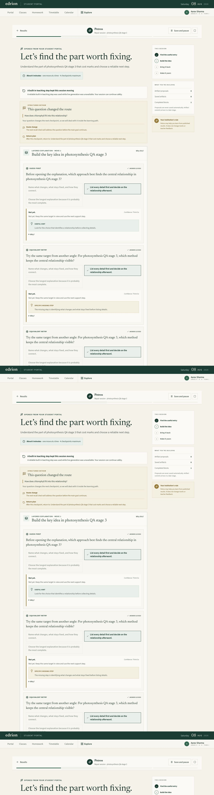
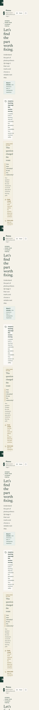

# Petros Stage 3 — Observation Handoff

Date: 2026-08-08  
Verdict: **Stage 3 complete**

## Delivered scope

- Durable answer capture with explicit confidence (`sure`, `think_so`, `guessing`) and response time.
- Server-only question specifications, answer keys, rubrics, hint material, missing-step material, and worked solutions.
- Deterministic evaluation for objective questions; routed structured evaluation for subjective answers; safe partial-credit fallback when the evaluator is unavailable or malformed.
- Immutable raw observations plus normalized evaluation rows and a bounded, summarized observation view for PLAN.
- Guess-first interactions before teaching content, with explicit required/completed/skipped/not-applicable state in planning decisions.
- A persisted struggle stretch: first miss gives a hint, second names the missing step, third gives a worked solution and a linked reworded attempt, and recovery closes on success.
- High-value misconception (`incorrect + sure`) and fragile-success (`correct + think_so/guessing`) flags that affect the next PLAN.
- Structured composer questions that become visible detours with acknowledgement, route change, causal observation IDs, and a return plan.
- Optimistic block/session versions, idempotent commands, immutable committed answers, and tenant/student scoping.
- Learner UI for locked answers, confidence, hints, ladder support, earned recovery, detours, polite announcements, visible focus, touch targets, mobile layout, and reduced motion.
- Authorized Super Admin decision/observation diagnostics and AI usage filters for PLAN, RENDER, answer evaluation, and hint generation. Diagnostic reads are audited and raw learner text is excluded.

## Architecture and data flow

1. RENDER persists a public teaching block and private `petros_question_specs` rows in one transaction.
2. The learner commits one answer, confidence, response time, expected block version, and an idempotency key.
3. Objective answers are evaluated locally. Subjective answers call `answer.evaluate` with a strict schema; invalid/unavailable output becomes safe partial credit and does not increment conceptual failures.
4. The answer, confidence, and response-time observations are written atomically with the normalized evaluation, block version, question lock, struggle stretch, and follow-up question.
5. PLAN receives only bounded recent observations plus summarized outcomes. It records the exact causal observation IDs when an observation changes the route.
6. A composer question creates an observation and detour. The following PLAN activates it; completion of the changed block rejoins the main goal.
7. Authorized diagnostics join decisions, observations, evaluations, ladder state, function/request metadata, and correlation IDs without returning raw answer/composer text.

The deterministic fallback now makes every fallback recall prompt objectively gradable. A provider outage therefore cannot leave a fallback recall block in an endless subjective-partial loop.

## Migration

Migration [`0188_petros_observation_loop.sql`](../packages/database/migrations/0188_petros_observation_loop.sql) was applied successfully with:

```sh
pnpm --filter @edrion/database migrate
```

It adds block versioning and PLAN observation metadata, upgrades Stage 2 session/decision versions, and creates:

- `petros_question_specs`
- `petros_observations`
- `petros_answer_evaluations`
- `petros_struggle_stretches`
- `petros_session_detours`

The tables have ownership indexes, foreign keys, bounded status/type checks, and append-only raw observation semantics at the application boundary.

## Key files

- Contracts: [`packages/schemas/src/petros-learning.ts`](../packages/schemas/src/petros-learning.ts)
- Database schema: [`packages/database/src/schema/petros-learning.ts`](../packages/database/src/schema/petros-learning.ts)
- Migration: [`packages/database/migrations/0188_petros_observation_loop.sql`](../packages/database/migrations/0188_petros_observation_loop.sql)
- Observation/ladder policy: [`apps/api/src/modules/student/petros-loop/petros-observation.policy.ts`](../apps/api/src/modules/student/petros-loop/petros-observation.policy.ts)
- PLAN/RENDER policy: [`apps/api/src/modules/student/petros-loop/petros-loop.policy.ts`](../apps/api/src/modules/student/petros-loop/petros-loop.policy.ts)
- Repository/transactions: [`apps/api/src/modules/student/petros-loop/petros-loop.repository.ts`](../apps/api/src/modules/student/petros-loop/petros-loop.repository.ts)
- Orchestration/API: [`apps/api/src/modules/student/petros-loop/petros-loop.service.ts`](../apps/api/src/modules/student/petros-loop/petros-loop.service.ts)
- Learner UI: [`apps/student-web/src/components/petros/petros-repair-session.tsx`](../apps/student-web/src/components/petros/petros-repair-session.tsx)
- Learner styling: [`apps/student-web/src/components/petros/petros-session.module.css`](../apps/student-web/src/components/petros/petros-session.module.css)
- Diagnostics UI: [`apps/super-admin-web/src/components/petros-routing/petros-decisions-panel.tsx`](../apps/super-admin-web/src/components/petros-routing/petros-decisions-panel.tsx)
- Usage UI: [`apps/super-admin-web/src/components/petros-routing/petros-usage-budget-panel.tsx`](../apps/super-admin-web/src/components/petros-routing/petros-usage-budget-panel.tsx)

## Automated verification

| Command                                                                                          | Result                                            |
| ------------------------------------------------------------------------------------------------ | ------------------------------------------------- |
| `pnpm exec vitest run src/petros-learning.spec.ts` from `packages/schemas`                       | Pass: 1 file, 10 tests                            |
| `pnpm --filter @edrion/api test`                                                                 | Pass: 49 files, 304 tests                         |
| `pnpm --filter @edrion/student-web test -- src/components/petros/petros-repair-session.spec.tsx` | Pass: 1 file, 5 tests                             |
| `pnpm --filter @edrion/schemas typecheck`                                                        | Pass                                              |
| `pnpm --filter @edrion/database typecheck`                                                       | Pass                                              |
| `pnpm --filter @edrion/api-client typecheck`                                                     | Pass                                              |
| `pnpm --filter @edrion/api typecheck`                                                            | Pass                                              |
| `pnpm --filter @edrion/student-web typecheck`                                                    | Pass                                              |
| `pnpm --filter @edrion/super-admin-web typecheck`                                                | Pass                                              |
| `pnpm --filter @edrion/api build`                                                                | Pass                                              |
| `pnpm --filter @edrion/student-web build`                                                        | Pass; `/petros/session` production route built    |
| `pnpm --filter @edrion/super-admin-web build`                                                    | Pass; `/ai/petros-routing` production route built |
| `git diff --check -- <Stage 3 paths>`                                                            | Pass                                              |

Focused coverage includes the confidence matrix, exact three-level ladder, linked equivalent/reworded questions, recovery, stuck support, partial/invalid attempt preservation, objective no-AI evaluation, malformed evaluator fallback, idempotency, stale concurrency, student/institution isolation, composer causality, deterministic outage-safe recall, detour rejoin, locked UI semantics, and structured composer UI.

Lint could not run because the workspace does not have the declared `eslint` executable installed. Both Next lint scripts instead start an interactive first-time configuration prompt. No lint configuration was created or changed.

The broader schema suite has a pre-existing unrelated failure in `src/student/exam-questions.spec.ts` (two `quick_check` assertions). The focused Petros schema suite passes.

## Browser checks actually performed

Common learner route: `http://localhost:3011/petros/session`  
Fixture: Greenwood Academy, Aarav Sharma (`student@greenwood.edu`, local dev seed), repair topic `photosynthesis QA stage 3`.  
Authorized dashboard: `/ai/petros-routing`, signed in as `owner@edrion.dev`; the local verification instance ran on port 3010 because the already-running port-3006 bundle had a stale public API URL.

| Check                          | Actual result                                                                                                                                                                                                                                                                                     |
| ------------------------------ | ------------------------------------------------------------------------------------------------------------------------------------------------------------------------------------------------------------------------------------------------------------------------------------------------- |
| Wrong once with `think so`     | Pass. Original answer locked; only “Useful hint” and an equivalent retry appeared.                                                                                                                                                                                                                |
| Three wrong answers            | Pass. Ladder advanced once per committed answer: hint → specific missing step → full worked solution plus earned-success prompt.                                                                                                                                                                  |
| Earned success                 | Pass. Correct reworded answer ended the stretch on success, removed the teaching cover, showed the explanation, and flagged uncertainty for an earlier recheck.                                                                                                                                   |
| Confidently wrong              | Pass on move 2. `sure + incorrect` showed a deliberate correction moment without shaming copy and appeared as `confident miss` in diagnostics.                                                                                                                                                    |
| Unsure but right               | Pass. `guessing + correct` showed “Correct with uncertainty” and appeared as `fragile success` in diagnostics.                                                                                                                                                                                    |
| Composer redirect              | Pass. No chat bubble appeared. The page showed “STRUCTURED DETOUR”, “This question changed the route”, route change, and return plan. The following PLAN cited the composer observation.                                                                                                          |
| Refresh                        | Pass after ladder level 1 and again on the accumulated recovery state; locked attempts and support persisted. Race/double-submit is covered by idempotency/stale-version tests.                                                                                                                   |
| Mobile/accessibility smoke     | Pass at a 390×844 viewport for responsive content, confidence/hint availability, semantic radio groups, polite feedback/detour announcements, 44px controls, focus-visible CSS, and reduced-motion CSS. Physical virtual-keyboard and external screen-reader passes remain release-device checks. |
| Decision/observation dashboard | Pass. Exact-session filtering removed other sessions and showed the ladder, evaluator, confident miss, fragile success, causal observation, and correlations.                                                                                                                                     |
| AI usage dashboard             | Pass for the local fixture: answer-evaluation and hint filters both showed 0 requests/attempts, matching the objective deterministic run and the absence of any configured provider route.                                                                                                        |
| Privacy/tenant                 | Automated pass for other-student and other-institution principals; both receive `PETROS_SESSION_NOT_FOUND`. Manual second-account browser verification remains in the release checklist below.                                                                                                    |

Learner evidence:





## Captured IDs

- Session: `9398378b-23a5-48f2-b145-89dfde730f80`
- Recovered block: `74db3cdb-55fb-40d1-b93a-339d1ba1995d`; correlation `f8b0e805-feec-4825-9578-0cb7b9ee518e`
- Composer-changed block: `ecf91579-2578-4e50-991b-2fc4348edf3d`; correlation `c845e654-b5d4-4d65-82fc-91e436c73d9b`
- Composer observation: `f833d877-717a-4064-9c53-45971ee462db`
- Detour: `396c32c4-ae17-4c78-aca7-e877bbe165e4`
- Causal PLAN decision: `0cfaecaf-4305-49e3-a7db-8ba23a555a12`
- Recovered struggle stretch: `505539ed-0218-4491-b331-4e90288ef605`
- Attempt correlations: first miss `2cbf5789-9d03-40cc-9e06-58beb3fd4821`; second miss `690d96ca-b23f-4dde-a1d6-5134c521dc5a`; third miss `f9dfa3ba-4bfe-45a1-b896-f380623ba180`; recovery `adab5a8c-120e-4860-948e-af6434aa7deb`; confident miss `95999039-c989-459f-a8af-09eb4d973a15`
- Audited diagnostic reads: decisions `95fb46a2-ca4e-4ec5-9933-2eed4d95ecc0`; observations `08e495cf-300d-45a0-8f9d-bde66bb96760`

## Dashboard-by-dashboard release runbook

Use a fresh repair session so every screenshot has one clean trace. For every item, capture the learner state plus the session UUID/correlation shown in diagnostics.

### 1. Wrong-once path

- Route/setup: learner `/petros/session`; new `repair` session for `photosynthesis`.
- Actions: select a wrong choice, select `Think so`, commit once.
- Expected UI: committed card locked; only useful-hint support; active equivalent retry; teaching remains covered.
- Evidence: one `answer_submitted` evaluation with `incorrect`, confidence `think_so`, ladder 1, support `hint`; block version increments once.
- Failure: answer remains editable, answer key is exposed, more than one ladder step advances, or PLAN/diagnostics omit the observation.
- Capture: learner card, observation ID, block version, correlation ID.

### 2. Three-wrong path

- Route/setup: continue item 1.
- Actions: miss the two equivalent retries once each.
- Expected UI: attempt 2 shows only the specific missing step; attempt 3 shows the full worked solution and one linked earned-success question.
- Evidence: one recovered/active stretch with wrong counts 1, 2, and 3 in successive observations; every question shares root/equivalence linkage.
- Failure: a refresh increments a count, support levels repeat/skip, the original answer appears before level 3, or no reworded question is created.
- Capture: all locked cards, stretch ID, three observation/correlation IDs.

### 3. Earned-success ending

- Route/setup: continue item 2.
- Actions: answer the reworded question correctly.
- Expected UI: “That lands”, recovery copy, teaching reveal, completion control enabled; the sequence does not end on the prior miss.
- Evidence: stretch `status=recovered`, `recovered_at` set, reworded question linked, recovery observation true.
- Failure: stretch stays active/stuck or progress summarizes the sequence as failure.
- Capture: recovery card, stretch row/ID, resulting block version.

### 4. Confidently wrong

- Route/setup: fresh objective question.
- Actions: choose a wrong answer and `Sure`.
- Expected UI: deliberate correction moment, neutral/non-shaming language, hint only on first miss.
- Evidence: `high_value_misconception=true`, `error_class` populated, confidence `sure`; next PLAN cites that observation.
- Failure: shaming copy, ordinary-miss handling only, or no causal PLAN reference.
- Capture: correction card, diagnostic `confident miss` badge, causal observation ID.

### 5. Unsure but right

- Route/setup: fresh objective question.
- Actions: choose the correct answer and `Guessing` or `Think so`.
- Expected UI: correct feedback plus an explicit earlier-recheck message.
- Evidence: `fragile_success=true`; next PLAN is a recall/recheck and cites the answer observation.
- Failure: treated as mastery with no recheck or marked incorrect.
- Capture: learner feedback, diagnostic `fragile success`, next PLAN decision.

### 6. Composer redirect and rejoin

- Route/setup: active session with at least two moves remaining.
- Actions: ask “How does chlorophyll fit into this relationship?”, finish the current block, then finish the changed block.
- Expected UI: no chat transcript; structured detour banner; acknowledgement, route change, return plan; main goal visible again after the changed block.
- Evidence: `question_asked` observation → detour `pending` → `active` with `changed_decision_id` → `rejoined` with `rejoined_at`.
- Failure: free-form chat bubble, PLAN ignores question, missing return plan, or detour never rejoins.
- Capture: detour banner, changed PLAN, detour row before/after rejoin.

### 7. Refresh and race

- Route/setup: repeat items 1–3.
- Actions: refresh after each ladder level; on one active question rapidly invoke submit twice.
- Expected UI: identical locked/support state after every refresh; second submit is disabled/idempotent or safely stale.
- Evidence: one answer observation/evaluation per question, no duplicate question/block, monotonically increasing versions.
- Failure: lost support, duplicate observation, skipped level, duplicate block, or incorrect progress.
- Capture: before/after refresh screenshots and row counts for question ID.

### 8. Mobile and accessibility

- Route/setup: 390×844 and a physical iOS/Android device; enable reduced motion; use a screen reader once.
- Actions: enter a long answer, select confidence and request a hint by keyboard only, submit, rotate/reopen keyboard, traverse locked feedback.
- Expected UI: no horizontal clipping; 44px touch targets; visible focus; radio groups announce names/state; feedback and detour updates announce politely; reduced motion removes block/progress animation.
- Evidence: accessibility tree contains named progressbar/radiogroups/status regions; CSS reduced-motion rule active.
- Failure: focus loss, hidden controls behind keyboard, clipped long answer, unannounced feedback, or motion persists.
- Capture: mobile before/after keyboard, focused confidence/hint, screen-reader transcript.

### 9. Decision and observation diagnostics

- Route/setup: Super Admin `/ai/petros-routing` → `Decision diagnostics`; sign in as an employee with `ai.view`; filter the exact session UUID.
- Actions: inspect move 1 and the composer-changed move; filter answer/confidence/composer observations and the date range.
- Expected UI: answer/confidence, ladder levels/support, evaluator, confident miss, fragile success, changed PLAN, causal observation IDs, request/correlation IDs; no raw answer/composer text.
- Evidence: matching `petros.diagnostics.view` audit rows with redacted filter state.
- Failure: cross-session rows after exact filtering, raw learner text, unredacted student ID, missing causality, or missing audit event.
- Capture: filtered decision/observation panels and audit event IDs.

### 10. AI Routing usage

- Route/setup: `/ai/petros-routing` → `Usage & budgets`; configure a test provider route for `answer.evaluate` and `hint.generate` in a non-production fixture.
- Actions: run one objective answer, one subjective answer, one explicit hint, and one forced malformed/timeout fallback; filter each function.
- Expected UI: objective evaluation adds zero `answer.evaluate` requests; subjective evaluation adds one request; hint adds one request; retry/fallback, latency, tokens, and cost match the gateway attempts.
- Evidence: usage rows joined by request/correlation IDs and function keys; learner output contains no provider/model detail.
- Failure: objective AI charge, missing subjective/hint usage, mismatched attempt/fallback totals, or provider details leak.
- Capture: both function filters and corresponding usage rows.

### 11. Privacy and tenant denial

- Route/setup: keep the session from Greenwood student A; sign in as Greenwood student B, then as a student in another institution.
- Actions: request the session document, question, answer, hint, composer, and observation identifiers directly.
- Expected API: safe not-found/denial without confirming the resource exists.
- Evidence: no returned learner content and an appropriate security/audit event according to the endpoint policy.
- Failure: any cross-student/cross-institution content or differing error that enables enumeration.
- Capture: sanitized response status/code and audit event ID.

## Limitations and recorded debt

- The local Petros routing registry had no configured provider/model route (`0/43` functions configured). This correctly exercised deterministic/no-cost behavior, but the positive provider-backed subjective usage row must be repeated in an environment with a test provider using runbook item 10.
- Browser QA verified semantic roles and responsive behavior, but a physical mobile virtual keyboard and external screen reader were not available in this environment; those remain release-device checks.
- The live composer fixture was captured in its active changed block. Rejoin is covered by the service test and repository transition; the release runbook retains the explicit before/after browser check.
- Workspace lint infrastructure is currently incomplete, as noted above.
- The unrelated schema `quick_check` failures and duplicate root `learn-evals` package-script key predate Stage 3 and were not changed.

## Stage 4 prerequisites

- Preserve `petros.session-state.v2`, `petros.plan.v2`, immutable observation IDs, question root/equivalence linkage, and optimistic versions.
- Treat raw answer/composer text and private question specs as server-only inputs; Stage 4 artifacts must consume redacted/authorized projections.
- Join artifact proposals/commits to session, decision, block, observation, and correlation IDs without auto-saving learner work.
- Keep deterministic objective evaluation ahead of routed evaluation and maintain the outage-safe, never-end-on-failure guarantee.
- Configure a non-production provider route before running the full cost/latency/retry/fallback acceptance matrix.

**Stage 3 complete.** The observation loop changes teaching behavior, the ladder reaches earned success or a real support path, confidence changes planning, composer questions redirect with a return plan, and the resulting behavior is traceable through authorized diagnostics and audited reads.
