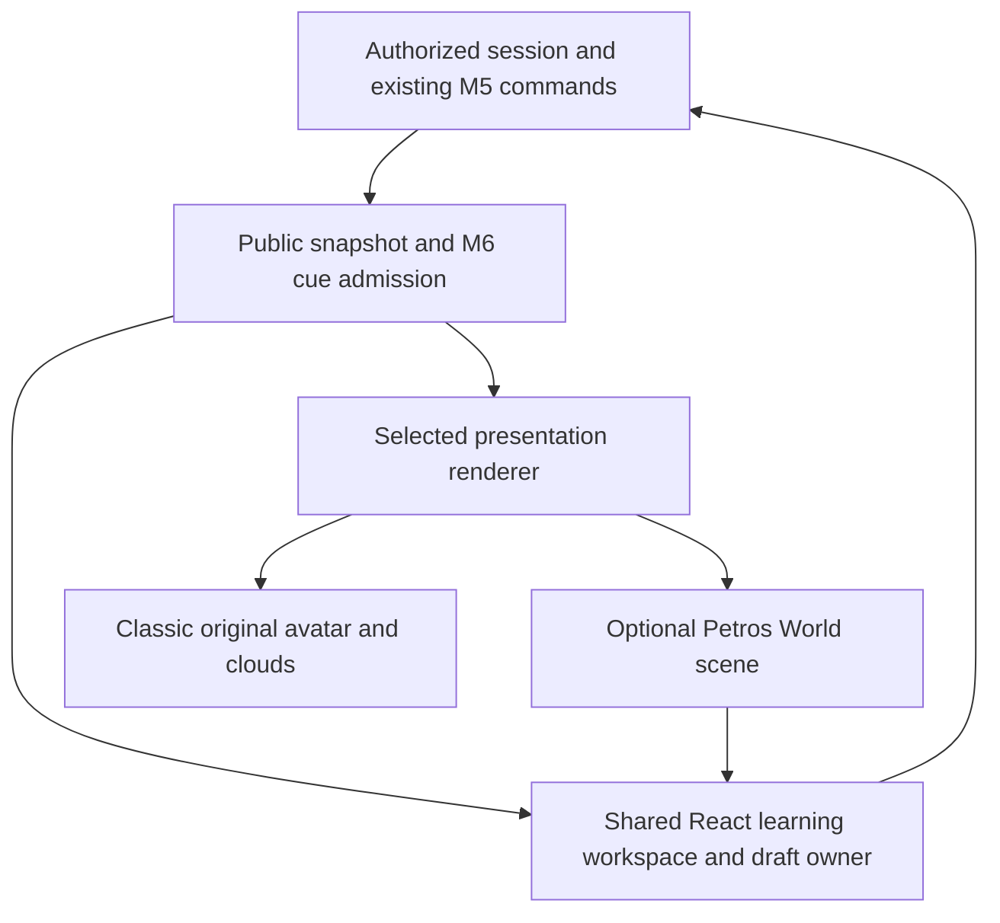

# Petros World: future optional renderer

25 October 2026. **Design only. No room, 3D character, mode switch or framework has
been implemented.** Faithful original-character art remains a blocking dependency.
See [presentation contract](presentation-contract.md) and [art inventory](petros-world-art-feasibility.md).

## Ownership and loading

Classic remains the default fast interface. Petros World is an explicit optional
presentation mode for the same authorized session, lesson, workspace, response,
evidence and evaluator. Keep one mounted session/draft/mutation owner above either
renderer. The renderer consumes an accepted public snapshot and presentation
intentions; it never owns an alternate lesson or teaching planner.

The World module, renderer engine, model, textures and clips load only after opt-in
and current institution/device capability checks. No static import from the Classic
critical path. A module/asset failure must leave the same accessible Classic
workspace usable. Do not install a 3D framework for this design document.

Scene state is ephemeral presentation: station, orientation, camera and current
approved clip. Academic state remains in existing durable checkpoints. Never store
private responses in asset URLs, global scene caches, analytics or reusable GPU
resources shared between authenticated users.

## Six-scene scenario

| Scene | Trigger and behavior | Required fallback |
| --- | --- | --- |
| 1. Enter | Student chooses World; verify school permission and device capability, initialize lazily, show a wide readable view of the bookshelf, desk/chair, whiteboard and experiment station. Petros begins at an approved rest anchor. Reconcile the existing session before presenting content. | Classic with the same session and draft if assets or graphics capability fail. |
| 2. Begin lesson | Current admitted lesson-start intention selects an approved station. If seated, use an approved stand clip; turn, follow a validated unobstructed path, stop at its interaction anchor and orient toward the board/student. | Show content immediately with Petros at a supported static/rest station; no sliding PNG or invented locomotion. |
| 3. Teach | A real accepted M5 operation updates the shared board. Synchronize an available approved gesture with that operation/beat. Board state remains correct even if the gesture cannot play. | Current React model and public caption, without the gesture. |
| 4. Student works | Yield the board, move once to a readable focused view when permitted, then stop camera movement. The existing accessible React controls handle keyboard, touch and precision input. | Stationary DOM workspace; full keyboard and text-only path. |
| 5. Ask for help | Check current help policy, interrupt/checkpoint through existing commands where required, await the actual authorized result, and present the approved text. Resume from the reconciled current activity. | Explicit restricted/unavailable state; no manufactured hint or lost draft. |
| 6. Outcome | Only a validated evaluation linked to the committed response determines outcome wording. Separate assisted correction from independent mastery. An optional approved return-to-rest clip can follow once interaction ends. | Neutral Petros and truthful public criterion/review/unavailable status in React. |

Walking/camera arrival must not gate saving, evaluation or access to educational
content. A late animation or asset completion cannot replace a newer activity.
Cancel paths, clips and camera callbacks against the same session epoch and event
identity used by presentation. Physical animation never confirms a simulator result.

## Station and rig capabilities

An environment manifest should map semantic roles to artist/designer-authored
anchors: rest, whiteboard, experiment, desk, safe camera positions and focus regions.
The renderer resolves a semantic current target to a reachable station. Validate
obstructions, supported paths, character bounds and camera readability locally.
No world coordinates are added to the academic evaluator.

A character manifest should declare identity-approved model/texture/clip hashes,
rig version, supported postures/gestures, hand contact anchors, reach limits,
blend/morph capabilities, reduced-motion poses and safe interruption points.
Unsupported intentions fall back immediately. A string named `walk` or `point`
does not prove that an approved clip or physically correct contact exists.

## Future mode switching transaction

1. Keep Classic selected by default. Offer World only when institution policy and
   actual device/art capabilities permit it. Store only an allowed presentation
   preference; do not place student work inside that preference.
2. Keep the existing React session and draft owner mounted. A mode request must
   not call `next`, create a session, reset a workspace or submit an answer.
3. During a mutation, retain the current renderer until the existing receipt and
   fresh snapshot reconcile. If commitment is uncertain, keep the submission guard
   and recovery UI; do not retry with a newly generated academic command ID.
4. Preserve the same local unsaved draft in memory. When existing policy requires
   a checkpoint before interruption, await its confirmed save. If it fails, retain
   the draft and make the failure clear. Persisted drafts remain server-owned.
5. Cancel outgoing presentation/audio through existing owners, dispose only the
   outgoing scene resources, then mount the new renderer from the same snapshot.
   Do not replay finished introductions/evaluations merely because it mounted.
6. On refresh, reauthenticate and reconcile first. Recover durable academic state
   through the existing path. Do not claim a purely in-memory unsaved draft survived.
7. On policy change, source revocation, graphics context loss, load failure or
   device limitation, stop World and retain the usable Classic path. No duplicated
   save/submission, stale academic content or forced immersive presentation.

Multiple tabs keep existing expected-revision, epoch and task-instance rules.
A scene cannot locally overwrite a newer committed version. Account/session
changes clear transient scene state, speech and cached student-specific content.

## Accessibility and performance acceptance

The educational workspace stays semantic HTML/React with equivalent keyboard,
screen-reader and touch controls. A 3D board texture alone is not an accessible
replacement. Keep visible controls and reading sizes adequate during focus mode;
avoid moving the camera while a field is focused. Reduced motion skips walking,
gestures and camera movement and presents the final safe view. Text-only mode and
Classic remain available without losing the session.

Before commissioning runtime integration, set device-tested budgets for compressed
transfer, decoded textures/GPU memory, geometry, draw calls and frame time. Measure
entry download, shader/scene initialization, input-to-frame, long tasks and thermal
behavior on representative school/mobile devices. These are proposed measurement
categories, **not achieved budgets or FPS claims**. Classic must fetch zero World
assets before explicit opt-in, verified by the network trace and bundle graph.

## Prerequisites for the next development cycle

- Accepted Classic implementation and its real session/security/accessibility checks.
- Artist-supplied faithful original-character model, turnaround and rig, with recorded
  visual approval and approved asset/clip hashes; see the separate art feasibility report.
- Approved room/station/camera design and measured unobstructed paths.
- Selected browser renderer based on actual device and asset requirements, followed
  by measured loading/memory/frame budgets; no engine is selected by this document.
- Capability/fallback contract tests and shared workspace/session ownership tests.
- Mode-switch, failed save, unknown receipt, context loss, revocation, multiple-tab,
  reduced-motion, keyboard/screen-reader and user-switch tests.
- Human review of identity fidelity, camera comfort, distraction and first-time use.

The room and embodied experience remain unimplemented until those prerequisites
are met. Existing academic/provider/production qualification gates remain separate.
