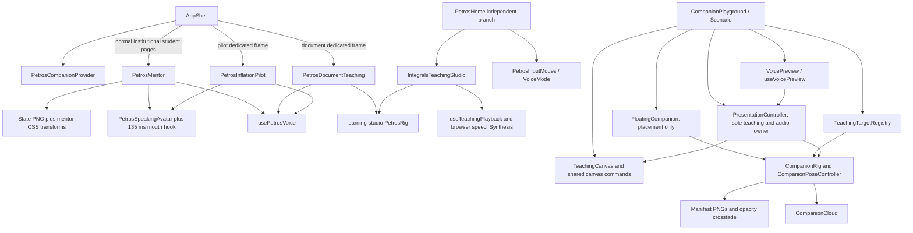

# Petros V2 — Companion, animation and voice integration audit

Audit date: 11 October 2026. Scope: the current working tree at `/Volumes/Chris/Edrion Labs`, including existing uncommitted Petros changes. Analysis only; no implementation changes, new artwork, provider calls, route changes, database connections, migrations, or production learning writes were made.

Evidence labels used below:

- **SOURCE VERIFIED:** traced through current imports, mounting, handlers and implementations.
- **LOCAL VERIFIED:** exercised with isolated tests, mocked HTTP, or local asset inspection during this audit.
- **HISTORICAL RUNTIME:** existing browser/audio artifacts; useful evidence, not a fresh session or deployment attestation.
- **UNVERIFIED:** requires an approved isolated runtime, real provider output, or inspection of the user's served build.

## A. Executive summary

Petros is currently several implementations sharing character PNGs. The regular institutional student shell mounts `PetrosMentor`; the Companion Playground explicitly excludes it and mounts `FloatingCompanion → CompanionRig`. Document teaching uses another component, `PetrosRig`. The inflation pilot has its own renderer. These do not share one animation controller or cloud implementation.

**The portal's visible bob and tilt are real, mounted CSS animations applied to a complete PNG.** `petros-mentor.module.css` runs a 4.8-second idle cycle with a two-pixel lift and small rotation. Its listening, thinking and session-reaction selectors add other whole-image movements. During actual speech, `PetrosSpeakingAvatar` paints an SVG mouth over the idle PNG and toggles it every 135 ms. This is an approximation, not audio-reactive lip synchronization. [Portal rendering][mentor-render], [portal CSS][mentor-motion], [mouth implementation][mouth].

**The Playground does use the latest V2 rig, but that rig deliberately has no idle animation.** It displays the same eight existing PNG poses, crossfades during eligible teaching, and admits short directional poses for valid visible targets. Its manifest explicitly specifies a quiet static idle and unsupported independent face/body controls. It neither imports the portal CSS nor mounts its speaking SVG. Waiting for longer will not reveal an idle loop. Current source matches all six files in the latest responsive-fix source manifest; the earlier desktop-only pointing restriction has already been removed. [V2 renderer][v2-rig], [V2 policy/controller][v2-controller], [manifest][manifest], [latest follow-up][responsive-report].

**The Cedar/Marin problem has a definitive source-level explanation on legacy TTS models.** The portal sends the selected name correctly. On `tts-1` or `tts-1-hd`, the non-strict adapter silently replaces either name with **`onyx`**, then sends that same effective voice to `/audio/speech`. The portal response hides that effective identity. Existing route evidence lists `openai-live-eval / tts-1`; this is a stored snapshot, not a fresh live route inspection. A fresh mocked-HTTP execution of the actual adapter confirmed `cedar → onyx` and `marin → onyx` on `tts-1`. Neither caching nor failure to update the frontend selection is needed to explain identical output. Current live routing and audible output remain **UNVERIFIED**. [Fallback][tts-adapter], [portal service][companion-service], [route snapshot][route-snapshot].

The Playground's newer voice preview is a separate, deliberately gated diagnostic. It exposes server-qualified voices, rejects unsupported names, returns effective route receipts and uses the shared presentation owner for playback. It does not automatically narrate the fixture lesson or run a live conversation. Its currently implemented preview qualification accepts priced legacy TTS routes, not Mini TTS; therefore Cedar/Marin are not available through that path merely by opening the controls. [Preview service][preview-service], [preview UI][preview-ui], [mounted scenario][scenario].

Safe verification completed: **108 frontend tests across 14 files and 66 backend tests across four files passed**; all eight manifest image hashes/dimensions matched; the six latest responsive-fix source hashes matched. Existing browser evidence records 66 seconds of static Playground idle and content-sized clouds with stable conversation controls. Existing WAV fixtures contain digital silence, so none constitutes a voice audition. No fresh app server was started because the configured runtime was not established as isolated from the prohibited production database.

## B. Rendering map

### Route ownership and actual mounting

`AppShell` has early dedicated-workspace returns for `/petros/document` and `/petros/pilot`. The ordinary shell mounts `PetrosMentor` only for an institutional principal with a student ID and `student.learn.use`, and excludes the exact Playground/document/pilot paths. Exam attempts use the focus layout. A context provider alone does not mount an avatar. [Shell][shell], [workspace routing][workspace-frame], [companion context][context].

The Playground server page checks `PETROS_V2_COMPANION_PLAYGROUND_ENABLED` and tester IDs, forwards existing cookies to `/v1/student/me` with a five-second timeout/no-store, and fails closed. `authorizedPlaygroundTester` requires institutional metadata, a valid UUID in the first 32 valid allowlist entries, learning permission (or `*`) and no required password change. It does not impersonate a student or admit a client-supplied owner ID. [Server page][playground-page], [admission][playground-admission].

The following route table and renderer profiles together specify entry point, avatar, controller, state owner, assets, clouds, voice, events and gates for each surface.

| Exact route/surface | Mounted entry and renderer profile | Additional route facts |
|---|---|---|
| `/` → `/home` | Root page redirects; `/home` page → shell **P1** | Home registers contextual candidates with `usePetrosPage` at line 117; it does not create a separate home avatar. |
| Student “dashboard” | **P1** on `/home` | No separate `/dashboard` page was found in the current App Router tree. |
| `/learn`, `/learn/goals/[id]`, `/learning-path` | Normal shell **P1** | `/learn` registers page candidates at line 230. Teaching/session navigation does not substitute the V2 rig. |
| `/petros/session?session=<id>` | `PetrosRepairSession` plus shell **P1** | Session blocks, narration and diagram events drive the shell mentor. Server-backed session, not an M0-P fixture. |
| `/petros`, institutional branch | `PetrosHome → InstitutionalPetrosHome`, static hero **P2**, plus shell **P1** | Both the page's static hero and the floating mentor can exist. |
| `/petros`, independent-student branch | `PetrosHome → TeachingStudioLauncher + PetrosInputModes`, **P3/P6** | Institutional shell mentor is not admitted for this principal. Studio opens locally on this route; there is no separate integrals URL. |
| `/petros/document?session=<id>` | `PetrosDocumentTeaching → PetrosRig`, **P4** | Dedicated workspace; no shell mentor. Help header and teaching dock can both render a rig. Session required for actual document work. |
| `/petros/pilot?session=<id>` | `PetrosPilotPageContent → PetrosInflationPilot`, **P5** | Dedicated workspace; no shell mentor. Institutional permission/session admission applies. |
| `/petros/companion-playground` | Server page → `CompanionPlayground → Scenario → FloatingCompanion → CompanionRig`, **P7** | Feature/tester admission; fixture canvas; shell mentor explicitly excluded. |
| Other ordinary student routes listed below | Normal shell **P1**, subject to the same principal/permission gate | A route need not import an avatar itself to show Petros. |
| `/exams/[scheduleId]/attempt` | Focus layout; **no shell companion** | Shell exclusion prevents mentor interference with the attempt surface. |
| Login/activation/password and other authentication pages | **No ordinary student-shell companion** | Outside this normal authenticated rendering path. |

Other normal-shell pages found in the route tree: `/announcements`, `/assignments`, `/assignments/[id]`, `/attendance`, `/calendar`, `/classes`, `/classes/[id]`, `/courses`, `/courses/[id]`, `/design-system`, `/documents`, `/exams`, `/fees`, `/fees/pay`, `/flashcards`, `/homework`, `/homework/[id]`, `/hostel`, `/materials`, `/notes`, `/notes/[id]`, `/notifications`, `/petros/artifacts`, `/profile`, `/progress`, `/report-cards`, `/report-cards/[id]`, `/requests`, `/requests/[id]`, `/requests/new`, `/results`, `/settings`, `/timetable`, `/transport`. These inherit P1 when admitted; this is not a claim that every page publishes rich teaching events.

### Renderer profiles

| Profile | Avatar/assets | Animation controller and state owner | Cloud/text renderer | Voice and driving events | Gates/capabilities |
|---|---|---|---|---|---|
| **P1 — regular portal** | `PetrosMentor`; ordinary poses are `` using eight `/petros/states/*.png`; talking mounts `PetrosSpeakingAvatar` using idle PNG + SVG mouth | Mentor React state, `PetrosCompanionProvider` page/selection context, `usePetrosVoice`, CSS pose/data selectors; reaction timeout | Inline mentor thought spans, conversation bubble and session/diagram guidance; no `CompanionCloud` | `usePetrosVoice`; selected-page context, query/mutation state, lesson play/stop, session pulse/reaction, diagram focus/step/stop, workspace question/interrupt, audio events | Institutional student + permission; server preferences include animation; OS/HTML reduced motion suppress motion. No V2 capability governor. |
| **P2 — Petros home hero** | `InstitutionalPetrosHome` static `petros-point-right.png` | Page state and server queries; no avatar rig/controller | Static hero thought panel | Page actions/navigation; voice is supplied by separately mounted P1 | Institutional branch; not an expressive renderer. |
| **P3 — integrals teaching studio** | `IntegralsTeachingStudio → PetrosPlacement → PetrosRig`; old `petros-pointing.png`, or idle PNG/SVG mouth for `speak` | `StudioExperience`, `useTeachingPlayback`; placement geometry from target registry; own mode/index/status | Studio captions, placement arrow and local question panel | Local beat audio when supplied, otherwise browser `speechSynthesis`; playback and local Q&A state | Independent branch launcher; studio's reduced-motion handling; not V2 admission/capability logic. |
| **P4 — document teaching** | Dynamic import of `PetrosRig`; old pointing PNG or speaking SVG | `PetrosDocumentTeaching` server session/ref, draft/help state, serialized document command queue, `usePetrosVoice` | Own explanation/activity/help/cards, not V2 cloud | Document session transitions; mic/transcript/help and real audio state; queued `/student/petros/sessions/{id}/document-teaching` actions | Dedicated frame, institutional/learning permissions and owned session; no V2 controller. Voice hook uses its Cedar default rather than mentor's stored selection. |
| **P5 — inflation pilot** | Static hero `point-left`; teaching avatar selects `listening`, `point-up` or `PetrosSpeakingAvatar` | `PetrosInflationPilot` session, scene/step/placement, voice state; its own CSS movement/step effect | Local teaching caption and help/pilot panels | Pilot session/lesson transitions, `usePetrosVoice`, actual speaking/listening | Entry requires institutional permission; reduced-motion CSS and hook. Voice preference not inherited from mentor. |
| **P6 — older input modes** | `PetrosInputModes` static point-right hero | Active-mode state; `VoiceMode` owns recorder/session/turn/audio state | Mode-specific hero thought cloud and response panels | Separate `/student/petros/voice/sessions` and `/voice/turns`, `new Audio` for turn response; no Cedar/Marin selector | Currently rendered from independent `/petros` branch, but backend voice endpoints require institutional principal. The source branch/endpoint mismatch means this must not be assumed a functioning institutional portal voice entry. |
| **P7 — M0-P Playground** | `CompanionRig` mounts eight manifest PNGs; `FloatingCompanion` portals placement to `document.body` | `Scenario` creates one `PresentationController`; `useSyncExternalStore` distributes its state. `CompanionPoseController` admits poses, not a second timeline | `CompanionCloud` with floating-wrapper sizing/tails; compact status + Show text | Accepted canvas action IDs, published fixture cues, registered visible targets, local typing/replies/source checks; gated `VoicePreview` uses the same presentation audio owner | Playground enabled + tester allowlist + institutional permission; reduced motion, pointing toggle, assessment-safe mode, supported capabilities. Preview has additional approval/runtime/budget gates. |

Profile source anchors: [P1][mentor], [P2/P6 branch][petros-home], [P6][input-modes], [P3 studio][studio], [P3 playback][studio-playback], [P4][document], [P5][pilot], [P7][scenario].

`PetrosCompanionPanel` and `PetrosBriefingStrip` still contain static Petros images and tests, but repository import tracing found no current production mount. Their existence/tests do not prove that they render on the portal. The learning-studio `PetrosRigState` type lists `walk`, `think`, `listen`, `acknowledge`, etc.; most of those names currently select exactly the same pointing image. `pointAngle` is accepted in the prop type but never read. [Older panel][old-panel], [older strip][old-strip], [learning rig][learning-rig].

### Component dependency map



There is intentionally no edge from `PetrosMentor`, `PetrosSpeakingAvatar`, or `PetrosRig` into the Playground's current rendering path.

## C. Animation implementation matrix

“REAL” means an independently changing component or executable control; “APPROXIMATED” means complete-image motion, pose switching or a painted overlay; “UNSUPPORTED” means the requested articulated behavior is absent. A static expressive PNG is not a facial animation.

| Capability | Actual implementation/controller and trigger | Classification and artwork | Routes where mounted | Playground availability |
|---|---|---|---|---|
| Idle bob | Mentor `.character img` → `petros-idle`; default mounted image, 4.8 s loop, −2 px lift | **APPROXIMATED**, whole PNG; existing assets sufficient | P1 normal shell | **Absent**. V2 CSS has no idle keyframe; manifest expressly chooses static neutral. |
| Natural blinking | No mounted eyelid controller/layers | **UNSUPPORTED**; needs clean face/eyelids/masks for a proper rig | None | Absent. |
| Eye movement | No mounted pupil/gaze controller/layers | **UNSUPPORTED**; needs separate eyes/pupils and bounds | None | Absent. |
| Head tilt | Mentor idle/listen/think/teach/answer rotations and reaction transforms | **APPROXIMATED** whole character rotation, not independent head | P1 | No equivalent continuous tilt. Independent head unsupported everywhere. |
| Breathing/posture | Mentor teaching scale/lift and other PNG transforms | **APPROXIMATED** posture impression; no chest/body deformation | P1; pilot has its own movement effects | No breathing animation. Gentle whole-image motion would not require new artwork. |
| Gesture transitions | V2 `CompanionRig` keeps PNG nodes mounted; active opacity changes over 240 ms when admitted | **APPROXIMATED**, whole authored pose crossfade; no skeletal interpolation | P7; P1 instead swaps images and applies its own CSS/movement | **Implemented and mounted** during active eligible teaching; off on pause/stall/loading/reduced motion/assessment. |
| Facial expression | Listening/thinking/talking images differ; mentor SVG overlay changes mouth | **APPROXIMATED**, static complete poses and simple SVG mask | P1/P5/P7 static poses; P3/P4 speaking overlay | Static pose choice only; no facial controls. |
| Directional pointing | Mentor pose priority/diagram placement; V2 `targetIsVisible` + geometry → `CompanionPoseController.resolve` → `resolveSupportedPose` | **APPROXIMATED**, four complete cardinal poses, not precise hand contact | P1; P5 limited up pose; P3/P4 old pointing image/flip | **Implemented**, including narrow panes. Requires current accepted action, focus/highlight and a connected, unclipped target. |
| Speaking appearance | `usePetrosSpeakingMouth` and `PetrosSpeakingAvatar`; mentor/pilot real `speaking` state; learning rig `state==='speak'` | **APPROXIMATED** SVG mask/paths over idle PNG; mouth itself changes independently, but is not authored separated artwork | P1/P5; P3/P4 via `PetrosRig` | Only static `petros-talking.png`, admitted by actual presentation audio `speaking`, including explicit preview. No SVG mouth. |
| Audio-reactive mouth/phonemes | No analyser, amplitude envelope, viseme data or phoneme controller in these paths | **UNSUPPORTED as implemented**. Proper mouth shapes/art and timing analysis required for robust lip sync | None | Absent. The 135 ms interval elsewhere is not audio-reactive. |
| Cooldown | V2 `CompanionPoseController`: once per action; 6,000 ms between gestures; holds 700/820/940 ms sampled by presentation updates | **REAL policy**, operating on static poses; no extra clock | P7 | Mounted. Pause/replay lifecycle tested. Mentor reaction timer is a different mechanism, usually 2,800 ms and minimum 1,200 ms, not this cooldown. |
| Reduced motion | Mentor CSS OS/HTML/preference selectors; mouth hook `useReducedMotion`; learning rig Motion flag; pilot CSS; Playground OS/HTML observer, controller pause and policy/CSS | **REAL suppression**, not replacement articulated assets | All relevant profiles, with differing implementations | Mounted: disables pose transitions/point gestures and pauses playback on reduced-motion update. |
| Arrival / “walking” | Mentor arrival and moving-image bounce; learning rig only `enter` fades/translates for 340 ms; pilot placement/step CSS | **APPROXIMATED**, no gait/limb rig | P1/P3/P5 | No walking rig; floating relocation is layout/dragging, not animated anatomy. |
| Session acknowledgement/retry/celebration | Mentor `petros:session-reaction` handler sets reaction; mounted reaction selectors transform image | **APPROXIMATED**, whole-image lean/nod/pop | `/petros/session` through P1 when emitted | Not subscribed to portal session events; local fixture feedback instead. |

Exact implementation anchors: [mentor pose/render][mentor-render], [mentor motion/keyframes][mentor-motion], [mentor reactions][mentor-reactions], [mouth][mouth], [learning rig][learning-rig], [V2 rig visibility/transition][v2-rig], [V2 controller][v2-controller], [V2 policy][v2-policy], [V2 CSS][v2-css], [pilot CSS][pilot-css].

Important selector detail: portal bob/tilt CSS targets `.character img`. Its speaking renderer is an SVG containing `<image>`, so those `img` selectors do not automatically animate the speaking SVG. Transferring the SVG alone would not also transfer the portal's idle CSS.

The mouth hook reads the HTML reduced-motion attribute at effect start; it does not independently observe subsequent attribute mutations. Playground does have such a `MutationObserver`. OS reduced-motion changes are handled by the Motion hook. This is a small consistency edge case for future shared presentation work, not the cause of a permanently static Playground.

## D. Playground versus portal: precise reasons for the difference

### Confirmed causes

1. **Different mounted components.** The shell excludes `/petros/companion-playground`; `Scenario` mounts `FloatingCompanion`, which mounts the latest `CompanionRig`. Portal CSS, mentor React pose selection and the SVG mouth hook never enter that tree. [Shell][shell], [floating mount][floating], [V2 rig][v2-rig].
2. **Different idle policy.** The portal continuously animates a PNG by default. V2 has no idle timer/keyframes and explicitly describes quiet static neutral. `data-idle-artwork="required"` is descriptive; it does not load additional art or initiate an animation. Missing layered art explains the absence of articulated breathing/blinking, but does not make a simple bob technically impossible. [Manifest][manifest], [V2 CSS][v2-css].
3. **V2 gestures are deliberately brief and conditional.** Teaching must be playing, the current action must already have been accepted, the cue must be teaching, a semantic target must be focused/highlighted and fully visible, and progress must be below one. The governor admits one brief cardinal pose per action, spaced at least six seconds apart. Pausing, typing, loading, stall, assessment-safe mode or missing/clipped targets revokes it. A static-looking interval is often expected even during a valid lesson. [Controller][v2-controller], [policy][v2-policy].
4. **Fixture text is not speech.** `Scenario` does not call `configureNarration`. Its fixture lesson normally uses text playback. The mounted voice preview is an explicit separate diagnostic; it changes the same presentation audio state only after actual playback events. No audio means no V2 speaking pose. The older studio, by contrast, sets `speak` from its own playing state, which can animate a mouth before/without verified real audio. [Scenario][scenario], [presentation audio][presentation], [studio placement][studio], [studio playback][studio-playback].
5. **Same old artwork, different display treatment.** V2's new rig logic did not bring new facial/body artwork. Clouds and pose admission improved independently from idle expressiveness. Its 92×124 desktop/70×94 mobile avatar also makes very brief pose changes less obvious than a larger portal/pilot character. [Floating CSS][floating-css], [manifest][manifest].

### Investigated alternatives and evidence

| Proposed explanation | Finding |
|---|---|
| Latest expressive rig never mounted | **Ruled out in current source.** Imports and mount reach `CompanionRig`; fresh mounted-rig tests pass. |
| Updated bob/mouth logic exists but is not connected | **Confirmed across implementations.** Mentor CSS and SVG mouth exist in P1/P3/P4/P5, not P7. |
| Idle suppressed only by reduced motion | **Insufficient explanation.** Even with reduced motion false, V2 has no idle animation. Reduced motion can additionally suppress transitions/gestures. |
| Broken cue/event subscription | **No evidence of a general break.** Scenario subscribes to the controller and passes state/cues/canvas; tests exercise real mounted pose changes. Portal window events are intentionally not this controller's input. |
| Mobile always forces neutral | **Outdated explanation.** Latest geometry logic permits visible targets in narrow panes; fresh tests cover 688-pixel width. Manifest prose and inspector text still describe an older mobile fallback. |
| Replay retains spent gesture history forever | **Previously addressed, not current root cause.** Governor resets on presentation identity; Continue retains the same history. Fresh tests cover both cases. |
| CSS/lifecycle unintentionally disables all motion | **No demonstrated global defect.** V2 suspension and transition guards are intentional; resize/scroll observers and media handlers have cleanup. Source inspection cannot rule out browser-specific failures. |
| Stale frontend build or wrong served route | **UNVERIFIED.** Current six follow-up source hashes match the saved manifest. That proves working-tree identity, not which build the user's browser serves. |

Historical browser evidence: [idle observation][idle-evidence] sampled neutral/waiting with zero animations at approximately 22, 44 and 66 seconds; [waiting observation][waiting-evidence] records the same quiet behavior over 33.66 seconds. The [latest 688-pixel screenshot][responsive-image] shows the newer expanded caption arrangement. These are earlier saved runs; no new browser observation was fabricated.

## E. Artwork capability assessment

The relevant public asset tree contains **nine genuine PNG images and the V2 JSON manifest**. It also contains eight 4,096-byte macOS AppleDouble sidecars named `states/._petros-*.png`; their header is `00051607`, not a PNG signature. They are metadata, not additional artwork or layers, and are not referenced by the rig. No authored layered face/eye/mouth/arm assets, joint data, source illustration files, or separate animation sheets were found there. The SVG mouth is generated in component code, not a newly supplied layered character asset.

| Actual asset under `apps/student-web/public/petros/` | Native dimensions | Bytes | Mounted use |
|---|---:|---:|---|
| `petros-pointing.png` | 724×760 | 463,455 | Learning-studio/document `PetrosRig`; older static surfaces |
| `states/petros-idle.png` | 384×512 | 255,463 | Mentor idle, speaking SVG base, V2 neutral |
| `states/petros-listening.png` | 384×512 | 255,698 | Mentor/pilot/V2 listening |
| `states/petros-thinking.png` | 384×512 | 253,550 | Mentor/V2 thinking |
| `states/petros-talking.png` | 384×512 | 253,201 | V2 static speaking; mentor pose table exists but its talking render uses SVG instead |
| `states/petros-point-right.png` | 384×512 | 246,586 | Hero/mentor/V2 directional pose |
| `states/petros-point-left.png` | 384×512 | 248,196 | Pilot hero/mentor/V2 directional pose |
| `states/petros-point-up.png` | 384×512 | 250,724 | Pilot/mentor/V2 directional pose |
| `states/petros-point-down.png` | 384×512 | 252,932 | Mentor/V2 directional pose |

Fresh inspection verified PNG dimensions, RGBA color type and all eight manifest SHA-256 values. The eight state images have genuinely transparent pixels, with alpha values 0/255; the larger old pointing image also has intermediate edge alpha. The idle export has a stray bottom fragment: portal/V2 CSS crop its bottom 6.25%, and the speaking SVG clips at y=480 of 512. This is existing rendering treatment, not an audit modification. [Manifest/inventory][manifest], [portal crop][mentor-motion], [V2 crop][v2-css], [SVG crop][mouth].

The manifest's asset inventory and supported/unsupported rig distinction are substantially accurate: `layers: []`, `pivots: {}`, `contactAnchors: {}`. Its placement/pointing prose has drifted: `calloutAnchor` still says above the dock, although the floating wrapper places the cloud beside the avatar; `pointingPolicy` still describes desktop-only pointing/mobile neutral, although current code uses geometry on mobile too. These prose fields are not the runtime geometry implementation.

Dimensions and anchors are not standardized. The mentor uses different floating/docked/teaching sizes (including 94×126, 64×84 and 88×116), CSS origin 50%/92%, and its own coordinates. Pilot teaching uses 116×154. V2 floating uses 92×124 or 70×94 and DOM rectangles. `PetrosRig` uses a 724×760 viewBox and nests the 384×512 speaking asset at x=77, width=570, height=760. No common artist-authored neck/eye/hand pivots exist. `pointAngle` in the older rig has no effect. [Mentor CSS][mentor-css], [pilot][pilot], [floating CSS][floating-css], [learning rig][learning-rig].

What is possible now:

- **REAL independently changing primitive:** the SVG mouth path can open/close independently of its PNG backdrop. Its painted-face mask makes it an **APPROXIMATED character mouth**, not a clean authored layer or lip-sync rig.
- **APPROXIMATED and feasible without new art:** gentle whole-image lift/tilt, restrained scale/posture impression, arrival, authored pose switching/crossfade and cardinal pointing. These are meaningful visible idle/attention cues if explicitly described as approximations.
- **UNSUPPORTED with the current authored assets:** natural eyelid motion, eye gaze, independently rotating head, articulated shoulders/elbows/hands, true breathing deformation and precise anatomical hand-to-target contact. The manifest lists the required separated surfaces, overlap masks, pivots and bounds for each.
- **Not implemented but partially possible without a full rig:** audio amplitude could drive an approximate mouth overlay in future. Robust expressive/phoneme mouth motion still needs approved mouth shapes and suitable timing data. Merely changing the 135 ms timer is not true synchronization.

New artwork is therefore **not a prerequisite for a consistent gentle idle bob**, but is a dependency for the promised independent face/body behaviors.

## F. Dynamic speech/thought-cloud analysis

### Playground

`CompanionCloud → cloudContent` trims captions, uses a source-check/listening fallback only for those statuses, and returns nothing for other empty captions. The floating wrapper adds distinct speech/status tails, intrinsic size and placement. Only P7 mounts this updated component. [Cloud][cloud], [floating wrapper][floating], [floating CSS][floating-css].

- **Width:** floating cloud overrides the base cloud's `width:100%` with `width:max-content`, minimum `min(96px,100%)`, maximum 100% of the available grid track. Wrapper width follows the desktop harbor; compact width is 158 px; expanded small-screen width is at most 278 px and viewport−24 px. Long words wrap.
- **Height:** automatic content height; paragraph caps at 88 px and scrolls vertically. Long text is not forced into a giant unrestricted panel. Paragraphs over 120 characters become keyboard focusable for scrolling.
- **Relative position:** fixed portal to body; grid places cloud beside the avatar, left/right flipped according to available position. Bounds are clamped to viewport. Speech uses a triangular tail; thinking/listening statuses use circles/dashed styling. Dragging is disabled while generating and otherwise does not mutate teaching state.
- **Conversation stability:** the harbor reserves its maximum envelope independently of actual cloud content: 156 px desktop, 100 px compact mobile, 210 px expanded mobile. This prevents caption-height changes from moving Send/Clear between pointer down/up.
- **Mobile:** compact initially hides cloud but shows a status and visible **Show text** button. Current code preserves expansion through teaching/replay. This is newer than the earlier compact-only behavior.

Historical measured browser results in [cloud-results.json][cloud-evidence]:

| Sample | Cloud width × height (px) | Result |
|---|---:|---|
| Status | 107.06 × 57.83 | Small content-sized bubble |
| Short | 122.66 × 57.83 | Short text stays short |
| Two-line | 202 × 95.27 | Grows with wrapping |
| Long | 202 × 127.11 | Paragraph reaches 88 px and scrolls |
| Empty ordinary caption | No cloud or tail | No empty visual bubble |

Send remained at x=1123/y≈546.45 with width≈86.22/height=36 for all recorded samples; `pointerControlsStable` was true. These measurements are historical, not newly measured dimensions in the user's browser. Fresh cloud/layout-related tests pass.

### Semantics and stale-state handling

`Scenario` prioritizes actual mic recording, explicit preview speech/preparation/stall, an inspector sample, a local source check, then `resolveCompanionCue`. Typing or interruption suppresses teaching gesture authority. Replies remain visible while paused until explicit Continue; that is useful retained context, not necessarily stale generation status. Source-check epochs and preview generation epochs prevent old results from overwriting later interactions. [Scenario cue][scenario], [cue policy][v2-controller], [preview hook][preview-hook].

The normal fixture teaching caption is semantically a teaching explanation, **not proof of spoken audio**. Actual preview speaking is admitted from shared media events. Waiting and question-ready captions reflect paused/input states. Assessment-safe mode provides a neutral independent-response message.

Two minor wording gaps remain: after microphone recording stops, encoding/transcribing can continue in the preview panel while the avatar no longer says Listening; it may say question ready. Compact `thinking` is generically labeled Checking even for TTS preparation. Detailed preview phase text is more precise. These are presentation inconsistencies, not evidence that STT/TTS are connected to the normal lesson.

### Portal and other surfaces

The mentor uses separate inline thought spans for query/send/transcribe state, with canned phrases selected around lines 940–944, not `CompanionCloud`. Thought spans have `width:max-content`, maximum width about 190 px, their own float effect and positioning. Its main conversation panel is a much larger panel (desktop width 440 px; guide variants about 360 px and bounded viewport height), with scrollable body and responsive overrides. It does not use V2's content-sized cloud/harbor system. [Mentor thought/render][mentor-render], [mentor CSS][mentor-css].

Home/input-mode hero thought panels, document teaching cards, studio captions and pilot captions are further independent implementations. Portal “Checking portal” style phrases are activity labels, not observed internal reasoning or granular provider progress. There is no shared cloud component across these routes; consistent artwork does not imply consistent bubble sizing or status semantics.

## G. STT/TTS routing map

All frontend endpoint strings below are relative to the API client, whose default base adds `/v1` and includes credentials. [API client][api-client]. The gateway chooses routes from effective registry/routing configuration; component defaults do not establish the live provider/model.

### STT — regular portal, document and pilot

```text
PetrosMentor / PetrosDocumentTeaching / PetrosInflationPilot
  → usePetrosVoice.startListening
  → getUserMedia + MediaRecorder
  → POST /v1/student/petros/media/intents
  → PUT  /v1/student/petros/media/{id}/content
  → POST /v1/student/petros/media/{id}/process
  → PetrosInputModesService process/mediaFunction
  → PetrosAiGatewayService.execute(functionKey='speech.transcribe')
  → PetrosAiRoutingService.previewRoute / effective route plan
  → OpenAiCompatibleAdapter.transcribe
  → provider-base/audio/transcriptions
  → normalized transcript → editable question/help field
```

| Stage | Current implementation and checks |
|---|---|
| Microphone/recording | `usePetrosVoice`, preferred WebM/Opus, then MP4/AAC, then Ogg/Opus, otherwise browser default; chunks every 250 ms; maximum recording 120 seconds; explicit mic action, echo cancellation/noise suppression, stop previous speech. [Hook][portal-voice] |
| Intent/upload ownership | Controller authentication, institutional principal/permissions and rate limits; owner-scoped intent, declared MIME/bytes/duration limits, expiry and daily controls; streamed byte limit; actual uploaded length validated; only owned permitted states accepted. Default audio maximum 12,582,912 bytes/120 seconds. [Controller][input-controller], [service][input-service], [configuration][config] |
| Media safety | `inspectAndSanitiseMedia` sniffs format/signature; scanner result gates clean storage/processing; unsafe content quarantined; scan failure remains unavailable/retryable. External scanner timeout is 15 seconds and production without scanner fails closed. Local EICAR-signature test scanning is explicitly not a full AV guarantee. Compressed audio duration is primarily declared metadata here, not robust decoded-duration measurement. [Safety][media-safety] |
| Processing | Owned stored media → bounded/retry-aware processing job → `speech.transcribe`; language comes from hook selection unless auto; gateway cache disabled. Configured retention/storage policy applies; this upload pipeline is different from the transient preview pipeline. [Input service][input-service] |
| Provider adapter | Multipart `/audio/transcriptions`, selected model and audio file, language/hints as supported; Whisper uses verbose JSON, other formats normalize returned text/confidence/uncertainty. Provider base/key come from registry. [Adapter][stt-adapter] |
| Transcript delivery | Hook calls the supplied callback; mentor puts text in the editable composer, document/pilot in their local question/help state. It does **not** automatically submit the transcript. Fresh hook tests verify language/transcript and cancellation paths. |
| Errors/timeouts/cancel | Permission/recorder/upload/process errors surface as error state. Generation fences discard late results; recorder and tracks stop on cancel/background/unmount. Regular STT requests do not pass an abort signal through the full upload/process chain and have no explicit overall frontend deadline; cancel prevents late UI delivery but does not prove an already-running provider call stops. Gateway/provider attempts have configured deadlines/retries. [Hook][portal-voice], [gateway][gateway] |

**Provider/model evidence:** the saved route inventory contains `groq / whisper-large-v3-turbo` tier 0 and `groq / whisper-large-v3` tier 1 for transcription. These are historical candidates; rules, budgets, health, quotas and failures can change actual selection. No fresh configured route or real transcription was queried during this audit. User-reported working STT is consistent with the source, but the exact provider for that browser session is **UNVERIFIED**. [Snapshot][route-snapshot].

### STT — Playground preview

`VoicePreview → useVoicePreview` is mounted but lazily activated when the diagnostic details are expanded. Its microphone path requires an authorized ready transcription route. It captures a short browser recording, decodes/resamples locally into **mono PCM16 WAV at 16 kHz**, bounds it to **10 seconds / 330,000 bytes**, then posts consent and route identity to `/v1/student/petros/companion/voice-preview/transcription`. The server validates WAV structure and actual encoded duration, binds to the qualified route, reserves shared cost allowance and calls `speech.transcribe` with no cache, no retries and one route attempt. [UI][preview-ui], [hook][preview-hook], [audio conversion][preview-audio], [contract][preview-contract], [controller][preview-controller], [service][preview-service].

Transcript can be corrected and explicitly copied with **Use as fixture question**; it is not automatically submitted. The preview has a 45-second request deadline, abort handling, a 10-second recording stop, controller-epoch fencing, collapse/background cleanup and server disconnect propagation. Its qualified STT routes are currently Groq Whisper large-v3/turbo with audio-hour pricing. Authorization/status failure leaves typed fixture questions available.

This is **not the same STT flow** as the regular portal: it has different endpoints, limits, encoding, safety/accounting and transcript controls, despite using the same gateway function/adapter family.

### TTS — regular portal selection to output

| Step | File/function and current behavior |
|---|---|
| UI selection | `PetrosMentor` exposes Cedar and Marin, initial Cedar; controls around lines 1120–1124. [Mentor][mentor] |
| Preference | Hydrates per student from `localStorage['petros:voice:'+studentId]`; preserves Marin or defaults Cedar; also stores auto-read/language. Updating voice stops current speech and saves preferences locally. No shared server voice preference or automatic propagation to document/pilot/preview. [Mentor preferences][mentor-prefs] |
| Request | `usePetrosVoice.speak` sends trimmed text ≤2,000 characters, current `voice` and speed to `POST /student/petros/companion/speech`, with abort signal. Defaults Cedar when no caller preference supplied. [Hook][portal-voice] |
| Backend validation | `StudentPetrosCompanionController` accepts voice enum Cedar/Marin and speed 0.85–1.15. Institutional authenticated/permission path. [Controller][companion-controller] |
| Service | `PetrosCompanionService.speak` calls `speech.synthesise`, language `en`, transient portal metadata, passes speech options, `disableCache:true`; does **not** set `strictVoice:true`. [Service][companion-service] |
| Gateway/config | Live mode gate, registry/function settings, active release/version and rules, effective provider/model/routing health, quota/budget, retries/fallback; passes speech options to the chosen adapter. A required-response hint of 8,000 ms is not itself an 8-second overall deadline. Historical function settings show 45,000 ms/two retries. [Gateway][gateway], [routing][routing], [snapshot][route-snapshot] |
| Adapter | `OpenAiCompatibleAdapter.synthesise` resolves model-specific supported voices; non-strict unsupported choice → Cedar on Mini TTS or Onyx otherwise. Sends selected model, **effective** voice, speed, `response_format:'wav'`, input; adds tutor instructions only for supported Mini TTS. [Capabilities][speech-capabilities], [adapter][tts-adapter] |
| Return | Adapter includes `effectiveVoice`; portal service returns only audio base64/MIME + transcript, dropping effective voice/provider/model identity. [Service][companion-service] |
| Playback | Hook creates a fresh `Audio(data:...)`; actual play/pause/end/error/timeupdate handlers drive speaking/progress. Speech text progress uses estimated weighted text positions, not provider word/phoneme alignment. Stop aborts pending request, pauses/removes audio and detaches handlers. [Hook][portal-voice] |

The WAV response and tutor instruction branch are source-level behavior, not proof of the user's perceived quality improvement. The selected live model, account behavior, recording/playback environment and actual sound were not audibly assessed.

### Effective configuration and why no live route probe was made

`PetrosAiRoutingService.previewRoute` assembles functions, providers, models, rules, budgets and usage; the routing engine filters availability, capabilities, pricing and health and selects ordered candidates. The gateway may try another candidate after a retryable failure. A stored enabled model is not necessarily the successful effective model. `ensureRegistry`/module initialization can synchronize built-ins, so booting the configured API or calling a supposedly diagnostic path is not guaranteed read-only with respect to its database. This audit used mocks and existing snapshots instead. [Routing][routing], [gateway][gateway].

The saved route metadata names `openai-live-eval` with `openai` adapter and primary `tts-1`; it records credential presence, not exposed keys. Health metadata includes an older timestamp and is not a current availability assertion. No `.env` credential values were printed or decrypted, and no production DB was consulted. [Snapshot][route-snapshot].

### TTS — Playground diagnostic

`VoicePreview` requests status only on expansion, displays the qualified route's voices and route identity, and submits ≤500 public-text characters with selected `routeId/voice/speed`. `useVoicePreview` prepares an interrupted checkpoint through `PresentationController`, validates returned effective provider/model/route/voice, and then delegates actual audio playback to that same controller. A receipt displays the effective identity and estimated cost; actual cost may be null. The last six samples are retained in tab memory for explicit replay. [UI][preview-ui], [hook][preview-hook], [presentation][presentation].

The service requires Playground admission, preview enabled, paid approval, isolated non-production approval, valid approval ID and expiry within 24 hours, bounded per-call/total cost, live gateway mode and shared Redis accounting. The defaults are disabled; the current environment was not inspected to assert its actual gate state. When gates fail, status returns authorization-required/empty route arrays before routing. Requests are no-store, explicitly route-constrained, strict-voice, cache-disabled, retry-disabled, one-attempt and disconnect-abortable. [Configuration][config], [preview service][preview-service], [preview controller][preview-controller].

The currently implemented qualifier accepts `tts-1`/`tts-1-hd` with character pricing. **It rejects Mini TTS**, whose output-audio-token cost is not bounded by the existing character-cost reservation. Therefore enabling a button or selecting a model name is insufficient to connect Cedar/Marin safely here. No preview flags were enabled in this audit.

### Additional speech paths that must not be confused with either flow

- `useTeachingPlayback` in the integrals studio uses provided local audio or device `speechSynthesis` at rate 0.96, with no specific provider voice selection. Its “playing” state drives the old rig. Device voices are not Cedar/Marin provider voices. [Studio playback][studio-playback].
- `PetrosInputModes.VoiceMode` uses the older voice-session/turn pipeline. The voice-turn adapter can request interaction output audio with fixed Alloy/MP3, then use synthesis fallback/text response where needed. This does not consume the mentor's Cedar/Marin preference. Current frontend principal branching and institutional backend admission must be resolved before declaring that old UI path usable. [Input modes][input-modes], [input controller][input-controller], [input service][input-service], [provider adapters][provider-adapters].

### Capability comparison by route

“Implemented” below means code/mocked verification, not an unauthorized live-provider success claim.

| Capability | Regular institutional portal companion | M0-P Playground |
|---|---|---|
| Microphone recording | Implemented; up to 120 s, browser recorder | Implemented only in admitted preview; 10 s canonical WAV path |
| Speech transcription | Media upload/process → gateway; actual current provider success unverified | Preview endpoint → constrained gateway; disabled/unavailable unless extra gates satisfied |
| TTS generation | Speech endpoint implemented; gateway/routing required | Explicit diagnostic generation only; not automatic lesson/reply narration |
| Voice selection | Cedar/Marin local preference | Per-tab model-qualified server voice list |
| Effective switching | **Fails to distinguish these two names on legacy TTS**; both become Onyx | Strict eligible names forwarded and receipt checked; real sound unverified |
| Audio playback | Hook-owned HTMLAudioElement | Shared `PresentationController` audio owner; preview only in mounted fixtures |
| Audio cancellation | Request abort + player stop + stale result guard; STT pipeline lacks full abort propagation | Epoch fence, request abort, shared player cleanup, disconnect signal |
| Speaking animation | SVG mouth overlay on real speaking state | Static talking image on actual shared audio speaking event |
| Mouth/audio synchronization | Approximate 135 ms alternation; no amplitude/phonemes | No changing mouth; real media state controls static speaking appearance |
| Text-only fallback | Composer/transcript and visible response retained when audio unavailable | Default fixture teaching/replies remain text; preview failure retains test text/checkpoint |

## H. Cedar/Marin investigation

### Supported names and exact fallback

OpenAI's current official [text-to-speech guide](https://developers.openai.com/api/docs/guides/text-to-speech) lists Cedar and Marin for `gpt-4o-mini-tts`; the legacy `tts-1`/`tts-1-hd` voice set excludes both. The installed repository contract matches that distinction: legacy voices are `alloy`, `ash`, `coral`, `echo`, `fable`, `onyx`, `nova`, `sage`, `shimmer`; Mini adds `ballad`, `verse`, `cedar`, `marin`. Known dated Mini model keys also match the capability helper. Unknown model keys return no supported voices. Provider/account qualification remains separate from a name being documented. [Capability implementation][speech-capabilities].

The current fallback is precisely `apps/api/src/modules/petros-ai-routing/petros-provider-adapters.ts:286–287`:

```ts
const effectiveVoice = requestedVoice && voices.includes(requestedVoice)
  ? requestedVoice : supportsTutorInstructions(model.modelKey) ? 'cedar' : 'onyx';
```

The adapter sends `voice: effectiveVoice` at line 294. `strictVoice` rejects unsupported choices at lines 283–285, but the regular portal service does not opt into strict mode. The preview service does. [Actual code][tts-adapter], [portal call][companion-service], [strict preview][preview-service].

### Requested versus effective voice table

| UI voice label/path | Requested voice | Selected TTS model | Selected provider | Effective voice | Fallback behavior | Functional status | Evidence |
|---|---|---|---|---|---|---|---|
| Portal Cedar, historical configured candidate | `cedar` | `tts-1` in saved snapshot; current live model unverified | `openai-live-eval`, adapter `openai`, in saved snapshot | `onyx` if this route is used | Silent replacement because Cedar is unsupported | Code path functional with valid route; live service/audio unverified | Historical inventory + current adapter + fresh mocked request |
| Portal Marin, historical configured candidate | `marin` | Same `tts-1` snapshot qualification | Same snapshot provider | `onyx` if this route is used | Same silent replacement | Same limitation | Same evidence; mocked provider payload identical in voice field |
| Portal Cedar, Mini TTS possibility | `cedar` | `gpt-4o-mini-tts` or accepted dated Mini key | A qualified OpenAI/compatible route would be needed; none established here | `cedar` | No fallback for this supported name | Adapter supports it; configured/paid/audible route unverified | Current capability helper + fresh mocked Mini request + official guide |
| Portal Marin, Mini TTS possibility | `marin` | Same Mini model family | Same conditional requirement | `marin` | No fallback for this supported name | Same limitation | Fresh mocked request differs at provider voice field |
| Playground on qualified legacy route | Server voice list excludes Cedar/Marin | `tts-1` or `tts-1-hd` only under current qualifier | Effective admitted route from status, not fabricated here | Selected supported legacy voice | Strict validation; unsupported names rejected, no silent audition fallback | Conditional on all approval/runtime gates; live unverified | Preview service and passing strict-route tests |
| Playground Cedar/Marin today | Cannot validly select either from the currently qualified legacy list | Mini excluded by pricing qualifier | No established qualified route | None | Reject/unavailable, not Onyx substitution | Not currently qualified by this preview implementation | `PetrosVoicePreviewService.route` and strict validation |

### Fresh zero-cost adapter verification

Executed the actual `PetrosProviderAdapterRegistry`/OpenAI-compatible adapter with synthetic credentials, a mocked `fetch` and a `.invalid` provider base. Captured outgoing JSON and returned synthetic bytes; no network/provider call or audio audition occurred.

| Mocked model | Requested | Outgoing `voice` | Returned `effectiveVoice` | Format | Tutor instructions |
|---|---|---|---|---|---|
| `tts-1` | Cedar | `onyx` | `onyx` | WAV | Absent |
| `tts-1` | Marin | `onyx` | `onyx` | WAV | Absent |
| `gpt-4o-mini-tts` | Cedar | `cedar` | `cedar` | WAV | Present |
| `gpt-4o-mini-tts` | Marin | `marin` | `marin` | WAV | Present |

Existing adapter/route tests also verify strict unsupported rejection before HTTP and forwarding of the nine legacy voices. This is definitive **provider-request-level** evidence of collapse on `tts-1`, not an assertion about recorded acoustics or the current live route.

### Cache, preference and replay findings

1. The selected mentor voice reaches the hook payload and backend speech options. Voice updates stop the current player and save the new preference. There is no demonstrated dropped-selection bug in this path.
2. Each portal speech action generates a fresh request/audio object. `disableCache:true` bypasses gateway response caching. The gateway's generic key does not itself encode speech options, but that is not the cause here because this service disables the cache.
3. A voice change does not transform audio already generated. Playground **Replay** intentionally replays a stored sample with its original receipt; changing the dropdown and replaying an old sample is not a new synthesis comparison. Generate a new sample to test the new voice.
4. The portal labels the **requested** preference and drops effective provider/model/voice from its service response. This makes silent replacement invisible. Playground displays/checks effective identity instead.
5. Document/pilot default to Cedar independently; studio device speech and old voice turns have other owners. Comparing these surfaces without identifying the path can produce misleading conclusions.

**Conclusion:** the old Onyx fallback still exists in current code and exactly explains Cedar and Marin sounding identical **when the portal resolves to the historically documented legacy route**. Live route identity/account functionality and genuine audible differences remain **UNVERIFIED**. The saved WAV verification signals are four seconds of all-zero PCM samples, so they provide no acoustic evidence for either voice. [Adapter][tts-adapter], [hook][portal-voice], [service][companion-service], [saved media evidence][media-evidence].

## I. Missing integrations and root causes, in priority order

| Priority | Finding | Evidence/status | Consequence |
|---|---|---|---|
| **P1** | Portal exposes two unsupported names on legacy models, permits silent fallback, hides effective identity | Source + mocked HTTP confirmed; live legacy selection supported only by historical snapshot | Two labels can synthesize the same Onyx voice with no user-visible explanation. |
| **P1** | No shared presentational animation contract between portal and V2 | Imports/mounts/CSS confirmed | Portal bob/tilt/SVG mouth improvements are absent from the Playground despite new clouds and pose controller. |
| **P2** | V2 idle explicitly static; independent face/body art unavailable | Manifest, CSS, assets + historical idle runtime | No continuous expressiveness; “new rig” can appear unchanged while waiting. This is a current design limitation, not evidence of a missing mount. |
| **P2** | Mounted Playground does not bind lesson narration or live dialogue | No `configureNarration` call; fixture adapter inspected | Teaching text/replies do not automatically produce speech; preview is not the lesson voice service. |
| **P2** | Mouth elsewhere is timer-based; studio sometimes derives speaking from playing | Hook/studio source confirmed | Existing animation must not be advertised as audio-reactive or reliable lip sync. |
| **P2** | Voice preferences, media owners, cloud implementations and rig state semantics diverge | Route profiles/source confirmed | Document/pilot/studio/old inputs can sound/look different without respecting mentor selection. |
| **P2** | Older input-mode UI principal branch differs from voice backend admission | Current `PetrosHome` branch + controller guards confirmed | Source existence does not establish that the independent branch's old voice flow is usable. |
| **P3** | Manifest/inspector still describe mobile neutral and old cloud anchoring | Source confirmed; latest mobile fix/tests current | Documentation can wrongly diagnose current responsive behavior. |
| **P3** | Old `PetrosRig` state vocabulary and `pointAngle` overstate actual behavior | Source confirmed | Several states render one PNG; pointing angle has no effect. |
| **P3** | Regular STT cancel discards late output but lacks full upload/process abort; no frontend overall deadline | Hook/API-client source confirmed | UI cancellation does not establish provider-work cancellation; long operations may outlast the UI. |
| **P3** | Generic compact status can misdescribe encoding/transcription/TTS preparation | Cue/status source confirmed | Small status labels lag the more precise preview phase. |
| **Open verification** | User's served build, current route, provider health/entitlement and actual audio quality | Unverified; no unsafe runtime/provider access | Cannot claim a deployment bug, live model selection or audible A/B result from this audit. |

No evidence supports treating old desktop-only pointing, missing latest rig mount, or already-fixed replay history as current primary defects. Those would be incorrect diagnoses of the present working tree.

### Safe verification record

| Check performed now | Result and scope |
|---|---|
| V2 frontend: companion, teaching Playground, narration, playback refinement, practice history, workspace scroll, voice | **81/81 passed, 10 files**. Mounted-rig tests cover narrow-pane pointing, clipping/sticky headers, cooldown and replay/Continue. DOM rectangles/media/provider responses are mocked; jsdom does not demonstrate actual CSS pixels or sound. |
| Legacy frontend: voice hook, companion panel, document teaching, inflation pilot | **27/27 passed, 4 files**. Includes editable STT delivery, stale/cancel guards and document/pilot behavior. Panel tests do not prove the unmounted old panel is a production renderer. |
| API: provider adapters, voice route capability, preview service, media safety | **66/66 passed, 4 files**. No DB or provider connections; credentials removed from child environment. |
| Actual-adapter mocked JSON comparison | Four cases above confirmed legacy collapse/Mini distinction; no synthesis calls. |
| Assets | Nine PNGs inspected; eight manifest hashes/dimensions verified; idle visual/crop inspected. |
| Latest follow-up source identity | All six entries in `responsive-companion-fix-20261011/source-manifest.json` match the current files. |
| Existing browser/media evidence reviewed | Idle/waiting, cloud geometry, narrow-pane screenshot, actual HTMLAudioElement lifecycle with local silence. Historical evidence only. |
| Existing WAV fixtures decoded | Both checked `qa-silent-test-signal.wav` files are four seconds of zero PCM values. No provider voice can be identified or compared from them. |

Frontend tests were run under the available pinned **Node 24.21.0** binary. An initial Homebrew executable nominally under a Node 24 path actually reported Node 25 and caused `localStorage.clear is not a function` setup failures in Playground tests; rerunning under the real Node 24 binary passed without source changes. This was a test-runtime issue, not an application defect.

Reproduction commands, from the indicated package directory, using an available Node 24 binary and an environment without production secrets:

```sh
# apps/student-web (first 81 tests)
node node_modules/vitest/vitest.mjs run \
  src/features/petros-v2/companion \
  src/features/petros-v2/playground/teaching-playground.spec.tsx \
  src/features/petros-v2/playground/narration-playback.spec.ts \
  src/features/petros-v2/playground/playback-refinement.spec.ts \
  src/features/petros-v2/playground/practice-history.spec.ts \
  src/features/petros-v2/playground/workspace-scroll.spec.ts \
  src/features/petros-v2/voice --reporter=default

# apps/student-web (additional 27 tests)
node node_modules/vitest/vitest.mjs run \
  src/components/petros/use-petros-voice.spec.tsx \
  src/components/petros/petros-companion.spec.tsx \
  src/components/petros/petros-document-teaching.spec.tsx \
  src/components/petros/petros-inflation-pilot.spec.tsx --reporter=default

# apps/api (66 mocked tests)
node node_modules/vitest/vitest.mjs run \
  src/modules/petros-ai-routing/petros-provider-adapters.spec.ts \
  src/modules/petros-ai-routing/petros-voice-route-capability.spec.ts \
  src/modules/student/petros-companion/petros-voice-preview.spec.ts \
  src/modules/student/petros-input-modes/petros-media-safety.spec.ts --reporter=default
```

No build/typecheck result is claimed as fresh. Earlier reports contain other test/typecheck results, which must retain their original provenance. No fresh local browser/server run was attempted: safe account/session/API/DB isolation was not established, and the request expressly prohibits the configured unsafe production DB. Read-only source tracing, mocks, actual local file inspection and saved browser evidence supplied the available verification.

## J. Recommended next changes — proposal only

No changes below have been implemented. Keep the approved canvas and layout; the smallest coherent work is to share presentation primitives while preserving each surface's authority.

### Immediately implementable without paid providers or new artwork

| Proposed change | Exact existing components/files to reuse or modify | Boundaries and verification |
|---|---|---|
| **Make portal voice choices truthful first** | Reuse `supportedSpeechVoices`/strict validation from `petros-speech-capabilities.ts` and `PetrosVoicePreviewService`; modify `petros-companion.controller.ts`, `petros-companion.service.ts`, `use-petros-voice.ts`, `petros-mentor.tsx` | Return effective provider/model/voice and model-qualified allowed choices; reject unsupported requests rather than silently substitute. For an existing legacy route, expose supported legacy choices and migrate stale Cedar/Marin preferences explicitly. The current two-value request schema must change if exposing nine voices. Route identity must correspond to the actual successful attempt, including fallback, not an assumed default. Mocked routing tests can verify this. |
| **Share a small presentational avatar layer** | Extract/reuse the whole-image idle/attention treatment from `petros-mentor.module.css` and the render-only `PetrosSpeakingAvatar`; integrate at `companion-rig.tsx`/`companion.module.css`; then adapt `petros-mentor.tsx` to the same primitive | Inputs should be resolved pose, real speech phase, reduced motion, motion permission and suspension. Keep V2's validated targets, current-action admission, cooldown and full-pose transition. Do not mount the full mentor or its voice hook inside the Playground. |
| **Add restrained approximate idle under an explicit policy** | V2 rig/CSS and `public/petros/v2/rig/manifest.json`; reuse portal's low-amplitude bob/tilt idea | Existing PNGs suffice. Label this whole-image idle approximation; choose explicitly whether neutral waiting may move, with quiet/student-response/assessment/reduced-motion states respected. Do not create a second teaching/action clock. CSS-only visual movement must not advance progress or change checkpoints. |
| **Optionally reuse the approximate speaking mouth** | `petros-speaking-avatar.tsx`, V2 rig/policy/manifest | Mount only on actual shared audio `speaking`, stop on stall/pause/interruption and observe reduced-motion changes. Declare the overlay capability honestly; keep independent-art/phoneme controls unsupported. Use a common wrapper so `img`-only selectors do not silently miss SVG. |
| **Correct stale descriptive metadata** | V2 manifest, inspector text in `companion-playground.tsx` | Describe geometry-based narrow-pane pointing and side cloud anchoring; retain existing runtime behavior and approved UI. |
| **Normalize state/preference adapters gradually** | `PetrosRig`, document/pilot callers, mentor preference handling, `useTeachingPlayback` | Use one shared preference contract where appropriate and explicit renderer adapters. Either implement or remove misleading `pointAngle`/state claims. Preserve document/pilot server ownership; do not move their session commands into V2. |
| **Improve cancellation/status precision** | `use-petros-voice.ts`, API client callers/backend request cancellation where supported; preview cue/compact label mapping | Propagate cancel/deadlines across regular STT where possible, preserving media ownership/safety. Map encoding/transcribing/preparing separately from Listening/Checking. This requires focused mock cancellation tests, not a paid call. |

### Dependencies requiring separate authorization, paid qualification or authored assets

1. **Retain Cedar/Marin as real choices:** qualify a configured `gpt-4o-mini-tts` route (including account access, health and correct billing). Extend preview cost reservation/price constraints for output audio tokens before allowing it through that diagnostic. Then perform a separately approved, bounded A/B audition with real audio/receipts. Source support alone cannot establish sound or entitlement. No model/route should be enabled as part of this audit.
2. **Natural rig:** obtain clean face/body surfaces, eyelid states and masks, separate eyes/pupils, mouth shapes, head/neck pivot, arm/hand segments and approved ranges/contact anchors listed by the manifest. Only then implement genuine independent blinking/gaze/head/limb/breathing. No artwork generation is required for the smaller idle proposal above.
3. **Automatic fixture narration:** bind existing approved public local segments using `PresentationController.configureNarration`; do not introduce `speechSynthesis`, another media owner or unapproved paid generation into `Scenario`. Current preview audio plumbing may be reused through the controller, but preview authorization must not become general lesson authorization.
4. **Live dialogue:** replacing `fixtureDialogue` with a provider is a separate product/security milestone. It is not implied by connecting a microphone or speaking avatar, and must preserve fixture-only isolation until explicitly changed.

### Invariants for any future integration

- `PresentationController` remains the only Playground authority for timeline, accepted actions, audio, interruptions, epochs and resume/checkpoints. A presentational avatar may animate pixels, never accept teaching actions or advance progress.
- Keep `TeachingCanvas`, schema-validated commands, semantic target registry and visibility/clipping checks. Gesture placement must not bypass focus/highlight validation or claim exact hand contact.
- Preserve student edit boundaries, revision checks, submission/history rules and assessment-safe mode. A shared avatar cannot write learning evidence.
- Preserve per-student/per-fixture local checkpoint keys, interruption/Continue behavior and fresh-controller Replay behavior. Do not replay an already-consumed action on Continue.
- Preserve OS/HTML reduced-motion handling and quiet paused/response states; test switching preferences while audio is active.
- Keep server Playground admission, permission/session ownership, preview approval/runtime/cost gates, media safety and credential isolation. Reusing a portal hook wholesale would bypass the fixture preview contract and introduce conflicting speech/timeline ownership.

## K. Human verification instructions

Use only an already established **isolated local/test runtime**, an authorized test student and public fixture material. This audit does not authorize enabling paid flags, connecting the configured production DB, changing provider routes or generating speech. Steps requiring a provider are pending a separately approved bounded test. If no safe runtime is available, the mocked tests above are the available verification.

### 1. Identify the actual renderer/build

1. Open `/home`, then `/petros/companion-playground` in the isolated student app. Use the test student's normal authentication; do not bypass admission.
2. In Elements, `/home` should have the mentor's `data-pose`, `data-avatar-state`, `data-animate` attributes. Playground should have `[aria-label="Floating Petros"]` and `[data-rig="static-authored-poses"]`; it should not also have a shell mentor.
3. Compare served source/build identity with the latest follow-up files before diagnosing an old mobile/replay issue. A matching repository hash alone is insufficient proof of the browser build.

### 2. Idle, teaching and reduced motion

1. On `/home`, enable the existing animation preference, turn off reduced motion, leave the companion idle for 15–60 seconds. Expect a small whole-character lift/tilt, not blinking or an independently tilting head. Inspect `getAnimations()` on the character `` for `petros-idle`.
2. On Playground, before Play, watch for the same period. **Current expected result: static neutral.** Inspect `[data-pose]`/active pose images; do not interpret a missing idle loop as a runtime regression.
3. Select **Build an equation** or **Build a diagram**, click Play and keep the highlighted target fully visible. Watch for a brief cardinal pose and eligible opacity transition; record action ID, target ID, pose and timestamp. Allow six seconds between admitted gestures. Not every beat must gesture.
4. Pause or begin typing a question during teaching. Expect immediate loss of pointing authority and retained canvas/checkpoint. Continue the same action should not repeat a consumed gesture. Replay from a fresh presentation can gesture again.
5. Resize to approximately 688 px wide; use **Show text**, play again and keep the target clear of sticky headings/playback controls. Current code permits narrow-pane pointing. Scroll a target behind clipping/chrome: expect neutral/highlight fallback.
6. Enable OS or app reduced motion. Expect animation/transition suppression and Playground pause. No test should require changing the approved canvas or forcing an invalid target.

### 3. Cloud size, controls and semantics

1. While not playing, expand the inspector and select the available cloud samples (status, short, multiline/long and empty). Measure `[data-cloud]` and its paragraph; short samples should stay small, long paragraph height should cap at 88 px with scrolling, ordinary empty caption should remove cloud/tail.
2. Compare Send/Clear rectangles before and after sample changes; they should not move because of bubble text. Drag/park only when permitted; verify left/right placement and tails remain inside the viewport.
3. On mobile, expand with Show text and verify the expanded choice survives teaching/replay. Check waiting/typing captions and explicit Continue behavior. Local source check should finish/reset; paused reply text may legitimately remain.
4. Compare the portal's separate thought spans/conversation panel. They currently have different sizing and status vocabulary; identical appearance is not the present acceptance criterion.

### 4. STT — provider-dependent checks pending separate approval

1. On the portal, choose a language, start mic recording, say a short non-private sentence, stop, and confirm the transcript lands in an editable composer. It must not auto-send. Inspect intent/upload/process endpoints and effective route evidence without exposing audio/credentials.
2. Cancel during recording and again while processing; confirm tracks stop and late results do not overwrite new input. Current regular STT cancellation does not prove provider cancellation.
3. In Playground, open VoicePreview. If status says authorization required/unavailable, record that result; do not enable gates. In an independently approved preview runtime, record ≤10 seconds, verify canonical WAV/transcription endpoint, correct transcript and **Use as fixture question** copies without submitting.
4. Deny microphone permission and test timeout/provider error using existing mocks or safe fixtures; typed questions must remain usable.

### 5. Genuine voice switching and TTS playback — pending separate approval

1. First establish the **effective model/provider**, not just a selected label. A legacy `tts-1` route cannot produce genuine Cedar/Marin switching through the current portal adapter; the zero-cost mocked comparison already proves both outgoing names become Onyx.
2. For any separately approved real A/B, use identical short public text, speed and output environment. Generate **new** audio for each supported voice; do not replay a previously generated sample after merely changing the dropdown.
3. Record requested voice, effective voice, provider/model/route and new generation identity. Playground receipts expose this; the current portal does not, so backend/request evidence or a future identity response is needed. Never record credentials or learner audio.
4. Listen only to actual provider-generated approved audio. The saved silent QA WAV files cannot verify cleanliness or voice differences. Do not claim an audible pass based on receipt metadata alone.
5. Verify real `play`, `timeupdate`, `ended`, error and stall events. Portal should toggle its approximate mouth only while speaking; current Playground should show a static talking pose, not moving lips. Normal Playground fixture Play alone is text-only today.

### 6. Interruption and consistency

1. With mock/local approved audio, interrupt during preparation, active playback and stall; type/select a canvas part, collapse preview, switch fixture and hide the tab. Expect immediate stop, stale completion ignored and no unintended canvas advance.
2. Continue the lesson and reload the same fixture. Verify the checkpoint, student work and selected semantic target survive according to current restore rules; preview replay must not consume teaching actions.
3. Compare portal/document/pilot/Playground only after recording their renderer/voice owner. Current known differences are the idle CSS, speaking overlay versus static PNG, cloud layout, preference scope and preview gates. Consistency fixes should be assessed against the future shared primitive proposal, not assumed already implemented.

---

### Source and evidence index

All local links identify the audited working tree. Line anchors mark the relevant implementation entry; subsequent lines contain the detailed branches described above.

[shell]: </Volumes/Chris/Edrion Labs/apps/student-web/src/components/app-shell/app-shell.tsx:286>
[workspace-frame]: </Volumes/Chris/Edrion Labs/apps/student-web/src/features/learning-studio/learning-workspace-frame.tsx:25>
[context]: </Volumes/Chris/Edrion Labs/apps/student-web/src/components/petros/petros-companion-context.tsx:101>
[mentor]: </Volumes/Chris/Edrion Labs/apps/student-web/src/components/petros/petros-mentor.tsx:185>
[mentor-prefs]: </Volumes/Chris/Edrion Labs/apps/student-web/src/components/petros/petros-mentor.tsx:365>
[mentor-render]: </Volumes/Chris/Edrion Labs/apps/student-web/src/components/petros/petros-mentor.tsx:919>
[mentor-css]: </Volumes/Chris/Edrion Labs/apps/student-web/src/components/petros/petros-mentor.module.css:1>
[mentor-motion]: </Volumes/Chris/Edrion Labs/apps/student-web/src/components/petros/petros-mentor.module.css:55>
[mentor-reactions]: </Volumes/Chris/Edrion Labs/apps/student-web/src/components/petros/petros-mentor.module.css:561>
[mouth]: </Volumes/Chris/Edrion Labs/apps/student-web/src/components/petros/petros-speaking-avatar.tsx:7>
[learning-rig]: </Volumes/Chris/Edrion Labs/apps/student-web/src/features/learning-studio/petros-rig.tsx:8>
[petros-home]: </Volumes/Chris/Edrion Labs/apps/student-web/src/components/petros/petros-home.tsx:27>
[input-modes]: </Volumes/Chris/Edrion Labs/apps/student-web/src/components/petros/petros-input-modes.tsx:61>
[studio]: </Volumes/Chris/Edrion Labs/apps/student-web/src/features/learning-studio/integrals-teaching-studio.tsx:121>
[studio-playback]: </Volumes/Chris/Edrion Labs/apps/student-web/src/features/learning-studio/use-teaching-playback.ts:9>
[document]: </Volumes/Chris/Edrion Labs/apps/student-web/src/components/petros/petros-document-teaching.tsx:58>
[pilot]: </Volumes/Chris/Edrion Labs/apps/student-web/src/components/petros/petros-inflation-pilot.tsx:880>
[pilot-css]: </Volumes/Chris/Edrion Labs/apps/student-web/src/components/petros/petros-inflation-pilot.module.css:291>
[old-panel]: </Volumes/Chris/Edrion Labs/apps/student-web/src/components/petros/petros-companion-panel.tsx:35>
[old-strip]: </Volumes/Chris/Edrion Labs/apps/student-web/src/components/petros/petros-briefing-strip.tsx:19>
[scenario]: </Volumes/Chris/Edrion Labs/apps/student-web/src/features/petros-v2/playground/companion-playground.tsx:45>
[playground-page]: </Volumes/Chris/Edrion Labs/apps/student-web/src/app/(app)/petros/companion-playground/page.tsx:8>
[playground-admission]: </Volumes/Chris/Edrion Labs/apps/student-web/src/features/petros-v2/playground/playground-admission.ts:4>
[floating]: </Volumes/Chris/Edrion Labs/apps/student-web/src/features/petros-v2/playground/floating-companion.tsx:55>
[floating-css]: </Volumes/Chris/Edrion Labs/apps/student-web/src/features/petros-v2/playground/floating-companion.module.css:1>
[v2-rig]: </Volumes/Chris/Edrion Labs/apps/student-web/src/features/petros-v2/companion/companion-rig.tsx:13>
[v2-controller]: </Volumes/Chris/Edrion Labs/apps/student-web/src/features/petros-v2/companion/companion-controller.ts:6>
[v2-policy]: </Volumes/Chris/Edrion Labs/apps/student-web/src/features/petros-v2/companion/companion-policy.ts:6>
[v2-css]: </Volumes/Chris/Edrion Labs/apps/student-web/src/features/petros-v2/companion/companion.module.css:1>
[cloud]: </Volumes/Chris/Edrion Labs/apps/student-web/src/features/petros-v2/companion/companion-cloud.tsx:4>
[manifest]: </Volumes/Chris/Edrion Labs/apps/student-web/public/petros/v2/rig/manifest.json>
[presentation]: </Volumes/Chris/Edrion Labs/apps/student-web/src/features/petros-v2/presentation-controller.ts:37>
[portal-voice]: </Volumes/Chris/Edrion Labs/apps/student-web/src/components/petros/use-petros-voice.ts:151>
[api-client]: </Volumes/Chris/Edrion Labs/apps/student-web/src/lib/api-client.ts:75>
[input-controller]: </Volumes/Chris/Edrion Labs/apps/api/src/modules/student/petros-input-modes/petros-input-modes.controller.ts:85>
[input-service]: </Volumes/Chris/Edrion Labs/apps/api/src/modules/student/petros-input-modes/petros-input-modes.service.ts:69>
[media-safety]: </Volumes/Chris/Edrion Labs/apps/api/src/modules/student/petros-input-modes/petros-media-safety.ts:23>
[companion-controller]: </Volumes/Chris/Edrion Labs/apps/api/src/modules/student/petros-companion/petros-companion.controller.ts:29>
[companion-service]: </Volumes/Chris/Edrion Labs/apps/api/src/modules/student/petros-companion/petros-companion.service.ts:182>
[gateway]: </Volumes/Chris/Edrion Labs/apps/api/src/modules/petros-ai-routing/petros-ai-gateway.service.ts:101>
[routing]: </Volumes/Chris/Edrion Labs/apps/api/src/modules/petros-ai-routing/petros-ai-routing.service.ts:332>
[provider-adapters]: </Volumes/Chris/Edrion Labs/apps/api/src/modules/petros-ai-routing/petros-provider-adapters.ts:45>
[stt-adapter]: </Volumes/Chris/Edrion Labs/apps/api/src/modules/petros-ai-routing/petros-provider-adapters.ts:198>
[tts-adapter]: </Volumes/Chris/Edrion Labs/apps/api/src/modules/petros-ai-routing/petros-provider-adapters.ts:273>
[speech-capabilities]: </Volumes/Chris/Edrion Labs/apps/api/src/modules/petros-ai-routing/petros-speech-capabilities.ts:3>
[preview-ui]: </Volumes/Chris/Edrion Labs/apps/student-web/src/features/petros-v2/voice/voice-preview.tsx:35>
[preview-hook]: </Volumes/Chris/Edrion Labs/apps/student-web/src/features/petros-v2/voice/use-voice-preview.ts:128>
[preview-audio]: </Volumes/Chris/Edrion Labs/apps/student-web/src/features/petros-v2/voice/voice-preview-audio.ts:79>
[preview-contract]: </Volumes/Chris/Edrion Labs/apps/api/src/modules/student/petros-companion/petros-voice-preview.contract.ts:5>
[preview-controller]: </Volumes/Chris/Edrion Labs/apps/api/src/modules/student/petros-companion/petros-voice-preview.controller.ts:20>
[preview-service]: </Volumes/Chris/Edrion Labs/apps/api/src/modules/student/petros-companion/petros-voice-preview.service.ts:37>
[config]: </Volumes/Chris/Edrion Labs/packages/config/src/index.ts:20>
[route-snapshot]: </Volumes/Chris/Edrion Labs/docs/verification/petros-v2/m0p-expressive/voice-routes.json>
[responsive-report]: </Volumes/Chris/Edrion Labs/docs/verification/petros-v2/responsive-companion-fix-20261011/report.md>
[responsive-image]: </Volumes/Chris/Edrion Labs/docs/verification/petros-v2/responsive-companion-fix-20261011/expanded-688.jpg>
[idle-evidence]: </Volumes/Chris/Edrion Labs/docs/verification/petros-v2/expressive-v2-20261011/idle-observation.json>
[waiting-evidence]: </Volumes/Chris/Edrion Labs/docs/verification/petros-v2/expressive-v2-20261011/waiting-observation.json>
[cloud-evidence]: </Volumes/Chris/Edrion Labs/docs/verification/petros-v2/expressive-v2-20261011/cloud-results.json>
[media-evidence]: </Volumes/Chris/Edrion Labs/docs/verification/petros-v2/expressive-v2-20261011/media-browser-results.json>
