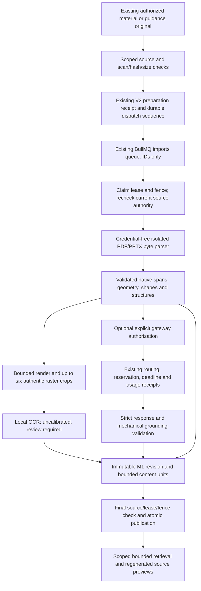

# Petros V2 M2 — document understanding verification

Implemented and verified locally on 12–13 October 2026, Asia/Kolkata. This report concerns the shared checkout at `/Volumes/Chris/Edrion Labs`. It grants no staging, provider, academic, or student-release approval.

## A. Executive summary

M2 now reads actual PDF and PPTX bytes, produces validated structural evidence and M1 content units, performs bounded local OCR, persists immutable source revisions through restricted-role transactions, and processes jobs through the existing preparation receipt and BullMQ infrastructure. A working local inspector compares authentic source renders with extracted text, cells, native connectors, charts, source coordinates, uncertainty, and exact OCR crops.

The isolated foundation is implemented and reviewable. **Full M2 acceptance remains OPEN.** Provisional native fact recovery is **19/21 (90.48%) for Cloud Computing** and **18/18 (100%) for English Argument Analysis**. Both important cloud omissions are flagged, **2/2**. Cloud recovery remains below the required 95%; independent academic labelling remains open. Genuine model inference was **not** executed. The real gateway contract was tested with a controlled adapter, which does not demonstrate AI understanding. Legacy PPT and unqualified platform conversion remain blocked.

The final verification sets passed **816 tests**, with zero failures and zero skips: 78 API extraction/contract/regression tests, 9 disposable M2 database tests, 22 M1/boundary regressions, 578 schema tests, and 129 student-interface regressions. Type checking, compilation, selected lint checks, and a compiled adapter smoke test passed. These are the selected checks described in section N, not a claim that every repository test ran.

No configured application database was contacted, no live migration or deployment was performed, no paid/provider request or private upload occurred, and no real academic publication was created. M3–M8 were not started. Two historical M1 generated evidence files were refreshed by the regression harness; the preservation exception is documented in section M.

| Required evidence category | This implementation |
| --- | --- |
| **IMPLEMENTED AND VERIFIED WITH REAL FILES** | Native PDF/PPTX extraction, bounded rendering/local OCR, changed bytes, source highlights and inspector |
| **IMPLEMENTED AND VERIFIED IN DISPOSABLE DATABASE** | Actual restricted-role ingestion/persistence/retrieval, BullMQ, lease/fence, idempotency and revocation tests |
| **IMPLEMENTED WITH CONTROLLED PROVIDER RESPONSES** | Existing gateway integration, reservation/dispatch/settlement and strict proposal validation |
| **LIVE MODEL-VERIFIED** | None; zero genuine provider requests |
| **PARTIALLY SUPPORTED** | Heuristic PDF tables/reading order, native visual structures, literal equations and uncalibrated OCR labels |
| **BLOCKED** | Legacy PPT, unqualified platform conversion, real provider/staff reservation prerequisites, academic and staging release |
| **NOT IMPLEMENTED** | Persistent derived-binary asset storage/purge, production restart scope scheduler, general visual semantic inference, computational equation kernel, advanced vector/SmartArt reconstruction and legacy native inventory/map |

## B. Architecture



`PetrosContentIntelligenceService` owns admission, preparation, unit production, optional interpretation corrections, retrieval, status, cancellation/retry, and authorized page/crop inspection. `PetrosContentIntelligenceJobs` registers `knowledge.content.m2.prepare` with the existing worker and producer. The M1 source-binding, immutable revision/unit repository, current-source access rules, storage driver, source-live function, and readiness-scope/RLS mechanisms remain the authority.

Native parsing, conversion, OCR, and gateway work occur outside database transactions. Native run/style detail remains in the inspection evidence and can be regenerated from original bytes; database revisions store the bounded units, provenance/receipts and canonical representation hash rather than the complete worker payload. Final persistence rechecks source access and the worker fence inside the atomic transaction. The new `runInScopedTenant` helper propagates the already-authorized explicit transaction to injected repositories through the existing async-local database proxy.

The service is gated by both `NODE_ENV=test` and `PETROS_M2_ISOLATED_ENABLED=true`. The flag defaults to false. No public M2 upload/controller route or student preparation command was enabled. The inspector is a separate fixed-fixture local tool.

## C. PDF extraction

The adapter uses the installed `pdfjs-dist` 4.10.38 inside the existing isolated worker and validates its output before admitting evidence. Actual native PDF items produce exact UTF-16 spans, text/style/position records, page dimensions, normalized regions, and a source-to-render transform. Real page images are rendered with the installed canvas runtime, bounded to 1,280 pixels on the longest edge. Original byte hashes are checked independently in the caller.

Implemented features include headings, paragraphs, numbered/bulleted lists, conservative gutter-based column order, aligned text tables, code fragments, literal equations and symbols, image regions, captions, and explicit unresolved vector graphics. Simple PDF table cells retain native text and coordinates; uncertain headers/row reconstruction are flagged. No table structure is invented from arbitrary prose. Links are inert metadata, never fetched.

Actual files exercised: the two-page cloud reference, argument and revised argument PDFs, image-only, injection, structure/list/equation/code/vector-chart, rotated, encrypted, truncated/corrupt, oversized-page-count, and huge-page-dimension fixtures. Encrypted and malformed files return explicit safe failures; over-limit files are refused before uncontrolled rendering. Image-only documents retain their original render and unresolved units rather than becoming empty successful lessons.

Limits: untagged reading order is heuristic; complex/merged PDF tables, vector chart data, vector diagram topology, mathematical layout, and font/encoding ambiguities require review. A glyph-level equation parser and computation kernel are not implemented. Rotation is represented and warned about, with an actual rotated-file test. The native text path does not silently substitute OCR.

## D. PPTX and legacy PPT

PPTX evidence comes from actual OOXML parts, strict XML parsing, presentation relationship order, and the actual shape IDs. It records native slide identifiers, dimensions, layout/master placeholder geometry when available, paragraphs and native runs, real table cells/spans, diagrams/connectors, native cached chart categories/series/points, embedded raster images, and separate speaker-note and hidden-content channels. Native shape IDs and semantic cell/node/edge IDs back highlighting and references. Glyph boxes are not invented from shape geometry.

Simple connectors with native arrowheads yield direction marked `visual_only`. An arrow does not establish causality. A connector without direction yields `connects` plus an ambiguity warning. Advanced charts, SmartArt, groups, unsupported transforms, media, and flattened objects remain explicit partial/unresolved content. Ordinary printer-setting binary parts are permitted; macros and executable attachments are refused.

The native SVG preview is a reconstruction of parsed evidence and is visibly labelled as such. For approved PPTX fixtures the inspector also runs the **actual bundled LibreOfficeDev 26.8 converter**, then renders its real PDF output. Original and converted hashes, executable/version pins, slide count, and title/order checks are recorded. This is Office export fidelity, not proof of identical Microsoft PowerPoint rendering or a universal native-object-to-pixel map.

Conversion runs in a separate macOS sandbox with a temporary profile, no inherited database/provider credentials, no network permission, process-group cancellation, CPU/wall/RSS/process/output bounds, and cleanup. The ordinary `/Applications/LibreOffice.app` process stalled under the isolated profile; the explicitly qualified bundled converter succeeded on the pilot decks. No fallback to an unrestricted converter was added.

**Legacy `.ppt` is blocked.** The adapter checks the OLE signature, but there is no qualified native slide inventory/original-to-converted locator map. `legacy-blocked.ppt` is a signature-bearing negative fixture, not a genuine successful legacy-deck demonstration. Linux Office isolation, genuine legacy conversion correctness, and adversarial Office sandbox qualification remain open. PPTX-native parsing does not require Office conversion.

## E. Visual interpretation

All eleven M1 unit kinds are produced from actual fixture evidence: `heading`, `paragraph`, `list`, `table`, `figure`, `diagram`, `chart`, `equation`, `code`, `caption`, and `unresolved`. That verifies representation paths, not complete understanding of every example.

Native diagram nodes/connectors and simple cached chart values remain source-backed. Chart axes are represented only when actual axis parts exist; unavailable axis geometry is null. Literal equation tokens have stable symbol IDs and unknown meanings remain null. Display/citation/highlight capabilities are separate from editing, explanation, computation, and assessment. Unreviewed teaching, computation, and assessment remain unsupported.

The selector admits at most six visible source regions. PNG/JPEG decoding and crop generation run in the isolated crop worker; source dimensions are checked before decoding. Native SVG is never used as authentic OCR evidence. `extractSourceCrop` produces the exact PNG/hash/size/pixel recipe without invoking a model. `extractSelectedOcr` uses local **Tesseract 5.5.1**, with executable and English trained-data hash pins, a separate deny-by-default sandbox, no network or credentials, and bounded CPU/wall/RSS/output. Temporary files are cleaned up.

OCR receipts preserve original source hash, source locator and region, crop hash, pixel recipe and dimensions, method/version, exact recognized labels and normalized label boxes, and text. Confidence is **null and uncalibrated**, with `review_required` status. OCR labels neither prove edges nor supply semantic meaning. An authentic embedded Gateway label was recovered, **1/1**, separately from native coverage. The flattened arrow remains unrecovered and flagged. No external vision inference occurred.

The service regenerates page previews and receipt-backed crops from reauthorized original bytes and verifies the representation/crop hash before returning them. Derived binary assets are not persisted in a separate cache/storage table; immutable metadata and recipes are stored in the existing M1 revision JSON. Persistent derived-asset storage and its purge policy remain a future qualification item.

## F. Semantic interpretation

`petros-content-interpretation.ts` calls the existing `PetrosAiGatewayService` under task `document.understand`. It requires an explicit trusted authorization, qualified route and actual reservation context, rechecks source authorization before/after dispatch, disables caching, bounds input to eight visible units/48 KiB, output to 3,000 tokens, deadline to 15 seconds, routes to one, and retries to zero. Prompt/version/schema hashes, model identifiers, dispatch/settlement receipts, and usage are retained. Hidden/notes content cannot silently enter the visible-source semantic request.

The strict response allows bounded proposed topics, concepts, definitions, examples, comparisons, claims, evidence, warrants, counterarguments, prerequisites, visual descriptions, and uncertainties. It permits no approval/release field. Support must resolve to the exact source/revision/unit/hash/locator and valid semantic anchor; quoted support must match native content. Changed numeric facts, equations/operators, table-cell quotes, fabricated references, and reversed native diagram edges are rejected. Unsupported proof/causal/absolute terms absent from support are rejected. Source instructions are passed only as untrusted data, with no tools, secret context, external fetch, or approval authority.

Mechanical grounding proves reference and quotation validity. It **does not establish general semantic entailment**. Literal native excerpts can be identified mechanically; paraphrases and relationships remain review-required, with null confidence. Not every unsupported paraphrase can be rejected by deterministic rules. Adversarial controlled cases prove those particular defenses; they do not establish a model-wide unsupported-claim rate.

The 17 interpretation tests run the actual gateway with a controlled in-process provider and controlled routing/ledger fixtures. They exercise reserve → dispatch → settle, cache-off behavior, denied authorization/spending, invalid responses/references, injection/proof/numeric/table/arrow defenses, and provider failure. The disposable persistence test stores a **controlled** proposal as an immutable correction with its receipt; it is labelled controlled and academically unapproved.

**Genuine inference: not executed; paid/provider requests: 0; semantic fact recovery: unverified.** The current durable gateway reservation context is learner-command/session oriented. A real staff-source reservation path must be approved/implemented before a teacher invocation can use a genuine route; M2 does not manufacture a learner command to bypass that prerequisite.

Prepared live pilot, requiring separate authorization: one request containing the first eight visible native units from `cloud-models.pptx`, and one from `argument.pdf`, using their manifest hashes and fresh immutable revisions. Maximum two requests, 48 KiB input each, 3,000 output tokens each, 15-second deadline, one qualified route, no retries, explicit spending cap/reservations, cache off, no publication. Recheck current access before/after each call, retain model/prompt/usage receipts, run the same strict validator, and obtain independent subject review. This small pilot would not certify whole-document semantic quality or the 95% gate. No request is scheduled or dispatched by this report.

## G. Provenance

Original SHA-256 identities, parser/renderer pins, native text/geometry/shape registries, and canonical representation hashes are independent of model proposals. Unit IDs derive deterministically from immutable revision ID and extraction key. Unit content hashes use the existing M1 canonical contract. Optional new fields do not alter old hashes through inserted defaults.

PDF references identify page, region and actual span. Slide references identify native slide/shape and region where recoverable. Tables, diagram nodes/edges, chart series/points, code fragments, and equation symbols retain semantic anchors. Crop receipts retain source and exact pixel identities. Notes and hidden material carry explicit channels. Unavailable geometry remains null, with an explicit capability limitation.

The native content remains immutable when interpretation changes. Semantic results append a correction revision and remap copied unit references; they do not overwrite originals. Existing database immutability constraints reject mutation. Repeated admission/delivery deduplicates by current binding/original hash/extractor/representation/interpretation pins.

Changed-source demonstrations use actual new bytes: PaaS `Application code` → `Application code and runtime`, Server → Database becomes Database → Server, and the English survey changes **84 → 24**. Tests detect the changed payloads and hashes without changing production parser logic. Old revisions remain immutable, while current-source retrieval denies obsolete/withdrawn binding access. Changed-source semantic re-evaluation remains provider-unverified. Exact per-element results and changed units are in `m2/evaluation.json` and `m2/runs.json`.

## H. Database and queue integration

The M2 database verifier creates a fresh private PostgreSQL 15 cluster, applies the full **159-migration** journal and final M1 overlay, and executes repository/service work as **`edrion_app`**, not owner. Synthetic institutions, staff, courses, recipients, originals, and guidance publications live only there. The configured database URL is not accepted or inherited by the verifier.

New migration **0236 is a proposal only**: it adds bounded, nullable `m2_progress` JSON to the existing preparation table, constrained to V2 stages. No new ingestion table or permission grant is introduced. Journal/schema changes require separate target approval with the unresolved M0-R/M1 staging gates.

The actual producer resolves existing storage bytes, verifies ready scan/type/size/hash/current staff scope, and enqueues the existing preparation receipt. Institution admission is bounded to two active preparations and bounded queue/actor/day counts. The worker claims a lease/fence, renews V2 authority/lease checks, uses a 55-second overall deadline, persists real progress checkpoints, and atomically commits revision, units, and final receipt. `completed` versus `partially_supported` reflects evidence, not an invented semantic success. Semantic unavailable/controlled status remains explicit.

Actual BullMQ delivery is tested against a newly launched private Unix-socket Redis with no TCP port, not the configured Redis or port 6379. Queue data contains IDs only. Repeated delivery yields one revision. Expired-lease recovery and late-fence rejection pass. The test seeds an expired lease to represent a crashed worker; it is not a full operating-system crash/restart rehearsal.

The existing durable receipt is authoritative after enqueue loss. The job service polls remembered authorized scopes every five seconds and exposes scoped `recover(scope)` for trusted reconstruction after restart. It does not globally enumerate tenant sources. **A production restart scheduler supplying trusted scopes remains open.** Cancellation, retry, withdrawal, and final fence checks reuse the existing receipt. The persistence-failure test proves atomic rollback; its recovery explicitly resets the disposable fault receipt and is not evidence that every unknown infrastructure error is automatically retryable.

Retrieval uses existing full-text ranking and deterministic order, at most two passes/four units each, parent/nearby/caption context, and at most eight admitted units with an explicit content-gap response. Every pass/final return rechecks current source access. No privileged full-source traversal or public asset URL is provided.

## I. Security

Passed restricted-role cases cover cross-tenant access, nonrecipient access, unsafe student worker scope, source withdrawal during parsing, stale fence, unavailable scan/hash/type, immutable-content mutation, revoked publication, unauthorized page preview and unauthorized exact crop. An authorized crop matches its persisted receipt hash. Guidance identity remains `guidance_attachment:<object-id>:<publication-version>`; an actual guidance PDF is processed without publishing the assignment, and nonrecipients/withdrawn publications remain denied. No source-owner database pool is used for application operations.

The native worker retains the existing V1 credential-free OS sandbox. M2 permits only the explicitly installed parser/canvas dependencies and validated runtime roots/addons. The V1 no-addon path and tighter existing bounds remain intact. Six real process-boundary tests verify credential/file/process/network denial and CPU/wall/output/RSS/cancellation containment. M2 parser and crop tests also use the actual isolation boundary.

| Boundary | Enforced pilot bound |
| --- | --- |
| Original input | 20 MiB; PDF 20 pages; presentation 30 slides |
| Extracted text | 2 million characters |
| Native parser | 20 s wall, 15 s CPU, 512 MiB sampled RSS limit, 32 MiB bounded worker output |
| Raster decoding/rendering | 16 million input pixels; render/crop longest edge 1,280 px |
| Crop worker | 5 s wall; 256 MiB RSS; 2 MB worker output |
| Local OCR | 5 s wall; 3 s CPU; 256 MiB RSS; 500 KB output; one thread |
| Visual selection | At most six regions per preparation |
| OOXML ZIP | 2,048 entries; 64 MiB expansion; 16 MiB per entry; ratio 200; streamed expansion counters |
| XML | No DTD/entities; depth 64; 200,000 nodes; bounded text |
| Office | 20 s wall/CPU; 512 MiB process-tree RSS; at most 16 descendants; bounded output/per-file size |
| Preparation | 55 s overall deadline; one active job per worker instance; two active per institution |
| Retrieval/model | Eight units/two passes; model 48 KiB/3,000 tokens/15 s |

ZIP traversal, duplicate/unsafe paths, expansion bombs, XML entities, macros, and embedded executable parts fail closed. Executable/macro fixtures are structural rejection probes, not samples of real malware. External links are retained inertly and not fetched. The bounded parser APIs never accept arbitrary URLs or runtime dependency paths from a source.

Qualification limits: Office and OCR do not have the same complete independent escape-probe suite as the native Node worker. Office temporary storage has per-file/input/output/time bounds, but a hard aggregate filesystem quota is not implemented. Broader untrusted Office ingestion remains unqualified; legacy conversion is blocked. Isolation on other operating systems is blocked where an equivalent qualified sandbox is unavailable. No claim of production sandbox certification is made.

The inspector binds only to `127.0.0.1:4872`, serves fixed original CC0 fixtures and saved evidence, uses a restrictive CSP/no-store/nosniff, has no application DB access or arbitrary upload/path endpoint, and exposes no credentials/private material. Original downloads recheck size/hash against the fixed manifest and displayed source identity. Actual HTTP checks passed for a matching original, malformed percent encoding (400), unknown source (404), and POST (405); see `m2/inspector-http-checks.json`. Application page/crop retrieval is a separate authorized service path covered by restricted-role tests. There is no public cached asset URL to test as a stale grant; persistent-asset URL/purge qualification is pending because that feature is absent.

## J. Two-subject evaluation

Four original educational documents were generated and genuinely parsed: Cloud Computing PPTX (7 slides) and reference PDF (2 pages), English Argument PDF (1 page) and commentary PPTX (4 slides). They are original **CC0-1.0 engineering fixtures**. The gold labels were written by the engineering author; **independent academic review is OPEN**. No claim of externally approved curricular correctness is made. The main source hashes are recorded in the source manifest and every gold row.

| Metric | Cloud Computing | English Argument Analysis |
| --- | ---: | ---: |
| Native objective-relevant elements recovered | 19/21, **90.48%** | 18/18, **100%** |
| Native text elements | 8/8 | 16/16 |
| Gold table-cell elements | 4/4 | 2/2 |
| Diagram elements | 3/5 | 0/0, not applicable |
| Equation elements | 2/2, literal only | 0/0, not applicable |
| Chart metadata elements | 2/2 | 0/0, not applicable |
| Important omissions detected/flagged | **2/2, 100%** | 0/0, no evaluated omissions; no percentage claimed |
| Additional OCR label recovery | 1/1, uncalibrated; separate from native score | 0/0 |
| Genuine semantic fact recovery | Unverified | Unverified |
| Genuine model unsupported-claim rate | Not measured | Not measured |
| Independent reviewer approval | Open | Open |

The two missed cloud elements are the **flattened Gateway image label** and the **pixel arrow relationship**. Native extraction appropriately marks the visual as unresolved; local OCR recovers Gateway but does not establish the edge. These cases remain in the denominator. No difficult case was removed or the target reduced. Both are important omissions and both are flagged. English recovery measures literal text/elements, not validated interpretation of argument quality or causal warrants.

Gold rows report element ID, source file/hash/locator, kind, extraction/interpretation status, severity, omission flag, and review requirement. Mechanical unit provenance/hash validation and original-byte parsing are tested separately from the provisional gold score. The inspector verifies actual cell and paragraph overlays against the rendered source. Academic locator/semantic review remains open.

The 26-file corpus additionally contains revised bytes, image-only/low-text, code/list/equation/vector graphics, rotation, ambiguous connectors, hidden slides, groups, external links, SmartArt, and malicious/malformed structural probes. **15 files yield complete or partial evidence; 11 are explicitly blocked.** `injection.pdf` is complete for native extraction only; its instructions never authorize actions. Detailed results are preserved in `m2/runs.json` and the 34 edge-case tests.

## K. Performance

Actual local measurements use Node **24.21.0** on macOS. Twenty sequential native parses (five fresh processes per main document) measured extraction/rendering independently of OCR. Six actual Office conversions were timed separately. Queue measurements use twenty actual enqueue acknowledgments against private Redis.

| Measurement | Actual result | Scope |
| --- | ---: | --- |
| Queue acknowledgment p95 | **0.470 ms** | 20 acknowledgments in the final disposable integration run; target ≤500 ms |
| Native extraction plus render p95 | **508.2 ms** | 20 local samples; target ≤60 s |
| Selected-region local OCR p95 | **935.6 ms** | Same 20 fixture preparations; includes empty selection where applicable |
| Actual Office conversion p95 | **6,420.0 ms** | 6 local converted decks; separate from native parse |
| Peak sampled native parser RSS | **125,360 KiB (~122.4 MiB)** | 100 ms process-tree sampling, not instantaneous high-water RSS |
| Genuine semantic/vision inference latency | Not measured | No authorized dispatch |
| Paid/provider requests | **0** | No cost incurred by M2 verification |

`m2/performance.json` contains raw samples, hashes, statuses, parser wall/output/RSS receipts, and queue measurements. The parser/OCR sample run preceded the final crop-access refactor; that refactor reuses the same crop operation, and the final OCR/integration tests passed afterward. These local serial measurements do not qualify staging load, multi-tenant contention, production memory, Office instantaneous RSS, or provider waiting time. Controlled adapter latency is not reported as genuine model performance.

## L. Human inspection

Open the retained local [M2 inspector](http://127.0.0.1:4872). It is independent of the normal application database. To regenerate and serve from the repository root with the verified Node 24 runtime:

```sh
/tmp/node-v24.21.0-darwin-arm64/bin/node apps/api/scripts/inspect-petros-m2.mjs --serve
```

To serve previously generated evidence without reparsing:

```sh
/tmp/node-v24.21.0-darwin-arm64/bin/node apps/api/scripts/inspect-petros-m2.mjs --reuse --serve
```

The wrapper removes configured DB/provider environment, loads no dotenv/app bootstrap, and accepts only the fixed fixture corpus in the TypeScript driver. It writes `m2/runs.json`/`evaluation.json`. Native source results are generated from bytes, not subject-specific hardcoded extractor answers. Synthetic revision IDs exist only for local fixture inspection; database evidence uses the actual repository/service.

Reproducible review sequence:

1. Choose `cloud-models.pptx`, slide 3, table, then **Operating system** or **Application code**. Compare the actual cell highlight and readable extracted table. Slide 4 shows native connectors; slide 5 retains the flattened figure and its uncertainty; slide 6 displays the equation and chart cache. Speaker notes are a separate channel.
2. Choose `argument.pdf`; select the survey paragraph. The original passage says **120 learners / 84 preferred later access**, with the real span/region. Inspect the separate assumptions, objections, inconsistent costs, and table. The banner explicitly says genuine semantics are unavailable.
3. Choose `cloud-models-revised.pptx`, slide 3: **Application code and runtime** highlights its changed cell. Slide 4 displays **Database → Server · visual_only**. Choose `argument-revised.pdf` to see **24**. Expand source revision comparison for hashes and changed payloads.
4. Choose `image-only.pdf`; select the figure and expand **Selected visual crop · OCR requires review**. Compare the actual crop, text, hash, method/version, null confidence, and unresolved relationships. Choose `smartart.pptx` for explicit partial support or `corrupt.pdf` for a blocked zero-unit result.
5. Expand restricted-role security evidence. The separate disposable integration tests demonstrate cross-tenant/nonrecipient/revoked preview/crop denials. This CC0 localhost inspector itself does not emulate a logged-in production student.

Browser QA used the actual Codex in-app browser. It verified original cell and paragraph overlays, changed values and arrow direction, notes separation, zero visible/two hidden units on the hidden first slide, blocked corrupt input, an expanded authentic OCR receipt, keyboard Enter activation, and a 390×844 viewport without horizontal overflow. Temporary viewport overrides were reset. No full accessibility or cross-browser audit is claimed. `m2/browser-qa.json` records the observations.


Additional actual browser captures: `cloud-table.jpg`, `cloud-reversed-arrow.jpg`, `image-only-uncertainty.jpg`, `ocr-crop-receipt.jpg`, `corrupt-blocked.jpg`, and `narrow-inspector.jpg` in `m2/screenshots/`. These are screenshots of functioning extraction results, not generated UI mockups.

## M. Code inventory

The complete inventory, including every new/modified source, fixture and evidence file, is [m2/file-inventory.md](/Volumes/Chris/Edrion Labs/docs/verification/petros-v2/m2/file-inventory.md). Original/current hashes and baseline comparisons are in `m2/preservation-audit.json`; the starting 5,209-file hash snapshot and Git status are retained. The principal new code is the adapter/worker family, content-intelligence service/jobs, OCR/crop and interpretation modules, real-file/integration test fixtures, inspector/verifier/benchmark scripts, two subject gold sets, genuine source generators/26 source files, and proposed migration 0236.

Modified existing implementation files are:

- `knowledge-pdf-process.ts` and `pdf-extract.cjs`: validated M2 runtime/canvas/evidence dispatch while retaining V1 isolation and behavior.
- `knowledge-preparation.repository.ts`: explicit V2 receipts/stages, admission, scoped dispatch recovery, lease/fence and terminal status.
- `petros-content-unit.repository.ts`: authorized original resolution, optional immutable receipts, ranked bounded contextual lookup.
- `knowledge-document.module.ts`: isolated adapters/service/jobs and existing gateway module registration.
- `presentation-converter.ts`: separate isolated M2 conversion, with V1 path preserved.
- Database `client.ts`/`student-knowledge.ts`, migration journal, and config: explicit scoped async-local helper, nullable progress schema, proposal journal entry and default-off isolated flag.
- Schema `petros-v2/content.ts`: optional channel/list/chart/provenance receipts without changing old canonical values.
- Disposable test helper and M1 foundation test: safe short temporary sockets/diagnostics and full-journal count **159**.

**Preservation audit: 5,194/5,209 baseline files are byte-for-byte unchanged; 15 changed; zero missing.** Thirteen are the intended M2 implementation/test/schema changes above. The other two are `m1-evidence/repository-query-behavior.json` and `m1-evidence/source-identity-demo.json`: the M1 regression harness regenerated them before a valid backup was captured. Their original hashes are preserved in the audit, but the original bytes are unavailable. Refreshed synthetic IDs are not historical originals. This is a preservation exception, not a claim of full byte preservation.

The Playground/companion/student frontend code, blueprint/plan, unrelated baseline changes, existing lockfile/package declarations, original M1 code not named above, M0-R reports, and historical fixtures remain unchanged against the starting hash snapshot. No files were staged, committed, or discarded. Existing unrelated dirty work was retained. Formatting used the root configuration minus its unavailable Tailwind formatter plugin for M2 files only; no dependency or lockfile was changed.

## N. Test results

| Final check | Result | Evidence |
| --- | --- | --- |
| Native/semantic/OCR/edge/boundary/retrieval/guidance, 7 files | **78 passed; 0 failed; 0 skipped** | `m2/native-and-model-tests.json` and log |
| M2 restricted-role disposable integration, 1 file | **9 passed; 0 failed; 0 skipped** | `m2/database-tests.json`, `database-evidence.json` and log |
| M1 foundation plus assessment boundaries, 2 files | **22 passed; 0 failed; 0 skipped** | `m2/m1-regression-tests.json` and log |
| Schema regression, 70 files | **578 passed; 0 failed; 0 skipped** | `m2/schema-regression-tests.json` and log |
| Selected student UI/Playground/companion/presentation/audio, 20 files | **129 passed; 0 failed; 0 skipped** | `m2/frontend-regression-tests.json` and log |
| API type check | Passed, exit 0 | `m2/typecheck.log` |
| API compilation to disposable output | Passed, exit 0 | `m2/build.log` |
| Compiled PDF adapter and Nest constructor metadata | Passed, actual two-page PDF | `m2/built-adapter-smoke.json` |
| Selected new/changed TS lint | Passed, exit 0 | `m2/lint.log`, final inspector lint |
| Actual browser review | Passed scoped checks described in L | `m2/browser-qa.json`, screenshots |

The 34 standalone edge tests and three standalone OCR tests also passed; they are included in the 78 and **are not counted twice**. JSON suite counts include nested describes; the file counts above come from actual test-result files. Total reported tests: **816**.

The exact final test/check commands and the explicit selected frontend file list are in [m2/verification-commands.md](/Volumes/Chris/Edrion Labs/docs/verification/petros-v2/m2/verification-commands.md). Principal commands from the repository root:

```sh
/tmp/node-v24.21.0-darwin-arm64/bin/node apps/api/scripts/verify-petros-m2.mjs
/tmp/node-v24.21.0-darwin-arm64/bin/node apps/api/scripts/benchmark-petros-m2.mjs
```

The disposable DB script accepts **no target arguments**, strips configured environment, creates its own cluster/Redis/storage, and cleans them up. The M1 regression harness refreshes the two generated historical evidence files noted in M; review that behavior before reproducing it.

Diagnostics encountered and resolved: scoped repository transaction propagation, private PostgreSQL locale/socket setup, strict XML/archive error classification, the ordinary Office binary stalling under isolation, temporary compiled-smoke module resolution, and a missing formatter plugin. A first final test command misspelled the retrieval filename and ran only 71 tests; it was corrected and the seven-file **78-test** suite rerun successfully. Earlier diagnostic logs do not supersede the final passing JSON reports. Deprecation notices are present; they are not test failures. No provider failure is converted into a fake semantic success.

Limitations not hidden as skipped success: no genuine legacy-PPT successful-conversion test, no real provider inference, no independent academic quality approval, no staging/production load/security test, no complete OS crash/restart rehearsal, no persistent derived-asset URL qualification, and no full repository/application boot against configured infrastructure. The compiled smoke check used actual compiled adapter classes and copied worker assets into the disposable output at the paths selected by the existing build asset glob; it was not a deployed build.

## O. Outstanding prerequisites

| Category | Required next qualification |
| --- | --- |
| Academic quality | Independent cloud/English gold labels, semantic/locator review, recovery of flattened visual facts; ≥95% each subject and 100% important-omission flagging before full quality acceptance |
| Genuine AI | Explicit approved spending/route, a valid staff-source reservation context, bounded live pilot and real model/usage receipts; then wider semantic evaluation |
| Environment | Node 24, qualified macOS sandbox/canvas/Tesseract/Office binaries; equivalent qualified isolation before other platforms are enabled |
| Unsupported formats | Genuine legacy PPT inventory/mapping and conversion corpus; complex PDF tables/vector figures/math and advanced OOXML features |
| Production security | Office/OCR independent escape tests, hard aggregate temporary-storage quota, sustained resource/load tests, storage/derived-asset policy and revocation qualification |
| Durable operation | Trusted scope reconstruction after restart; real crash/restart rehearsal and qualified retry classification |
| Staging/database | Resolve existing M0-R/M1 gates; separately approve proposed migrations/overlay and exact target before any staging application |
| Release | Teacher subject review and later milestone approval; no M2 lesson/assessment/student release authority |

## P. M3 readiness

The native-source, structural-unit, provenance, restricted persistence, bounded retrieval, queue, local visual review, and controlled gateway foundations are ready for **review and continued isolated engineering** toward teacher proposals. They provide concrete source evidence and truthful uncertainty for M3 to consume.

**M2 is not fully accepted or qualified for real student teaching.** Cloud native recovery is below the unchanged target; independent reviewer and genuine semantic quality are unverified; legacy/production converter qualification and durable restart prerequisites remain open. Teacher-facing live proposal generation additionally needs the staff reservation path and authorized route. All proposed interpretations must remain review-required and cannot authorize teaching/assessment/publication.

No M3 work has begun. Stop here for user review.
