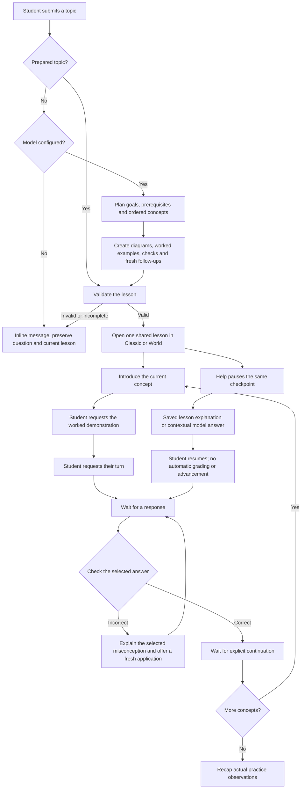

# Topic lessons and the model workflow

The [authored learning upgrade](LEARNING_EXPERIENCE.md) adds diagnostics, independent Test questions and mixed assessment for the knowledge-reasoning showcase. Other prepared and generated topics retain their practice flow and evidence records; their model-declared answers do not award independent verification.

AI, time travel and the six-concept integrals lesson work without a model. Type **How do integrals work?** into the topic form or select its chip. Integrals includes a real left-rectangle approximation, exact area, adjustable slope/upper limit, and 4/8/16/32 pieces in Classic and World. The optional local key controls broader topic generation.

## Connect a model later

The local file `apps/student-web/.env.local` has been created with these settings:

```dotenv
OPENAI_API_KEY=
PETROS_TOPIC_MODEL=gpt-5.4-mini
# Optional Responses-compatible endpoint:
# OPENAI_BASE_URL=https://api.openai.com/v1
```

Add the key locally and restart the dev server. Keep it in a server environment variable, without a `NEXT_PUBLIC_` prefix. This file is ignored by Git. On another machine, create it with the same contents before adding your own key.

Then open [the local prototype](http://localhost:3022/prototype), enter a new question such as **How does photosynthesis work?**, and press **Let's explore**. The connector supports OpenAI's Responses API or an endpoint implementing that protocol. Use a model your account can access that supports Structured Outputs. No source-code change is needed to enable the configured connector.

`GET /prototype/api/capabilities` reports `topicModel: true` when a key is present. This is a configuration check, not proof of valid credentials or available quota. Authentication, quota, network, refusal and incomplete-output errors appear beside the form; the entered question and previous lesson stay intact.

If the value begins with **key\_**, it is an API key identifier, not the secret credential. Copy the secret value from OpenAI API Keys into OPENAI_API_KEY. The app identifies this mistake locally with MODEL_KEY_ID rather than sending that identifier to OpenAI. The model setting is separate; changing it cannot repair an invalid credential.

## The complete workflow



The model does not send an unstructured chat answer and leave the UI to invent a lesson. The system prompt in `teaching/topic-provider.ts` requires a complete blueprint before the first concept opens:

- Two to four concrete learning goals and one to three prerequisites.
- Four to eight distinct, dependency-ordered concepts, usually six, progressing from meaning and a concrete example to mechanism, application, misconception and transfer.
- An introduction, worked demonstration, simpler explanation and different worked example for every concept.
- A meaningful three-stage diagram with a caption. The current renderer supports conceptual text diagrams. It does not execute generated HTML, JavaScript, shader code or invented physical simulations.
- A three-option check, a correct-answer index, explanation and feedback for each option. A separate follow-up checks the same idea in a different scenario instead of repeating the original task.

The server requests strict structured JSON and validates field types, lengths, concept count/uniqueness, option uniqueness, answer membership, follow-up differences and diagram data. The client validates the completed lesson again before replacing the current session. Question IDs and continuation links are created by the app. A malformed, refused or truncated response cannot open a partial lesson.

The existing shared controller owns demonstration, response gates, retries, assistance history, skip/review choices and explicit continuation. Animation completion cannot advance a concept. Multiple-choice checks use the lesson's declared answer key; this is practice, not certified mastery. Free-form student questions are never treated as graded responses.

## Contextual questions and interruption

Prepared explanations and explicit commands such as a simpler explanation remain available immediately. A question outside the stored explanation can use the same isolated model connector once a key is configured. Its prompt includes the actual current concept, diagram, parameters, computed integral totals where applicable, pending task and prior response. The reply contains only answer text: it cannot change questions, grade a response or issue a progression command.

Help pauses the checkpoint. The student resumes explicitly. Failed or cancelled requests leave the lesson intact. A new lesson/module choice or a mode transition cancels pending topic creation, preventing late results from replacing the student's newer choice.

## State, provenance and boundaries

The entire active topic blueprint, diagram state, answer draft and practice observations are stored in this browser tab's session checkpoint. Refresh and mode changes retain it. Selecting another lesson starts a new active lesson, matching the existing prototype behavior; this is not a server-side multi-course history service.

Prepared mathematics and generated content are labelled separately. Generated lessons carry an AI-generated general-knowledge label and a reminder to check important facts. Schema validation establishes a usable plan, not factual correctness. Live quality, latency, provider access and cost need evaluation when a real key is added.

The connector is server-only and sends `store: false`. It calls no production tutor, conversation, grading or assessment endpoint and does not write academic records. Existing source-module help retains its prepared/source-linked behavior; uploaded PDFs are not automatically sent through topic generation. Voice remains unchanged.

The request format follows the official [Structured Outputs documentation](https://developers.openai.com/api/docs/guides/structured-outputs?api-mode=responses). The default model's supported features are documented on the [GPT-5.4 mini model page](https://developers.openai.com/api/docs/models/gpt-5.4-mini).

## Verify without a key

```sh
pnpm --filter @edrion/petros-showcase test
pnpm --filter @edrion/petros-showcase run verify:topics
```

The browser suite uses the real integrals lesson and the blank-key endpoint when no key is configured. If a key is configured, its missing-connection form case uses an explicit fixture. Provider-dependent cases use labelled controlled fixtures and never make a live call. Unit tests exercise blank-key handling, provider request construction and response validation with mocked provider responses. See [the topic evidence report](evidence/topic-workflow/HANDOFF.md) and the [current learning upgrade report](evidence/learning-experience/HANDOFF.md).
